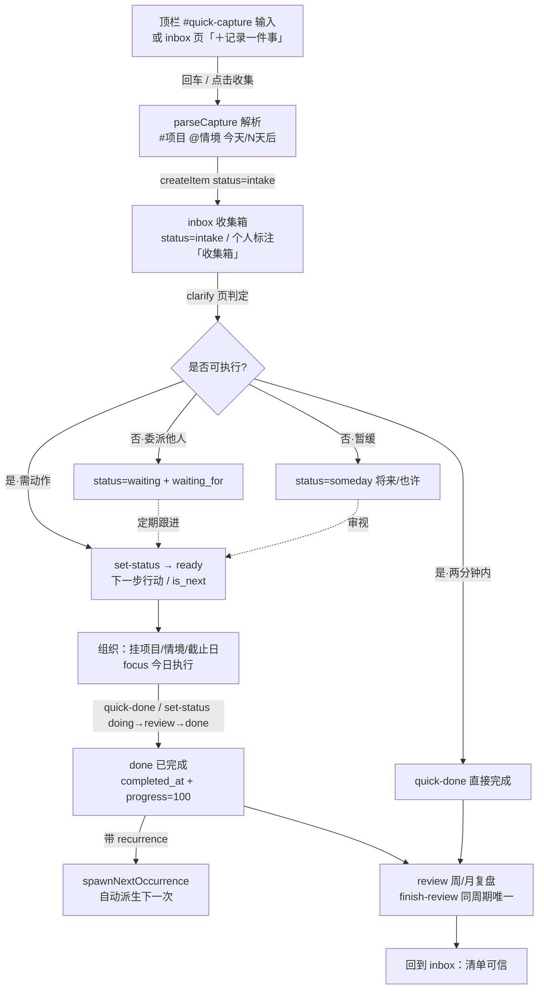
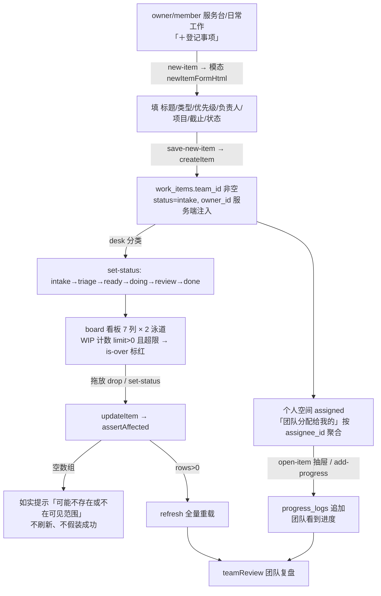
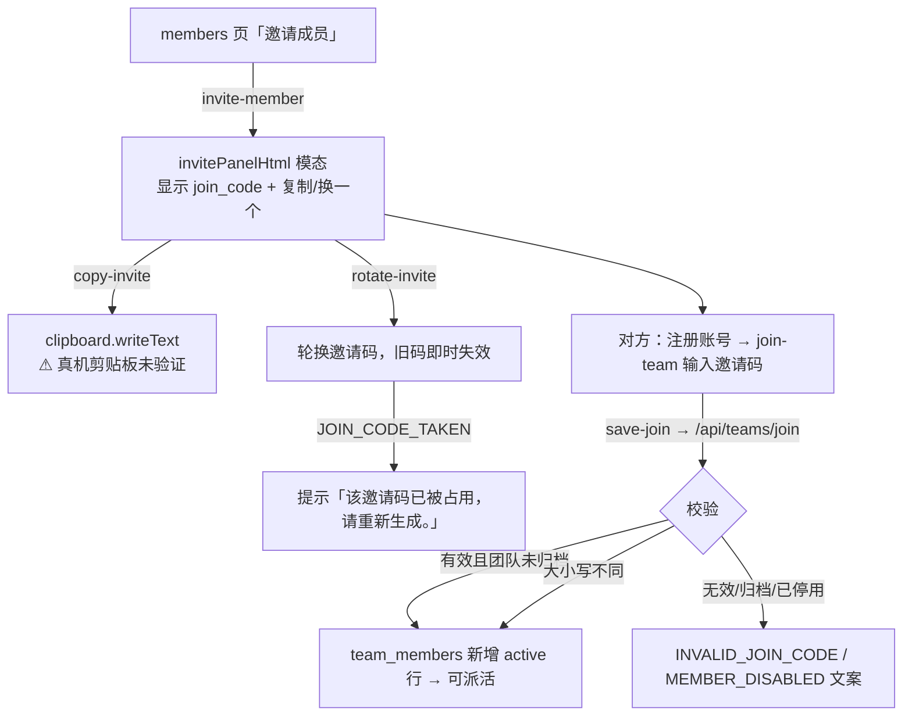
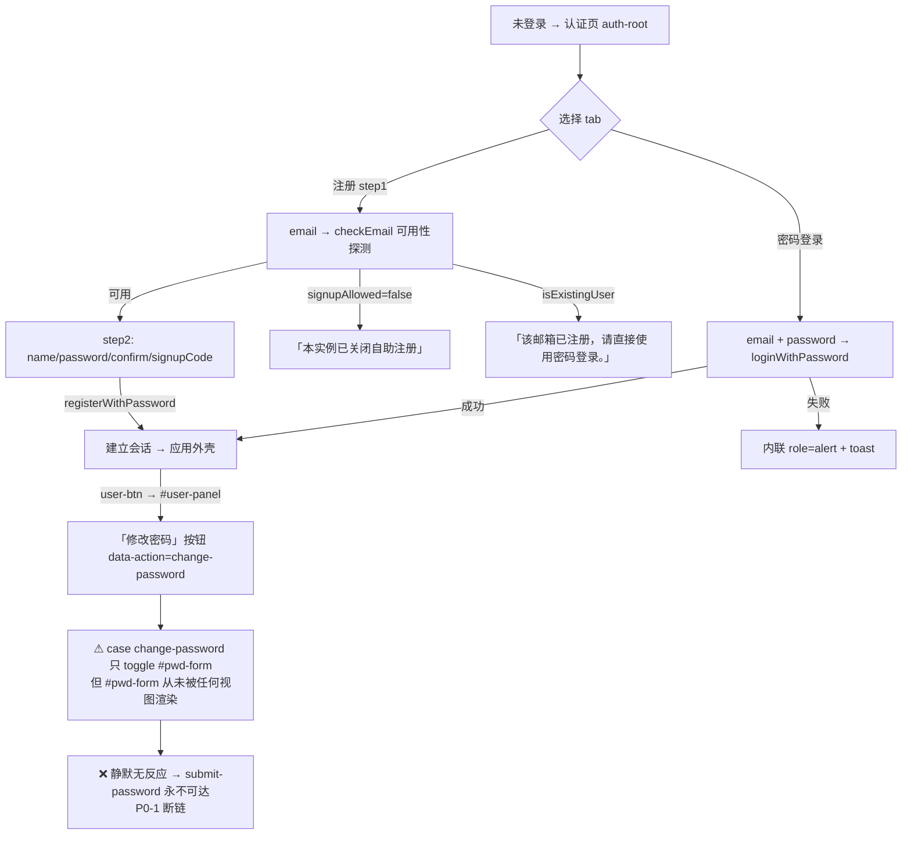
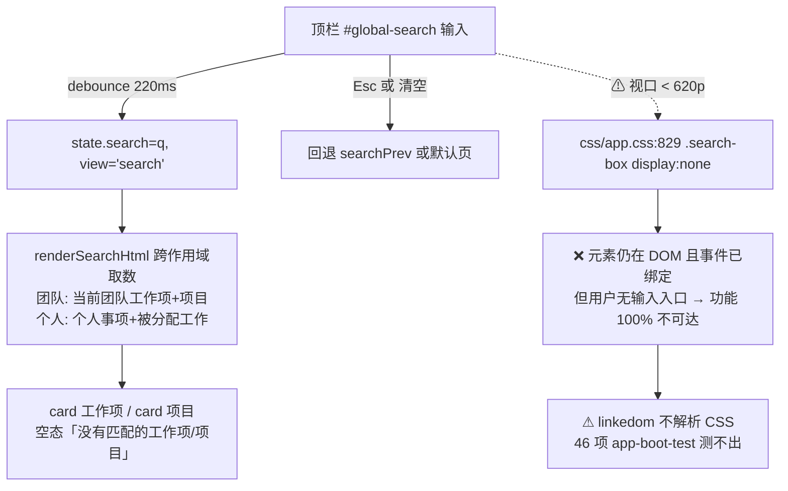

# 03 · FDS 功能设计说明书（页面 / 交互 / 视觉规格）

> GTD4Teams 治理体系重建 · UI/UX 设计师（苏巧思）交付
> 版本：**v1.0** ｜ 日期：2026-11-13 ｜ 执行模式：**严格模式**（命中登录认证 / RBAC 权限 / 前端交互契约 / 隐私与安全提示）
> 上位文档：`00_开发流程总纲.md` §4（G1 门禁）、§5.2（统一编号规则）、§5.3（追溯链）、§8（反向补课）、§9（严格模式六项）
> 需求基线：`02_需求调研与PRD.md`（35 条 REQ / 25 条 BR / 21 条 EX / 12 条 SC / 12 个 OPEN）
> 服务对象：`07_测试体系与各阶段验收标准.md` §3.2 的 **G1 设计阶段验收单**（`ACC-G1-YYYYMMDD`）
> 本文路径：`docs/process/03_FDS_功能设计说明书.md` ｜ 责任角色：UI/UX 设计师 ｜ 更新触发：页面、流程、交互状态、视觉规范变更（总纲 §5.1）
> **本次性质**：存量项目的**设计侧反向补课 + 交互评审**。只写本文档，**不修改任何业务代码，不写他人产出文件**（与 `02` §0 边界一致）。

---

## 0. 口径与证据标注约定

用户（李鹏 / Leo）明确要求「重视实测数据与证据，不接受未经验证的断言」。本文沿用 `02` §0 的三档标注，并补一档「上游实测引用」用于区分「本次自己读到的」与「协作成员已实测的」，**不另造一套体系**。

| 标注 | 定义 | 允许的证据形式 | 本文典型例子 |
|---|---|---|---|
| **【已验证·本次实读】** | 本次会话用 `Read` / `Grep` 直接读到具体 `文件:行号` | `js/views.js:1907-1935`、`css/app.css:829`、`js/app.js:603-609` | 24 个 NAV 视图名称、8 条缺口的证据链、设计令牌取值 |
| **【已验证·上游实测引用】** | 前端工程师端木灵 / 后端工程师寇豆码 / QA 严过关在本次治理期已实跑并提供的实测结论，经主理人中转；**照录不改写、不冒充本人重跑** | `07` §0.2 / §2.2、主理人任务上下文 | 24=24=24、50↔50 双向差集、80/65/46 项本机全绿 |
| **【推断】** | 由两条及以上【已验证】事实推出，但无代码/文档直接写出该结论 | 必须写明「由 X + Y 推出」 | 「`--text-1` 未定义会导致 `.user-name` 回落继承色」 |
| **【未验证·需人工补验】** | 本次未实际执行、条件不具备，或**依赖真实浏览器**（布局、焦点、CSS 动画、对比度、剪贴板、FormData、confirm） | 明确写出「需真机/工具复核」 | 620px 搜索消失的视觉表现、焦点陷阱、动画时序、对比度比值 |

**硬约束（本文自律）**：
1. 凡依赖真实浏览器的结论，一律标【未验证·需人工补验】，**不写成已通过**（对齐 `07` §2.3 / §0.4）。
2. 不编造不存在的页面、视图、组件或 `data-action`。组件清单逐项来自 `js/views.js` 实读。
3. 与 PRD 冲突处以「待裁决」列出（§附录 B），**不擅自改 PRD**。
4. **不做技术选型**（UI 组件库归架构师 `architecture.frontend_ui_library_selection`）；**不写前端代码**（本文是规格，实现归前端工程师）。
5. Skill 通用验证命令 `mysql < sql/database.sql` / `npm run build` 对本项目 **N/A**（`07` §0.3 已明列），本文只给项目真实命令。

| 本次实读 / 检索的材料（附录 D 给逐项索引） | 方式 |
|---|---|
| `00` / `02` / `07` 全文；`04` §2.2/§8.4、`06` §1/§2 片段 | Read 全文 + Grep |
| `js/config.js`（170 行）、`js/util.js`（327 行）、`js/api.js`（385 行）、`js/auth-ui.js`（346 行）、`index.html`（66 行）、`css/app.css`（830 行） | Read 全文 |
| `js/views.js`（NAV / renderView / 基础组件 / 列表筛选 / 资源链接 / 表单 / 抽屉 / 用户面板 / 引导页） | Read 片段 + Grep |
| `js/app.js`（state / 白名单 / render / refresh / assertAffected / 浮层 / dispatch 全量 case / 快速收集 / 搜索 / 改密） | Read 片段 + Grep |
| `pyapp/security.py`（口令 MIN/MAX） | Read 片段 |
| 全项目 `aria-` / `role=` / `focus-visible` / `prefers-reduced-motion` / `--text-1` / `state.filters` / `assertAffected` / `case '` | Grep 全量命中 |

---

## 1. 文档控制与追溯

### 1.1 版本、读者、术语

| 项 | 内容 |
|---|---|
| 文档编号 / 版本 | `03_FDS_功能设计说明书.md` / `v1.0`（`vMAJOR.MINOR`：页面/流程/交互变更 +0.1；编号规则或章节结构变更 +1.0；错字修正不递增但记 §附录 D） |
| 主要读者 | 用户（李鹏 / Leo，G1 放行权）、架构师（G1-01 一致性核对）、前端工程师（实现依据）、QA（`ACC-G1` 验收单）、安全工程师（G1-06/G5 联动） |
| 前置门禁 | G0 通过（`02` §5.4 自检：REQ/BR/EX/权限矩阵齐备；「原始诉求」部分满足，OPEN-08 待裁决） |
| 后续门禁 | **G1**（`07` §3.2，G1-01~G1-09）→ G2 开发 |
| 编号规则 | 严格沿用总纲 §5.2：`REQ-` / `BR-` / `EX-` / `TC-` / `ACC-Gn-` / `BUG-` / `CR-` / `APP_VERSION` / `GTD_BUILD`；**本文不新增前缀** |
| 产品形态 | 原生 ES 模块 Web 工作台；Python `http.server` 直托管；**无构建链、零第三方运行时依赖**；`index.html` 66 行 + `views.js`/`app.js`/`api.js`/`config.js`/`util.js`/`auth-ui.js` + `css/app.css` |
| 品牌调性 | 浅色为主、低饱和、弱边框、大留白；「把注意力留给内容本身」（`css/app.css:2-5`）；全中文硬编码，`index.html:2` `lang="zh-CN"` 已正确 |

**术语表**（与 `00` §5.2 / `02` §3 / `04` §0.1 对齐）

| 术语 | 本文含义 | 证据 |
|---|---|---|
| 双域 | 团队空间（`state.space='team'`）/ 个人空间（`='personal'`），共用同一张 `work_items`，靠 `team_id` 是否为空区分 | `js/config.js:10-15`、`02` §3.2 |
| 三层状态机 | `space` / `activeTeamId` / `view`，由 `app.js` 单一 `dispatch` 驱动 | `js/app.js:67-93`、`04` §2.2 |
| 十态状态机 | `intake/triage/ready/doing/review/blocked/waiting/someday/done/archived`；团队用 `label`（Kanban 列），个人用 `personal`（GTD 清单） | `js/config.js:37-48`（**实测 10 键**，见 §1.3 差异 D-1） |
| 视图 / 页面 | NAV 导航视图 24 个（个人 12 + 团队 12）；另有「导航外渲染态」（认证页 / 搜索 / 空工作区引导 / 抽屉 / 模态 / toast） | `js/views.js:1907-1935`、`js/app.js:85-86` |
| 浮层 | 抽屉（`<aside class="drawer">`）/ 模态（`<div class="modal">`），由 `#drawer-root` / `#modal-root` 承载 | `js/app.js:369-395`、`index.html:60-62` |
| `assertAffected` | 写操作返回空数组时「如实提示、不假装成功」的前端纪律 | `js/app.js:347-353`、`04` §8.4 |
| 已净化 HTML 契约 | 组件的部分参数**期望传入已拼接、已转义的 HTML 片段**（而非纯文本），调用方负净化责任 | `js/views.js:265-289,334-340`（见 §9.2） |

### 1.2 追溯矩阵（REQ → FDS → TDS → 接口 → TC → G1）

按总纲 §5.3「一次改动必须能走通」与 G1-08「每条 REQ 的设计落点可查」。**共覆盖 21 条主要需求**（超出「至少 12 条」要求）。接口编号取 `06` §1 端点表（20 条 / 19 唯一路径），TC 取 `07` §8.2 与 `02` §7.2。

| REQ-ID | 需求（摘自 `02` §4.3） | 关联 BR / EX | FDS 落点（本文 §） | TDS 模块（`04` §2.2） | 接口（`06` §1） | 测试用例 | G1 验收项 |
|---|---|---|---|---|---|---|---|
| REQ-001 | 创建团队并原子登记 owner | BR-002 / EX-009 | §2.1 团队树、§3 F2、§6.2 新建团队 | `pyapp/store.py` / `pyapp/policy.py` | 12 `POST /api/teams/create` | `test_10`、TC-FLOW-001 | G1-01 / G1-04 |
| REQ-002 | 凭邀请码加入团队 | BR-015 / EX-010 | §3 F4、§6.2 加入团队、§10.2 | `pyapp/store.py` | 13 `POST /api/teams/join` | `test_11`~`test_13` | G1-01 / G1-03 |
| REQ-003 | 成员与角色管理 | BR-008 / EX-009 | §2.1 `members`、§7.1 成员表 | `pyapp/policy.py` | 11 `POST /api/rows` | `test_18`/`test_19`、TC-PERM-004 | G1-07 |
| REQ-004 | 成员停用即失权 | BR-007 / EX-011 | §5.2 无权限态、§10.2 | `pyapp/policy.py` | 11 `POST /api/rows` | `test_20`、TC-AUTH-003 | G1-06 / G1-07 |
| REQ-005 | 登记团队工作项（7 票种/优先级/泳道/指派） | BR-014 / EX-012 | §3 F2、§6.2 新建事项、§9.1 `newItemFormHtml` | `pyapp/db.py` / `pyapp/store.py` | 11 `POST /api/rows` | `config.js:21-29`、TC-BND-003 | G1-01 / G1-04 |
| REQ-006 | 看板 7 列 + 双泳道 + WIP 显示与配置 | BR-011 / BR-012 / EX-016 | §3 F2、§4.1 主区、§7.2 排序、§8.4 动效 | `js/views.js` / `pyapp/db.py` | 11 `POST /api/rows` | `test_25`、TC-BND-001 | G1-01 |
| REQ-007 | 服务台 / 日常工作视图 | BR-014 | §2.1 `desk`/`routine`、§7.1/§7.3 | `js/views.js` | 10 `GET /api/workspace` | `render-test.mjs` | G1-01 |
| REQ-010 | 值班排班与交接（4 班次 / 主备 / 模板） | BR-024 / BR-016 | §3 F3、§6.2 值班表单、§10.2 | `pyapp/db.py` | 11 `POST /api/rows` | 待补（IMP-11） | G1-01 / G1-04 |
| REQ-011 | 资源与知识库 / 工具台账（6 类） | BR-024 / **EX-020** | §2.1 `resources`/`tools`、§5.4 缺口 7、§9.2 | `pyapp/db.py` | 11 `POST /api/rows` | TC-EXC-004、待补 URL scheme | **G1-06 / G5 联动** |
| REQ-013 | 团队复盘（同周期唯一 / 他人不可改） | BR-009 / EX-019 | §3 F1 第⑤步、§6.2 复盘 | `pyapp/store.py` / `pyapp/db.py` | 14 `POST /api/reviews/save` | `test_26`/`test_27`、TC-DUP-001 | G1-04 |
| REQ-017 | 快速收集（顶栏输入回车入收集箱） | BR-011 | §3 F1 第①步、§4.1 顶栏、§6.2 快速收集 | `js/app.js` / `js/util.js` | 11 `POST /api/rows` | `app-boot-test.mjs`、TC-FLOW-002 | G1-01 |
| REQ-018 | GTD 五步 12 清单视图 | BR-011 / BR-001 | §2.1 个人树、§3 F1、§5.2 八态矩阵 | `js/views.js` / `js/app.js` | 10 `GET /api/workspace` | `render-test.mjs`(80)、`app-boot-test.mjs`(46) | G1-01 / G1-08 |
| REQ-019 | 「团队分配给我的」 | BR-001 | §2.1 `assigned`、§3 F2 第4步 | `js/views.js:100,643-670` | 10 `GET /api/workspace` | AC-F-19 | G1-01 |
| REQ-021 | 个人复盘 | BR-009 | §2.1 `review`、§6.2 复盘 | `pyapp/db.py` | 14 `POST /api/reviews/save` | `test_26` | G1-01 |
| REQ-022 | 工作项抽屉编辑 + 进度日志 | BR-010 / EX-016 | §4.1 浮层、§6.2 抽屉、§9.1 `itemDrawerHtml`、§5.3 | `js/views.js` / `pyapp/policy.py` | 11 `POST /api/rows` | `test_21`、TC-EXC-003 | G1-01 / G1-03 |
| REQ-023 | 到期 / SLA 风险前端提示 | BR-013 / EX-002 | §9.1 `dueChip`/`slaRisk`、§8.4 | `js/views.js:111-128,307-325` | 10 `GET /api/workspace` | `render-test.mjs` | G1-01 |
| REQ-025 | 注册 / 登录 / 登出 / 改密 | BR-017 / BR-018 / EX-003~008 | §3 F5、**§6.3 改密（设计上有、实现缺失）**、§10.3 | `pyapp/security.py` / `pyapp/httpd.py` | 6/7/8/9 `/api/auth/*` | `test_03`~`test_09`、`auth-flow-test.mjs`(65) | G1-02 / G1-03 / **G1-06** |
| REQ-026 | 行级权限与双域隔离 | BR-001 / BR-003 / EX-009 | §2.3 双域切换、§5.2 无权限态、§5.3 空数组口径 | `pyapp/policy.py` | 10 `GET /api/workspace`（逐行 `can_select`） | `test_14`~`test_17`、TC-PERM-001 | G1-07 |
| REQ-028 | 自助注册开关与注册口令 | EX-014 | §3 F5、§6.2 注册第二步、§10.3 | `pyapp/config.py` / `pyapp/httpd.py` | 5 `GET /api/auth/check-email`、6 `POST /api/auth/register` | `test_05`、AC-F-28 | G1-02 / G1-03 |
| REQ-030 | 运行日志 `app_logs` | BR-010 / EX-018 | §13.5 日志与监控点 | `pyapp/store.py` / `pyapp/policy.py` | 15 `POST /api/logs` | `test_28`、TC-EXC-002 | G1-06 |
| REQ-032 | 可选 AI 通道 | BR-023 / EX-015 | §10.3（LLM 四类文案）、§1.2 | `pyapp/llm.py` / `js/api.js` | 17~20 `/api/llm/*` | `test_38`/`test_39` | G1-03 |
| REQ-035 | 版本串四处同步 | BR-025 | §8.2 令牌、§13.3 回滚、登录页右下角 `v` 展示 | `js/config.js` / `index.html` / `pyapp/__init__.py` | 1 `GET /api/health` | G2-05、IMP-02 | G1-08 |

> **矩阵自检**：21 条 REQ 均可追到「≥1 条 BR/EX + ≥1 处 FDS 落点 + ≥1 个 TDS 模块 + ≥1 个接口 + ≥1 条 TC/测试锚点 + ≥1 个 G1 验收项」，满足总纲 §5.3 与 G1-08。其余 REQ（008/009/012/014~016/020/024/027/029/031/033/034）在 §2.1 页面树与 §3 流程中有落点，按 `02` §5.1「合并判定」不重复列表。

### 1.3 上游口径差异登记（**待裁决**，不擅改上游）

本次实读发现 5 处数字/措辞口径差异。属「PRD / 上游文档与代码现状冲突」，按任务要求**如实列出交主理人裁决**，本文一律以代码实测为准并在括号内标注上游说法。

| 差异 ID | 上游说法 | 代码实测 | 本文采用的口径 | 裁决建议 |
|---|---|---|---|---|
| **D-1** | `02` §4.6 标题「统一状态机（**11 态**）」、§2.1 DD-05「11 态统一状态机」 | `js/config.js:37-48` **10 个键**；`02` §4.6 表格自身也只列 10 行；`07` §2 覆盖矩阵写「ITEM_STATUS **10 态**」；主理人任务上下文写「十态」 | **10 态**（`intake`…`archived`） | 出 `CR-` 修 `02` 的「11」为「10」，或明确「11」另有所指；**FDS 不改 PRD** |
| **D-2** | `02` §4.4 标题「25+ 视图」、DD-14「前端 **25 个页面/视图**由 `renderView` 分发」；`02` §4.4 页面表另列认证页/外壳/引导/搜索/浮层 | `views.js:1907-1935` NAV = `views.js:2017-2048` `renderView` 分支 = `app.js:85-86` 白名单 = **24 = 24 = 24**【已验证·上游实测引用】；`state.view==='search'` 由 `app.js:121` 独立渲染（**不进三处集合**） | **24 个导航视图 + 6 类导航外渲染态**（认证 / 搜索 / 引导 / 抽屉 / 模态 / toast）；「25」= 24 + search | 统一为「24 导航视图（12+12）+ 导航外渲染态」，避免 G1-01 对照表出现孤儿项 |
| **D-3** | 任务上下文 / `07` §2.3「`friendlyError` MAP 共 **20 个 code**，表驱动只覆盖 7 个」；`02` §4.8/§4.10「**22 个**业务错误码 + 3 类网络异常」；`06` §2.2「**31 个**唯一机读码」 | `js/api.js:359-380` 逐行清点 **MAP 22 个 key**（见 §10.3 全表）；另有 `kind` 前置分支 2 条（`:352` timeout / `:353-355` network+backend-unavailable）+ 1 条兜底（`:384`） | 前端可展示文案 = **22 条 MAP + 2 类 kind + 1 兜底**；`06` 的 31 是**服务端**机读码全集（其中 9 条前端无专门文案） | 三方对齐计数口径；`07` §2.3 的「20」与 IMP-15 断言数量建议按 22 复核 |
| **D-4** | 任务上下文「`assertAffected` **21 处**调用」 | `js/app.js` Grep 命中 **23 行** = 1 处定义（`:347`）+ **22 处调用**（`:690,702,713,755,775,832,851,944,1004,1038,1076,1096,1186,1202,1212,1240,1277,1292,1324,1353,1397,1490`） | **22 处调用 + 1 处定义** | 差 1 处，请前端工程师核对是否含 `1490` 拖放分支；本文按逐行清点列出 |
| **D-5** | 主理人上下文「ARIA/role 仅 5 处（`views.js:2002`、`views.js:376`、`auth-ui.js:66/68/**83**`）」 | 实测 5 处 = `auth-ui.js:66`(tablist) / `:68`(tab) / **`:84`**(alert) / `views.js:376`(aria-hidden) / `:2002`(aria-label)；另有 `index.html:55` `tabindex=-1` | 5 处 + 1 个 tabindex；`role=alert` 在 **`:84`** | 1 行偏差（上游按 `alertHtml()` 函数起始 `:82-83` 记），仅行号口径，不影响结论 |

### 1.4 结论先行

| 项 | 判断 |
|---|---|
| 当前判断 | **代码与交互资产质量高于设计规格质量**：24 视图 / 50 动作 / 三套冒烟（80/65/46）结构清晰且三处登记完全一致；但页面/流程/交互状态/视觉规范此前**零过程文档**，且「全绿 ≠ 覆盖充分」（`07` §2.2）。本文补齐设计侧规格与交互评审。 |
| 最大风险 | **不可判定性**：8 条设计侧缺口中，1 条（620px 全局搜索）与 2 条（浮层语义/焦点、动画时序）**linkedom 模拟 DOM 无法验证**（`07` §2.3 C1/C2/C3），46 项全绿仍漏掉；若把「全绿」当「可上线」，会在移动端与无障碍场景直接失守。 |
| 推荐动作 | 不是重画界面，而是：① 把 24 视图 / 八态 / 8 条缺口沉淀成可勾选规格（本文 §2/§5/§12）；② 3 条 P0 登记 `BUG-`/`CR-` 并在 G2 前闭环；③ §14 未验证项在 `ACC-G1` 明确标「未验证，需人工补验」，不得勾通过。 |
| 是否阻塞 G1 | **不阻塞 G1 文档评审**（四份设计文档齐备、追溯链闭合、差异逐条列出 → G1-01/G1-08 满足）；但 **P0-3 安全项受 G5 独立阻塞权约束**，且 3 条 P0 不得带入 G2 而无处置记录。结论为「**有条件放行**」，见 §12.3。 |

---

## 2. 信息架构

### 2.1 完整页面树（真实名称，逐项来自实读）

> 【已验证·本次实读】`js/views.js:1907-1920` `PERSONAL_NAV` 12 项 + `:1922-1935` `TEAM_NAV` 12 项；`js/views.js:2017-2048` `renderView` 分支；`js/app.js:85-86` `TEAM_VIEWS`/`PERSONAL_VIEWS` 白名单。三者 **24 = 24 = 24 完全一致**【已验证·上游实测引用，端木灵】。
> 图标为 `config.js` / `views.js` 内的 emoji 字面量（现状，非本文新增）。

```
GTD4Teams 应用
├── [未登录] 认证页 auth-root（auth-ui.js:49-80）★导航外
│   ├── 密码登录 tab（#auth-form：email / password）
│   ├── 注册 tab · 第一步 邮箱（checkEmail 可用性探测）
│   └── 注册 tab · 第二步 账号（name / password / confirm / signupCode）
│
├── [已登录] 应用外壳 app-root（index.html:17-57）
│   ├── 顶栏 topbar（:18-51）：brand ｜ space-tabs ｜ team-switch ｜ capture ｜ search-box ｜ user-slot→user-panel
│   ├── 布局 layout（:53-56）
│   │   ├── 侧栏 #sidebar（:54，views.js:1952-2011 写入）
│   │   │   ├── .side-team（团队名 / 使命）｜空态「还没有团队」+ 新建/加入按钮
│   │   │   ├── <nav class="nav" aria-label="主导航">（views.js:2002）← 24 视图菜单
│   │   │   └── .side-foot（头像 / 姓名 / 邮箱 / 当前空间·团队）
│   │   └── 主区 #main（:55，tabindex=-1）← renderView / renderSearchHtml / renderOnboarding
│   │
│   ├── 个人空间 PERSONAL_NAV（12）★ space='personal'
│   │   ├── inbox      收集箱      → viewInbox        (views.js:473)
│   │   ├── clarify    厘清        → viewClarify      (:498)
│   │   ├── focus      今日执行    → viewFocus        (:530)  ← 个人默认落地页 (:2047)
│   │   ├── next       下一步行动  → viewNext         (:556)
│   │   ├── waiting    等待他人    → viewWaiting      (:589)
│   │   ├── calendar   日程        → viewCalendar     (:605)  ← week 周切换
│   │   ├── someday    将来 / 也许 → viewSomeday      (:636)
│   │   ├── assigned   团队分配给我的 → viewAssigned   (:643)
│   │   ├── myProjects 我的项目    → viewMyProjects   (:671)
│   │   ├── contexts   情境        → viewContexts     (:708)
│   │   ├── review     复盘        → viewReviewPersonal (:734)
│   │   └── done       已完成      → viewDone         (:781)
│   │
│   └── 团队空间 TEAM_NAV（12）★ space='team'
│       ├── overview     团队总览      → viewTeamOverview   (:817) ← 团队默认落地页 (:2033)
│       ├── routine      日常工作      → viewTeamRoutine    (:861)
│       ├── desk         服务台        → viewTeamDesk       (:886)
│       ├── board        看板          → viewTeamBoard      (:918)
│       ├── projects     项目          → viewTeamProjects   (:960)
│       ├── oncall       值班与交接    → viewTeamOnCall     (:1001)
│       ├── resources    资源与知识库  → viewTeamResources  (:1051)
│       ├── tools        工具台账      → viewTeamTools      (:1090)
│       ├── reports      报表          → viewTeamReports    (:1131)
│       ├── members      成员与角色    → viewTeamMembers    (:1232)
│       ├── teamReview   团队复盘      → viewTeamReview     (:1285)
│       └── teamSettings 团队设置      → viewTeamSettings   (:1315)
│
├── 导航外渲染态（6 类，不进 NAV / renderView / 白名单三处集合）
│   ├── 搜索页 search ★ app.js:121 分支 / renderSearchHtml (app.js:1497-1521)
│   ├── 空工作区引导 renderOnboarding（views.js:2051-2061，首次登录且无团队无事项）
│   ├── 抽屉 drawer-root（app.js:369-375）：工作项抽屉 / 项目抽屉
│   ├── 模态 modal-root（app.js:383-389）：新建事项/团队/加入/项目/情境/资源/成员/邀请/值班/复盘
│   ├── toast-root（util.js:111-117）★ 提示条
│   └── 认证页 auth-root（同上）
│
└── 浮层表单清单（views.js 导出，app.js:19-24 import）
    newItemFormHtml(:1532) / teamFormHtml(:1571) / joinTeamFormHtml(:1586)
    projectFormHtml(:1599) / contextFormHtml(:1639) / resourceFormHtml(:1662)
    memberFormHtml(:1714) / invitePanelHtml(:1754) / onCallFormHtml(:1785)
    projectDrawerHtml / itemDrawerHtml(:1378) / userPanelHtml(:1877)
```

> **`search` 的特殊性（设计说明，非缺口）**：`state.view` 可被置为 `'search'`（`app.js:527`），但它**不在** `TEAM_VIEWS`/`PERSONAL_VIEWS` 白名单（`app.js:85-86`）中，也**不在** `renderView` 分支（`views.js:2017-2048`）中，由 `app.js:121` 单独承担渲染（注释明示「要跨团队/个人两种作用域取数，不走 views 的分发」，`app.js:120`）。因此「24 = 24 = 24」的实测结论成立，**新增视图必须改三处**的纪律（`04` §7.5、总纲 §4 G2）对它不适用。这解释了 `02` DD-14 的「25」口径（差异 D-2）。

### 2.2 菜单层级、模块归属与角色入口

| 层级 | 元素 | 归属模块 | 交互 `data-action` | 证据 |
|---|---|---|---|---|
| L0 空间切换 | `个人空间` / `团队空间` 双 tab | `renderSpaceTabs`（views.js:1937） | `switch-space` | `views.js:1940-1941` |
| L0 团队选择 | `<select id="team-select">` | `renderTeamSelect`（:1945） | `change` 事件委托（非 data-action） | `app.js:575-583` |
| L0 快速收集 | `#quick-capture` + `#quick-submit` | `index.html` / `app.js` | 回车 / click 直绑 | `index.html:31-34`、`app.js:545-555` |
| L0 全局搜索 | `#global-search` | `app.js:522-543` + `renderSearchHtml` | input(debounce 220ms) / Esc | `app.js:522-543` |
| L0 用户面板 | `#user-btn` → `#user-panel` | `userPanelHtml`（views.js:1877） | `change-password` / `nav` / `sign-out` | `views.js:1895-1897` |
| L1 侧栏菜单 | 24 个 `.nav-item` | `renderSidebar`（views.js:1952） | `nav` + `data-view` | `views.js:1974` |
| L1 徽标 | `.nav-badge`（inbox/triage/focus/ready/waiting/someday/assigned/overdue/teamOpen） | `computePersonalMetrics` / `computeTeamMetrics` | 只读 | `views.js:1959-1969` |
| L2 页内筛选 | `.tabs` > `.tab` | `teamFilterTabs`（views.js:812） | `filter` + `data-key`/`data-value` | `views.js:813` |
| L2 页头动作 | `.ph-actions` | `pageHeader`（views.js:265） | 各 `new-*` / `save-*` | `views.js:266-273` |
| L3 行/卡 | `.irow` / `.bcard` / `.rcard` / `.pcard` / `.trow` / `.mrow` | `itemRow` / 各视图 | `open-item` / `open-project` / `open-resource` / `set-status` / `quick-done` | `views.js:384`、`app.js:644-734` |

**角色入口**（对齐 `02` §1.2 / §3.1，角色 3 类 `owner/admin/member` 来自 `config.js:76-80`）

| 角色 | 默认落地 | 可见菜单 | 被拦表现 | 证据 |
|---|---|---|---|---|
| owner / admin | `overview`（团队）/ `focus`（个人） | 24 视图全可见；`teamSettings` 可编辑 WIP / 邀请码 / 归档 | 非管理角色进 `teamSettings` 显示「权限不足」空态 | `views.js:1324`、`app.js:75` |
| member | 同上 | 24 视图全可见；`teamSettings` 只读 | 「你不是该团队的所有者或管理员」 | `views.js:1324` |
| 未加入团队 | `focus` / 引导页 | 个人 12 视图；团队视图统一 `noTeam()` 空态 | 「先创建一个团队，或凭邀请码加入」 | `views.js:792-800` |
| 停用成员 | — | 团队数据不可见（服务端每次请求重算） | 「你已被移出该团队，请联系团队所有者。」 | `02` §3.1、`api.js:369` |
| 未登录 | 认证页 | 无应用外壳 | 认证内联 `role=alert` + toast | `auth-ui.js:82-86` |

> **权限不在前端判定**（`04` §2.2 `pyapp/policy.py:5-7`）：上表「可见/被拦」是**显示层预期**，边界由后端逐行判定。前端只负责把「空数组 / 403」如实翻译，见 §5.3。

### 2.3 双域切换规则（`space` / `activeTeamId` / `view` 三层状态机）

【已验证·本次实读】`js/app.js:67-93`、`app.js:603-634`、`app.js:575-583`。

| 触发 | 状态变化 | 副作用 | 证据 |
|---|---|---|---|
| 点击 `switch-space` | `state.space` ← `team`/`personal`；**`state.filters = {}` 清空**；团队空间且无 `activeTeamId` 时挑首个非归档团队 | `normalizeView()` 纠偏 → `saveUiPrefs()` → `render()` | `app.js:611-622` |
| 切换 `#team-select` | `state.activeTeamId` ← `Number(value)`；**`state.filters = {}` 清空** | `normalizeView()` → `saveUiPrefs()` → `render()` | `app.js:575-583` |
| 点击 `nav` | `state.view` ← `ds.view`；**`state.search = ''` 且清空 `#global-search`**；**不清 `state.filters`** ⚠ | `saveUiPrefs()` → `render()` | `app.js:603-609`（缺口 4 根因） |
| 点击 `filter` | `state.filters = { ...state.filters, [key]: value }`（**扁平命名空间**）⚠ | `render()` | `app.js:624-634` |
| 输入 `#global-search` | `state.search` ← q；非空时 `state.view='search'` 并记 `searchPrev`；空时回退 `searchPrev` 或默认页 | debounce 220ms 后 `render()` | `app.js:522-533` |
| Esc / `week` | Esc 清搜索回退；`week` 改 `state.weekAnchor` | `render()` | `app.js:535-543,636-640` |
| `normalizeView()` | `view` 不在当前空间白名单 → 回落 `overview`/`focus` | 空间切换时纠偏 | `app.js:88-93` |
| 持久化 | `localStorage['gtd4teams.ui.v1']` 只存 `space / activeTeamId / view`（**不存 filters / search**） | 刷新后筛选与搜索重置 | `app.js:42-63` |

**设计规则（目标）**：
- R1「空间切换 = 换一套菜单 + 换一套筛选上下文」：`switch-space` / team-select 已清 `filters`（现状正确）；
- R2「视图切换 = 换一个页面，**也应换一套筛选上下文**」：`nav` **应同时清 `filters`**（现状缺失，见 §5.4 缺口 4 与 §7.4）；
- R3「双域共用 `work_items`，个人视角只换状态标注」（`config.js:37-48` 的 `personal` 字段），不复制数据、不新建页面；
- R4 `activeTeamId` 变化时服务端权限按当前 `team_id` 重算（`02` §3.4），前端不做「这条是不是我的」判断。

---

## 3. 用户流程

> 依据 `product_design.user_flow_design` Skill：每条给「主流程 + 关键节点 + 流失风险 + 优化建议」。流程编号 `FLOW-01`~`FLOW-06`（本文内部编号，不新增总纲前缀）。
> 关联 `02` §1.4 的 `SC-01`~`SC-12`、§4.5 主/分支/异常流程、`BR-` / `EX-` 表。

### FLOW-01 · 个人 GTD 五步闭环（收集 → 厘清 → 组织 → 执行 → 复盘）｜SC-07 / REQ-017,018,021,024



| 关键节点 | 流失风险 | 优化建议 |
|---|---|---|
| ① 收集（`app.js:545-555`） | 顶栏输入框在 900px 以下被换行到第二行（`css/app.css:804`），620px 未隐藏但空间拥挤【未验证·需人工补验】 | 保留回车直达；不在本期改结构 |
| ② 厘清（`views.js:498-529`） | 「两分钟原则」只在 `inbox` 引导文案里（`views.js:476-481`），无强制引导 | 建议把引导做成可关闭的常驻提示（P2，走 CR） |
| ④ 执行（`views.js:530-555`） | `quick-done` 可在 `done ↔ ready` 间来回切（`app.js:683-689`），误点可回退（**刻意保留**，`02` OPEN-03） | 不加转换约束，除非主理人裁决 |
| ⑤ 复盘 | 同周期唯一由后端唯一索引兜底（`02` BR-009），重复提交 upsert 无用户感知 | 复盘卡显示「已完成 + 完成时间」（现状已有，`views.js:766`） |

### FLOW-02 · 团队派活与看板流转｜SC-01/06/08 / REQ-001,005,006,019,022



| 关键节点 | 流失风险 | 优化建议 |
|---|---|---|
| 登记（`app.js:654-677`） | 7 票种默认泳道由 `BR-014` 决定，`request`/`incident` 落 `unplanned`；无「票种可改」二次确认 | 抽屉内可改类型（`views.js:1430`），现状够用 |
| WIP 触顶（`views.js:931-936`） | **软提示不拦截**（`02` GAP-04 / OPEN-01）：用户可继续拉入，文案「先完成、再拉新」（`views.js:956`） | 语义待裁决，**FDS 不擅自加硬约束** |
| 拖放（`app.js:1457-1493`） | `set-status` 接受任意目标状态、无合法转换表（`02` OPEN-03）；拖放依赖 HTML5 DnD，**真机鼠标行为未验证** | 见 §14 未验证项 |
| 写后全量 `refresh`（`app.js:344`） | 不做乐观更新（刻意取舍），换取「不存在本地与服务端不一致」 | **不建议改**（附录 A） |

### FLOW-03 · 值班交接｜SC-02 / REQ-010 / BR-016

```mermaid
flowchart TD
    A[oncall 值班与交接] -->|new-oncall / open-oncall| B[onCallFormHtml 模态<br/>日期/班次(4)/主班/备班/备注/交接记录]
    B -->|save-oncall → updateItem/insert| C[on_call 行更新<br/>handover_notes 纯文本]
    C --> D[HANDOVER_TEMPLATE 5 条清单<br/>未关闭告警/在办工单/本班变更/受阻/下班次盯防]
    D --> E[下班次人工查看 → 接班]
    E -.现状无「已交接/未确认」状态.-> F[⚠ 责任归属无系统痕迹<br/>02 OPEN-12 / Q03]
```

| 关键节点 | 流失风险 | 优化建议 |
|---|---|---|
| 交接单（`views.js:1802-1803`） | 纯文本 textarea，模板是 `config.js:152-159` 的静态字符串，**无结构化字段、无「未确认接班」状态** | 结构化与否待主理人裁决（`02` OPEN-12）；FDS 不改数据模型 |
| 班次 | 4 班次 `day/night/weekend/holiday`（`config.js:107-112`），主/备来自 active 成员 | 空态「还没有排班记录。」（`views.js:1047`） |

### FLOW-04 · 邀请成员加入｜SC-11 / REQ-002,003 / BR-015



| 关键节点 | 流失风险 | 优化建议 |
|---|---|---|
| 成员关系建立 | **只能本人凭邀请码建立**，`memberFormHtml` 刻意不提供「输入邮箱直接添加」（`views.js:1705-1713` 注释说明会把归属绑错） | **不建议改**（刻意取舍，附录 A） |
| 复制邀请码（`app.js:797-810`） | 依赖 `navigator.clipboard`，`07` §2.3 C7 明确打桩无剪贴板 API | 需真机补验；建议提供「选中即复制」的降级（P2） |
| 停用成员 | `status != 'active'` 立即失权且不可自行重入（`02` BR-007） | 文案已覆盖（`api.js:369`） |

### FLOW-05 · 注册 / 登录 / 改密｜SC-11 / REQ-025,028 / EX-003~008,014



| 关键节点 | 流失风险 | 优化建议 |
|---|---|---|
| 认证表单（`auth-ui.js:88-143`） | 两步注册中「抢占竞态」已处理（`auth-ui.js:251-259` `EMAIL_EXISTS` 退回第一步） | **做得好，保留** |
| 防重复提交（`auth-ui.js:33,184,327-338`） | `state.busy` + `setBusy()` 禁用按钮并改文案「处理中…」 | **认证链路做得好**；业务 `dispatch` 未见统一 busy 锁【推断，需前端核对】 |
| 口令校验 | 后端 `pyapp/security.py:29` MIN=8 / **`:73` MAX=200**；前端 `auth-ui.js:116,120` 仅 `minlength=8`、`app.js:1443` 仅判 `<8` → **前端缺 MAX=200** | 见 §6.1，补 `maxlength=200`（`07` IMP-15 已登记） |
| **改密** | **设计上有、实现上缺失**（`views.js:1895` → `app.js:863-866` → `app.js:868` → `submitPassword()` `app.js:1439-1451`），`07` §2.2.1 定级 **P0** | **单列 §6.3** |

### FLOW-06 · 全局搜索｜SC-07 / REQ-018（关联页面 §2.1 导航外渲染态）



| 关键节点 | 流失风险 | 优化建议 |
|---|---|---|
| 输入（`app.js:522-533`） | debounce 回调**不读 `e.target`**（`app.js:520-521` 注释，避免事件对象被回收），改读 `$('#global-search')?.value` | **刻意纪律，保留** |
| 结果（`app.js:1497-1521`） | 搜索范围随 `space`/`activeTeamId` 变化，标题展示「搜索「q」」 | — |
| **<620px** | **整个功能无替代入口**（无搜索按钮、无手势、无其他触发） | 见 §5.4 缺口 1 / §12 P0-2 |

### 3.1 分支流程（对齐 `02` §4.5）

| 分支 | 触发 | FDS 表现 | 证据 |
|---|---|---|---|
| B1 受阻 / 等待外部 | 依赖未就绪 | `blocked` + `blocked_reason`；或 `waiting` + `waiting_for`；个人视角换标注 | `config.js:43-44` |
| B2 中断型抢占 | `request`/`incident` 进入 | 落 `unplanned` 泳道，看板分道展示 | `views.js:923-925` |
| B3 完成回退 | 误点完成 | `quick-done` 从 `done` 切回 `ready`（保留 progress） | `app.js:683-689` |
| B4 周期巡检 | 完成带 `recurrence` 的项 | `spawnNextOccurrence` 派生下一次，SLA 相对时限一并顺延 | `app.js:453-467` |
| B5 成员停用 | owner 置 `status != active` | 下次请求起视为非成员；文案 `api.js:369` | `02` BR-007 |
| B6 团队归档 | `archive-team` | 团队不再出现在 `#team-select`，归档后跳回个人空间 | `app.js:1207-1218` |
| B7 多团队切换 | `renderTeamSelect` | 切 `activeTeamId`，权限按当前 `team_id` 重算 | `views.js:1945-1950` |

### 3.2 异常流程（对齐 `02` §4.8 EX 表）

| EX-ID | 前端表现（本文 §10 文案口径） | 状态 | 证据 |
|---|---|---|---|
| EX-001 / 002 / 018 | 网络/超时/离线 → toast(error) + 主区 `.loading` 失败块 | **部分实现**（无重试、无 `role=alert`） | `app.js:311-317`、`api.js:352-355` |
| EX-003~008 | 认证错误 → 内联 `role=alert` + toast(error) | **已实现**（做得好） | `auth-ui.js:82-86,306-310` |
| EX-009 / 011 | 权限/停用 → toast 固定文案 | 已实现 | `api.js:366,369` |
| EX-010 | 邀请码无效/占用 | 已实现 | `api.js:367-368` |
| EX-012~015 | 数据/AI 错误 | 已实现（`friendlyError`） | `api.js:370-380` |
| **EX-016** | 权限拦下返回空数组 → **`assertAffected`「如实提示」** | **已实现且是纪律** | `app.js:347-353`（§5.3） |
| EX-019 | 同周期复盘重复保存 | upsert 无用户感知 | `02` BR-009 |
| EX-020 | 目录穿越 | 静态层拦截，无前端 UI | `06` §1 |

---

## 4. 低保真布局说明

### 4.1 主框架分区（`index.html` 66 行 + `css/app.css`）

【已验证·本次实读】`index.html:13-64`、`css/app.css:229-390,734-791`。

```
┌──────────────────────────────────────────────────────────────────┐
│ topbar  （min-height 58px，background --surface，border-bottom）  │
│ [brand-mark▣ 团队 GTD 工作台] [个人|团队] [team-select▾]           │
│ [ #quick-capture ........................ [收集] ]                  │
│ [ #global-search 🔍 ]                    [ avatar 姓名/邮箱 ▾ ]     │
│   └ #user-panel（position:absolute，width 250px，z-index 90）     │
├───────────────┬──────────────────────────────────────────────────┤
│ sidebar       │ main  （overflow-y:auto，padding 24/28/64）        │
│ width 236px   │  ┌ ph 页头：ph-title(21px) / ph-sub / ph-actions ┐ │
│ ┌ .side-team┐ │  ├ .ph-tabs（筛选项 tabs）                        │ │
│ │团队名/使命│ │  ├ .grid-3 / .grid-4 指标卡（stat）              │ │
│ └──────────┘ │  ├ .card × N（card-head / card-body）             │ │
│ <nav> 24 项  │  │   ├ .irow 事项行 / .bcard 看板卡 / .rcard 资源 │ │
│  .nav-item   │  │   ├ .empty 空态 / .bar-row 占比条 / .timeline   │ │
│  + .nav-badge│  │   └ .board 7 列 × 2 泳道                       │ │
│ ┌ .side-foot┐ │  └ .prose / .guide / .callout / .report-text      │ │
│ │身份+空间  │ │                                                   │ │
│ └──────────┘ │                                                   │ │
├───────────────┴──────────────────────────────────────────────────┤
│ 浮层（fixed inset:0，z-index 100，遮罩 rgba(20,26,34,.28)）       │
│  ├ drawer：right:0，width min(600px,94vw)，head/body/foot 三段     │
│  └ modal ：居中，width min(560px,94vw)，max-height 90vh           │
│ toast-root（fixed，left 50%，bottom 26px，z-index 120）            │
└──────────────────────────────────────────────────────────────────┘
```

| 分区 | 元素 / 尺寸 | 交互职责 | 证据 |
|---|---|---|---|
| 顶栏 | `.topbar` min-height 58px；`.capture` flex:1 max-width 520px min-width 240px；`.search-box input` width 210px | 空间切换 / 团队切换 / 快速收集 / 全局搜索 / 账号 | `index.html:18-51`、`css:233-285` |
| 侧栏 | `.sidebar` width 236px，overflow-y:auto；`.nav-item` padding 8/10 | 24 视图导航 + 徽标 + 身份上下文 | `css:341-385`、`views.js:1952-2011` |
| 主区 | `#main` flex:1，`tabindex=-1`，`outline:none` | 承载 `renderView` / 搜索 / 引导 | `index.html:55`、`css:387` |
| 浮层 | `.drawer-root`/`.modal-root` fixed inset 0，`:not([hidden]){display:block}`；遮罩 `::before` | 抽屉 / 模态，180ms 退场 | `index.html:60-61`、`css:736-783` |
| toast | `.toast-root` z-index 120；`.toast` 黑底 / `.toast-error` 红 / `.toast-warn` 橙 | 全局轻提示，3200ms 自动消失 | `css:785-791`、`util.js:111-117` |

**两个结构性事实**（设计说明，非缺陷）：
- `index.html:54` 是 `<nav id="sidebar">`，而 `views.js:2002` 又写入一个 `<nav class="nav" aria-label="主导航">` → **双层 nav 嵌套**（见 §5.4 缺口 6）。
- `#main` 有 `tabindex=-1` 但**从未被 `focus()`**（Grep 全库无 `$('#main').focus()`），视图切换后屏幕阅读器/键盘焦点不迁移（见 §11）。

### 4.2 断点规则表（真实取值，`css/app.css:793-830`）

| 断点 | 规则 | 布局意图 | 证据 |
|---|---|---|---|
| `≤1200px` | `.grid-4` → 2 列 | 指标卡收拢 | `css:795-797` |
| `≤1000px` | `.grid-2/.grid-3` → 1 列；`.board` 列宽 196→180px | 内容单列 | `css:798-801` |
| **`≤900px`** | `.topbar` gap 10 / padding 8-12；`.capture` `order:3; flex-basis:100%`（换行到第二行）；`.search-box input` 210→150px；`.layout` 改 column；`.sidebar` 横向（width 100%、flex-direction row、`overflow-x:auto`）；**`.nav` 改 row**，24 项横排滚动；**`.side-team` `display:none`**；**`.side-foot` `display:none`**；`.main` padding 16/14/60 | 平板/手机：顶栏换行、侧栏变横向标签条 | `css:802-820` |
| **`≤620px`** | `.auth-wrap` 1 列、`.auth-aside` 隐藏；`.grid-4` 2 列；`.frow/.frow-3` 1 列；`.wip-fields` 1 列；`.ph-title` 21→18px；**`.search-box { display:none }`** | 手机：表单单列、隐藏搜索 | `css:822-830` |

### 4.3 当前实现的偏差（现状 vs 目标）

| # | 断点 | 目标布局规则 | 当前实现偏差 | 关联缺口 |
|---|---|---|---|---|
| 1 | 900px | 横排导航应保留「当前团队 + 当前身份」上下文，或提供可展开的替代入口 | `.side-team` / `.side-foot` 被 `display:none`，`teamHeader` 页头虽有「团队：X」（`views.js:808`）但**侧栏身份块完全消失**；24 个导航项挤在一条可横滚的窄带里，首尾项需多次滑动 | 缺口 8 |
| 2 | 620px | 全局搜索应「换位置而非消失」（如收进可展开图标 / 顶栏第二行 / 独立搜索页入口） | `.search-box` 直接 `display:none`；`#global-search` 元素**仍在 DOM**、事件仍绑定（`app.js:522`），但用户无任何输入入口 | 缺口 1（P0-2） |
| 3 | 620px | 认证页单列时品牌区可隐藏，但需保留版本标识 | `.auth-aside` 隐藏，`auth-version`（`auth-ui.js:74`）保留 ✅ | 无偏差 |
| 4 | 全断点 | 24 视图在窄屏应可键盘可达 | `.nav-item` 为 `<button>` 可聚焦，但无 `aria-current`、无 `:focus-visible`（`css` 全文无该选择器） | 缺口 6 |

> 【未验证·需人工补验】以上 1/2/4 的**视觉表现**（横滚手感、隐藏后剩余间距、焦点可见性）依赖真实浏览器布局引擎；linkedom 无布局引擎（`07` §2.3 C1），本文只依据 CSS 源码判定，不宣称已目视确认。

---

## 5. 交互状态矩阵（核心）

### 5.1 八态定义（本文统一口径）

| 状态 | 定义 | 触发 | 目标表现 | 当前实现 |
|---|---|---|---|---|
| **S1 加载** | 数据请求在途 | `refresh()` / `loadWorkspace()` | 主区骨架或 `.loading` 文案，禁重复触发 | **仅首屏**：`app.js:112` 条件 `state.loading && !state.ready`；`state.ready` 置 true 后所有二次 refresh **无指示** |
| **S2 空** | 无数据 | 视图渲染 | `.empty` 卡片（title + hint + 可选 action） | **覆盖较全**（`emptyState`，20+ 处，见 §7.3）——**做得好的部分** |
| **S3 有数据** | 正常渲染 | `renderView` | 列表/卡片/看板/报表 | 已实现 |
| **S4 错误** | 请求失败 | `refresh()` catch | `role=alert` 错误块 + 重试按钮 + 保留旧数据 | **不完整**：`app.js:311-317` 复用 `.loading` 样式、无重试、无 `role=alert`、覆盖式替换主区 |
| **S5 无权限** | 越权 / 停用 / 非成员 | 403 或空数组 | 明确文案 + 不误导为「服务器错误」 | 部分：`api.js:366,369` 有文案；`views.js:1324` 有「权限不足」空态；EX-016 走 `assertAffected` |
| **S6 提交中** | 写操作在途 | 点击 `save-*` | 按钮 disabled + 「处理中…」+ 防重复 | 认证链路有（`auth-ui.js:33,184,327-338`）；业务 `dispatch` 未见统一 busy 锁【推断，需前端核对】 |
| **S7 成功** | 写成功 | `rows>0` | toast(成功) + `refresh()` + 浮层关闭 | 已实现（`app.js` 各 save 分支） |
| **S8 失败** | 写失败 / 空数组 / 校验不通过 | catch / `assertAffected` false | 区分「网络失败」「权限拦下」「校验失败」三类文案 | 已实现但文案分层见 §5.3 / §10 |

### 5.2 八态 × 主要视图矩阵

> 单元格 = 当前表现；`⚠` = 该态缺失或不合格；`—` = 该视图不涉及此态。证据见 §5.4 与设计缺口表。

| 视图 / 组件 | S1 加载 | S2 空 | S3 有数据 | S4 错误 | S5 无权限 | S6 提交中 | S7 成功 | S8 失败 |
|---|---|---|---|---|---|---|---|---|
| 认证页（登录/注册） | — | — | 表单 | 内联 `role=alert` ✅ | 注册关闭提示 ✅ | `state.busy` + 禁用 ✅ | 进工作台 ✅ | 内联 + toast ✅ |
| 应用外壳 / 首屏 | `.loading`「正在同步你的工作区…」✅ | `renderOnboarding` ✅ | 外壳 | ⚠ `app.js:315` 复用 `.loading`、无重试、无 `role=alert` | — | — | — | toast(error) |
| **二次 refresh（所有视图）** | **⚠ 无任何指示** | — | — | ⚠ 覆盖式错误块 | — | — | — | — |
| 个人 12 视图（inbox…done） | ⚠ 同上 | `emptyState` 逐视图文案 ✅ | `.irow`/`.card` ✅ | ⚠ 同上 | 服务端收敛，前端不判 | ⚠ 未见统一锁 | toast + refresh | `assertAffected` ✅ |
| 团队 `overview`/`desk`/`routine`/`board` | ⚠ 同上 | `noTeam()` / `emptyState` ✅ | 指标卡 / 队列 / 看板 ✅ | ⚠ 同上 | `noTeam()` 空态 | ⚠ 同上 | toast + refresh | `assertAffected` ✅ |
| `teamSettings` | ⚠ 同上 | — | WIP / 邀请码 / 归档 | ⚠ 同上 | **「权限不足」空态 ✅**（`views.js:1324`） | ⚠ 同上 | toast + refresh | `assertAffected` ✅ |
| `members` / `resources` / `tools` / `projects` / `oncall` | ⚠ 同上 | `emptyState` ✅ | `.mrow`/`.rcard`/`.pcard`/`.shift` | ⚠ 同上 | 服务端收敛 | ⚠ 同上 | toast + refresh | `assertAffected` ✅ |
| `reports` / `review` / `teamReview` | ⚠ 同上 | `emptyState` ✅ | `.bar-row`/`.ring`/`.rev-steps` | ⚠ 同上 | 复盘他人不可改（后端） | ⚠ 同上 | toast + upsert | `assertAffected` |
| **搜索页 `search`** | — | 「没有匹配的工作项/项目」✅ | `.searchpage` | ⚠ 同上 | 作用域收敛 | — | — | — |
| **抽屉 / 模态** | — | 表单空态 ✅ | 表单 | ⚠ 错误仅 toast，表单内联错误缺失 | — | ⚠ 未见统一锁 | toast + 关闭 | toast(error) |
| **toast** | — | — | 3 种 kind | — | — | — | info | error / warn |
| **<620px 全局搜索** | — | — | — | — | — | — | — | **⚠ 功能不可达（P0-2）** |

> **总体判断**：S2（空态）与 S3（有数据）覆盖充分；**S1/S4/S6 是系统性短板**（缺口 3）；S5 已由后端边界 + `assertAffected` 保证「不假装成功」；S7/S8 基本到位但文案分层需统一（§10）。

### 5.3 `assertAffected` 返回空数组时的「如实提示」统一口径

【已验证·本次实读】`js/app.js:347-353`；【已验证·上游实测引用】`04` §8.4、`02` §4.8 EX-016、`README.md:87`。

**当前实现文案（逐字）**：
```
未能修改该{what} —— 它可能不存在，或已不在你可见的团队范围内。
```
（`toast(..., 'warn')`，`what` 取值：条目 / 记录 / 项目 / 情境 / 资源 / 排班 / 团队 / 团队设置 / 邀请码 / 成员 / 工作项 / 进度记录 / 复盘记录）

**三条不可违背的口径**（`04` §8.4 明列义务）：
| # | 口径 | 理由 |
|---|---|---|
| U1 | **不得当作成功**刷新界面 / 关闭浮层 / 报「保存成功」 | 空数组 = 没改到；`app.js:690` 等 22 处均为 `if (!assertAffected(rows)) return` |
| U2 | **不得谎称「服务器错误」** | 这不是异常，是权限/可见性收敛（`policy.py:13-14`） |
| U3 | 与 403 `PERMISSION_DENIED` **语义不同、文案不同** | `Denied` = 整个操作在权限上不可能成立（如往非成员团队 insert）；空数组 = 这一行看不见/改不到。`06` §2 会分别列出 |

**目标文案口径（建议统一，供前端实现）**：

| 场景 | 目标文案 | 类型 | 是否阻断后续 |
|---|---|---|---|
| update/delete 返回 `[]` | 「未能修改该{what} —— 它可能不存在，或已不在你可见的团队范围内。」（沿用现状，不改） | toast `warn` | 是，`return`，不刷新、不关浮层 |
| insert 抛 `Denied` → 403 | 「没有权限执行该操作（可能你不是该团队成员）。」（`api.js:366`，EX-009） | toast `error` | 是 |
| 成员被停用 | 「你已被移出该团队，请联系团队所有者。」（`api.js:369`） | toast `error` | 是 |
| 登录态失效 | 「登录状态已失效，请重新登录。」（`api.js:359`） | toast `error` + 跳认证 | 是 |
| 网络/服务不可达 | 「无法连接本地服务，请确认服务进程仍在运行（python server.py）。」（`api.js:354`） | toast `error` | 是 |

> **设计原则**：所有「没成功」的写操作都必须给用户**一个可判读的原因**，且**不出现「操作已成功」类措辞**。这是本项目「不能假装成功」纪律在 UI 层的落点（附录 A）。

### 5.4 八条设计侧缺口：现状 → 影响 → 目标状态 → 验收方式

> 依据前端工程师端木灵的前端评审（主理人中转，【已验证·上游实测引用】），本文逐条**复核证据行号**并补实测。验收方式严格区分「可自动化」与「需真机人工」。

#### 缺口 1 · <620px 全局搜索完全不可达 ⚠ **P0-2**

| 项 | 内容 |
|---|---|
| **现状**【已验证·本次实读】 | `css/app.css:822-830` 的 `@media(max-width:620px)` 内 `:829` `.search-box { display:none }` 直接隐藏 `#global-search`；而搜索交互全依赖它：`app.js:522-533`（input debounce）、`app.js:535-543`（Esc 清空）、`app.js:120-129`（search 视图 focus 回填）、`app.js:1497-1521`（结果渲染）。元素仍在 DOM 且事件已绑定（`app.js:522` 直接 `addEventListener`），但**无任何替代输入入口**。 |
| **影响** | <620px 设备上**全局搜索功能 100% 不可达**（REQ-018 关联的搜索能力、`02` §4.4「搜索」页）；且 `07` §2.3 C1 明确 linkedom 不解析 CSS，`app-boot-test.mjs`(46 项) **测不出**，构成「全绿 ≠ 覆盖充分」的典型（`07` §2.2 共同根因）。 |
| **目标状态** | 620px 以下搜索**换位置而非消失**：至少提供一个可聚焦入口（顶栏图标展开 / 第二行输入框 / 独立搜索页入口），并保证 Esc 回退与 `searchPrev` 语义不变；`app.js:522` 的绑定需容忍元素被重新挂载（事件委托或重绑）。 |
| **验收方式** | ①【可自动化】`render:searchbox-entry-at-620`：断言 620px 媒体查询下存在可见的搜索触发元素（需 CSS 解析或注入样式表断言，linkedom 不解析 CSS → 只能断言 DOM 结构）；②【**未验证·需人工补验**】真机 620px 两侧（619/620/621px）逐视图确认搜索可输入、可出结果、Esc 可回退；③ 挂 `TC-` 与 `BUG-`，按 `07` §4.1 改动类型 `js/views.js`+`css/app.css` 跑 `render-test.mjs`(80) + `app-boot-test.mjs`(46)。 |

#### 缺口 2 · 浮层无 dialog 语义 / 焦点陷阱 / 焦点还原 ⚠ **P1-1**

| 项 | 内容 |
|---|---|
| **现状**【已验证·本次实读】 | `app.js:369-395` 的 `<aside class="drawer">` / `<div class="modal">` 无 `role="dialog"` / `aria-modal="true"` / `aria-labelledby`；全库 `aria-`/`role=` 仅 5 处（`auth-ui.js:66` tablist / `:68` tab / `:84` alert、`views.js:376` aria-hidden / `:2002` aria-label），Grep 全库**无** `aria-modal` / `aria-labelledby` / `role="dialog"` / `aria-live` / `aria-current` / `aria-selected` / `focus-visible` / `prefers-reduced-motion`；`index.html:55` `#main` `tabindex=-1` **从未被 focus**（Grep 无 `$('#main').focus()`）；`util.js:111-117` toast 无 `aria-live`。仅有的焦点处理是 `app.js:783-784,821` 对 `#t-name`/`#j-code`/`#r-title` 的 `setTimeout(...,60)` 局部聚焦，与 `auth-ui.js:79` 认证页首个 input 聚焦。 |
| **影响** | 屏幕阅读器无法宣告浮层出现/标题；Tab 可逃出浮层到背景内容；关闭后焦点不回到触发元素；toast 与视图切换对辅助技术静默。WCAG 2.1 `2.4.3`/`2.1.2`/`4.1.3` 不达标。 |
| **目标状态** | 浮层 `role="dialog"` + `aria-modal="true"` + `aria-labelledby` 指向 head 的 `<h2>`；打开时把焦点移入浮层首个可聚焦元素、建立 Tab 循环、Esc 关闭（现状 `app.js:587` 已有 Esc）、关闭后焦点还原到触发元素；`#main` 在视图切换后 `focus()`；toast 容器 `aria-live="polite"`（error `assertive`）。 |
| **验收方式** | ①【可自动化】`boot:drawer-dialog-semantics` / `boot:modal-dialog-semantics`：断言 `role`/`aria-modal`/`aria-labelledby` 存在且 `h2` id 匹配；②【**未验证·需人工补验**】真机键盘 Tab 遍历浮层不逃逸、Esc 关闭后焦点回到触发按钮、屏幕阅读器宣告；③ 对齐 `07` §2.3 C2。 |

#### 缺口 3 · 加载 / 错误三态不完整 ⚠ **P1-2**

| 项 | 内容 |
|---|---|
| **现状**【已验证·本次实读】 | `app.js:112-115` 仅首屏 loading（`if (state.loading && !state.ready)`，`main.innerHTML='<div class="loading">正在同步你的工作区…</div>'`）；`refresh()`（`app.js:305-345`）每次都设 `state.loading=true`（`:306`），但 `state.ready` 置 true 后**所有二次 refresh 无任何指示**；失败分支 `app.js:311-317` 复用 `.loading` 样式、把主区**覆盖式**替换为 `加载失败：{friendlyError}`，**无重试按钮、无 `role=alert`、不保留旧数据**。`views.js` 的 `emptyState`（`:334-340`）覆盖较全（§7.3，20+ 处）——**这是做得好的部分**。 |
| **影响** | 写后全量 `refresh`（刻意取舍、每次写都触发）期间界面无反馈，用户可能重复点击；加载失败后旧数据被抹掉且无法一键重试，用户只能刷新整页。 |
| **目标状态** | 区分「首屏加载」与「后台刷新」：后者用顶栏细进度条 / 按钮 disabled，不覆盖主区；错误态用独立 `.error-state` + `role="alert"` + 「重试」按钮（触发 `refresh()`）+ 保留上一次成功数据；三态（加载/错误/空）各有独立视觉。 |
| **验收方式** | ①【可自动化】`boot:refresh-loading-indicator` / `boot:error-state-retry-button` / `render:error-role-alert`；②【可自动化】断网注入后断言主区不被清空；③【**未验证·需人工补验**】真机观察重试按钮与网络恢复。 |

#### 缺口 4 · 筛选状态串味（列表假空） ⚠ **P1-3**

| 项 | 内容 |
|---|---|
| **现状**【已验证·本次实读】 | `app.js:603-609` 的 `case 'nav'` **只清 `state.search` 不清 `state.filters`**；而 `app.js:624-634` 的 `case 'filter'` 用**扁平对象** `{ ...state.filters, [key]: value }`。`views.js` 共 7 处读取：`558` `context`、`864` `itemType`(routine)、`890` `itemType`(desk)、`923` `swimlane`、`964` `projectStatus`、`1056` `resKind`、`1094` `toolKind`。其中 **`itemType` 被 `routine` 与 `desk` 两个视图共用同一 key**（`864`/`890`）。 |
| **影响** | 复现路径：团队空间 `routine` 点「周期巡检」→ `filters.itemType='inspection'` → 点侧栏「服务台」`nav` → `filters` 未清 → `desk` 的 `deskTypes=['incident','request','change','problem','event']`（`views.js:889`）不含 `inspection` → 列表**假空**并显示「队列已清空。」（`views.js:914`）。用户误以为队列真的清空（**信息误导**，比单纯 UI bug 严重）。 |
| **目标状态** | 见 §7.4：`state.filters` **命名空间化**为 `filters[view][key]`（推荐）或 `case 'nav'` 同步清空 `filters`（最小改动）。同时 `localStorage` 不持久化 filters 的现状（`app.js:57-61`）保持不变，避免刷新后串味复活。 |
| **验收方式** | ①【可自动化】`boot:filters-isolation-per-view`：模拟 routine→inspection→nav(desk)，断言 `desk` 列表非空且 `filters` 已隔离；②【可自动化】`render:filter-tabs-active-state`：断言每个视图的 `.tab.is-on` 与自身命名空间一致；③ 挂 `BUG-`，回归跑 `render-test.mjs` + `app-boot-test.mjs`（`07` §4.1 改动 `js/app.js` 的 dispatch/render 必跑）。 |

#### 缺口 5 · 浮层 180ms 退场 timer 竞态 ⚠ **P1-4**

| 项 | 内容 |
|---|---|
| **现状**【已验证·本次实读】 | `app.js:377-381` `closeDrawer()` / `:391-395` `closeModal()` 的 `setTimeout(()=>{ root.hidden=true; root.innerHTML='' }, 180)` **未保存 timer 句柄**，`openDrawer`/`openModal`（`:369-375` / `:383-389`）**open 时未 `clearTimeout`**；CSS 时长：遮罩 `opacity .2s`（`css:742`）、`.drawer` `transform/opacity .22s`（`css:751`）、`.modal` `transform/opacity .2s`（`css:780`）→ **JS 固定 180ms 与 CSS 200/220ms 不一致**（差 20~40ms）。 |
| **影响** | 关闭后约 100ms 内重开同一浮层，旧 timer 仍会触发，把新写入的 `root.innerHTML` 清空并置 `hidden=true` → **浮层闪现后消失 / 半开态**；动画也可能被截断（配合 `07` §2.3 C3：46 项只等 `hidden` 属性、不等 180ms 动画）。 |
| **目标状态** | 用模块级 `drawerTimer`/`modalTimer` 保存句柄，`open*` 开头 `clearTimeout`；把 JS 时长与 CSS 时长统一为单一令牌（建议 JS 读 `--overlay-duration` 或统一 220ms，与 `.drawer` 对齐）；或改用 `transitionend` 事件 + 兜底 timer。尊重 `prefers-reduced-motion`。 |
| **验收方式** | ①【可自动化】`boot:overlay-timer-race`：关闭后 100ms 内重开，断言 250ms 后 `root.innerHTML` 非空、`hidden=false`、`is-open` 存在；②【**未验证·需人工补验**】真机观察退场动画是否完整播放、是否被截断（`07` §2.3 C3）。 |

#### 缺口 6 · 无障碍细节 ⚠ **P2-1**

| 项 | 内容 |
|---|---|
| **现状**【已验证·本次实读】 | ① `index.html:54` `<nav id="sidebar">` 内嵌 `views.js:2002` `<nav class="nav" aria-label="主导航">` → **双层 nav**，外层无标签；② `views.js:1974` `.nav-item` 只有 `class="is-active"`、**无 `aria-current="page"`**；③ `auth-ui.js:66-69` `role="tablist"` / `role="tab"` **缺 `aria-selected`、缺方向键切换**（`auth-ui.js:149-177` 只有 click 委托），且 tab 与 panel 无 `aria-controls`/`id` 关联；④ 全库 **无 `prefers-reduced-motion`**（Grep 无命中）；⑤ `.btn` / `.nav-item` / `.icon-btn` **无 `:focus-visible`**（`css` 全文仅 `:focus` 且 `outline:none`，见 `css:122-124,146,268,276,285`）。 |
| **影响** | 键盘/读屏用户无法判断当前页与当前 tab；线性导航出现冗余 landmark；键盘焦点在按钮上不可见；前庭敏感用户被 `.22s` 动画影响。 |
| **目标状态** | 外层 `#sidebar` 去 `<nav>` 语义改 `<div>`（或加互补 `aria-label`）；`.nav-item.is-active` 加 `aria-current="page"`；tab 补 `aria-selected` / `aria-controls` / `id` + ←→ 方向键；新增 `@media (prefers-reduced-motion: reduce)` 关闭 `transition`/`animation`；`.btn/.nav-item/.icon-btn` 加 `:focus-visible { outline: 2px solid var(--accent); outline-offset: 2px }`。 |
| **验收方式** | ①【可自动化】`render:nav-aria-current` / `render:tab-aria-selected` / `render:focus-visible-css`（静态断言 CSS 规则存在）；②【**未验证·需人工补验**】真机键盘 Tab / 方向键、读屏宣告、对比度工具（§11）。 |

#### 缺口 7 · 资源链接 URL 未做协议白名单 ⚠ **P0-3（安全，归 G5 / `08`）**

| 项 | 内容 |
|---|---|
| **现状**【已验证·本次实读】 | `views.js:1071` 的 `<a class="rcard-link" href="${esc(r.url)}" target="_blank" rel="noopener noreferrer" data-action="noop">打开链接 →</a>`：`esc` 即 `util.js:6-14` 的 `escapeHtml`，只转义 `& < > " '`，**不处理 URL scheme**；`resourceFormHtml` 的 `#r-url` 是 `<input type="url">`（`views.js:1676`），浏览器原生约束不阻止 `javascript:` / `data:` 形态的字符串落库。`rel="noopener noreferrer"` 只防 `window.opener`，**不阻止 `javascript:` URI 执行**。 |
| **影响** | 存储型 XSS 注入面（REQ-011 资源台账）。**安全工程师已在 `08` 复核服务端**（主理人上下文），本文不重复判定服务端是否已有过滤；FDS 只登记**前端渲染层契约缺失**。 |
| **目标状态** | 组件/渲染层增加 `safeUrl()`：仅允许 `http:` / `https:` / `mailto:` 白名单，其余返回 `'#'` 并 `disabled`/隐藏链接；服务端持久化层同步校验（归 `08` / 架构师裁决放置位置）；`data-action="noop"` 的语义（`app.js:511` 前置拦截）保持不变。 |
| **验收方式** | ①【可自动化】`render:resource-url-scheme-whitelist`：注入 `javascript:alert(1)` / `data:text/html,...` / `//evil` / 合法 `https://`，断言只渲染白名单 href；② 与 `08` 的越权/注入用例表共用编号（`07` §7 建议）；③ **G5 独立阻塞权**：若 `08` 判定为阻塞项，则 FDS 的 P0-3 不得豁免（总纲 §4）。 |

#### 缺口 8 · <900px 丢失当前团队与身份上下文 ⚠ **P1-5**

| 项 | 内容 |
|---|---|
| **现状**【已验证·本次实读】 | `css/app.css:802-820`：`.layout` 改 column、`.sidebar` 变横向 `overflow-x:auto`、`.nav` 改 row（24 项横排滚动）、`:812 .side-team{display:none}`、`:816 .side-foot{display:none}`。 |
| **影响** | 移动端/平板丢失「当前团队名 + 使命」与「登录身份 + 当前空间」两块常驻上下文；24 个导航项挤在一条横滚带，首尾项可达性差。页头 `teamHeader`（`views.js:804-809`）虽把「团队：X」拼进副标题，但**个人空间与侧栏身份块无替代**。 |
| **目标状态** | 900px 以下提供一个可展开的「团队/身份」摘要条（或把 `.side-team`/`.side-foot` 折进顶栏下拉），保证任一断点都能回答「我在哪个团队 / 我是谁 / 我在哪个空间」。 |
| **验收方式** | ①【可自动化】`render:mobile-context-present`：断言 900px 断点下存在承载团队名与身份的元素（DOM 结构断言）；②【**未验证·需人工补验**】真机 900/899px 两侧逐视图目视核对（`07` §2.3 C1）。 |

### 5.5 本次 FDS 新发现（补充登记，均【已验证·本次实读】）

| 新发现 ID | 内容 | 影响 | 建议 | 定级 |
|---|---|---|---|---|
| **NEW-1** | `css/app.css:296` `.user-name { color: var(--text-1) }`，但 `:root`（`css:7-32`）**只定义 `--text` / `--text-2` / `--text-3`，从未定义 `--text-1`**（Grep 全库仅此 1 处引用）。【推断】该声明失效，`.user-name` 回落继承色（`.user-btn` 未显式设 color → 继承 `--text`），视觉上恰好接近预期，故长期未被发现。 | 令牌表不完整；若未来给 `.user-btn` 设浅色，用户名将失去对比度 | 统一为 `var(--text)` 或补 `--text-1` 别名；纳入 §8.2 令牌表 | **P2-2** |
| **NEW-2** | `views.js:1401-1402` 工作项抽屉已有 `#f-source`（来源/报障人）、`:1409` `#f-sla`（承诺时限 SLA）、`:1413` `#f-swimlane`（泳道）**表单入口**；而 `02` §2.2 GAP-13 / OPEN-11 描述为「`reported_by`/`source`/`sla_due_at`/`waiting_for` 等字段**无录入规则**」。 | GAP-13 的表述可精确化为「**部分字段已暴露到表单，但录入/消费规则未文档化**」，避免下游误判为「字段完全未暴露」 | 交产品经理在 `02` 复核措辞；`waiting_for`/`impact`/`urgency` 是否暴露仍待 OPEN-11 裁决 | P2（口径） |
| **NEW-3** | `views.js:889` `deskTypes = ['incident','request','change','problem','event']` 含 `'event'`，但 `ITEM_TYPES`（`config.js:21-29`）**无 `event` 键**；`:906` 的 `.filter(t => ITEM_TYPES[t])` 会把它过滤掉。 | 无功能影响（死值），但会让「服务台支持 5 类」的阅读者误解 | 清理或补注释 | P3 |
| **NEW-4** | `views.js:1774` 邀请面板引导文案仍写「邮箱 + **验证码**」，而 `auth-ui.js:8-11` 注释明确「**去掉了邮件验证码**」，注册链路是邮箱 + 密码（`auth-ui.js:106-129`）。 | 微文案与实现不一致，误导新成员 | 改为「邮箱注册并设置密码」，纳入 §10.2 文案表 | P3 |
| **NEW-5** | `06` §2.2 列出 **31 个服务端唯一机读码**，而 `api.js:358-381` 的 `friendlyError` MAP 只有 **22 个**；`METHOD_NOT_ALLOWED` / `NOT_FOUND` / `UNSUPPORTED_MEDIA_TYPE` / `INTERNAL_ERROR` / `MISSING_CREDENTIALS` / `BAD_OP` / `TEAM_NAME_REQUIRED` / `TEAM_CREATE_FAILED` / `BAD_BACKUP` **9 个码无前端专门文案**，落 `api.js:384` 兜底「操作失败，请稍后重试。」 | 违反 G1-03「未配置类错误返回可操作指引，不静默失败」的普适精神；用户得不到可操作信息 | 见 §10.3，补映射或明确「服务端 message 兜底已足够」 | P2-3 |

---

## 6. 表单设计规则

> 依据 `product_design.form_design_rules` Skill：逐张给字段表、校验规则、错误提示、提交逻辑。
> **通用原则**：① 前端校验只做「即时反馈」，**权威校验在后端**（`04` §2.2、`06` §2）；② 所有网络动作必须套 `withTimeout()`（`auth-ui.js:15-17` 纪律）；③ 错误**同时**写内联提示条与 toast，仅 toast 会让用户以为「点了没反应」（`auth-ui.js:16`）；④ 组件参数区分「纯文本（自动 `esc`）」与「已净化 HTML 片段」（§9.2 契约）。

### 6.1 通用规则与前端/后端一致性

| 规则 | 前端现状 | 后端权威 | 一致性判定 |
|---|---|---|---|
| 口令长度 | 注册 `auth-ui.js:116,120` `minlength="8"`，`app.js:1443` 判 `newPassword.length < 8`；**无 `maxlength`** | `pyapp/security.py:29` `MIN_PASSWORD_LENGTH = 8`；`:71-74` `validate_password()`：`<8` → 「密码至少需要 8 位」，`>200` → 「密码过长」 | ⚠ **不一致**：前端缺 **MAX=200**（`07` §2.3 / IMP-15 已登记）。超长口令前端放行 → 服务端 `WEAK_PASSWORD` → `api.js:364` `msg \|\| '密码强度不足。'` → 用户看到「密码过长」（若服务端 message 透传）或「密码强度不足。」 |
| 邮箱格式 | `auth-ui.js:197,268` `isValidEmail()`（`util.js:134-136` 正则） | `pyapp/httpd.py:38` `EMAIL_RE`，`INVALID_EMAIL` 400 | 基本一致（正则口径未逐字比对【推断】） |
| 必填 | HTML `required` + `type=email`/`url` 原生约束 | 服务端 `MISSING_CREDENTIALS` / `BAD_PAYLOAD` | 双层，合理 |
| 防重复提交 | **认证链路**：`auth-ui.js:33` `state.busy`、`:184` `if (state.busy) return`、`setBusy()`（`:327-338` disabled + 「处理中…」）✅<br>**业务 `dispatch`**：`app.js:504-518` click 委托 `await dispatch(...)`，**本次未逐 case 全量核对 busy 守卫**【推断，需前端工程师确认】 | 复盘同周期唯一索引（`02` BR-009）、登录限速（BR-017）兜底 | ⚠ 建议：所有 `save-*` 动作加统一 `state.submitting` 锁 + 按钮禁用，避免双击产生重复行（与 `07` §2.2.3 重试不幂等联动） |
| 字段白名单 | 表单提交的 `id=`/未知字段 | `pyapp/db.py:565-591` `split_payload` 丢弃 pk/owner/stamp/未知字段（`02` BR-020） | 后端为准，前端不设边界 |
| 归属 | 表单不提交 `owner_id` | 服务端注入（`02` BR-002） | 一致 |

**统一错误提示口径（表单级）**：

| 场景 | 目标文案 | 呈现位置 | 证据 |
|---|---|---|---|
| 必填未填 | HTML 原生提示 + 提交时内联「请填写完整」 | 内联 `role=alert` | `app.js:1442` |
| 邮箱非法 | 「请输入有效的邮箱地址。」 | 内联 + toast | `auth-ui.js:197`、`api.js:363` |
| 口令 <8 | 「密码至少需要 8 位」/「新密码至少 8 位」 | 内联 / toast | `auth-ui.js:228`、`app.js:1443` |
| 口令 >200（**待补**） | 「密码过长」 | 内联 + toast | `security.py:74`、`api.js:364` |
| 两次不一致 | 「两次输入的密码不一致」 | 内联 | `auth-ui.js:229` |
| 缺注册口令 | 「请输入注册口令」 | 内联 | `auth-ui.js:231` |
| 权限拦下（写后空数组） | §5.3 U1 口径 | toast `warn` | `app.js:349` |
| 网络失败 | §10.3 网络类文案 | 内联 + toast | `api.js:352-355` |

### 6.2 主要表单逐张字段表

#### F-01 快速收集（顶栏，`index.html:31-34` / `app.js:545-555` / `app.js:400-427`）

| 字段 | 类型 | 必填 | 校验 / 解析 | 错误提示 | 证据 |
|---|---|---|---|---|---|
| `#quick-capture` | text | 是（空值 `return`，无提示） | `parseCapture`：`#项目` / `@情境` / `今天·明天·明日·后天·昨天·N天\|周\|月后·YYYY-MM-DD`；其余 token 拼为标题；`status='intake'`、`team_id=null`（个人） | 无（静默忽略空输入） | `app.js:400-427,429-442` |
| `#quick-submit` | button | — | 回车或 click → `submitCapture` | — | `app.js:552-555` |

> 设计缺口：空输入**无任何反馈**；无长度上限（后端 `max_body_bytes` 8MiB 兜底）。建议（P3）：空输入轻提示「先写点什么再收集」。

#### F-02 新建事项（`views.js:1532-1569` / `app.js:654-677`）

| 字段 | id | 类型 | 必填 | 校验 | 默认 | 证据 |
|---|---|---|---|---|---|---|
| 标题 | `q-title` | text | 是（语义） | 前端无显式 required；服务端 `BAD_PAYLOAD` 兜底 | — | `views.js:1548` |
| 类型 | `q-type` | select（7 票种） | 是 | 枚举 `ITEM_TYPES` | 由入口 `data-type` 带入 | `views.js:1551` |
| 优先级 | `q-priority` | select（p1~p4） | 是 | 枚举 `PRIORITY` | `p3` | `views.js:1554` |
| 负责人 | `q-assignee` | select（active 成员） | 否 | 仅团队域出现 | 当前用户 id | `views.js:1536-1540` |
| 所属项目 | `q-project` | select（active 项目） | 否 | 仅团队域出现 | 空 | `views.js:1541-1543` |
| 截止日期 | `q-due` | date | 否 | — | `status==='ready'` 时今天 | `views.js:1559` |
| 进入状态 | `q-status` | select（10 态，按域显示 `label`/`personal`） | 是 | 枚举 | 入口 `data-status` | `views.js:1561` |

提交：`data-action="save-new-item"` → `app.js:659-677` → `createItem` → `assertAffected` → `refresh`。取消：`data-action="close-modal"`。

#### F-03 新建团队（`views.js:1571-1584` / `app.js:783,1186`）

| 字段 | id | 类型 | 必填 | 校验 | 错误提示 | 证据 |
|---|---|---|---|---|---|---|
| 团队名称 | `t-name` | text | **是** | 后端 `TEAM_NAME_REQUIRED` 400（`06` §2.2） | 「数据表不存在或不可写。」类兜底风险（NEW-5）⚠ | `views.js:1576`、`store.py:179` |
| 一句话定位 | `t-desc` | text | 否 | — | — | `views.js:1577` |
| 使命 | `t-mission` | textarea(2) | 否 | — | — | `views.js:1578` |

`app.js:783` 有 `setTimeout(()=>$('#t-name')?.focus(),60)` 局部自动聚焦 ✅（但不构成焦点陷阱，见缺口 2）。提交 `save-team-new`，后端**原子登记 owner**（REQ-001）。

#### F-04 加入团队（`views.js:1586-1597`）

| 字段 | id | 类型 | 必填 | 校验 | 错误提示 | 证据 |
|---|---|---|---|---|---|---|
| 邀请码 | `j-code` | text（`text-transform:uppercase`） | 是 | 大小写不敏感唯一（`02` BR-015） | 「邀请码无效，请向团队所有者确认。」/`api.js:367` | `views.js:1591` |

#### F-05 邀请成员（`views.js:1754-1783` / `app.js:796-811`）

| 字段 | id | 类型 | 必填 | 交互 | 状态 | 证据 |
|---|---|---|---|---|---|---|
| 团队邀请码 | `invite-code` | text `readonly` | — | 只读展示 | `code` 为空时复制按钮 `disabled` | `views.js:1767-1768` |
| 复制 | — | button | — | `copy-invite` → 剪贴板 | **真机剪贴板未验证** | `views.js:1768`、`07` §2.3 C7 |
| 换一个 | — | button | — | `rotate-invite` | 旧码即时失效；`JOIN_CODE_TAKEN` 时提示 | `views.js:1769-1771`、`api.js:368` |

> 「成员关系只能由本人建立」是**刻意取舍**（`views.js:1705-1713`），不提供代填邮箱。文案见 NEW-4（「验证码」措辞需修）。

#### F-06 资源链接（`views.js:1662-1703` / `app.js:821-832`）

| 字段 | id | 类型 | 必填 | 校验 | 证据 |
|---|---|---|---|---|---|
| 类型 | `r-kind` | select（6 类 `RESOURCE_KINDS`） | 是 | 枚举 | `views.js:1671` |
| 分类 | `r-category` | text | 否 | — | `views.js:1673` |
| 名称 | `r-title` | text | 是（语义） | — | `views.js:1675` |
| **链接地址** | `r-url` | **`type="url"`** | 否 | ⚠ **仅 HTML 原生类型，无协议白名单** → 缺口 7 | `views.js:1676` |
| 说明 | `r-desc` | textarea(3) | 否 | — | `views.js:1677` |
| 维护负责人 | `r-custodian` | select | 否 | — | `views.js:1680` |
| 复核日期 | `r-review` | date | 否 | 到期列表标黄 | `views.js:1682-1683` |
| 关键程度 | `r-critical` | select | 否 | — | `views.js:1687` |
| 供应商 | `r-vendor` / 续期 `r-renewal` | text / date | 否 | 写 `meta` JSON | `views.js:1689,1692` |
| 置顶 | `r-pinned` | checkbox | 否 | — | `views.js:1693` |

> **目标设计**：`#r-url` 增加 `safeUrl()` 白名单校验（§5.4 缺口 7），且**渲染时**（`views.js:1071`）二次校验，不能只依赖录入端。

#### F-07 复盘（个人 `views.js:734-779` / 团队 `views.js:1285-1314` / `app.js:859`）

| 字段 | id | 类型 | 必填 | 校验 | 错误提示 | 证据 |
|---|---|---|---|---|---|---|
| 今日回顾 | `daily-note` | textarea(3) | 否 | `finish-review` `data-kind="daily"` `data-key=todayStr()` | — | `views.js:773-774` |
| 本周结论 | `weekly-note` | textarea(3) | 否 | `kind="weekly"` `key=isoWeekKey` | — | `views.js:776-777` |

同周期唯一由后端唯一索引兜底（`02` BR-009 / EX-019），重复提交 upsert 无用户感知；`views.js:766-768` 显示「已完成 + 完成时间」为**成功态做得好的例子**。

#### F-08 值班 / 交接（`views.js:1785-1812`）｜F-09 项目 / 情境 / 成员（简表）

| 表单 | 关键字段 | 证据 |
|---|---|---|
| 值班 `onCallFormHtml` | `o-date` / `o-slot`(4 班次) / `o-primary` / `o-backup` / `o-notes` / **`o-handover`（交接记录 textarea 5 行）** | `views.js:1793-1803` |
| 项目 `projectFormHtml` | `p-name` / `p-desc` / `p-kind` / `p-status` / `p-lead` / `p-area` / `p-due` / `p-progress`(range 0-100 step5) | `views.js:1606-1628` |
| 情境 `contextFormHtml` | `c-name` / `c-scope`(个人/团队) | `views.js:1645-1651` |
| 成员 `memberFormHtml` | 仅调整**已有成员**的角色/岗位/容量/状态；不新增成员 | `views.js:1705-1716` |
| 工作项抽屉 `itemDrawerHtml` | `f-title`/`f-type`/`f-priority`/`f-status`/`f-context`/`f-assignee`/`f-project`/`f-area`/**`f-source`**/**`f-sla`**/`f-swimlane`/`f-start`/`f-due`/`f-est`/`f-focus` + 进度时间线 | `views.js:1417-1458`（NEW-2） |

### 6.3 「修改密码」——**设计上有、实现上缺失**的典型（单列）

> 这是本次交互评审最典型的「契约断链」：`02` §4.3 REQ-025 明列「改密」，`06` §1 端点 9 `POST /api/auth/password` 与 `api.js:139` `changePassword()` 后端链路**齐全**，但前端 UI 到 dispatch 的链路**断开**。QA `07` §2.2.1 已定级 **P0**。

#### 6.3.1 断链证据链（逐行，【已验证·本次实读】）

```
[设计/需求层] 02 §4.3 REQ-025 改密；02 §4.4 认证页列 change-password
        │
[UI 层]      views.js:1895  userPanelHtml 渲染
             <button class="upanel-item" data-action="change-password">修改密码</button>   ✅ 存在
        │
[dispatch]   app.js:863-866  case 'change-password':
               const form = $('#pwd-form')
               if (form) form.hidden = !form.hidden     ← 只 toggle 一个元素
               break
        │
[缺失]       ⚠ 全库 Grep 'pwd-form' 仅命中 app.js:864 一处（读取），
               任何 views.js / auth-ui.js / index.html 都**没有渲染 id="pwd-form"**
               → form 恒为 null → toggle 不执行 → 点击「修改密码」静默无反应
        │
[下一步]     app.js:868  case 'submit-password': await submitPassword(); break   ✅ 已注册
             app.js:1439-1451  submitPassword() 读 #pwd-old / #pwd-new，
             校验「请填写完整」「新密码至少 8 位」，调 changePassword()   ✅ 已实现
        │
[结论]       submit-password 永远无法被触发（UI 不渲染 form → 无 submit 按钮）
             → 50↔50 双向差集只剩 submit-password（真断链）与 noop（合法）
               【已验证·上游实测引用：端木灵 / 07 §2.2.1】
```

#### 6.3.2 应有的字段与交互契约（**设计规格，非既有实现**）

| 字段 | 建议 id | 类型 | 必填 | 前端校验 | 后端校验 / 错误码 | 目标错误提示 |
|---|---|---|---|---|---|---|
| 原密码 | `pwd-old` | password `autocomplete="current-password"` | 是 | 非空；`minlength=8` | `INVALID_OLD_PASSWORD` 401（`06` §2.2 / `httpd.py:630`） | 「原密码不正确。」（`api.js:361`） |
| 新密码 | `pwd-new` | password `autocomplete="new-password"` | 是 | **8 ≤ len ≤ 200**（补 MAX，见 §6.1） | `WEAK_PASSWORD` 400（`security.py:69-75`） | 「密码至少需要 8 位」/「密码过长」 |
| 确认新密码 | `pwd-confirm`（**建议新增**） | password | 是 | 与 `pwd-new` 一致 | — | 「两次输入的密码不一致」 |
| 表单容器 | `#pwd-form` | `<form>` | — | 必须有，且被 `userPanelHtml` 或独立模态渲染 | — | — |
| 提交 | — | button `data-action="submit-password"` | — | `state.submitting` 防重复；`withTimeout(..., 30000, '修改密码')` | `POST /api/auth/password`（`api.js:139-141`） | 成功「密码已更新」+ 关闭面板 |
| 取消 | — | button `data-action="close-modal"` 或收起 | — | 还原焦点到 `#user-btn` | — | — |

**交互契约（目标）**：
1. 点击「修改密码」→ 打开含 `#pwd-form` 的**模态**（`openModal()`，`app.js:383-389`），焦点移入 `#pwd-old`；现状 `case 'change-password'` 的 toggle 语义应改为 `openModal(...)` 或渲染内联表单后再 toggle。
2. 表单需满足 §5.4 缺口 2 的 dialog 语义与焦点还原。
3. 提交前 `state.submitting` 锁；成功后 `toast('密码已更新')` + 关闭面板 + **提示「其它设备的登录已失效」**（`02` BR-018 改密踢其它会话，当前 `app.js:1446` 只 toast 成功、未告知该副作用）。
4. 失败保留表单内容与内联错误（现状 `submitPassword` 只 toast，`app.js:1442-1450`）。
5. **登记纪律**：补齐需同时改「`views.js` 视图函数 + `renderView` 分发（若为独立视图）/ `renderSidebar` 导航项」三处中的适用项 + `app.js` `dispatch` case + `render-test.mjs` / `app-boot-test.mjs` 用例（`04` §7.5、总纲 §4 G2）。
6. **验收用例**：`boot:change-password-flow`（`07` §3.2 v1.1 已建议）——必须**真的点那个按钮**（`app-boot-test.mjs:254-262` 只测面板开/关、没点按钮，故 46 项全绿仍漏检，`07` §2.2.1）。

---

## 7. 列表 / 筛选 / 排序 / 分页规则

> 依据 `product_design.list_filter_pagination_design` Skill。24 视图中**涉及列表/集合渲染的 20 个**（`overview`/`reports` 以指标卡为主、`calendar` 为周网格，仍列明）。

### 7.1 逐视图列表规则表

| 视图 | 列表主体 | 字段（渲染项） | 筛选项（`filters` key） | 排序规则 | 分页 | 空态文案（逐字） | 证据 |
|---|---|---|---|---|---|---|---|
| `inbox` | `.irow` | 标题/类型/优先级/状态/截止/项目负责人 | — | 默认（数据序） | 无 | 「收集箱已清空」/「这里暂时是空的」 | `views.js:491,468` |
| `clarify` | `.irow` | 同上 | — | 默认 | 无 | 「没有待厘清的条目」 | `views.js:525` |
| `focus` | `.irow` | 同上 | — | `todayFocus()` 过滤 | 无 | 「今天还没有排定焦点，从『下一步行动』里挑 3 件最重要的。」 | `views.js:550` |
| `next` | `.irow` | 同上 | **`context`**（`views.js:558`） | 默认 | 无 | 「没有可执行的下一步」 | `views.js:585` |
| `waiting` | `.irow` | +`waiting_for` | — | 默认 | 无 | `rowsSection` 默认「这里暂时是空的」 | `views.js:468` |
| `calendar` | `.cal-item` 7 列周网格 | 标题/状态 | `week`（`app.js:636`） | 按日期列 | 无 | `.cal-empty`「—」 | `css:695-707` |
| `someday` | `.irow` | 同上 | — | 默认 | 无 | 「还没有沉淀下来的想法。」 | `views.js:639` |
| `assigned` | `.irow` | +所属团队/指派人 | — | 默认 | 无 | `rowsSection` 默认 | `views.js:468` |
| `myProjects` | `.pcard` | 项目名/性质/状态/进度 | — | 默认 | 无 | 「暂无在办项目」 | `views.js:703` |
| `contexts` | `.ctxcard` | 名称/条目数 | — | 默认 | 无 | 「还没有情境」 | `views.js:723` |
| `review` | `.rev-steps` / `.stat` | 6 步检查清单 | `kind`(daily/weekly) + `period_key` | 固定顺序 | 无 | — | `views.js:750-778` |
| `done` | `.irow` | 同上 | — | **`completed_at` 倒序** | **`slice(0,60)` 截断，非分页** | 「还没有完成记录。」 | `views.js:783-785` |
| `overview` | `.stat` / `.irow` | 指标卡 + 告警列表 | — | 默认 | 无 | 「没有异常信号」/「没有未分派的工作」 | `views.js:848,1197` |
| `routine` | `.irow` | 同上 | **`itemType`**（all/routine/inspection） | 默认 | 无 | 「没有在办的例行工作。」 | `views.js:864,881` |
| `desk` | `.irow` | 同上 | **`itemType`**（all + 5 票种）⚠ 与 routine 共用 | **优先级 rank 升序 → `sla_due_at` 升序** | 无 | 「队列已清空。」 | `views.js:890,893-897,914` |
| `board` | `.bcard` × 7 列 × 2 泳道 | 标题/类型/SLA/负责人/进度 | **`swimlane`**（all/planned/unplanned） | 按 `BOARD_COLUMNS` 顺序 × 泳道 | 无 | 「看板是空的」/ 列内 `.bcol-empty`「—」 | `views.js:923,929-939,955` |
| `projects` | `.pcard` | 同上 | **`projectStatus`**（默认 `active`） | 默认 | 无 | 「没有符合条件的项目」 | `views.js:964,997` |
| `oncall` | `.shift` | 班次/主备/交接标记 | — | 按日期 × 班次 | 无 | 「还没有排班记录。」 | `views.js:1047` |
| `resources` | `.rcard` | 类型/分类/名称/维护人/复核/链接 | **`resKind`**（all + 4 类） | 默认 | 无 | 「还没有资源条目」 | `views.js:1056,1086` |
| `tools` | `.trow` | 工具/资产/厂商/续期/负责人 | **`toolKind`**（all/tool/asset） | 默认 | 无 | 「还没有登记工具」 | `views.js:1094,1127` |
| `reports` | `.bar-row` / `.ring` / `.report-text` | 状态分布 / 健康度 / 一页纸 | — | 枚举顺序 | 无 | `emptyState` | `views.js:1131-1231` |
| `members` | `.mrow` | 姓名/角色/容量/状态 | — | 默认 | 无 | 「还没有成员」/「还没有成员负荷数据」 | `views.js:1276,1151` |
| `teamReview` | `.rev-steps` | 同上 | `kind`/`period_key` | 固定顺序 | 无 | — | `views.js:1285-1314` |
| `teamSettings` | WIP 输入组 | WIP 上限/邀请码/归档 | — | 固定 | 无 | 「权限不足 / 你不是该团队的所有者或管理员」 | `views.js:1315-1356,1324` |
| `search`（导航外） | `.irow` / 项目卡 | 标题/备注/项目名 | 搜索词 `state.search` | 默认 | 无 | 「没有匹配的工作项」/「没有匹配的项目」 | `app.js:1514,1519` |

> **分页结论**（【已验证·本次实读】）：**全项目无分页组件**。数据由 `GET /api/workspace` 一次性全量返回（`06` §1 端点 10），客户端 `filter` 渲染；仅 `done` 用 `slice(0,60)` 截断（`views.js:785`）、服务端 `app_logs` 有 `LOG_LIMIT=400`（`04` §2.4）。设计取舍：**小型团队数据量下不引入分页**（附录 A），若未来增长需评估（走 CR）。

### 7.2 筛选项与排序汇总

| `filters` key | 读取位置 | 值域 | 共用视图 | 默认值 | 风险 |
|---|---|---|---|---|---|
| `itemType` | `views.js:864`（routine）/`:890`（desk） | all / routine / inspection / 5 票种 | **2 个视图共用** ⚠ | `all` | **串味根因**（缺口 4） |
| `swimlane` | `:923` | all / planned / unplanned | 1 | `all` | — |
| `projectStatus` | `:964` | all / active / waiting / someday / done / archived | 1 | **`active`**（非 all） | — |
| `resKind` | `:1056` | all / runbook / doc / link / credential | 1 | `all` | — |
| `toolKind` | `:1094` | all / tool / asset | 1 | `all` | — |
| `context` | `:558` | all / 情境 id | 1 | `all` | — |
| （非 filters）`weekAnchor` | `app.js:636-640` | 日期 | calendar | `todayStr()` | — |
| （非 filters）`search` | `app.js:522-533` | 文本 | search | `''` | 620px 不可达 |

**筛选组件**：`teamFilterTabs(state, key, pairs, current)`（`views.js:812-813`）产出 `<div class="tabs">` + `.tab[data-action=filter][data-key][data-value]`，激活态用 `class="is-on"`（**无 `aria-selected` / `aria-current`**，见缺口 6）。计数 `n` 直接拼在标签后（`${esc(label)} ${n}`）。

### 7.3 空态文案清单（`emptyState` 覆盖较全，这是做得好的部分）

【已验证·本次实读】`views.js:334-340`（组件）、Grep 全量文案命中。精选：

| 位置 | 空态标题 | hint | 证据 |
|---|---|---|---|
| `rowsSection` 默认 | 「这里暂时是空的」 | 调用方覆盖 | `views.js:468` |
| `inbox` | 「收集箱已清空」 | 「这是 GTD 状态最好的时候。继续保持。」 | `:491` |
| `clarify` | 「没有待厘清的条目」 | 「收集箱里的每一条都已经有了归属。」 | `:525` |
| `focus` | 「今天还没有排定焦点…」 | — | `:550` |
| `next` | 「没有可执行的下一步」 | 「先清空收集箱，再把待厘清项转成具体动作。」 | `:585` |
| `desk` | 「队列已清空。」 | — | `:914` |
| `board` | 「看板是空的」 | 「从服务台或日常工作里登记一条工作项…」（含 action 按钮） | `:955` |
| `projects` | 「没有符合条件的项目」 | 引导立改善型项目 | `:997` |
| `resources` | 「还没有资源条目」 | 「从最常被问到的那一个问题开始写…」 | `:1086` |
| `tools` | 「还没有登记工具」 | 「先登记监控、备份、远程接入…」 | `:1127` |
| `oncall` | 「还没有排班记录。」 | — | `:1047` |
| `members` | 「还没有成员」/「还没有成员负荷数据」 | — | `:1276,1151` |
| `teamSettings` | 「你不是该团队的所有者或管理员」 | 「如需调整团队设置，请联系所有者。」 | `:1324` |
| **无团队** | 「先创建一个团队，或凭邀请码加入」 | 双域说明 + 2 个 action | `:792-800` |
| **空工作区引导** | 「开始使用」 | 双域说明 + 创建/加入 | `:2051-2061` |
| `search` | 「没有匹配的工作项」/「没有匹配的项目」 | — | `app.js:1514,1519` |
| 抽屉时间线 | 「尚无进度记录」 | 「在事项详情里更新进度…」 | `:444` |
| 邀请面板 | 「请先选择或创建一个团队」 | — | `:1757` |

> **注意**：`07` §2.3 指出 `render-test.mjs` 的 EMPTY 视图只覆盖 **4 个视图** → 建议补 `render:empty-all-views`（IMP-14）。本文 §7.3 提供逐视图文案清单作为该用例的预期值来源。

### 7.4 `state.filters` 命名空间化的目标设计（缺口 4 的规格）

**现状**（`app.js:627`）：`state.filters = { ...state.filters, [key]: value }` —— 扁平对象，key 全局共享。

**目标（推荐方案 A · 按视图命名空间）**：
```
state.filters = {
  [view]: { [key]: value }      // 例如 { routine: {itemType:'inspection'}, desk: {itemType:'all'} }
}
```
- 读取侧：`views.js` 各视图改取 `state.filters?.[currentView]?.[key] ?? DEFAULT`，`currentView` 由 `renderView(state)` 的 `state.view` 传入；
- 写入侧：`app.js` `case 'filter'` 改 `state.filters = { ...state.filters, [state.view]: { ...(state.filters?.[state.view]||{}), [key]: value } }`；
- `teamFilterTabs` 的 `data-key` / `data-value` 契约**不变**（`views.js:813`），前端工程师改动面可控；
- `switch-space` / team-select 的 `state.filters = {}` 清空语义不变（`app.js:578,613`）。

**最小方案 B（低风险，建议先落地）**：在 `app.js:603-609` 的 `case 'nav'` 增加一行 `state.filters = {}`，与 `switch-space` 对齐。优点：改动 1 行、不改任何视图函数；缺点：切走再切回不保留筛选（对本项目可接受）。

| 方案 | 改动面 | 保留跨视图筛选 | 回归范围（`07` §4.1） | 建议 |
|---|---|---|---|---|
| A 命名空间化 | `app.js` 1 处 + `views.js` 7 处读取 + `teamFilterTabs` 可不动 | 是 | `app-boot-test.mjs` + `render-test.mjs` + `auth-flow-test.mjs` | 目标态，走 `CR-` |
| **B nav 清空** | `app.js` 1 行 | 否 | 同上 | **先落地解 P1-3** |

> 两方案都需新增 `boot:filters-isolation-per-view` 断言（§5.4 缺口 4 验收）。**FDS 只给设计规格，实现与 `dispatch` 兼容性由架构师/前端工程师确认**（不做技术选型）。

---

## 8. UI 风格规范与设计令牌

> 依据 `product_design.ui_style_guide` Skill。所有取值**从 `css/app.css` 实读还原**，不虚构、不引入外部框架。

### 8.1 视觉规范总览

| 维度 | 规范 | 证据 |
|---|---|---|
| 色彩体系 | 浅色为主，低饱和、弱边框、大留白；语义色 `danger`/`warn`/`accent` 三级；票种/状态/优先级各有独立 `color`+`soft` 配色（`config.js:21-29,37-48,68-73`） | `css:2-5`、`config.js` |
| 字体 | 系统字体栈（`-apple-system, BlinkMacSystemFont, "Segoe UI", "PingFang SC", "Hiragino Sans GB", "Microsoft YaHei", "Source Han Sans SC", "Noto Sans CJK SC", sans-serif`）；等宽用于报表 `ui-monospace, SFMono-Regular, Menlo, Consolas, monospace` | `css:30-31`、`css:689` |
| 字号级差 | base **14px** / line-height 1.6；页面标题 21px（620px→18px）；卡片标题 14px；正文 13px；辅助 12.5px / 12px / 11.5px / 11px；统计值 22px；健康度环 23px；认证页 h1 27px | `css:42-43,392,418,828,436,672,176` |
| 间距 | 顶栏 `8px 20px`（900px→8/12）；侧栏 `14px 12px`；主区 `24px 28px 64px`（900px→16/14/60）；卡片 padding 16px；抽屉/模态 body 18px、head/foot 16-18/13-18px；栅格 gap 14~16px | `css:235,342,387,414,764,767,409` |
| 圆角 | `--radius-sm 8px` / `--radius 12px` / `--radius-lg 16px`；另有 10px、999px（胶囊 chip/头像/按钮）、20px（认证卡） | `css:24-26,446,305,166` |
| 阴影 | `--shadow-sm` / `--shadow` / `--shadow-lg` 三级 | `css:27-29` |
| 图标 | **emoji 字面量**（`config.js:22-28,84-89` 的 `icon` 字段、`views.js:1908-1934` NAV 图标）；无图标字体、无 SVG sprite（仅 `views.js:376` 一处完成标记 SVG、`css:128` select 箭头 data-URI SVG） | 实读 |
| 深色/浅色 | **仅浅色**：`:root`（`css:7-32`）一套变量；全文 830 行**无** `prefers-color-scheme`、无 `[data-theme]`、无 `.dark` 类；`index.html` 无 `<meta name="color-scheme">` 【已验证·本次全文 Read】 | `css:7-32` |

### 8.2 设计令牌表（**具体值，逐项带行号**）

| 类别 | 令牌 | 值 | 用途 | 行号 |
|---|---|---|---|---|
| 背景 | `--bg` | `#f5f6f8` | 页面底色 | `css:8` |
| 背景 | `--surface` | `#ffffff` | 卡片/顶栏/侧栏/浮层 | `css:9` |
| 背景 | `--surface-2` | `#fafbfc` | 次级面 / 空态 / 输入框 | `css:10` |
| 背景 | `--surface-3` | `#f1f3f5` | hover / tab 底 / 轨道 | `css:11` |
| 边框 | `--border` | `#e5e8ec` | 常规边框 | `css:12` |
| 边框 | `--border-strong` | `#d6dae0` | 强边框 / 输入框 / 空态虚线 | `css:13` |
| 文本 | `--text` | `#1b2029` | 主文本 | `css:14` |
| 文本 | `--text-2` | `#5b6472` | 次文本 | `css:15` |
| 文本 | `--text-3` | `#8b949f` | 辅助/占位 | `css:16` |
| 文本 | **`--text-1`** | **未定义** ⚠ | `.user-name` 引用（NEW-1） | `css:296` |
| 主色 | `--accent` | `#14867a` | 主按钮 / 焦点环 / 激活态 | `css:17` |
| 主色 | `--accent-hover` | `#0f6d63` | hover / 激活文字 | `css:18` |
| 主色 | `--accent-soft` | `#e7f4f2` | 激活底 / ok callout | `css:19` |
| 语义 | `--danger` | `#b42318` | 错误 / 逾期 / SLA 违约 | `css:20` |
| 语义 | `--danger-soft` | `#fdecec` | 错误底 | `css:21` |
| 语义 | `--warn` | `#b45309` | 警告 / 待复核 | `css:22` |
| 语义 | `--warn-soft` | `#fdf3e3` | 警告底 | `css:23` |
| 圆角 | `--radius-sm` / `--radius` / `--radius-lg` | `8px` / `12px` / `16px` | — | `css:24-26` |
| 阴影 | `--shadow-sm` | `0 1px 2px rgba(16,24,40,.05)` | 卡片/按钮 | `css:27` |
| 阴影 | `--shadow` | `0 4px 16px rgba(16,24,40,.07)` | hover | `css:28` |
| 阴影 | `--shadow-lg` | `0 18px 48px rgba(16,24,40,.14)` | 浮层/toast/认证卡 | `css:29` |
| 字体 | `--font` | 系统字体栈（见 §8.1） | 全局 | `css:30-31` |
| 字号 | base / title / card / body / small | `14px` / `21px` / `14px` / `13px` / `12.5·12·11.5·11px` | — | `css:42,392,418,499,63` |
| 焦点环 | — | `box-shadow: 0 0 0 3px rgba(20,134,122,.13)`（输入框）；`:focus{outline:none}` ⚠ 无 `:focus-visible` | 表单 | `css:122-124` |

> **语义色补充**（来自 `config.js`，非 CSS 变量但属同一设计系统）：票种 7 色（`#0f766e`/`#0369a1`/`#4f46e5`/`#b91c1c`/`#7c2d12`/`#b45309`/`#15803d`）、状态 10 组 `color`+`soft`、优先级 4 组、头像 8 色 `PALETTE`（`css:310-317` 的 `.av-*`）。建议后续把 `soft` 系列也收进令牌表（P3，走 CR）。

### 8.3 动效时长与「180ms / .2s / .22s 不一致」问题

| 动效 | 值 | 定义位置 | 载体 |
|---|---|---|---|
| 按钮过渡 | `.15s`（background/border/box-shadow）；`transform .05s` | `css:73` | CSS |
| 输入框过渡 | `.15s` | `css:119` | CSS |
| **遮罩淡入** | **`opacity .2s`** | `css:742` | CSS |
| **抽屉进/退场** | **`transform .22s ease, opacity .22s ease`** | `css:751` | CSS |
| **模态进/退场** | **`transform .2s ease, opacity .2s ease`** | `css:780` | CSS |
| 进度条 | `width .3s` / `.4s` | `css:518,659` | CSS |
| **浮层退场 timer** | **固定 `180` ms** | `app.js:380`（drawer）、`app.js:394`（modal） | **JS** |
| `nextFrame` | `requestAnimationFrame` / 兜底 `setTimeout(fn,16)` | `app.js:364-367` | JS |
| 表单自动聚焦 | `setTimeout(...,60)` | `app.js:783,784,821` | JS |
| 搜索 debounce | `220ms`（`app.js:533`）；`util.debounce` 默认 `260ms`（`util.js:121`） | `app.js:533`、`util.js:121` | JS |
| toast 存活 | `3200ms` | `util.js:116` | JS |
| 网络超时 | `REQUEST_TIMEOUT 30000` / `health 6000` / `llmChat 180000` / `withTimeout 默认 30000` | `api.js:21,316,334`、`util.js:207` | JS |

> **不一致结论**（缺口 5）：JS 退场 `180ms` 比 CSS 的 `.2s`(200ms) 早 20ms、比 `.22s`(220ms) 早 40ms → 浮层 DOM 在动画**尚未播完**时即被 `root.innerHTML=''` 清空。**目标**：把三者收敛到单一令牌（建议 `--overlay-duration: 220ms`，JS 读取或统一常量），并用 `transitionend` + 兜底 timer 替代裸 `setTimeout`。另全库**无 `prefers-reduced-motion`**（缺口 6）。

### 8.4 深色/浅色支持结论

**仅支持浅色**【已验证·本次全文 Read】。若未来要支持深色：① 需为 `css:7-32` 的 22 个令牌补一套 dark 值；② `config.js` 里硬编码的 `color`/`soft` 十六进制（票种/状态/优先级/资源类型）**不在 CSS 变量内**，深色化需同步改造 `chip` 的 `style="color:...;background:..."`（`views.js:288`）；③ 图片资源仅 2 处 data-URI SVG（图标/箭头），无适配成本。**本期明确不做**（`02` §4.2「明确不做」：不引入构建链/框架/CDN）。

---

## 9. 组件清单与状态矩阵

> 依据 `product_design.component_inventory` Skill。逐项来自 `js/views.js` / `js/util.js` 实读，**不编造组件**。

### 9.1 公共组件表（职责 / 参数 / 事件 / 状态 / 复用）

| 组件 | 定义 | 职责 | 参数（签名） | 事件 `data-action` | 状态 | 复用自 / 被复用 |
|---|---|---|---|---|---|---|
| `escapeHtml` / `safeText` | `util.js:6-19` | 文本净化 | `value` | — | — | 全渲染层基石 |
| `pageHeader` | `views.js:265` | 页头（标题/副标题/动作/标签） | `title, subtitle, actions='', tabs=''` | 由 `actions`/`tabs` 携带 | — | 被 20+ 视图复用 |
| `card` | `views.js:276` | 卡片容器 | `title, body, opts={class,aside}` | 由 `body` 携带 | — | 被 `rowsSection`/`noTeam`/搜索复用 |
| `chip` | `views.js:287` | 胶囊标签 | `text, color, soft, extra` | — | `extra` 进 class | `typeChip`/`priorityChip`/`statusChip`/`dueChip` 复用 |
| `typeChip` / `priorityChip` / `statusChip` | `views.js:291,296,301` | 票种 / 优先级 / 状态标签 | `item` / `(status,scope)` | — | 枚举驱动 + `statusLabel` 双标注 | `itemRow` / `itemCard` / 抽屉 |
| `dueChip` | `views.js:307` | 截止 / SLA 提示 | `item` | — | `breach`/`risk`/`late` 三态 | `itemRow` / `itemCard` |
| `statTile` | `views.js:326` | 指标卡 | `label, value, hint, tone` | — | `''`/`is-warn`/`is-danger` | 团队/个人指标区 |
| `emptyState` | `views.js:334` | 空态 | `title, hint='', action=''` | 由 `action` 携带 | — | **20+ 处**（§7.3） |
| `avatar` | `views.js:342` | 头像（首字母 + 稳定配色） | `name, seed` | — | 8 色 `PALETTE` | 侧栏 / 用户面板 / 事项行 |
| `barRow` | `views.js:349` | 横向占比条 | `label, value, total, color, extra` | — | 宽度 `clamp(0,100)` | `reports` |
| `progressBar` | `views.js:358` | 完成度进度条 | `value` | — | 4 段配色 | 项目卡 / 看板卡 |
| `scoreRing` | `views.js:364` | 健康度环 | `score` | — | 4 段配色（conic-gradient） | `reports` |
| `itemRow` | `views.js:384` | 事项行 | `item, lk, opts={scope,showTeam,showAssignee,class,emptyHint}` | `open-item`/`quick-done`/`set-status` | `is-done` / `is-overdue` | 个人/团队/搜索共用 |
| `rowsSection` | `views.js:465` | 带计数的列表卡片 | `title, list, lk, opts, emptyHint` | 由 `itemRow` 携带 | 空/非空 | 大量视图 |
| `noTeam` | `views.js:792` | 无团队空态 | — | `new-team` / `join-team` | 空态 | 12 个团队视图的 `if (!activeTeamId)` |
| `teamHeader` | `views.js:804` | 团队页头（拼「团队：X」+ 角色 chip） | `state, lk, title, subtitle, actions, tabs` | 由 `actions` 携带 | — | 12 个团队视图 |
| `teamFilterTabs` | `views.js:812` | 筛选标签条 | `state, key, pairs, current` | **`filter`** + `data-key`/`data-value` | `.tab.is-on` ⚠ 无 ARIA | 6 个筛选视图 |
| `itemDrawerHtml` | `views.js:1378` | 工作项全字段抽屉 | `item, state, lk` | `save-item`/`delete-item`/`add-progress`/`add-to-project`/`close-drawer` | 编辑态 | `open-item` |
| `newItemFormHtml` | `views.js:1532` | 新建事项模态 | `scope, itemType, status, state, lk` | `save-new-item`/`close-modal` | 新建态 | `new-item` |
| `teamFormHtml` / `joinTeamFormHtml` | `views.js:1571,1586` | 建团队 / 加入 | — | `save-team-new` / `save-join` | 新建态 | 引导页 / 侧栏空态 |
| `projectFormHtml` / `contextFormHtml` / `resourceFormHtml` | `views.js:1599,1639,1662` | 项目/情境/资源表单 | `(obj, state, lk?)` | `save-*`/`delete-*`/`close-modal` | 新建/编辑 | 各视图 |
| `memberFormHtml` / `invitePanelHtml` | `views.js:1714,1754` | 成员调整 / 邀请 | `(member, state, lk)` | `save-member`/`copy-invite`/`rotate-invite` | 编辑/展示 | `members` |
| `onCallFormHtml` | `views.js:1785` | 值班/交接 | `(row, state, lk, defaults)` | `save-oncall`/`delete-oncall` | 新建/编辑 | `oncall` |
| `userPanelHtml` | `views.js:1877` | 用户下拉面板 | `ident, version` | **`change-password`** / `nav` / `sign-out` | 显示/隐藏 | 顶栏 |
| `renderSpaceTabs` / `renderTeamSelect` / `renderSidebar` / `renderOnboarding` | `views.js:1937,1945,1952,2051` | 外壳 / 导航 / 引导 | `state` (`, lk`) | `switch-space`/`nav` | 由 state 驱动 | `app.js` render |
| `renderView` | `views.js:2017` | 24 视图分发 | `state` | — | 12+12 分支 | `app.js:121` |
| 抽屉 / 模态容器 | `app.js:369-395` | 浮层开关 | `html`（**已净化 HTML**） | `close-drawer`/`close-modal` | `hidden` / `is-open` / 180ms timer | 全部表单 |
| `toast` | `util.js:111-117` | 全局提示条 | `message, kind` | — | `info`/`error`/`warn`，3200ms | 全项目 |
| `renderSearchHtml` | `app.js:1497` | 搜索结果页 | 读 `state` | `open-project` | 空/命中 | `app.js:121` |

### 9.2 「哪些参数要求传入已净化 HTML」的契约声明 ⚠ 重点

> 前端评审 P2 指出这是**潜在注入面**；本次实读确认：**当前所有调用点均为内部常量或已 `esc()` 的片段，非现存漏洞**。但契约必须写明，供前端实现与后续 CR 复核。

**规则**：`views.js` 的基础组件把参数分成两类——
- **纯文本类**：函数内部用 `esc()`（即 `escapeHtml`，`views.js:263`）转义后插入；
- **HTML 片段类**：**直接字符串插值，不做转义**，调用方必须保证「已净化」。

| 组件 | 纯文本参数（自动转义） | **已净化 HTML 参数（不转义）** | 证据 | 当前调用点性质 |
|---|---|---|---|---|
| `pageHeader(title, subtitle, actions, tabs)` | `title`, `subtitle` | **`actions`**, **`tabs`** | `views.js:268-272` | 内部常量按钮 / `teamFilterTabs` 输出（已 esc） |
| `card(title, body, opts)` | `title` | **`body`**, **`opts.aside`**, **`opts.class`** | `views.js:277-284` | `rowsSection` 传 `itemRow` 输出、`emptyState` 输出；`aside` 为内部常量 |
| `emptyState(title, hint, action)` | `title`, `hint` | **`action`** | `views.js:336-338` | 内部常量按钮 HTML |
| `chip(text, color, soft, extra)` | `text` | **`color` / `soft`（进 `style`）/ `extra`（进 `class`）** | `views.js:288` | `color`/`soft` 来自 `config.js` 常量；`extra` 为内部字符串 |
| `barRow(label, value, total, color, extra)` | `label`, `value` | **`color`（进 `style`）/ `extra`（进 `.bar-value`）** | `views.js:350-355` | 内部常量 |
| `progressBar` / `scoreRing` | — | 数值→`style`（`clamp` 保护，`views.js:359,365`） | `views.js:358-369` | 数值，已 clamp |
| `openDrawer(html)` / `openModal(html)` | — | **`html`（整段）** | `app.js:372,386` | 各 `*FormHtml` 输出 |
| `toast(message, kind)` | `message`（`escapeHtml`，`util.js:114`） | `kind` 只用于拼 class 名（未白名单，但调用点固定 3 值） | `util.js:111-117` | 内部固定值 |

**契约声明（写入前端实现规范）**：
1. 任何 `actions` / `tabs` / `body` / `aside` / `action` / `html` 参数，**禁止直接拼接未净化的用户输入**；动态文本必须先经 `esc()` 或 `safeText()`（`util.js:17-19`）。
2. `chip` 的 `color`/`soft` 参数来自 `config.js` 枚举常量，**不得**由服务端/用户数据传入（当前如此，需保持）。
3. **URL 类参数例外**：`views.js:1071` 的 `href="${esc(r.url)}"` 只做 HTML 转义，**不足以约束 URL scheme**（缺口 7 / EX-020 面）——必须补 `safeUrl()` 白名单，这是当前唯一「转义方式与被插入上下文不匹配」的实证点。
4. 新增组件若引入新的 HTML 片段参数，必须在 `CR-` 的 `impact_code` 里登记该契约（`02` §6.1）。

### 9.3 组件状态矩阵（摘要）

| 组件 | 默认 | 加载 | 空 | 错误 | 成功 | 禁用 / 无权限 | 焦点 |
|---|---|---|---|---|---|---|---|
| `.btn` | ✅ | — | — | — | — | `:disabled{opacity:.55}`（`css:77`） | ⚠ 无 `:focus-visible` |
| `.nav-item` | ✅ | — | — | — | — | — | ⚠ 无 `aria-current` / 无 `:focus-visible` |
| `.tab` | ✅ | — | — | — | `.is-on` | — | ⚠ 无 `aria-selected` |
| `.chip` | ✅ | — | — | — | 语义色 | — | — |
| `.empty` | — | — | ✅ 主体 | — | — | 「权限不足」变体 | — |
| `.toast` | — | — | — | `.toast-error` | `.toast`(info) | `.toast-warn` | ⚠ 无 `aria-live` |
| `.drawer` / `.modal` | `hidden` | — | — | — | `is-open` | — | ⚠ 无 dialog 语义 / 焦点陷阱 |
| `.field input` | ✅ | — | — | — | `:focus` 环 | `:disabled` | ✅ 有 `:focus` 但 `outline:none` |
| `.bcol` | ✅ | — | `.bcol-empty`「—」 | — | — | `.is-over`（WIP 触顶） | — |
| `.stat` | ✅ | — | — | — | — | `.is-warn` / `.is-danger` | — |

---

## 10. 微文案规范

> 依据 `product_design.microcopy_prompt_text` Skill。语气原则 + 统一文案表 + 与 `friendlyError` 错误码映射对齐。

### 10.1 语气原则

| 原则 | 说明 | 正例（现状） | 反例（应避免） |
|---|---|---|---|
| P1 如实、不夸大 | 不假装成功、不把「没改到」说成「已保存」 | 「未能修改该工作项 —— 它可能不存在，或已不在你可见的团队范围内。」 | 「保存成功」（空数组时） |
| P2 给可操作指引 | 告诉用户下一步能做什么 | 「先创建一个团队，或凭邀请码加入」+ 2 个按钮 | 「暂无数据」 |
| P3 运维语境、克制 | 用团队熟悉的语言，不卖萌、不堆感叹号 | 「触顶时正确做法是『先完成、再拉新』」 | 「太棒啦！」 |
| P4 区分「系统问题」与「你的操作」 | 网络/权限/校验三类文案不混用 | `api.js:354` 网络 vs `api.js:366` 权限 vs `api.js:363` 校验 | 「操作失败，请稍后重试。」用于所有场景 |
| P5 全中文、无 i18n | `index.html:2` `lang="zh-CN"`；刻意取舍（附录 A） | 全站中文 | 中英混排 |
| P6 不泄露敏感信息 | 前端不下发密钥、错误详情经 `cleanMessage` + 日志脱敏 | `api.js:230-249` `sanitize()` | 回显 API Key |

### 10.2 统一文案表（成功 / 失败 / 空态 / 权限 / 网络）

| 场景 | 统一文案（逐字，取自代码） | 类型 / 位置 | 证据 |
|---|---|---|---|
| 成功·通用 | 「密码已更新」/「操作成功」类 toast（各 save 分支多为 `toast('已保存')` 变体，未完全统一 ⚠） | toast info | `app.js:1446`、`auth-ui.js:291` |
| 成功·改密 | 「密码已更新」（**建议补**「其它设备的登录已失效」，BR-018） | toast info | `app.js:1446` |
| 失败·写未生效 | 「未能修改该{what} —— 它可能不存在，或已不在你可见的团队范围内。」 | toast **warn** | `app.js:349` |
| 失败·通用兜底 | 「操作失败，请稍后重试。」 | toast error | `api.js:384` |
| 失败·加载 | 「加载失败：{friendlyError}」 | 主区 `.loading`（⚠ 复用样式） | `app.js:315` |
| 空态·通用 | 「这里暂时是空的」 | `.empty` | `views.js:468` |
| 空态·逐视图 | 见 §7.3（20+ 条） | `.empty` | `views.js` |
| 权限被拒·插入 | 「没有权限执行该操作（可能你不是该团队成员）。」 | toast error | `api.js:366` |
| 权限被拒·页面 | 「你不是该团队的所有者或管理员」/「如需调整团队设置，请联系所有者。」 | `.empty` | `views.js:1324` |
| 权限被拒·停用 | 「你已被移出该团队，请联系团队所有者。」 | toast error | `api.js:369` |
| 网络·服务未启动 | 「无法连接本地服务，请确认服务进程仍在运行（python server.py）。」 | toast error / 失败块 | `api.js:354` |
| 网络·超时 | 「请求超时，请稍后重试」 | toast error | `api.js:352` |
| 表单·校验 | 见 §6.1 表 | 内联 `role=alert` + toast | `auth-ui.js:197-231` |
| **待修文案** | 「邮箱 + **验证码**」→ 应为「邮箱注册并设置密码」（NEW-4） | 邀请面板引导 | `views.js:1774` |

### 10.3 与 `api.js:358-381` `friendlyError` 错误码映射对齐

> **口径说明**：`api.js:352-355` 先判 `kind`（2 类），再查 `MAP`，未知码回落服务端 `message`，最后兜底 `api.js:384`。本节按**逐行清点**列出 MAP **22 条**（差异 D-3：任务/QA 记「20」，PRD 记「22」，`06` 记服务端 31 个机读码）。EX-ID 取自 `02` §4.8。

| # | code | 前端文案（逐字） | EX-ID | 行号 | 与 `06` 对照 |
|---:|---|---|---|---|---|
| 1 | `UNAUTHENTICATED` | 登录状态已失效，请重新登录。 | EX-003 | `api.js:359` | A 类 401 |
| 2 | `INVALID_CREDENTIALS` | 邮箱或密码不正确。 | EX-004 | `:360` | B 类 401 |
| 3 | `INVALID_OLD_PASSWORD` | 原密码不正确。 | EX-005 | `:361` | B 类 401 |
| 4 | `EMAIL_EXISTS` | 该邮箱已注册，请直接登录。 | EX-006 | `:362` | B 类 409 |
| 5 | `INVALID_EMAIL` | 请输入有效的邮箱地址。 | EX-007 | `:363` | B 类 400 |
| 6 | `WEAK_PASSWORD` | `msg \|\| '密码强度不足。'`（服务端 message 优先，含「密码过长」） | EX-007 | `:364` | B 类 400 |
| 7 | `RATE_LIMITED` | 尝试次数过多，请稍后再试。 | EX-008 | `:365` | B 类 429 |
| 8 | `PERMISSION_DENIED` | 没有权限执行该操作（可能你不是该团队成员）。 | EX-009 | `:366` | A 类 403 |
| 9 | `INVALID_JOIN_CODE` | 邀请码无效，请向团队所有者确认。 | EX-010 | `:367` | C 类 400/404 |
| 10 | `JOIN_CODE_TAKEN` | 该邀请码已被占用，请重新生成。 | EX-010 | `:368` | C 类 409 |
| 11 | `MEMBER_DISABLED` | `msg \|\| '你已被移出该团队，请联系团队所有者。'` | EX-011 | `:369` | C 类 403 |
| 12 | `UNKNOWN_TABLE` | `msg \|\| '数据表不存在或不可写。'` | EX-012 | `:370` | C 类 404 |
| 13 | `BAD_PAYLOAD` | `msg \|\| '提交的数据格式不正确。'` | EX-012 | `:371` | C 类 400 |
| 14 | `BAD_JSON` | `msg \|\| '提交的数据格式不正确。'` | EX-012 | `:372` | A 类 400 |
| 15 | `PAYLOAD_TOO_LARGE` | `msg \|\| '提交的内容过大。'` | EX-012 | `:373` | A 类 413 |
| 16 | `CROSS_ORIGIN_BLOCKED` | 请求被安全策略拒绝（跨站来源）。 | EX-013 | `:374` | A 类 403 |
| 17 | `SIGNUP_DISABLED` | `msg \|\| '本实例已关闭自助注册。'` | EX-014 | `:375` | B 类 403 |
| 18 | `INVALID_SIGNUP_CODE` | `msg \|\| '注册口令不正确。'` | EX-014 | `:376` | B 类 403 |
| 19 | `LLM_NOT_CONFIGURED` | `msg \|\| '尚未配置 AI 服务。'` | EX-015 | `:377` | D 类 400 |
| 20 | `LLM_UNREACHABLE` | `msg \|\| '无法连接 AI 服务。'` | EX-015 | `:378` | D 类 502 |
| 21 | `LLM_UPSTREAM_ERROR` | `msg \|\| 'AI 服务返回错误。'` | EX-015 | `:379` | D 类 502 |
| 22 | `LLM_TIMEOUT` | `msg \|\| 'AI 服务响应超时。'` | EX-015 | `:380` | D 类 504 |
| — | `kind=timeout` | `msg \|\| '请求超时，请稍后重试'` | EX-002 | `:352` | 非 code |
| — | `kind=network \| backend-unavailable` | 「无法连接本地服务，请确认服务进程仍在运行（python server.py）。」 | EX-001/018 | `:353-355` | 非 code |
| — | 未知 / 兜底 | `msg \|\| '操作失败，请稍后重试。'` | — | `:382-384` | — |

**NEW-5 展开**：`06` §2.2 的 31 个机读码中，以下 **9 个在 MAP 中无专门文案**，会落到「服务端 message 或兜底」：
`METHOD_NOT_ALLOWED`(405) / `NOT_FOUND`(404) / `UNSUPPORTED_MEDIA_TYPE`(415) / `INTERNAL_ERROR`(500) / `MISSING_CREDENTIALS`(400) / `BAD_OP`(400) / `TEAM_NAME_REQUIRED`(400) / `TEAM_CREATE_FAILED`(500) / `BAD_BACKUP`(400, CLI 路径)。

| 目标设计建议 | 说明 |
|---|---|
| T1 | 对用户**可能产生**的 4 个（`TEAM_NAME_REQUIRED` / `MISSING_CREDENTIALS` / `UNSUPPORTED_MEDIA_TYPE` / `INTERNAL_ERROR`）补可操作文案，例如「请填写团队名称」「请输入邮箱和密码」「请求格式不被支持，请刷新页面重试」「服务暂时不可用，请稍后重试」；其余 5 个属协议/CLI 层，保持兜底即可。 |
| T2 | 补 `auth:friendlyerror-full-map` 表驱动断言（`07` IMP-15）：按 **22 条**（而非 20）逐一触发并核对文案；当前只覆盖 7 个。 |
| T3 | G1-03 判定：错误码 ↔ 前端文案「一一映射」目前**对 22 条成立、对 31 条不成立**，需在 `ACC-G1` 明确写「22 条已映射 + 9 条按服务端 message 兜底，已评审可接受」或列入补齐项，**不得默认勾通过**。 |

---

## 11. 可访问性目标

| 项 | 目标 | 现状 | 验收方式 |
|---|---|---|---|
| **WCAG 目标级别** | **WCAG 2.1 AA**（设计目标，非已达成声明） | 未做正式审计；`07` §2.1 缺口 2/4 明确「无浏览器真机」「无兼容性矩阵」 | 【**未验证·需人工补验**】真机 + 对比度工具 + 读屏 |
| **对比度** | 正文 ≥4.5:1、大字 ≥3:1 | `--text-3 #8b949f` on `--surface #ffffff` 估算约 3:1（**未用工具实测**）；小字号 `.small 12px`、`.muted` 大量使用 `--text-3` | 【**未验证·需人工补验**】对比度工具逐令牌核查；`--text-1` 未定义（NEW-1）需一并核 |
| **焦点可见** | 所有可交互元素 `:focus-visible` 有 ≥2px 轮廓 | `css` 仅 `:focus{outline:none}` + 输入框光环；`.btn`/`.nav-item`/`.icon-btn` 无 focus-visible | ①【可自动化】CSS 规则断言；②真机 Tab 目视 |
| **焦点管理** | 浮层：打开移入、Tab 循环不逃逸、Esc 关闭、关闭还原触发元素；视图切换后 `#main.focus()` | 见缺口 2；`#main` 有 `tabindex=-1` 但从未 focus | 【**未验证·需人工补验**】键盘遍历（`07` §2.3 C2） |
| **ARIA 清单（目标）** | `role="dialog"` + `aria-modal` + `aria-labelledby`（浮层）；`aria-current="page"`（nav）；`aria-selected` + `aria-controls` + `id`（tab）；`aria-live`（toast/错误块）；`role="alert"`（错误） | 全库仅 5 处 ARIA/role + 1 tabindex（§5.4 缺口 2）；`auth-ui.js:84` 的 `role="alert"` 是**唯一做得好的动态宣告** | 【可自动化】DOM 断言（建议用例见 §13.2） |
| **键盘操作表** | 见下表 | 部分实现 | 真机逐项 |
| **`prefers-reduced-motion`** | 增加 `@media (prefers-reduced-motion: reduce)` 关闭 `transition`/`animation`，浮层直接显隐 | **全库无**（Grep 无命中） | 【可自动化】CSS 规则断言 + 真机偏好切换 |
| **语义结构** | 单一主导航 landmark；`<h1>` 每页一个；表单 `<label>` 关联 | `index.html:54` 与 `views.js:2002` 双 `<nav>`；`h1` 只在 `.ph-title`（`views.js:268`，认证页 `auth-aside h1` `views.js`/`auth-ui.js:54` 另一处）；表单用 `<label class="field">` 包裹 ✅ | 【可自动化】结构断言 |
| **减少动画/闪烁** | 无自动轮播、无强制动画 | 浮层 `.2s/.22s` 过渡 + toast 3200ms 自动消失（toast 非 `aria-live`，读屏用户会**完全错过**提示）⚠ | 真机 |

**键盘操作表（目标）**

| 键 | 场景 | 期望行为 | 现状 | 证据 |
|---|---|---|---|---|
| `Tab` / `Shift+Tab` | 浮层内 | 焦点在浮层内循环，不逃逸到背景 | ⚠ 无陷阱 | 缺口 2 |
| `Esc` | 浮层 / 搜索 / 用户面板 | 关闭浮层；清空搜索并回退；收起面板 | ✅ 浮层与搜索已实现（`app.js:587,536-543`）；用户面板未见 Esc 处理 | `app.js:585-592` |
| `Enter` | `#quick-capture` | 提交收集 | ✅ | `app.js:553-555` |
| `Enter` | 表单 | 提交（认证页 `<form>` ✅；业务模态**无 `<form>` 标签** ⚠，靠按钮 `data-action`） | 部分 | `auth-ui.js:91`、`views.js:1546` |
| `n` / `N` | 非输入态全局 | 聚焦快速收集框 | ✅ 已实现 | `app.js:588-591` |
| `←` / `→` | 认证 tab | 切换登录/注册 tab | ⚠ 无，仅 click | `auth-ui.js:149-177` |
| `Tab` | 24 个 `.nav-item` | 焦点可见 + 能判当前页 | ⚠ 无 focus-visible / 无 aria-current | 缺口 6 |

> **需真机人工验收清单**：本节全部带【未验证·需人工补验】的项，与 `07` §2.3 C1/C2/C3/C4 逐项对应，见 §14。

---

## 12. 设计评审结论

> 依据 `product_design.design_review` Skill：问题表 / 开发风险 / 优化建议 / 必须修改项。定级参照 `07` §5.1（P0 致命 / P1 严重 / P2 一般 / P3 轻微），并标注「设计侧建议级别」与「工程侧级别」的口径差异。

### 12.1 问题表（P0 / P1 / P2 / P3）

| 级别 | 编号 | 问题 | 证据行号 | 影响 | 建议 | 验证状态 |
|---|---|---|---|---|---|---|
| **P0** | **P0-1** | `submit-password` 改密断链：UI 从不渲染 `#pwd-form`，按钮静默无反应 | `views.js:1895` → `app.js:863-866` → `app.js:868` → `app.js:1439-1451`；`07` §2.2.1 | REQ-025 改密功能整体不可用；46 项全绿漏检 | 按 §6.3 补齐表单 + `boot:change-password-flow`（必须真点按钮） | 【已验证·上游实测引用，QA 定级 P0】 |
| **P0** | **P0-2** | <620px 全局搜索完全不可达 | `css:829`；`app.js:522-543,120-129,1497-1521` | 核心功能在移动端 100% 不可达、无降级入口、测试盲区 | 换位置而非消失；见 §5.4 缺口 1 | 【已验证·本次实读 CSS】；视觉表现【未验证·需人工补验】 |
| **P0** | **P0-3** | 资源链接 URL 未做协议白名单（存储型 XSS 面） | `views.js:1071`；`util.js:6-14`；`views.js:1676` | 安全注入面；**G5 独立阻塞权** | 补 `safeUrl()`（前端渲染 + 服务端持久化）；**以 `08` 结论为准** | 【已验证·本次实读前端】；服务端复核归 `08`【未验证】 |
| **P1** | P1-1 | 浮层无 dialog 语义 / 焦点陷阱 / 焦点还原；toast 无 aria-live；`#main` 从不 focus | `app.js:369-395`、`util.js:111-117`、`index.html:55` | WCAG 2.4.3 / 2.1.2 / 4.1.3 | 见 §5.4 缺口 2 / §11 | 【已验证·本次实读】；焦点行为【未验证】 |
| **P1** | P1-2 | 加载/错误三态不完整（仅首屏 loading；失败无重试/无 role=alert/覆盖主区） | `app.js:112-115,311-317` | 重复点击、旧数据被抹、无恢复路径 | 见 §5.4 缺口 3 | 【已验证·本次实读】 |
| **P1** | P1-3 | `case 'nav'` 不清 `filters` + 扁平 `itemType` 被 2 视图共用 → 列表假空「队列已清空。」 | `app.js:603-609,627`；`views.js:864,890,914` | **信息误导**（用户以为队列真清空） | 先落方案 B（nav 加 `filters={}`），再评估方案 A | 【已验证·本次实读】 |
| **P1** | P1-4 | 浮层 180ms timer 未保存/未 clearTimeout，且与 CSS 200/220ms 不一致 | `app.js:377-395`；`css:742,751,780` | 快速重开导致浮层闪现后消失 | timer 句柄 + 统一时长令牌 + transitionend | 【已验证·本次实读】；动画时序【未验证】 |
| **P1** | P1-5 | <900px 隐藏 `.side-team`/`.side-foot`，丢失团队与身份上下文 | `css:802-820` | 多团队场景误判当前空间 | 提供可展开摘要条 | 【已验证·本次实读】；布局【未验证】 |
| **P2** | P2-1 | 无障碍细节：双层 nav / 无 aria-current / tab 无 aria-selected 与方向键 / 无 prefers-reduced-motion / 无 focus-visible | `index.html:54`、`views.js:2002,1974`、`auth-ui.js:66-69`、`css` 全文 | 键盘与读屏体验 | 见 §5.4 缺口 6 / §11 | 【已验证·本次实读】 |
| **P2** | P2-2 | `var(--text-1)` 从未定义（NEW-1） | `css:296` vs `css:7-32` | 令牌不完整、潜在对比度隐患 | 改 `var(--text)` 或补别名 | 【已验证·本次实读】 |
| **P2** | P2-3 | 9 个服务端错误码无前端专门文案（NEW-5），落兜底「操作失败，请稍后重试。」 | `api.js:382-384` vs `06` §2.2 | 违反 G1-03 精神 | 见 §10.3 T1/T2/T3 | 【已验证·本次实读】 |
| **P2** | P2-4 | 口令 MAX=200 前端缺校验；业务 dispatch 未见统一防重复提交锁 | `security.py:29,71-74` vs `auth-ui.js:116,120` / `app.js:1443`；`app.js:504-518` | 超长口令走到兜底文案；双击风险 | 补 `maxlength=200`；`state.submitting` 锁 | 前半【已验证】；后半【推断，需前端核对】 |
| **P3** | P3-1 | GAP-13 措辞可精确化（部分字段已暴露表单）（NEW-2） | `views.js:1401-1409` vs `02` GAP-13 | 文档口径 | 交 `02` 复核 | 【已验证·本次实读】 |
| **P3** | P3-2 | 邀请面板「邮箱 + 验证码」文案与「已去验证码」实现不符（NEW-4） | `views.js:1774` vs `auth-ui.js:8-11` | 微文案误导 | 改「邮箱注册并设置密码」 | 【已验证·本次实读】 |
| **P3** | P3-3 | 快速收集空输入无反馈；`deskTypes` 含不存在的 `'event'`（NEW-3） | `app.js:548`、`views.js:889` | 轻微 | 轻提示 / 清理死值 | 【已验证·本次实读】 |
| **P3** | P3-4 | 深色模式不支持；`color`/`soft` 硬编码未收进令牌 | `css:7-32`、`config.js:21-29` | 未来扩展成本 | 本期**明确不做**（`02` §4.2） | 【已验证·本次实读】 |

### 12.2 开发风险与必须修改项

| 风险 | 触发条件 | 关联 |
|---|---|---|
| 「全绿 = 可上线」误判 | 只按套数全绿勾选 G1/G4，未核对 §14 未验证项 | `07` §0.1 口径提醒、§2.2 |
| 修复 P0/P1 时破坏「24=24=24」或「50↔50」一致性 | 补改密表单、补搜索入口时未同步改三处 / 未注册 `dispatch` | 总纲 §4 G2、`04` §7.5、`07` IMP-13 |
| 把「刻意取舍」当 bug 顺手「修好」 | 见附录 A | `02` §3.5 / RSK-01 |
| 前端 URL 白名单只做录入端、漏渲染端 | 只改 `#r-url` 不改 `views.js:1071` | 缺口 7 |
| 版本串四处不同步 | 任何 `js/` / `css/` / `index.html` 改动未递增 | 总纲 §7.2、G2-05 |

**必须修改项（进 G2 前）**：P0-1、P0-2、P0-3（P0-3 受 G5 独立阻塞权，**无豁免通道**）。
**建议修改项**：P1-1~P1-5（登记整改计划 + 目标版本）。
**记录项**：P2/P3 编号入台账，按 `07` §5.2 生命周期管理。

### 12.3 放行结论：**有条件放行（Conditional Go）**

| 判定维度 | 结论 | 依据 |
|---|---|---|
| **G1 文档评审本身** | ✅ **可放行**：`03`/`04`/`05`/`06` 四份设计文档齐备；本文 §1.2 追溯矩阵 21 条 REQ 闭合（G1-08）；页面/流程/交互状态与 TDS 模块逐项对应（G1-01）；错误码映射与未映射项如实列出（G1-03）；差异 D-1~D-5 逐条列出（G1-01「差异逐条列出」） | `07` §3.2 G1-01/03/08/09 |
| **条件 1** | 3 条 P0 必须登记 `BUG-` / `CR-`，在 **G2 开发前**修复或由用户书面裁定处置；**P0-3 走 G5 独立阻塞权，不可豁免**（总纲 §4） | 总纲 §4 G5、`07` §5.3 |
| **条件 2** | §14 全部【未验证·需人工补验】项在 `ACC-G1` 中**必须标注「未验证」**，不得勾选「通过」；`07` §0.4「勾选即表示已核对该项证据形式」 | `07` §0.4 / §2.3 |
| **条件 3** | P0-1 补齐后必须新增 `boot:change-password-flow` 与 `contract:data-action-vs-dispatch` 双向差集断言，否则 G2-03/G3-04 的「46 项全绿」不足以证明交互闭环（`07` §3.2 v1.1 提示） | `07` §2.2.1 / §7 IMP-13 |
| **条件 4** | 与 `08` 安全审计结论联动：P0-3 的最终级别与处置以 `08` 为准；若 `08` 判阻塞，则整体结论升级为**阻塞** | G5 |
| **不阻塞项** | 8 条缺口属**实现侧缺陷**而非设计规格缺失；按总纲 §8「反向补课」口径，不要求推翻存量、不要求停工 | 总纲 §1/§8 |

> **指向 G1 验收项**：G1-01（FDS/TDS 一致性，含差异 D-1~D-5）、G1-03（错误码映射，见 §10.3 T3）、G1-06（安全设计，P0-3）、G1-08（追溯矩阵，§1.2）、G1-09（评审签字，本结论即签字依据）。G1-02/04/05/07 由 `06`/`05`/`04` 承接，本文不越界判定。

---

## 13. 严格模式六项必填（单独成节）

> 依据总纲 §9 / `HARD_GATES` 与所加载 10 个 Skill 的「高风险强制门禁」。本文承担**设计侧**部分；安全侧完整台账归 `08`、运维侧归 `09`、测试台账归 `07`，本文只给索引与不重复定义（对齐 `02` §7 的边界声明）。

### 13.1 风险清单（影响范围 / 触发条件 / 严重程度）

| RISK-ID | 风险 | 影响范围 | 触发条件 | 严重程度 | 处置 |
|---|---|---|---|---|---|
| FDR-01 | <620px 搜索不可达被「46 项全绿」掩盖 | 移动端全部用户、G1→G4 判定 | linkedom 不解析 CSS | **高** | P0-2 + 真机清单 + `render:searchbox-entry-at-620` |
| FDR-02 | 改密断链长期未被发现 | REQ-025 / 账号安全 | 用户点「修改密码」 | **高** | P0-1 + `boot:change-password-flow` |
| FDR-03 | 资源 URL 注入面 | REQ-011 / 全团队共享数据 | 恶意 `javascript:` 链接落库 | **高** | P0-3 + `08` G5 |
| FDR-04 | 筛选串味导致「队列已清空」误判 | 服务台/日常工作调度 | routine 筛选后切 desk | 中高 | P1-3 + 方案 B |
| FDR-05 | 浮层 timer 竞态 + 时长不一致 | 所有表单 | 关闭后 100ms 内重开 | 中 | P1-4 |
| FDR-06 | 无障碍缺失（焦点/ARIA/reduced-motion） | 键盘与读屏用户、合规 | 任意浮层/导航 | 中 | P1-1 / P2-1 / §11 |
| FDR-07 | 加载失败无重试 + 覆盖旧数据 | 弱网/服务重启时的所有视图 | `refresh()` 抛错 | 中 | P1-2 |
| FDR-08 | 「刻意取舍」被误判为 bug 顺手修 | 看板流转 / 双域隔离 / 派活 | 新人改 `views.js`/`app.js` | 中高 | 附录 A 显式登记 + CR 影响分析（`02` RSK-01） |
| FDR-09 | 修复 P0 时破坏 24=24=24 或 50↔50 | 全站导航/交互 | 新增视图未改三处 / 新增动作未注册 dispatch | 中高 | `04` §7.5 + IMP-13 双向差集断言 |
| FDR-10 | 错误码 20/22/31 口径不一，验收判定分歧 | G1-03 / `auth-flow-test.mjs` | 按错误码数量写断言 | 低中 | 差异 D-3 交裁决 + §10.3 T2 |
| FDR-11 | 版本串四处不同步导致「展示版本 ≠ 实际代码」 | 全站、G2 门禁 | 改 `js/`/`css/`/`index.html` 未同步 | 中 | 总纲 §7.2 / G2-05 / IMP-02 |

### 13.2 测试用例清单（正常 / 边界 / 异常 / 权限 / 并发 / 重复请求）

> 正式台账归 `07` §8.2；本文只给**设计侧建议补的用例名与预期**，编号沿用 `07` 的 `TC-<域>-NNN` 与 `.smoke` 用例命名（`boot:` / `render:` / `auth:` / `contract:`）。

| 类别 | 建议用例名 | 预期（可判定） | 关联 P0/P1 | 现有锚点 / 状态 |
|---|---|---|---|---|
| 正常 | `boot:change-password-flow` | **真的点**「修改密码」→ 出现 `#pwd-form` → 填 3 字段 → 提交 → toast 成功 → 关闭还原焦点 | **P0-1** | `07` §3.2 v1.1 已建议；`app-boot-test.mjs:254-262` 只测面板开关 |
| 正常 | `render:all-24-views` | 24 视图逐一渲染无空白/异常 | — | `render-test.mjs`(80) 已有 |
| 正常 | `contract:data-action-vs-dispatch` | `views.js` data-action 集合 ↔ `dispatch` case 集合**双向差集** = `{noop}`；`submit-password` 有对应 UI | **P0-1** | `07` IMP-13（当前无断言） |
| 正常 | `contract:view-registry-consistency` | NAV = renderView 分支 = 白名单 = 24 = 24 = 24 | 防 FDR-09 | `07` §2.2.1（当前无断言保护） |
| 边界 | `render:searchbox-entry-at-620` | 620px 断点下存在可见搜索入口（DOM 断言） | **P0-2** | 无；CSS 表现需真机 |
| 边界 | `auth:password-max-length` | 200 / 201 字符口令分别通过/被拒，文案「密码过长」 | P2-4 | `07` IMP-15 |
| 边界 | `render:empty-all-views` | 24 视图空态文案与 §7.3 清单逐字一致 | P1-2 辅助 | `07` IMP-14（当前仅覆盖 4 个视图） |
| 边界 | `render:nav-aria-current` / `render:tab-aria-selected` | 激活 nav-item 有 `aria-current=page`；激活 tab 有 `aria-selected=true` | P2-1 | 无 |
| 异常 | `render:resource-url-scheme-whitelist` | `javascript:` / `data:` / `//evil` 不渲染为可点链接；`https://` 正常 | **P0-3** | 无；与 `08` 共用编号 |
| 异常 | `auth:friendlyerror-full-map` | **22 个 code** 逐一触发并核对 §10.3 文案 | P2-3 | `07` IMP-15（当前 7/20） |
| 异常 | `boot:error-state-retry-button` / `render:error-role-alert` | 失败块有 `role=alert` + 重试按钮 + 主区旧数据保留 | P1-2 | 无 |
| 异常 | `boot:refresh-loading-indicator` | 二次 refresh 期间存在可见加载指示 | P1-2 | 无 |
| 异常 | `boot:drawer-dialog-semantics` / `boot:modal-dialog-semantics` | `role=dialog` + `aria-modal` + `aria-labelledby` 指向存在的 `h2` | P1-1 | 无 |
| 异常 | `boot:overlay-timer-race` | 关闭后 100ms 重开，250ms 后 innerHTML 非空、hidden=false、is-open 存在 | P1-4 | 无 |
| 权限 | `boot:filters-isolation-per-view` | routine→inspection→nav(desk) 后 desk 列表非空且文案非「队列已清空。」 | P1-3 | 无 |
| 权限 | `render:permission-empty-state` | 非管理角色 `teamSettings` 显示「你不是该团队的所有者或管理员」 | S5 态 | `views.js:1324` 已有实现，缺断言 |
| 权限 | `boot:assertaffected-no-fake-success` | 写操作返回 `[]` 时：不刷新、不关浮层、出现 §5.3 U1 文案 | S8 态 | `app.js:347-353` 已有实现，缺断言 |
| 并发 | `boot:rapid-open-close-overlay` | 连续快速开关浮层 5 次，最终态一致 | P1-4 | 无 |
| 重复请求 | `boot:double-submit-guard` | 连点 `save-*` 两次只产生 1 行 / 1 次请求 | P2-4 | 无（与 `07` §2.2.3 重试不幂等联动） |

> **验证命令（项目真实命令，`07` §9.1；本次未执行，标「未实际验证」）**：
> ```
> node .smoke/render-test.mjs          # 80 项
> node .smoke/auth-flow-test.mjs       # 65 项
> node .smoke/app-boot-test.mjs        # 46 项（改 index.html / render / dispatch / 浮层后必跑）
> python tests/test_api.py             # 49 项
> python server.py --check             # 自检
> ```
> `.smoke/*.mjs` 由 `render-test.mjs:15-20` 运行时生成，**不存在测过期副本**（端木灵实测，`07` §0.2.2）。

### 13.3 回滚方案（FDS 变更如何回退）

| 场景 | 回退动作 | 版本串四处同步 | 依据 |
|---|---|---|---|
| 本文（文档）需回退 | 按 `v1.0 → v1.1` 递增并在附录 D 登记；**不物理删除**旧版本内容，标注「已废止（CR-xxxx）」 | 不涉及代码 → 不触发 | `02` §6.5 R1/R2、`00` §7 |
| **设计规格落地为代码后需回退** | 按 `CR-` 走：① 恢复 `js/views.js` / `js/app.js` / `css/app.css` 对应片段；② **回退也是改动，四处版本串仍须同步递增（不回退版本号）**；③ 重走 G2~G6 | **`APP_VERSION`(js/config.js:170) + 所有 `?v=`(js/app.js:15,16,24,29,33 等) + `index.html:9,64` + `pyapp/__init__.py:20`**，当前值 `20260917a` | 总纲 §7.2、`02` §6.5 R7、G2-05 |
| 新增视图回退 | 必须同时回退「`views.js` 视图函数 + `renderView` 分发 + `renderSidebar` 导航项」三处，否则 24=24=24 漂移 | 同上 | `04` §7.5、总纲 §4 G2 |
| 新增交互回退 | 必须同时回退 `dispatch` case 与 `render-test.mjs` / `app-boot-test.mjs` 用例 | 同上 | `07` §4.1 |
| 数据库/接口变更 | **本文不产生**表/接口变更；若 P0-3 涉及服务端校验，回滚 SQL 与契约回退归 `05`/`06` | — | 总纲 §4 G1 |
| 发布级回退 | `deploy/rollback.sh`（零停机，状态互换） | `GTD_BUILD` 指向上一版 | `07` §8.3 |

### 13.4 验收标准（可勾选，指向 G1）

- [ ] **G1-01**：`03` 每个页面/流程/交互状态在 `04` 有对应模块；反向无孤儿；差异 D-1~D-5 逐条列出 → 本文 §1.2 / §1.3 / §2 / §3 / §5 可核对。
- [ ] **G1-03**：错误码 ↔ 前端文案映射表可查（22 条已映射 + 9 条兜底已说明）→ 本文 §10.3。
- [ ] **G1-06**：安全设计检查中「静态白名单 / 输入校验」的前端侧结论与 `08` 一致 → 本文 §5.4 缺口 7 / §12 P0-3。
- [ ] **G1-08**：21 条 REQ 的设计落点（FDS 页 / TDS 模块 / 接口 / 表）可查 → 本文 §1.2。
- [ ] **G1-09**：评审结论「通过 / 阻塞」之一、签字齐全 → 本文 §12.3 给出「**有条件放行**」及 4 项条件。
- [ ] **本文自身交付验收**：14 个必需章节齐全（§1~§14）+ 附录 A~D；每条现状结论带 `文件:行号` 与三档标注；未修改任何业务代码、未写他人文件。

### 13.5 日志与监控点（前端错误上报 `app_logs`）

| 监控点 | 现有机制 | 设计侧要求 | 证据 |
|---|---|---|---|
| 运行日志 | `js/api.js:265-285` `log(level,event,message,detail)`：缓冲 **8 条或 1200ms** 刷入 `POST /api/logs`；`app_logs` 只写不改删（`02` BR-010） | 前端错误/交互失败应带 `action` + `errCode` + `sid`，**绝不记录密码/令牌** | `api.js:223-285`、`06` §1 端点 15 |
| 脱敏 | `api.js:230-249` `SENSITIVE_KEYS` 精确匹配 `password/token/code/...`，替换为 `***(长度 N，已脱敏)`；字符串 >500 截断 | 保持；新增表单字段若属敏感须加入该正则 | `api.js:230-249` |
| 交互失败 | `app.js:515` `log('error','app.action.fail',...)` 带 `action`/`id`/`describeError(err)` | ✅ 已实现，保留 | `app.js:512-517` |
| 数据加载失败 | `app.js:313` `log('error','data.refresh.fail',...)` | ✅ 已实现，保留 | `app.js:311-317` |
| 认证失败/成功 | `auth-ui.js:216,250,278,291,297` | ✅ 已实现 | `auth-ui.js` |
| 健康检查 | `GET /api/health` 回传 `version`+`build`；`api.js:314-317` `health()` 6000ms | 切流前核对 `build`（`07` §8.5） | `api.js:314-317` |
| **设计侧新增建议** | 浮层 timer 竞态、620px 搜索不可达、筛选串味**目前无前端日志埋点** | 建议 P0/P1 修复时补 `log('warn', 'ui.<事件>', ...)`，便于线上确认是否复发；不新增指标口径 | 【推断·建议】 |
| 匿名日志可读性 | `app_logs` 匿名可写但无人可读（`02` S-07 / OPEN-10） | 设计侧不裁决，交 `08`/主理人 | `policy.py:209-215` |

### 13.6 失败处理方案

| 失败场景 | 判定信号 | 处理动作 | 依据 |
|---|---|---|---|
| 加载失败 / 服务不可达 | `refresh()` catch | **目标**：`role=alert` 错误块 + 重试按钮 + 保留旧数据；**现状**：覆盖式 `.loading` 块（P1-2） | `app.js:311-317` |
| 请求超时 | `withTimeout` / `kind=timeout` | toast「请求超时，请稍后重试」；`finally` 恢复按钮（认证链路已有） | `util.js:207-217`、`api.js:352` |
| 写操作空数组 | `assertAffected` false | **不刷新、不关浮层、不报成功**，toast warn（§5.3 U1） | `app.js:347-353` |
| 权限被拒 403 | `PERMISSION_DENIED` / `MEMBER_DISABLED` | 对应固定文案 + 中止操作 | `api.js:366,369` |
| 校验不通过 | 前端校验 / `WEAK_PASSWORD` 等 | 内联 `role=alert` + toast，**保留表单内容** | `auth-ui.js:82-86,306-310` |
| 重复提交 | 双击 / 重试 | 认证链路 `state.busy` 已挡；业务侧建议补 `state.submitting`；后端复盘唯一索引 + 登录限速兜底 | `auth-ui.js:33,184`、`02` BR-009/017 |
| 部分成功 / 并发 | 两进程共库、commit 后重试 | 前端不做乐观更新，写后全量 `refresh` 取服务端真值（**刻意取舍**） | `app.js:344`、附录 A |
| 浮层快速重开 | `close` 后 100ms 内 `open` | 目标：clearTimeout + transitionend；现状会闪现后消失（P1-4） | `app.js:377-395` |
| 设计评审证据不足 | 任一现状结论缺 `文件:行号` | 降级为【推断】或【未验证】，**不得写成【已验证】** | `02` §0 |
| P0-3 安全阻塞 | `08` 判阻塞 | **禁止进入部署**，无豁免通道 | 总纲 §4 G5 |

---

## 14. 未验证项（需真实浏览器 / 人工补验）

> **本节全部为【未验证·需人工补验】，不得写成已通过**（对齐 `07` §2.3 / §0.4、总纲 §11）。`.smoke/*.mjs` 用 linkedom 建的是**模拟 DOM**，以下能力测不到。

| # | 检查项 | 具体证据 | 为何测不出 | 补验方式 | 关联 |
|---:|---|---|---|---|---|
| U-1 | **620px 全局搜索消失的视觉表现与替代入口可达性** | `css/app.css:829` `display:none`；`app.js:522-543,120-129` | linkedom 不解析 CSS（`07` §2.3 C1） | 真机浏览器按 619/620/621px 三档逐视图：能否输入、出结果、Esc 回退 | P0-2 / 缺口 1 |
| U-2 | **900px 断点横排导航手感 + 团队/身份上下文丢失** | `css/app.css:802-820` | 无布局引擎 | 真机 899/900px 两侧目视 24 项横滚与信息可达性 | P1-5 / 缺口 8 |
| U-3 | **浮层焦点顺序 / 焦点陷阱 / 焦点还原** | `app.js:369-395`；`app-boot-test.mjs:43-47` 只收集不触发 window 事件（`07` §2.3 C2） | 模拟 DOM 无真实焦点 | 键盘 Tab/Shift+Tab 遍历浮层不逃逸；Esc 关闭后焦点回触发元素 | P1-1 / 缺口 2 |
| U-4 | **CSS 动画时序与 180ms timer 竞态** | `app.js:380,394` vs `css:742,751,780`；`app-boot-test.mjs:374` 只等 `hidden`、不等动画（`07` §2.3 C3） | 无动画引擎 | 真机观察退场是否截断；快速重开是否闪现后消失 | P1-4 / 缺口 5 |
| U-5 | **颜色对比度（WCAG AA）** | `css:14-16`（`--text-3 #8b949f` on `#ffffff` 估算约 3:1，**未用工具实测**）；`css:296` `--text-1` 未定义 | linkedom 不计算样式（`07` §2.3 C4） | 对比度工具逐令牌核查；确认 `.user-name` 回落色 | P2-2 / §11 |
| U-6 | **真实 `confirm` 分支** | `app.js:870` `confirm('退出登录？')`；`app-boot-test.mjs:59` 打桩恒 true（`07` §2.3 C5） | 打桩 | 真机分别点「确定 / 取消」 | 流程 F5 分支 |
| U-7 | **真实 `FormData` 取值** | `auth-ui.js:185` `new FormData(form).entries()`；`auth-flow-test.mjs:34-41` `MiniFormData` 读 attribute 而非真实 value（`07` §2.3 C6） | 打桩 | 真机表单提交核对实际取值（尤其 password / signupCode） | F-05 注册 |
| U-8 | **真实剪贴板** | `app.js:797-810` `copy-invite`；`07` §2.3 C7 打桩无剪贴板 API | 打桩 | 真机复制/粘贴邀请码 | FLOW-04 |
| U-9 | **`prefers-reduced-motion` / `:focus-visible` 实际生效** | 全库无该规则（Grep 无命中） | 静态 + 真机 | 系统开启「减少动态效果」后观察浮层；键盘 Tab 看焦点轮廓 | P2-1 / §11 |
| U-10 | **看板 HTML5 拖放真机鼠标行为** | `app.js:1457-1493` `dragstart/dragover/drop` | 模拟 DOM 无真实指针 | 真机拖卡跨列/跨泳道，核对 `set-status` 与 `assertAffected` | FLOW-02 |
| U-11 | **屏幕阅读器宣告**（浮层/dialog、toast `aria-live`、nav `aria-current`） | §11 ARIA 清单 | 无辅助技术 | 读屏软件 + 真机 | P1-1 / P2-1 |
| U-12 | **全部浏览器侧检查 / `deploy/smoke.sh` L3 五组** | `07` §2.3 C8：端木灵明确「均未实际验证」，本次治理期 `smoke.sh` 未实跑 | 需先起 Python 服务 | 起服务后跑 L3 五组 + 人工浏览器检查 | G6-05 / IMP-10 |

> **本次未实际执行任何测试命令**：`render-test.mjs`(80) / `auth-flow-test.mjs`(65) / `app-boot-test.mjs`(46) / `test_api.py`(49) 的「本机全绿」为【已验证·上游实测引用】（端木灵 / 寇豆码 / `07` §0.2），**不构成 UI/UX 设计师本人本次的一次新验证**。若以本文作为某次 G1/G4 放行依据，执行人须按 §13.2 命令清单**当场重跑并留存输出**（`07` §0.1）。

---

## 附录 A · 刻意的设计取舍（**不建议改**，如实记录）

> 总纲 §2/§8、`02` §3.5 / GAP-03 要求：把「只存在于代码注释 / README 一句话」的取舍显式化，防止后来者误判为 bug 顺手「修好」。**以下均为刻意保留，改动前必须先读**。

| # | 取舍 | 证据 | 为什么保留 |
|---|---|---|---|
| A-1 | `views.js` **纯字符串渲染**：只产出 HTML，不绑事件、不读全局状态；交互全靠 `data-action`/`data-*` 表达 | `views.js:1-12`、`app.js` 分工 | 正是它让 2061 行渲染层能被 node 无浏览器测 80 项（`07` §1.1） |
| A-2 | `app.js` **单一 `dispatch` 事件委托** | `app.js:501-518,597-869` | 单一入口，50 个 case 与 50 个 data-action 可做双向差集断言 |
| A-3 | `api.js` **与后端唯一接缝**，27 个导出签名与云版本逐名一致 | `api.js:1-17`、`04` ADR-04 | 换后端时业务逻辑一行未改，是可验证性的基础 |
| A-4 | **无构建链、零外部资源、无 CDN / 无框架** | `index.html:9,64`（本地 css/js + `?v=`）、`02` §4.2「明确不做」 | 离线可用 / 单文件 Python 托管；破坏即违反 NFR-01/02 |
| A-5 | **全中文硬编码，无 i18n** | `index.html:2` `lang="zh-CN"` 已正确 | 面向单一小型中文团队，引入 i18n 属过度设计 |
| A-6 | **不做乐观更新**：每次写后全量 `refresh()` | `app.js:344`、`07` §2.2 关联 | 换取「不存在本地与服务端不一致」；与「不能假装成功」纪律同源 |
| A-7 | **`assertAffected` 22 处调用的「不能假装成功」纪律** | `app.js:347-353`、`04` §8.4、ADR-08 | 空数组必须如实提示；`06` §2 会把「空数组」与 403 分别列出 |
| A-8 | 被权限拦下返回**空数组**而非报错 | `02` §3.5 S-06、`policy.py:13-14` | 避免信息泄露；前端负责翻译 |
| A-9 | `work_items` 更新不含 owner 限制 / `contexts` 更新含 owner 限制（云版遗留） | `02` §3.5 S-01/S-02/S-03 | 前者保看板流转，后者如实保留；**不得「顺手统一」** |
| A-10 | 成员关系**只能本人凭邀请码建立**，不代填邮箱 | `views.js:1705-1713` | 防止 `user_id` 错绑导致派活归属错乱 |
| A-11 | `quick-done` 允许 `done ↔ ready` 回退；`set-status` 不设合法转换约束 | `app.js:683-689,699-705`、`02` OPEN-03 | 是否加约束**待主理人裁决**，FDS 不擅改 |
| A-12 | WIP **软提示不拦截** | `views.js:931-936,956`、`02` OPEN-01 | 是否改硬约束**待裁决** |
| A-13 | `nextFrame()` 用 rAF + `setTimeout(16)` 兜底，不裸调 rAF | `app.js:357-367` | 无渲染循环的测试容器不会抛 `ReferenceError` |
| A-14 | debounce 回调**不读 `e.target`** | `app.js:520-521`、`util.js:121-127` | 延时期间事件对象可能被回收 |
| A-15 | 浮层退场约 180ms（**但时长不一致属缺陷，见 P1-4**） | `app.js:380,394` | 退场机制保留，只修时长与 timer 竞态 |
| A-16 | 全项目无分页（一次性 `loadWorkspace`） | `app.js:305-345`、`06` 端点 10 | 小型团队数据量下的合理简化；增长后走 CR |

---

## 附录 B · 与 PRD 的差异与待裁决（提交主理人）

> 任务要求：「若发现 PRD 与代码现状有冲突，在 FDS 里如实列出『待裁决』而不是擅自改 PRD」。以下 8 项**本文均未擅自处理**。

| OPEN-FDS | 开放问题 | 选项 | 影响面 | 建议 | 关联 |
|---|---|---|---|---|---|
| **FDS-01** | 状态机「**11 态**」（`02` §4.6 标题 / DD-05）vs 代码 **10 态**（`config.js:37-48`） | A 出 CR 把 PRD 改「10」；B 明确「11」另有所指 | `02` / G1-01 对照表 / 枚举一致性断言 | **A**（PRD 自身表格也只有 10 行、`07` 写 10 态） | 差异 D-1 |
| **FDS-02** | 视图数「25」（`02` §4.4 / DD-14）vs 实测 **24 导航视图 + 导航外渲染态** | A 统一表述「24 导航视图 + 6 类导航外态」；B 其它 | `02` / G1-01 | **A** | 差异 D-2 / §2.1 |
| **FDS-03** | 错误码计数：任务/QA「20」、PRD「22」、`06`「31 机读码」、实测 MAP「22」 | A 统一为「前端 MAP 22 + 服务端 31」；B 其它 | `07` IMP-15 断言数量 / G1-03 | **A**，并复核 `auth:friendlyerror-full-map` 的 20→22 | 差异 D-3 / §10.3 |
| **FDS-04** | `assertAffected` 调用数「21」（任务）vs 实测「22 处 + 1 定义」 | A 按 22 复核；B 保留 21 | 文档口径 | 请前端工程师核对 `:1490` 是否计入 | 差异 D-4 |
| **FDS-05** | `02` GAP-13 说 `source`/`sla_due_at` 等「字段无录入规则」，实测抽屉已有 `f-source`/`f-sla` | A 精确化为「已暴露但规则未文档化」；B 保持 | `02` / OPEN-11 / 表单 §6.2 | **A**；`waiting_for`/`impact`/`urgency` 是否暴露仍待 OPEN-11 | NEW-2 |
| **FDS-06** | **P0 定级口径**：本文设计侧把「620px 搜索不可达」定 P0，而 `07` §5.1「核心功能不可用」属 P1 | A 设计侧从严（P0）；B 统一按 `07` 落 P1 | `ACC-G1` / BUG 台账 / G2 准入 | 请主理人裁定；本文暂按 **A** 并标注差异 | §12.1 P0-2 |
| **FDS-07** | 3 条 P0 是否作为 **G1→G2 的准入条件** | A 是（G2 前必须闭环或书面裁定）；B 允许带病进入 G2 并排期 | 门禁强度 / 排期 | **A**（总纲 §4「避免带病进入下一阶段」） | §12.3 条件 1 |
| **FDS-08** | P0-3（URL scheme）前端白名单**放置位置**：渲染层 / 持久化层 / 两者 | A 两层都做；B 仅服务端 | `08` / `06` / 架构师 | **A**，最终以 `08` G5 结论为准 | §5.4 缺口 7 |
| **FDS-09** | `state.filters` 命名空间化：方案 A（按视图）vs 方案 B（nav 清空）何时落地 | A 先 B 后 A；B 直接 A | `app.js` / 7 个视图 / 三套冒烟回归 | **先 B 解 P1-3，A 走 CR** | §7.4 |
| **FDS-10** | 真机浏览器人工验收是否引入（§14 U-1~U-12） | A 人工清单签字；B 引入一次性 E2E 依赖（不进生产镜像） | 零依赖约束 / `07` §9.4 | 沿用 `07` §9.4 待裁决项，**FDS 不擅自打破零依赖** | 总纲 §12.3 |

> 另交叉引用 `02` §8 的 12 个 OPEN 中与 FDS 直接相关者：**OPEN-01**（WIP 硬约束）、**OPEN-03**（状态转换约束）、**OPEN-08**（是否补真实访谈，决定 G0）、**OPEN-11**（字段是否暴露到表单）、**OPEN-12**（交接单结构化）。本文均未擅自决定。

---

## 附录 C · 给下游成员的输入摘要（索引）

| 下游 | 直接取用章节 | 关键输入 |
|---|---|---|
| **QA（严过关）· G1 验收单** | §1.2 追溯矩阵、§12 评审结论、§13.2 用例清单、§14 未验证项 | ① G1-01 对照表：24 视图 ↔ TDS 模块 + 差异 D-1~D-5；② G1-03：前端 MAP **22 条**已映射 + **9 条**兜底需明示，IMP-15 断言数 20→22 复核；③ §14 U-1~U-12 必须在 `ACC-G1` 标「未验证」不得勾通过；④ 建议补 17 个 `boot:`/`render:`/`auth:`/`contract:` 用例名（含 `boot:change-password-flow` = QA 已提）；⑤ 3 条 P0 进 BUG 台账，`P0-3` 无豁免通道 |
| **架构师（高见远）** | §2.3 三层状态机、§7.4 filters 命名空间化、§9.2 组件契约、§12.1 P0 | ① FDS **不做技术选型**，只给组件语义；② 需确认 `state.filters` 方案 A 与 `dispatch case 'filter'` 的兼容（改动 `app.js` 状态机）；③ 改密表单补齐须同步「views.js + dispatch + 测试」，遵守 `04` §7.5 三处登记；④ URL 白名单放渲染层还是持久化层，请与 `08` 联合裁决（FDS-08）；⑤ `nextFrame`/180ms timer 修复不得破坏 A-13/A-15 |
| **前端工程师（端木灵）** | §5 八态矩阵、§6 表单规则、§7 列表规则、§8 令牌、§9 组件清单、§10 文案 | ① 8 条缺口逐条「目标状态」即实现清单；② §6.3 改密表单完整字段与交互契约；③ §9.2「已净化 HTML」参数契约（新增组件须登记）；④ 新增交互必注册 `dispatch`、新增视图必改三处；⑤ 修复后按 §13.3 四处版本串同步递增 |
| **安全工程师（安思危）** | §5.4 缺口 7、§12 P0-3、§6.1 口令一致性 | ① `views.js:1071` URL scheme 前端渲染契约缺失，服务端复核结论请回写 FDS-08；② 口令 MAX=200 前端缺校验（`security.py:73`）；③ 9 个未映射错误码是否泄露信息 |
| **产品经理（许清楚）** | 附录 B FDS-01/02/05 | PRD 三处措辞待复核（11→10 态、25→24 视图、GAP-13 精确化）；FDS 不擅改 |
| **主理人（交付总监）** | §1.3 差异表、§1.4 结论先行、附录 B、§12.3 | 需裁决 10 个 FDS 开放问题；**FDS-07（P0 是否卡 G2）** 与 **FDS-06（P0 定级口径）** 影响门禁强度 |

---

## 附录 D · 证据索引与变更记录

### D.1 本次实读 / 检索索引

| 文件 | 关键行号 | 用于本文 |
|---|---|---|
| `00_开发流程总纲.md` | §4 G0~G6、§5.1 文档清单、§5.2 编号规则、§5.3 追溯链、§7 版本纪律、§8 反向补课、§9 严格模式六项 | 全文对齐依据 |
| `02_需求调研与PRD.md` | §1.4 SC 表、§3 权限矩阵、§4.3 REQ 35 条、§4.4 页面清单、§4.5 流程、§4.6 枚举、§4.7 BR、§4.8 EX、§6 变更、§7 用例、§8 OPEN | 需求基线逐条对齐 |
| `07_测试体系与各阶段验收标准.md` | §0 口径、§1.2 五层门禁、§2.2 结构性缺口、§2.3 linkedom 盲区、§3.2 **G1 验收单**、§5.1 级别、§7 IMP、§8.2 用例、§9.1 命令 | 服务对象 / 定级 / 用例 |
| `04_TDS_技术设计说明书.md` | §2.2 模块职责表、§7.5 三处登记、§8.4 空数组义务 | 追溯矩阵 TDS 列 / §5.3 |
| `06_接口契约与错误码.md` | §1 端点 20 条、§2.2 31 机读码、§2.3 前端映射 | 追溯矩阵接口列 / §10.3 |
| `js/config.js` | `:10-15` 方法论、`:21-29` 票种、`:37-48` **10 态**、`:51` 看板列、`:54-62` WIP、`:68-73` 优先级、`:76-80` 角色、`:83-90` 资源、`:107-112` 班次、`:118-159` 情境/模板、`:170` APP_VERSION | §2 / §8 / §1.3 |
| `js/views.js` | `:1907-1935` NAV、`:2017-2048` renderView、`:265-369` 基础组件、`:465` rowsSection、`:558/864/890/923/964/1056/1094` filters、`:792/804/812` 团队组件、`:1071` 资源链接、`:1378` 抽屉、`:1532-1812` 表单、`:1877-1900` 用户面板、`:1937-2011` 外壳、`:2051` 引导 | §2 / §5 / §6 / §7 / §9 全部 |
| `js/app.js` | `:67-93` state+白名单、`:101-131` render、`:305-345` refresh、`:347-353` assertAffected、`:364-395` 浮层、`:400-442` 快速收集、`:501-555` 事件委托、`:597-634` dispatch、`:858-868` 改密断链、`:1439-1451` submitPassword、`:1497-1521` 搜索 | §2.3 / §5 / §6.3 全部 |
| `js/api.js` | `:21,139-141,152-162,265-285,314-317,347-385`（MAP 22 条） | §10.3 / §13.5 |
| `js/util.js` | `:6-19` escapeHtml/safeText、`:111-117` toast、`:121-127` debounce、`:207-217` withTimeout | §9 / §8.3 |
| `js/auth-ui.js` | `:49-80` 渲染+tablist、`:82-86` role=alert、`:88-143` 表单、`:184,327-338` busy、`:306-310` fail | §6.1 / §11 |
| `index.html` | `:2` lang、`:9,64` `?v=`、`:14-62` 挂载点、`:31-34` 快速收集、`:38` #global-search、`:54-55` nav/main | §4 / §2.1 |
| `css/app.css` | `:7-32` 令牌、`:67-146` 按钮/表单、`:233-390` 外壳、`:296` `--text-1`、`:526-564` 看板、`:736-791` 浮层/toast、`:793-830` 断点 | §4 / §8 全部 |
| `pyapp/security.py` | `:29` MIN=8、`:71-74` MAX=200 | §6.1 |
| 全项目 Grep | `aria-`/`role=`/`focus-visible`/`prefers-reduced-motion`/`--text-1`/`state.filters`/`assertAffected`(23)/`case '`(50)/`emptyState` | §1.3 / §5 / §9 / §10 |

### D.2 变更记录

| 版本 | 日期 | 变更内容 | 关联 CR |
|---|---|---|---|
| v1.0 | 2026-11-13 | 首次交付：文档控制与 21 条追溯矩阵、24 视图信息架构、6 条主流程 + 分支/异常、低保真布局与 2 个断点偏差、八态交互矩阵 + `assertAffected` 口径 + 8 条缺口逐条、7 张表单（含改密单列）、列表/筛选/排序/分页规则 + filters 命名空间化、UI 令牌表、组件清单与「已净化 HTML」契约、微文案与 22 条错误码映射、可访问性目标、P0/P1/P2/P3 评审与「有条件放行」、严格模式六项、14 项未验证清单、刻意取舍 16 条、10 个开放问题 | — |

---

> **本文结束。** 本文为**设计侧规格**，不替代 `04`/`05`/`06`/`07`/`08`/`09`；所有「代码如此但产品语义存疑」的点已如实登记且未修正；所有未实际验证的结论已明确标注；所有 PRD 冲突已列入「待裁决」而未擅改 PRD。需主理人裁决事项见附录 B，其中 **FDS-06 / FDS-07 影响门禁强度**，**FDS-08 受 G5 独立阻塞权约束**。
