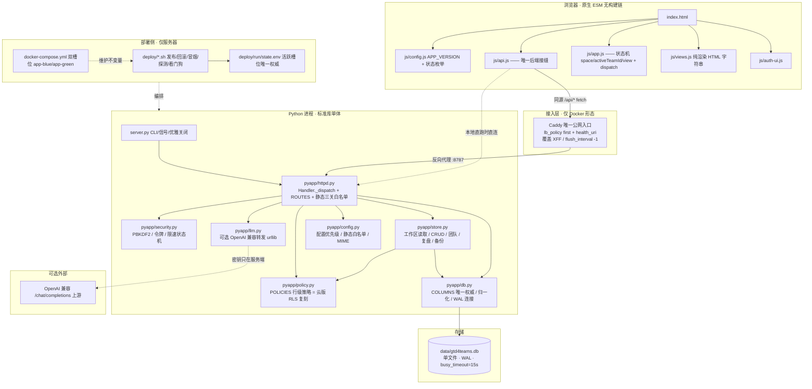

# 04 · TDS 技术设计说明书

> GTD4Teams 治理体系重建 · 架构师（高见远）
> 执行模式：**严格模式**（命中 `HARD_GATES.md` 的「登录认证 / 权限系统 RBAC / 数据库变更 / 生产部署回滚」四类高风险场景）
> 本文只描述**存量代码的真实架构**（反向补课），不提出推翻硬约束的重构；所有结论标注证据与验证状态。
> 上游依据：`00_开发流程总纲.md`（G0~G6、编号规则、追溯链）；同级文档 `03_FDS`、`05_数据模型`、`06_接口契约`。

---

## 0. 文档控制

| 项 | 内容 |
|---|---|
| 文档编号 | `04_TDS_技术设计说明书.md`（总纲 §5.1 编号 04，责任角色：架构师，更新触发：架构 / 环境 / 分支 / 认证权限变更） |
| 版本 | **v1.3** ｜ 日期：2026-11-14 ｜（v1.2/v1.1：2026-11-14；v1.0：2026-11-13）｜v1.0→v1.1：新增 ADR-13/14、修订 ADR-04、§4.6/§4.7、§5.5/§5.6、R-12~R-15、§0.4 行号基准。v1.1→v1.2：团队管理员沿用 `is_admin()`（owner+admin，`policy.py` 零改动）、白名单 5 逻辑项/6 路径、三 CLI 一律置 `must_change_password=1`、OR 兜底+告警、不加 `temp_password_expires_at`、R-14 必做、结构性保障。**v1.3：系统管理员只能建 `admin`（不能建 `member`）、新增 `NO_SYSTEM_ADMIN` 引导态错误码、`EMAIL_EXISTS` 文案改正、`friendlyError` 增 404 兜底** |
| 适用代码版本 | `APP_VERSION = '20260917a'`（`js/config.js:170`、`pyapp/__init__.py:20`）。**注意**：这是「前端/服务端源码版本串」，不是发布产物标识 |
| 发布产物标识 | `GTD_BUILD`：由构建时 `--build-arg GTD_BUILD=<标识>` 注入（`Dockerfile:46-47`），运行期经 `GET /api/health` 的 `build` 字段回传（`pyapp/config.py:61`、`pyapp/httpd.py:511`）；源码直跑默认 `'dev'`（`config.py:61`） |
| 二者语义 | `APP_VERSION` 回答「页面代码是不是最新」；`GTD_BUILD` 回答「起来的容器是不是我刚构建的这一版」。总纲 §5.2 把两者分开登记，不可互相替代；切流前核对的是 `build` 而非 `version`（总纲 §7.5） |
| 读者 | 用户（架构/运维终裁，G1/G6 放行权）、后端/前端工程师、数据建模师、QA、安全工程师、运维工程师 |
| 追溯链落点 | `REQ-xxx → BR/EX → 03 FDS → 本文（模块·ADR）→ 06 接口契约 / 05 数据模型 → TC-xxx → ACC-Gn-xxx → GTD_BUILD`（总纲 §5.3） |
| 门禁归属 | 本文是 **G1（设计）** 的入参之一；判定标准见总纲 §4 与 `07` |
| 对应 Skill | `architecture.architecture_blueprint`、`auth_architecture`、`permission_model`、`environment_strategy`、`api_standard`、`error_handling_standard`、`logging_monitoring_plan`、`security_architecture`、`api.endpoint_contract_design`、`code_quality.git_branch_commit`；门禁 `HARD_GATES.md` |

### 0.1 术语表（与 `00` 总纲 §5.2 逐字对齐）

| 前缀/术语 | 含义 | 本文中的用法 |
|---|---|---|
| TDS | 技术设计说明书（本文） | 模块、ADR、环境、认证权限、横切方案 |
| FDS | 功能设计说明书（`03`） | 页面/流程与本文模块一一对应（G1 判定项） |
| REQ- | 需求编号 | 追溯链起点，由 `02` 定义 |
| BR- | 业务规则 | `02`/`03`；本文 §6 权限矩阵对应「数据范围规则」 |
| EX- | 异常场景 | `02`/`03`/前端文案；本文 §9 与 `06` 错误码表对应 |
| TC- | 测试用例（如 `TC-AUTH-013`） | `07`；本文 §13.2 与 `06` §6 引用 |
| ACC-Gn- | 阶段验收单（如 `ACC-G4-20261113`） | 总纲 §4 每道门禁一张 |
| BUG- | 缺陷 | `07` |
| CR- | 需求变更单 | 总纲 §7.1：任何改动先开 `CR-`；本文 §8.4、`06` §5 |
| `APP_VERSION` | 源码版本串（四处同步） | 本文 §8.3 |
| `GTD_BUILD` | 构建标识（镜像 tag / health / 发布结论表） | 本文 §3.4、§7、§13.4 |

### 0.2 证据与验证状态标记（全文统一，用户对「实测证据」的要求）

> **重要声明**：本次工作是**纯文档撰写，未修改任何业务代码，也未重新执行任何测试**。凡标 `【测试·有名】` 者，指「仓库中存在该用例、且主理人在任务上下文中报告本机全绿」；「全绿」是**转述结论，非本次复跑结果**。凡需 Docker / 服务器 / 真实上游才能确认的，一律标 `【未验证】`，并汇总到 §14。

| 标记 | 含义 |
|---|---|
| `【代码·已核】` | 本次逐行核对了对应 `文件:行号`，是对现状的事实陈述 |
| `【文档·原文】` | 引自 `README.md` / 既有 `docs/*.md` 原句，注明出处行 |
| `【测试·有名】` | 存在对应测试用例名/断言（列出用例名），主理人称本机全绿，**本次未复跑** |
| `【推断】` | 由代码/文档推导，但无专门断言直接覆盖；已写明推导依据 |
| `【未验证】` | 需服务器 / Docker / 真机浏览器 / 真实 LLM 上游，或本次根本未执行 |

### 0.3 结论先行

| 项 | 判断 |
|---|---|
| 架构现状 | **单进程 Python 标准库单体 + SQLite 单文件 + 原生 ESM 前端**，可选 Docker 双槽位蓝绿。层次清晰、边界收敛，所有安全边界都在服务端（`policy.py` + `httpd.py`），无前端越权依赖 【代码·已核：`pyapp/httpd.py:343-416`、`pyapp/policy.py:224-267`】 |
| 最大架构风险 | **文档与代码漂移**：`GTD_BIND` 在旧专题文档与 memory 中被当作配置变量，但代码中不存在该变量（见 §7.4、§14 O-1）。这类漂移正是总纲 §2「不可追溯」的具体实例 |
| 次大架构风险 | **蓝绿期间登录限速状态不共享**（进程内字典，`security.py:116-159`）；限速窗口被双进程稀释，属推断出的残余风险（§13.1 R-5） |
| 是否阻塞下一步 | 不阻塞 G1 之外的门禁；**阻塞首次上服务器的是 `python3 tests/test_zerodowntime.py`（总纲 §1 / §12）**，与本文无关，但本文 §14 收录 |
| 本次交付边界 | v1.0：只写 `04` 与 `06` 两份文档；v1.1：同样只改这两份文档，**不改 `pyapp/`、`js/`、`tests/` 任何代码** |

### 0.4 行号基准（v1.0 记录的行号已整体漂移）

> **必读**：v1.0 之后 `pyapp/httpd.py` 等文件继续增长，**v1.0 全文行号普遍比当前文件小 90~230 行**。照 v1.0 行号跳转会落到无关代码上（例：v1.0 说 `ROUTES` 在 `httpd.py:815-836`，实际在 `:1048-1069`）。
> 当前基准：`httpd.py` 1105、`config.py` 176、`policy.py` 350、`store.py` 483、`db.py` 667、`security.py` 159、`server.py` 238、`js/api.js` 385。
> **约定**：v1.1 新增/修订的内容（§3 ADR-13/14、§4.6、§4.7、§5.5、§5.6、§12.1、§14）**全部使用当前实测行号**；其余章节保留 v1.0 行号原文（避免大范围改写引入新错），最常被引用的锚点映射见 **`06` §1.0**（唯一维护处，不在此重复）。

---

## 1. 设计目标与约束（可验证条目）

硬约束来自任务上下文与 `README.md`，逐条给出**验证方式**（能在本机判定的标已核，需环境的标未验证）。

| 编号 | 约束（可验证陈述） | 证据 | 验证方式 | 状态 |
|---|---|---|---|---|
| C-1 | 后端零第三方依赖：仅用标准库 `http.server`/`sqlite3`/`hashlib`/`secrets`/`urllib`/`argparse` 等 | `server.py:16-30`、`pyapp/*.py` 全部 import、`Dockerfile:3-7`（无 `requirements.txt`、无 `pip install`） | `grep -rn "^import\|^from" pyapp/ server.py` 人工核对；`python -c "import pyapp.config, ..."` 构建自检（`Dockerfile:37-40`） | 【代码·已核】；构建自检本身 【未验证·需 Docker】 |
| C-2 | 前端原生 ESM、无构建链、无 CDN 运行时依赖 | `README.md:29-31`、`index.html:64`（`<script type="module">`）、`js/*.js` 全为 `import`/`export` | 检索 `js/` 中无 `require(`/`define(`/`from 'http`；`index.html` 无外部 `<script src="http...">` | 【代码·已核】 |
| C-3 | 随处可运行：任意装有 Python 3.8+ 的目录即可启动，首次运行自建库建表 | `README.md:8,15,27`、`server.py:219`（`make_server` → `ensure_ready` → `init_db`） | `python server.py --check`（`server.py:86-105`）打印配置与统计后退出 | 【代码·已核】；实跑 【未验证·本次未执行】 |
| C-4 | 单服务器 / 单机形态，数据全在 `data/gtd4teams.db` 一个文件 | `README.md:56-59`、`pyapp/config.py:63-66`、`pyapp/db.py:425-436` | `python server.py --check` 的 `dbPath`；`ls data/` | 【代码·已核】 |
| C-5 | 数据可携带：整库可导出/还原为纯 JSON，且可跨机器迁移 | `server.py:108-133`、`pyapp/store.py:339-378` | `test_backup_round_trip`（`tests/test_api.py:755`）；`--export`/`--import` 往返 | 【测试·有名】 |
| C-6 | 前后端唯一耦合点是 `js/api.js`，导出签名与云版本逐名一致 | `js/api.js:1-17`、`README.md:209` | 逐名比对 `api.js` 导出与 `app.js`/`auth-ui.js` 的 import | 【代码·已核】 |
| C-7 | 权限在服务端判定，前端不做数据归属判断 | `pyapp/policy.py:1-7`、`js/api.js:13-16` | 越权用例 `test_14`~`test_21`（`test_api.py:296-427`） | 【代码·已核】+【测试·有名】 |
| C-8 | 版本串四处同步（详见 §8.3） | 总纲 §4 G2、`README.md:264-265` | 见 §8.3 的检索命令；当前四处实测同为 `20260917a` | 【代码·已核】 |
| C-9 | 发布产物以 `GTD_BUILD` 为准，切流前必须核对 | 总纲 §7.5、`Dockerfile:42-47`、`deploy/smoke.sh:68-78` | `test_02_health_的_build_能区分两个版本`、`test_07_冒烟脚本对错误的构建拦截`（`test_zerodowntime.py:191,271`） | 【代码·已核】+【测试·有名】 |
| C-10 | 离线可用、不开 CORS、静态资源白名单 | `README.md:31,96-101`、`pyapp/config.py:22`、`pyapp/httpd.py:332-334,420-484` | `test_29`~`test_31`、`test_36`（`test_api.py:548-623`）、`test_09` 冒烟抓目录穿越（`test_zerodowntime.py:286`） | 【代码·已核】+【测试·有名】 |

> 约束的**代价**不做粉饰：零依赖 ⇒ 无 ORM/迁移框架/连接池/异步；SQLite 单文件 ⇒ 单写、无跨进程限速共享、全量读取；无构建链 ⇒ 无 tree-shaking、无类型检查、版本串靠人工同步。见 §11、§12。

---

## 2. 总体架构

### 2.1 分层图



- **本地直跑 / WorkBuddy sites 形态**：无 `Caddy`、无 `OPS` 两框，浏览器直连 `httpd`；`PORT` 被注入时自动绑 `0.0.0.0` 【代码·已核：`pyapp/config.py:75-78`；文档·原文：`README.md:61-65`】。
- **Docker 形态**：`Caddy` 常驻唯一公网入口，两个槽位同时只跑一个，共用一个 `gtd-data` 卷 【代码·已核：`docker-compose.yml:116-164`；文档·原文：`README.md:120-130`】。

### 2.2 模块职责表

| 层 | 模块 | 职责 | 不做什么（边界） | 证据 |
|---|---|---|---|---|
| 入口 | `server.py` | CLI 解析、`Config` 组装、`--check/--export/--import/--set-password`、SIGTERM 优雅关闭 | 不含任何 HTTP 路由/业务规则 | `server.py:33-57,86-174,177-199` |
| 配置 | `pyapp/config.py` | 运行配置、优先级、`PUBLIC_ENTRIES` 静态白名单、`MIME_TYPES`、LLM 设置覆盖 | 不读数据库（由 `httpd.Application.connect` 代劳） | `config.py:22,24-40,50-137` |
| HTTP | `pyapp/httpd.py` | 路由表 `ROUTES`、请求分发与写锁重试、会话与安全响应头、静态三关白名单、SSE | 不直接写表结构、不实现业务规则 | `httpd.py:199-228,336-416,420-484,815-836` |
| 安全 | `pyapp/security.py` | 口令散列/校验/升级、令牌生成与指纹、进程内限速状态机 | 不碰 HTTP（`httpd` 负责取 IP 与 Cookie） | `security.py:36-159` |
| 权限 | `pyapp/policy.py` | `POLICIES` 逐表策略、`AuthzContext`、`load_context`、`Denied` | 不执行 SQL、不下沉到前端 | `policy.py:46-63,224-319` |
| 业务 | `pyapp/store.py` | 工作区读取、通用 CRUD、团队生命周期、复盘 upsert、运行日志、备份还原 | 不做认证（信任上游传入的 `ctx`） | `store.py:82-99,106-378` |
| 存储规格 | `pyapp/db.py` | DDL、`COLUMNS` 唯一权威、类型归一化/JSON 编解码、连接与建库幂等 | 不做权限判定 | `db.py:35-287,300-378,425-591` |
| 可选 AI | `pyapp/llm.py` | OpenAI 兼容转发、非流式/流式、错误脱敏 | 不向浏览器下发密钥 | `llm.py:24-190` |
| 前端接缝 | `js/api.js` | 同源 REST 客户端、30s 超时、错误结构化、`friendlyError`、日志缓冲脱敏 | 不含业务判断 | `api.js:19-385` |
| 前端状态 | `js/app.js` | `space/activeTeamId/view` 三层状态机 + 单一 `dispatch` 事件委托 | 不产出 HTML | `app.js:15-33`（import 清单）＋总纲 §8 |
| 前端渲染 | `js/views.js` | 纯函数产出 HTML 字符串 | 不持有状态、不发请求 | 总纲 §8、`README.md:212` |
| 部署 | `deploy/*.sh` + compose + Caddyfile | 槽位状态、健康检查、切流、冒烟、连续性探测、备份、自愈 | 不引入 python3/node 依赖 | `deploy/lib.sh:13-14`、`docker-compose.yml` |

### 2.3 数据流：一次写请求的完整链路（以 `POST /api/rows` 的 `op=insert` 为例）

链路逐跳给出落点，供联调（G3）与排障按图索骥：

1. **浏览器**：`api.js` 的 `mutate()` 组装 `{table, op, id, payload}`，`request()` 发 `fetch('/api/rows', {method:'POST', credentials:'same-origin', headers:{'Content-Type':'application/json'}})`，带 30s `AbortController` 超时 【代码·已核：`js/api.js:40-57,152-158`】。
2. **接入层（Docker 形态）**：Caddy `lb_policy first` 把请求给上游列表第一个可用槽位；`header_up X-Forwarded-For {http.request.remote.host}` **覆盖**客户端伪造值；`flush_interval -1` 保证 SSE 不被缓冲 【代码·已核：`deploy/Caddyfile.template:41-61`】。
3. **分发**：`do_POST → _dispatch('POST')`；`path` 去尾斜杠后查 `ROUTES.get(('POST','/api/rows'))` 命中 `h_rows`；非 `/api/` 前缀且非 GET → 405 【代码·已核：`httpd.py:323-324,336-352,825-826`】。
4. **写前三关**：`_check_origin()`（`Origin` 与 `Host` 比对，403 `CROSS_ORIGIN_BLOCKED`）→ `Content-Type` 必须 `application/json`（415 `UNSUPPORTED_MEDIA_TYPE`）→ `_read_body()` 一次性读取、`max_body_bytes` 8MB 上限（413）、非合法 JSON 对象 → 400 `BAD_JSON` 【代码·已核：`httpd.py:147-176,357-371`】。请求体只读一次，供重试复用（`_body_consumed` 语义，`httpd.py:355`）。
5. **写锁重试循环**：`for attempt in range(WRITE_RETRY_ATTEMPTS=6)`；每轮 `app.connect()` 新建连接（`WAL` + `synchronous=NORMAL` + `busy_timeout=15000`，`db.py:425-436`），并把库内 `settings` 的 LLM 三项覆盖到 `cfg`（`httpd.py:73-79`）【代码·已核：`httpd.py:382-386,118`】。
6. **认证**：`h_rows` → `_require_user(conn)` 从 Cookie 取 `gtd_session` → `token_fingerprint` → 查 `sessions JOIN users`；失效返回 401 `UNAUTHENTICATED`；顺带做**过期会话清理**与 `last_seen_at` 300s 节流刷新（改写失败不影响本次请求）【代码·已核：`httpd.py:241-286,232-239,648-655`】。
7. **权限上下文**：`load_context(conn, uid)` 读 `team_members`，仅纳入 `status=='active'` 的行，`role` 归并为 `{team_id: role}`；此读取**绕过 `team_members` 自身策略**（对应云版 `SECURITY DEFINER`）【代码·已核：`policy.py:304-319`】。
8. **字段归一化**：`db.split_payload(table, payload, for_insert=True)` 丢弃 `pk`/`owner`/`stamp`/未知字段，其余按 `COLUMNS` 的 kind 归一化（`int/real/bool/json/jsonarr/text/date/ts`）【代码·已核：`db.py:565-591,516-562`】。
9. **服务端注入归属**：若表含 `owner_id` 列，`values['owner_id'] = ctx.uid`；同时写 `created_at`/`updated_at` 【代码·已核：`store.py:113-119`】。
10. **权限判定**：`can_insert(table, prospective, ctx)` 为假 → `raise Denied` → `_dispatch` 转 403 `PERMISSION_DENIED`；为真才执行 `INSERT ... VALUES(?...)`（参数绑定，表名来自 `WRITABLE_TABLES` 白名单）→ `conn.commit()` → `_fetch` 返回解码后的行 【代码·已核：`store.py:106-127,33-58`；`httpd.py:391-393`】。
11. **响应**：`_json({'rows': rows})`；`_send` 无条件附加 `X-Content-Type-Options: nosniff` / `Referrer-Policy: no-referrer` / `X-Frame-Options: DENY`；`_log_access` 仅对 `status>=400` 输出【代码·已核：`httpd.py:199-217,671,138-141`】。
12. **异常与收尾**：`ApiError/StoreError/LlmError` → `_error()` 统一错误体；写锁争用（`_is_write_contention`，含 Windows 上报为 `SQLITE_READONLY` 的情形）→ 指数退避重试（`min(0.05*2^n, 0.4)`，累计约 1s），**且仅当响应尚未开始写**（`send_header` 覆写置 `_responded`，覆盖 SSE 不经过 `_json` 的漏洞）；`finally: conn.close()` 丢弃未提交事务，保证「要么整体生效、要么完全没发生」【代码·已核：`httpd.py:87-108,122-131,382-416`】。

> **`update`/`delete` 的差异**：权限不通过时**返回 `[]` 而非抛异常**（`store.py:141-142,155-156`），且行不存在也返回 `[]`（`134,153`）。这是刻意保留，详见 §6.3 与 ADR-08。

### 2.4 一次读请求的差异（补充）

`GET /api/workspace` 走 `h_workspace → load_context → store.load_workspace`，后者对 10 张表逐行在 Python 内跑 `can_select` 过滤后一次性返回（`teams/members/items/projects/areas/contexts/resources/reviews/onCall/logs`，`logs` 限 `LOG_LIMIT=400`）【代码·已核：`store.py:64-99`、`db.py:385-386`】。**读路径不带写**（会话刷新被 300s 节流），这是 §3.4 蓝绿共库成立的纪律之一。

---

## 3. ADR 架构决策记录（14 条）

> 每条含「决策 / 备选方案 / 选择理由 / 代价 / 何时重新评估」。ADR-01~12 状态为 **Accepted（存量，反向补录）**；**ADR-13/14 为 v1.1 新增**（`CR-2026-001` 带来的两个新决策，状态 **Accepted（本期拍板）**），并含 **ADR-04 的一处修订**（原约束作废）。

### ADR-01 后端用 Python 标准库，而非 Web 框架
- **决策**：`http.server.ThreadingHTTPServer` + `BaseHTTPRequestHandler` 手写路由，零第三方依赖 【代码·已核：`httpd.py:29-30,843-864`】。
- **备选**：FastAPI/Flask + uvicorn/gunicorn；引入 ORM 与迁移框架。
- **理由**：硬约束 C-1/C-3；`README.md:7-8,27-31`「拷到一个装有 Python 3 的目录里就能跑」；`Dockerfile:3-7` 不联网装包即可构建。
- **代价**：无自动 OpenAPI、无依赖注入、无中间件生态；路由/校验/错误映射全部手写且需靠文档 `06` 固化；无异步 IO，LLM 长连接占用线程。
- **重新评估**：当并发需要异步/多 worker 池、或需要生态中间件（限流/追踪/指标）且愿意放弃零依赖时。

### ADR-02 用 SQLite 单文件，而非 PostgreSQL
- **决策**：`data/gtd4teams.db` 单文件；`WAL + busy_timeout=15000 + synchronous=NORMAL` 【代码·已核：`db.py:425-436`；`config.py:63-66`】。
- **备选**：PG（云版本即 PG + RLS）；MySQL；外部数据库服务。
- **理由**：数据可携带（C-4/C-5）、备份即拷文件（`README.md:56-59`）、无需独立服务进程、字段名与云版本逐字一致以便前端零改动（`db.py:5-8`）。
- **代价**：单写（写写排队）、无数据库级 RLS（故有 ADR-06）、无在线 DDL、`--import` 为 `INSERT OR REPLACE` 不清空（`store.py:355-378`，总纲 §7.4）；跨进程不共享内存状态（A-风险 R-5）。
- **重新评估**：多写并发成为瓶颈、需要跨机多活、或需要数据库级行级安全与审计时。

### ADR-03 前端原生 ESM、无构建链
- **决策**：`<script type="module">` + 相对路径 `import ... ?v=20260917a`，Python 直接托管静态文件 【代码·已核：`index.html:9,64`；`js/*.js`】。
- **备选**：React/Vue + Vite/webpack；CDN SDK。
- **理由**：C-2/C-10 离线可用、无 Node 依赖（`README.md:29-31`）；镜像白名单 COPY 只需 `index.html`/`js`/`css`（`Dockerfile:26-30`）。
- **代价**：无类型检查与打包优化；缓存失效完全依赖人工递增版本串（§8.3）；无目录列表、白名单外文件 404（`httpd.py:420-484`）。
- **重新评估**：需要组件化复用/类型安全，且能引入构建链与 Node 运行时时。

### ADR-04 `js/api.js` 是与后端的唯一接缝，导出签名逐名对齐云版本
- **决策**：仅 `api.js` 内含 `/api/*` 路径与错误码，`app.js` 业务逻辑一行未改 【文档·原文：`README.md:209`】【代码·已核：`js/api.js:1-17`】。
- **备选**：让各视图直接 fetch；或引入统一 SDK。
- **理由**：可验证的替换边界；后端换栈时前端业务层零改动；契约变更集中在 `06` §5 管理。
- **代价**：任何接口变更都必须同步 `api.js` 与 `06`；`api.js` 承担传输、错误映射、日志三重职责（较胖）。
- **重新评估**：接缝内职责多到难以维护、或需要为不同后端提供多套 adapter 时。
- **⚠️ v1.1 修订（CR-2026-001）：「导出签名逐名对齐云版本」这条约束作废。**
  - 原因：云版本已不在维护，把本地导出签名钉在一个不再演进的实现上，只会让"下线一个已死的端点"（`registerWithPassword`）变成需要绕路的事。约束的**目的**（保证接缝单一、变更可追溯）与**手段**（逐名一致）本来就是两件事，现在换成更直接的手段：**本地实现为准 + 每次增删逐名登记**（登记处：`06` §10.7 与 §5.3 第 4 条）。
  - 不变的部分：`js/api.js` 仍是唯一接缝（`app.js`/`views.js` 不得直接 `fetch`）；导出总数不是硬指标（v1.1 恰好仍是 27，但那是巧合，不是要求）。
  - 代价：失去"和云版对照"这条外部校验线。补偿手段是 `06` §10.7 的登记表 + `.smoke/auth-flow-test.mjs` 的表驱动断言（`:371-388`）。

### ADR-05 `db.COLUMNS` 是字段规格的唯一权威
- **决策**：可写字段白名单、类型归一化、JSON 编解码全由 `COLUMNS` 驱动；键集合必须等于 `PRAGMA table_info` 【代码·已核：`db.py:19-21,300-378,494-591`】。
- **备选**：手写每条 SQL 的字段清单；从 `PRAGMA` 运行时反射生成。
- **理由**：防「手写 DDL 与规格表悄悄漂移」；`split_payload` 借它丢弃未知字段与 `owner_id`（安全相关，`db.py:568-572`）；有防漂移断言 `test_columns_spec_matches_real_schema`（`test_api.py:686`）【测试·有名】。
- **代价**：新增/改列必须同改 DDL + `COLUMNS` + `EXPECTED_TABLES` 等（§8.3/§8.4 登记纪律）；无迁移框架，兼容性靠人工（§12）。
- **重新评估**：引入迁移框架、或列数多到规格表难以人工维护时（但会破坏零依赖）。

### ADR-06 `policy.py` 逐条复刻云版 RLS 行级策略
- **决策**：`Policy(select, insert, update.using, update.check, delete)` + `AuthzContext`，11 张表策略表 `POLICIES` 【代码·已核：`policy.py:24-30,224-267`】。
- **备选**：把可见性判断放前端；在 `store.py` 里硬编码 if/else；下沉到 SQL `WHERE`。
- **理由**：安全边界不能下沉到前端（`policy.py:5-7`）；与云版 RLS 清单一一对应、便于逐条对照（`policy.py:132-134`）；`select_table` 明确选择「Python 逐行判策略」而非编译成 SQL，理由是数据体量小且前端本就一次性全量加载（`store.py:64-70`）。
- **代价**：全表读入内存再过滤，性能随数据量线性增长（§11）；策略与 DDL 双份维护，靠 G1 评审对齐（§6.4）。
- **重新评估**：单表行数过万导致 `loadWorkspace` 明显变慢、或未来回到带 RLS 的数据库时。

### ADR-07 双域共用一张 `work_items`
- **决策**：`team_id IS NULL` = 个人事项（仅本人可见），非空 = 团队事项（成员共享）；两者共用同一状态机与字段 【文档·原文：`README.md:85`】【代码·已核：`policy.py:11-12,79-85`、`db.py:106-146`、`js/config.js:12-15`】。
- **备选**：拆 `personal_items` / `team_items` 两表。
- **理由**：方法论底座要求「两层共用同一张 `work_items` 与同一套状态机」（`js/config.js:14-15`）；云版本字段名逐字一致（`db.py:5-8`）。
- **代价**：所有查询都需带 `team_id` 语义；权限谓词必须区分 `_personal_or_member`；误写 `team_id` 会造成跨域数据错配，靠 `split_payload` 归一化 + `can_*` 兜底。
- **重新评估**：个人域与团队域字段/流程差异大到共用表成为负担时（需评估迁移成本）。

### ADR-08 更新/删除被权限拦下时返回空数组，而非抛错
- **决策**：`update_row`/`delete_row` 在行不存在或权限不通过时 `return []`；`h_rows` 统一响应 `{rows: [...]}` 【文档·原文：`README.md:87`】【代码·已核：`store.py:130-159,1-9`、`httpd.py:648-652`、`policy.py:13-14,274-278`】。
- **备选**：抛 403/404 异常。
- **理由**：与云版 RLS「命中 0 行」语义一致；前端 `assertAffected()` 依赖「空数组 = 没改到」如实提示「可能不存在或不在你可见的范围内」，**不假装成功**、也不用「不存在」与「无权限」两个响应泄露数据存在性（`store.py:8-9`）。
- **代价**：调用方必须检查返回值长度，否则会误以为成功；前端负有如实提示义务（§9.4）；调试时「静默无操作」不直观。
- **重新评估**：若前端改用乐观锁/需要区分「不存在」与「无权限」时——但会改变产品语义与既有测试（`test_14/15/20` 断言 `rows == []`），属破坏性变更，须走 `CR-`。

### ADR-09 双槽位蓝绿共用同一个 SQLite 库文件
- **决策**：`app-blue`(127.0.0.1:8788)/`app-green`(127.0.0.1:8789) 共挂 `gtd-data` 卷，同时只跑一个；切流 = 重写 Caddy 上游顺序 + `caddy reload` 【文档·原文：`README.md:120-130`】【代码·已核：`docker-compose.yml:8-18,86-87,161-164`、`Caddyfile.template:38-48`、`lib.sh:202-279`】。
- **备选**：每槽位独立库 + 数据同步；停服发布；共享 PG。
- **理由**：零停机且无需数据同步；会话存在共享库中，切流不登出（`test_zerodowntime.py:199-203`）；`caddy reload` 平滑重载不断连接（`Caddyfile.template:22-26`）。
- **代价**：**三处代码纪律必须同时成立**：① 结构建全时跳过 DDL（`db.schema_present` + `init_db`，`db.py:439-487`）；② 会话刷新 300s 节流避免读路径带写（`httpd.py:232-239,268-279`）；③ 写锁争用退避重试且响应未开始写（`httpd.py:87-108,382-413`）。另要求新旧两版表结构兼容（总纲 §7.3 expand/contract）。
- **验证状态**：前提由 `tests/test_zerodowntime.py` 9 项覆盖（`test_01`~`test_09`，含并发写入零失败、会话跨进程有效、build 可区分、日志无锁冲突）【测试·有名】；**但开发机无 Docker，Linux 双进程场景总纲 §1 明示「首次上服务器前必须跑」→【未验证】**。
- **重新评估**：若并发写入在生产出现锁冲突、或需要跨机多活时（此时应换 ADR-02）。

### ADR-10 可选 LLM 走服务端转发、密钥只在服务端
- **决策**：`/api/llm/*` 由 `pyapp/llm.py` 用标准库 `urllib` 转发 OpenAI 兼容端点；`GET /api/llm/config` 只回 `{configured, baseUrl, model, apiKeySet}` 不回密钥（连掩码都不给）【文档·原文：`README.md:80,106,175-192`】【代码·已核：`llm.py:8-16,32-80`、`httpd.py:731-764`】。
- **备选**：浏览器直连厂商（密钥下发）；内置某一家 SDK（破坏零依赖）；强制流式。
- **理由**：密钥不出服务端（`httpd.py:738-739` 注释）；支持非流式（`llm.py:93-99`，与云版网关强制流式不同）；`stream:true` 时 SSE 直通（`httpd.py:796-812`）；未配置返回 `LLM_NOT_CONFIGURED` 给可操作指引（`llm.py:40-47`）。
- **代价**：长连接占线程；上游错误码需脱敏（`llm.py:74-80`）；SSE 中断处理见 `06` §7.2；密钥存在库 `settings` 表且 `--export` 会带出（`store.py:336-352` 注释明确为敏感文件）。
- **重新评估**：需要并发流式连接数较高、或需要统一 AI 网关/计费审计时。

### ADR-11 `GTD_TRUST_PROXY` 默认关，且必须与绑定形态配对
- **决策**：`trust_proxy` 默认 `False`；仅在显式声明在可信反代之后才采信 `X-Forwarded-For/Proto`，且 Caddy 必须**覆盖**而非追加 XFF 【文档·原文：`README.md:102-104,135-145`】【代码·已核：`config.py:87-92`、`httpd.py:186-197,308-313`、`Caddyfile.template:50-56`】。
- **备选**：无条件采信 XFF（云版直觉做法）；或永远不采信。
- **理由**：伪造 XFF 可换掉登录限流键使爆破不限速（`config.py:88-91`）；`test_40_forged_x_forwarded_for_cannot_bypass_login_throttle` 直接盯此退化（`test_api.py:659-680`）【测试·有名】。
- **代价**：反代后若忘记置 1，所有请求算成同一 IP、限流误伤且 Cookie 缺 `Secure`；反过来直连公网误置 1 则安全失守（配对见 §7.4）。
- **重新评估**：部署拓扑变化（槽位端口改为对外暴露）时必须重新判定，见 §7.4 配对表与 G5 门禁。

### ADR-12 会话令牌只存 SHA-256、口令用 PBKDF2、限速为进程内状态机
- **决策**：`secrets.token_urlsafe(32)` 存 Cookie，库里只存 `sha256(token)`；口令 `pbkdf2_sha256$240000$独立盐$摘要`，登录成功顺手 rehash；限速 `(email.lower, IP)` 15 分钟 10 次，进程内 `dict` + `threading.Lock` 【代码·已核：`security.py:26-29,36-66,83-95,116-159`、`httpd.py:288-298`】。
- **备选**：bcrypt/argon2（需编译依赖）；JWT 无状态令牌；Redis 集中限速。
- **理由**：零依赖硬约束（`security.py:10-11` 明确「选 PBKDF2 的唯一理由是零依赖」）；库被拷走也无法冒用登录态（`security.py:12-13`、`db.py:47-48`）。
- **代价**：无服务端主动吊销粒度之外的能力（改密踢会话靠删行，`httpd.py:634-638`）；**进程内限速状态机不跨进程共享** → 蓝绿双进程期间窗口被稀释（§13.1 R-5，【推断】）；PBKDF2 240k 迭代使登录有 CPU 开销。
- **重新评估**：需要多实例共享限速/会话吊销、或有 FIPS 之外的口令散列合规要求时。

### ADR-13 系统管理员用库内标记（`users.is_system_admin`），不再用环境变量白名单
> 状态：**Accepted（v1.1，CR-2026-001 拍板）**。本条**取代** v1.0 `config.py:104-118` 注释里"管理员不是业务概念、放环境变量最省事"的判断。

- **决策**：实例级管理员身份落在 `users.is_system_admin`（INTEGER 0/1，由版本化迁移层的 `_MIGRATIONS` **v1** 新增；`must_change_password` 是 **v2**，终值 `schema_version = 2`，见 `05` §13）；首次引导由 CLI `--create-admin` 产生（`06` §10.6）；`GTD_ADMIN_EMAILS`（`config.admin_emails`）在过渡期作为"OR 兜底"存在，v1.2 删除（`06` §10.11 Q-3）。
- **备选**：
  - A 环境变量白名单（现状，`config.py:104-118` + `is_admin_email` `:152-156`）；
  - B 独立 `instance_admins(user_id)` 表（多一表、多一条策略，可加审计列）；
  - C 在 `users` 上加 `role TEXT`（`'user'|'admin'`），与 `team_members.role` 同名不同域 —— **不采纳**：两个 `role` 会长期被混淆，而 `team_members.role` 已被 `policy.py` 深度依赖（`AuthzContext.is_admin`）。
- **理由（白名单的三条硬伤，都在本变更里变成了现实问题）**：
  1. **空实例无法引导**。白名单只能"给已存在的账号授权"，而"存在"本身需要一个免鉴权的建号入口。本期下线自助注册后，纯白名单方案下**第一个账号建不出来**（`--set-password` 能建号，但它不授予实例管理员，见 `server.py:146-166`），于是"谁能改 AI 配置"变成无人可答。库内标记 + CLI 引导把"第一个账号"恢复成一次显式的运维操作。
  2. **授权与发布耦合**。`admin_emails` 在 `Config.__init__` 里读一次（`config.py:116-118`），改一次要改 `.env` 并重启进程；而"提一个管理员"本应是即时、可追溯的业务动作。库内标记即时生效，且能被审计（`06` §10.3.6）、能随备份迁移。
  3. **权限挂在可变标识上**。`is_admin_email()` 按 **email 字符串**匹配（`config.py:152-156`），账号换邮箱/改名后权限跟着漂移或凭空消失；`users.id` 是 TEXT 主键、恒定（`security.new_user_id()`，`security.py:92-95`），挂在它上面才稳定。
- **代价（必须记住，否则会以"缺陷"的形式复发）**：
  1. **必须有引导流程**：新人接手/新环境部署的第一条命令不再是"打开浏览器注册"，而是 `--create-admin`。`09` 的部署 SOP 与 `server.py:80` 的 banner 都要改（banner 现在写的是「首次使用请先注册一个账号」，已失效）。
  2. **必须做数据库迁移**。而本项目**没有版本化迁移层**（`05` §8.4 已定性为"跳过 DDL 是对的、缺的是迁移层"）—— 本变更成为迁移层的**首个真实用例**：没有它，"加两列"发到生产后库不会长出新列（`05` §8.4 P3/P4 实测）。
  3. **权限来源从"部署配置"变成"库内数据"**：库被拷走即带走"谁是实例管理员"这部分信息。威胁模型未实质变化（口令散列、LLM 密钥本来就在库里），但**备份文件的分级没变、敏感性上升了一档**，`09` 的备份说明要跟着改。
  4. **`--export`/`--import` 会带上该标记**（`store.export_all` 是 `SELECT *`，`store.py:415-417`；`import_all` 对 users 放行任意列，`store.py:467-468`）→ 从生产备份还原到测试环境后，测试环境里也有同一批实例管理员。这是期望行为（否则灾备后没人能管），但**必须写进 `09`**，否则会被当成"权限泄漏"。
- **何时重新评估**：需要"实例管理员"与"运维账号"分离（即"能建号"与"能改配置"拆成两个权限）、或需要多租户/多实例管理面时 → 那时应改成独立表 + 审计表（备选 B）。

### ADR-14 账号创建收敛为「三级建号 + 强制改密闸门」，且闸门默认拒绝
> 状态：**Accepted（v1.1，CR-2026-001 拍板）**。

- **决策**：
  1. **三级建号**：系统管理员 → 可建任意团队的 **`admin`（仅 `admin`，v1.3 收紧）**；团队管理员（该团队 `owner`/`admin`）→ 只能为本团队建 `member`；其他任何人 → 不能建号。`owner` 一律不可经接口授予，系统管理员也不能建 `member`（§4.6 裁决 2）。
  2. **口令由系统生成、一次性返回**（`secrets`，16 位，`06` §10.6.5），账号带 `must_change_password=1`。
  3. **闸门默认拒绝**：`must_change_password=1` 时，除 `/api/auth/password`、`/api/auth/profile`、`/api/auth/me` 三条（以及天然不经 `_require_user` 的端点）外，一律 `403 PASSWORD_CHANGE_REQUIRED`。闸门实现在 **`_require_user` 内部**（`06` §10.5.2）。
  4. **唯一写入路径**：`store.create_account(conn, actor, ...)`（`06` §10.3.4 / 本文 §5.6）。`httpd` 不拼 SQL，也不用 `policy.can_insert` 近似。
- **备选**：
  - ① 回归"自助注册 + 邀请制"——产品已明确否决（本期要消灭的正是免鉴权建号）；
  - ② 让创建者自己填写初始口令 —— **更差**：口令由"创建者"与"使用者"两个人知道，且人会选弱口令（`validate_password` 只挡长度，`security.py:69-75`）；
  - ③ 邮件邀请链接 —— 需要邮件服务，破坏零依赖（C-1），且要处理令牌过期/重放；
  - ④ 闸门放 `_dispatch` 的某一步 —— 那里没有 user 对象（认证在各 handler 内完成），要么二次查会话、要么把路径白名单散到路由层，且会与"授权集中在 `policy.py` + 显式 store 函数"的设计相反。
- **理由**：
  1. **闸门放在 `_require_user` 是唯一"新增端点自动被覆盖"的位置**。现有 12 个受保护 handler 的第一个动作都是它；将来新增的端点照抄既有写法就自动继承。放在 `_dispatch` 则需要一张"所有路径"的白名单，而白名单会漏。
  2. **`_require_user` 天然不误伤匿名端点**：`h_session`、`h_log` 走 `_current_user`；`h_health`、`h_logout` 不鉴权；静态资源在前置分支。因此闸门里**只需要 3 条例外**，可逐条审计（`06` §10.5.3）。
  3. **口令必须一次性**：初始口令是"传递中的凭据"，它必然经过聊天窗口/便签/口头，无法保证不被旁观；`must_change_password` 把这个窗口压到"首次登录后立刻关闭"，是唯一可控的收口。
- **代价**：
  1. **必须保留 break-glass**：唯一系统管理员丢了口令 → 只能上服务器 `--set-password`；若连 CLI 都进不去，就只能改库文件。`09` 必须写清。
  2. **引导漏做 = 全站不可用**：迁移后没有任何 `is_system_admin=1` 的账号时，没人能建号（但既有账号仍能正常使用业务功能，**不会**锁站 —— 这是刻意设计：闸门只对 `must_change_password=1` 生效，迁移把存量账号置 0）。
  3. **前端多一个必过页面**（强制改密），且旧标签页会撞 403（`06` §10.9.1）。
  4. **测试夹具大面积改造**：`tests/test_api.py:124-126` 的 `Client.register` 是全域建号入口，端点删掉后必须换实现（`06` §10.9.4）。
- **何时重新评估**：接入 SSO/OIDC（那时 `must_change_password` 与初始口令整套可撤），或需要"批量导入账号"（那时应走 CLI 批量而非开放接口）。

---

## 4. 认证与会话架构

> 严格模式：本节对应 `HARD_GATES.md`「登录认证、Token/Session、密码、账号安全」。

### 4.1 时序（建号 / 登录 / 改密 / 登出）

| 动作 | 时序 | 证据 |
|---|---|---|
| ~~注册~~ **建号（v1.1 替代注册）** | ~~`checkEmail` → `POST /api/auth/register` 校验开关/邮箱/强度/重复 → `INSERT users` → 建会话 → 201 + Set-Cookie~~ **v1.1 起：自助注册端点已从 `ROUTES` 移除（404）**。建号改走 `POST /api/admin/accounts`（三级建号）→ 授权判定 → `store.create_account` 单事务写 `users` + 可选 `team_members` + 审计 `app_logs` → 201（**不建会话、不设 Cookie**）→ 一次性返回初始口令 | v1.1：`06` §10.3；原路径 `httpd.py:653-691`（已删）；`api.js:126-136`（已删） |
| 登录 | `POST /api/auth/login` → 组 `throttle_key=email.lower()|client_ip` → `is_rate_limited` → 查用户（邮箱不存在与口令错**同码** `INVALID_CREDENTIALS`，防账号枚举）→ `clear_failures` → `needs_rehash` 则升级散列 → `_start_session` → 200 + Set-Cookie | `httpd.py:579-606,592-601`；`test_06`（`test_api.py:190`） |
| 改密 | `POST /api/auth/password` → `_require_user` → 新密码强度 → 校验 `oldPassword` → 更新 `password_hash` → **删除该用户除当前令牌外的所有 sessions** → 200 | `httpd.py:619-639`；`test_09`（`test_api.py:217`） |
| 登出 | `POST /api/auth/logout` → 按指纹删当前 session → 200 + `Set-Cookie` `Max-Age=0`；前端 `signOut()` 静默吞异常保证能回登录页 | `httpd.py:609-616`；`api.js:107-113`；`test_07`（`test_api.py:203`） |
| 会话探测 | `GET /api/auth/session` 返回 `{user: null}` 或 `{user}`；`getSession()` 捕获任何异常返回 `null`，作为门禁判断（不抛错） | `httpd.py:518-520`；`api.js:82-90` |

> `--set-password <email>` 是「忘密码自救 + 关闭注册后开账号」的 CLI 通道：账号不存在则新建，存在则改密并清空该用户所有会话（`server.py:136-174`）。`【代码·已核】`
> **v1.1 修订**：该命令**不授予**系统管理员（`is_system_admin` 保持 0），并把 `must_change_password` 置 1；建号/改密的逐条契约见 `06` §10.6.4。同时新增 `--create-admin` / `--grant-admin` 两个命令（`06` §10.6.2-§10.6.3），三者正交：`--create-admin` 管"建号+授权"、`--grant-admin` 只管"授权"、`--set-password` 只管"改口令"。
> **登录语义 v1.1**：`POST /api/auth/login` 的响应 `user` 增加 `isSystemAdmin` / `mustChangePassword` 两个布尔字段（加法式），使前端登录后即可判定是否需要跳强制改密页；服务端闸门不依赖前端是否读了它（`06` §10.5）。

### 4.2 会话令牌生命周期

| 阶段 | 行为 | 证据 |
|---|---|---|
| 生成 | `new_token()` = `secrets.token_urlsafe(32)`；`new_user_id()` = `'u_' + token_hex(8)`（TEXT 主键，与云版 uuid 文本语义一致） | `security.py:83-95` |
| 存储 | `sessions` 表仅存 `token_hash = sha256(token)`、`user_id`、`created_at`、`expires_at`、`last_seen_at`、`user_agent`；不存明文令牌 | `db.py:47-58`；`httpd.py:288-298` |
| 有效期 | `SESSION_TTL_SECONDS = 30*24*3600`（30 天）；**`expires_at` 固定不滑动延长**，只刷新 `last_seen_at` | `security.py:27,98-109`；`httpd.py:267-268` |
| 活跃刷新 | 仅当 `seconds_since(last_seen_at) >= SESSION_TOUCH_SECONDS(300)` 才 UPDATE；写失败回滚并继续处理请求（记账失败 ≠ 业务失败） | `httpd.py:232-239,268-279` |
| 过期清理 | 读到过期会话时顺手 `DELETE`，删除失败也不影响返回 `None`（不把「登录已失效」变成 500） | `httpd.py:254-263` |
| 主动失效 | 登出（删当前）、改密（删其它）、`--set-password`（删全部） | `httpd.py:609-616,634-638`；`server.py:170` |

### 4.3 Cookie 属性矩阵

`_session_cookie()` 输出固定 `gtd_session=<token>; Path=/; HttpOnly; SameSite=Lax; Max-Age=<ttl>` 【代码·已核：`httpd.py:300-313`】。

| 属性 | 取值 | 条件 | 作用 / 证据 |
|---|---|---|---|
| `HttpOnly` | 恒有 | — | 脚本读不到令牌，XSS 无法直接窃取登录态（`httpd.py:11-13`） |
| `SameSite=Lax` | 恒有 | — | 跨站请求不带 Cookie，天然挡 CSRF（`httpd.py:13`）；是第三层防线 |
| `Path=/` | 恒有 | — | 全站同源携带（`api.js:47` `credentials:'same-origin'`） |
| `Max-Age` | `2592000`（30d） | 登录/注册；登出为 `0` | `security.py:27`；`httpd.py:616` |
| `Secure` | **条件附加** | 仅当 `trust_proxy==1` **且** `X-Forwarded-Proto == 'https'` | 明文 HTTP 下浏览器不会回传带 Secure 的 Cookie；该头同样以信任代理为前提（`httpd.py:308-313`）。`README.md:251` 记「开启后 Secure 随之加上」 |
| 纵深防御 | 写操作额外校验 | `Content-Type: application/json` + `Origin`/`Host` 一致 | `httpd.py:357-363,168-176`；`test_32/33`（`test_api.py:589,596`） |
| CORS | 不开 | `do_OPTIONS` 直接 405；无 `Access-Control-Allow-*` | `httpd.py:332-334`；`test_36`（`test_api.py:614`） |

### 4.4 限流键与 `GTD_TRUST_PROXY` 的关系

- 键：`f'{email.lower()}|{handler._client_ip()}'`（登录，`httpd.py:585`）；日志上报键：`f'log|{client_ip}'`（`httpd.py:717`）。
- `_client_ip()`：`trust_proxy=1` 时取 `X-Forwarded-For` **第一个值**，否则取 TCP 连接地址 `client_address[0]`（`httpd.py:186-197`）。
- 计数：`register_failure`/`bump_counter` 同一实现，`WINDOW_SECONDS=900`、`MAX_ATTEMPTS=10`，窗口过期自动清零，`clear_failures` 在登录成功后清空（`security.py:116-159`）。
- **因果链**：`GTD_TRUST_PROXY=0` 时伪造 XFF 无效（`test_40`）；置 1 后必须同时满足「槽位端口只绑回环」+「Caddy 覆盖 XFF」，否则客户端伪造值会排到真实 IP 前面被 `_client_ip` 取到（`Caddyfile.template:50-56`、`README.md:142-145`）。详见 §7.4 配对表。

### 4.5 改密踢出其它会话

`UPDATE users SET password_hash...` 与 `DELETE FROM sessions WHERE user_id = ? AND token_hash <> ?` 在**同一 `conn.commit()`** 内完成（`httpd.py:748-754`）；当前令牌从 Cookie 取指纹保留。`test_09` 断言：另一会话随后访问 `/api/workspace` 得 401，当前会话仍 200，旧密码不能登录、新密码可以（`test_api.py:217-234`）【测试·有名】。

**v1.1 追加（同一事务内必须做）**：`UPDATE users SET password_hash = ?, must_change_password = 0, updated_at = ?`。漏掉 `must_change_password = 0` 的后果是**改密成功但永远用不了**（每次都被闸门 403，且再改一次也没用）—— 这是本期最容易被漏测的故障，验收断言见 `06` §10.5.4。

### 4.6 三级建号（v1.1 新增，替代自助注册）

```
调用者身份            → 允许创建的账号                      → 依据
─────────────────────────────────────────────────────────────────────────
系统管理员            → 任意团队的 admin（**只有 admin**）    → 06 §10.3.3 #3-#10
（users.is_system_admin=1）  可省略 teamId（建号但暂不入队）   （可对任意 teamId 授 admin；不能建 member）
团队 owner / admin    → 仅本团队的 member                    → 06 §10.3.3 #11-#14
（team_members.role）        必须显式给 teamId
member / 非成员 / 未登录 → 不能建号                          → 06 §10.3.3 #1、#15-#17
```

**裁决 2（主理人 2026-11-14，v1.3）：系统管理员只能建 `admin`，不能建 `member`。**

- `role` 与 `teamId` **同现同缺**：省略 `teamId` 时 `role` 必须也省略（显式传任何角色 → 400 `ROLE_NOT_ALLOWED`）；给了 `teamId` 而省略 `role` 时**默认 `admin`**。
- 理由：需求原句是"系统管理员创建**团队管理员**"；给 `member` 会架空"团队管理员管成员"这条委派链，并让系统管理员获得"往任何团队塞人"的能力。
- 我原先的反对意见（"否则新团队产生不了第一个管理员"）**不成立**：系统管理员建**无团队账号** → 对方自己登录、改密、**自己建团队成为 owner**（`store.create_team_with_owner`，`store.py:233-237`）→ 再由他建成员。这条路径不碰 `member`。
- 副产品：团队成员的来源收敛成"团队管理员创建"与"本人建团队"两条可审计路径（审计事件只有 `account.created`，见 `06` §10.3.6）。

**裁决 1（主理人 2026-11-14，写死不可再议）：「团队管理员」= `owner` + `admin`，沿用 `ctx.is_admin()` 的合并语义，`policy.py` 零改动。**

- 校验代码**必须**是 `ctx.is_admin(teamId)`（`policy.py:60-61`，判定 `role in ('owner','admin')`），**不得**写成 `ctx.is_owner(teamId)` —— 写 `is_owner` 会把团队 admin 排除在外，而 admin 在语义上本来就是"团队管理员"。
- 与前端既有判断一致：`js/views.js:1258,1340` 就是用 `role === 'owner' || role === 'admin'` 判"能不能管成员"。
- 与 `policy` 的 `team_members.insert`（`is_admin(tid) or is_owner(tid)`，`policy.py:161-164`）语义对齐 —— 注意 `is_admin` 已包含 owner，所以那行里的 `or is_owner` 是冗余但无害的历史写法；**新增代码不要照抄这种冗余**。
- 本 CR 的硬约束是 **`policy.py` 零改动**，因此这一层判定只能出现在 `store.create_account` 的显式分流里（§5.6），不能表现为"改一个策略谓词"。

- **授权判定在 `store.create_account` 内显式分流**，不复用 `policy.can_insert`：`policy` 的 `team_members.insert` 是 `is_admin(tid) or is_owner(tid)`（`policy.py:161-164`），它只表达"团队管理员"这一层；系统管理员若不是该团队成员会**误拒**，而他若是成员又会被当成普通管理员**误放**。更根本的是 `AuthzContext` 里没有"系统管理员"这个概念（`policy.py:50-67`），硬塞进去会让策略层承担实例级概念。详见 §5.6。
- **`owner` 不可经接口授予**：与 `policy._team_members_policy.update_keep` ①「owner 行的 role 不可被修改，转让所有权不在本期」同源（`policy.py:179-183`）；团队管理员也不能授 `admin`（否则可无限复制同级管理员，同 `policy.py:184-189` 封堵"自提 owner"的动机）。
- **既有账号加入团队不走本接口**：`EMAIL_EXISTS` 的错误文案直接指向 `POST /api/teams/join`（`httpd.py:806-814`）。这条分工让"建号"永远不触碰已有账号 —— 从根上消掉"用建号接口改别人账号/口令"的越权面。
- **建号不建会话、不设 Cookie**（与已下线的 `h_register` 相反）：创建者的会话不能被切换。

### 4.7 强制改密闸门（v1.1 新增）

| 项 | 内容 |
|---|---|
| 触发 | 会话有效 **且** `users.must_change_password = 1` **且** 路径不在白名单 |
| 响应 | `403 PASSWORD_CHANGE_REQUIRED`，`message` 即最终展示文案（「初始密码尚未修改，请先设置新密码后再继续」） |
| 优先级 | `401 UNAUTHENTICATED` > `403 PASSWORD_CHANGE_REQUIRED` > 端点自身授权错误（`FORBIDDEN` 等） |
| 位置 | **`_require_user`（`httpd.py:328-332`）内部**，`_current_user` 之后、`return user` 之前 —— 仍在 `_dispatch` 的重试循环内（`httpd.py:440-445`），继承单连接/单事务/可重放判定 |
| 白名单（**5 逻辑项 / 6 条路径，统一登记进常量**） | `GET /api/health`、`GET /api/auth/session`、`GET /api/auth/profile`、`GET /api/auth/me`、`POST /api/auth/password`、`POST /api/auth/logout` |
| 不参与判定、也不登记 | `POST /api/logs`（走 `_current_user`，天然放行，且"改密失败"需要留证）、全部静态资源（`_dispatch` 前置分支 `:399-404`，连 `/api/` 前缀都不进） |
| 清零 | 改密时与 `password_hash` **同事务、同一次提交**（§4.5） |
| 实现陷阱 | 白名单必须比对**归一化后**的路径（`httpd.py:389` 的 `path` 是局部变量）；用 `self.path` 会让 `POST /api/auth/password/` 落不进白名单 → 账号永久锁死。修法：`_dispatch` 里 `self._path = path`，判门读它 |

**为什么放 `_require_user` 而不是 `_dispatch`**：四条理由见 ADR-14；核心是"新增端点自动继承"（fail-closed）与"匿名端点不需要在闸门里写例外"。白名单虽然只有 6 条路径，但**必须显式登记**（含当前天然放行的 health/session/logout）——多 3 行常量的成本可忽略，收益是将来有人把 `h_session` 重构成 `_require_user` 时不会把会话探测打死。**读也拦**：`/api/workspace` 一次返回全部可见数据（`store.py:116-133`），只拦写等于没拦。完整契约（白名单表、前端字段消费、7 条断言其中 3 条必做）在 `06` §10.5。

---

## 5. 权限模型（从 `policy.py` 逐表还原）

> 严格模式：本节对应 `HARD_GATES.md`「权限系统 / RBAC / 数据权限 / 越权用例」与总纲 §4 G1「权限矩阵与 `policy.py` 逐条对齐」。

### 5.1 模型定义

- 角色来自 `team_members.role`，`AuthzContext` 提供 `is_member / is_admin(owner|admin) / is_owner / role_of`（`policy.py:46-63`）。
- 成员有效性：`load_context` 只纳入 `status=='active'` 的行（`policy.py:310-319`）——**刻意收紧**，见 §5.3。
- 策略结构：`Policy(select, insert, update, delete)`，`update` 为 `PolicyUpdate(using, check)`，分别对应 SQL 的 `USING`（这一行当前能否被我改）与 `WITH CHECK`（改完之后的行是否仍合法）（`policy.py:24-30`）。
- 判定入口：`can_select/can_insert/can_update/can_delete`（`policy.py:287-301`）；`can_update` 要求 `using(old_row) AND check(new_row)` 同时为真。
- 团队键映射 `TEAM_KEY`：`teams` 用自身 `id`，其余 10 表用 `team_id`（`policy.py:32-43`）。
- `Denied` 只用于「整个操作在权限上根本不可能成立」（如往非成员团队插数据），**不用于**「看不见/改不到」（那返回空结果）（`policy.py:274-278`）。

谓词语义（供下表阅读）：

| 谓词 | 语义 | 证据 |
|---|---|---|
| `_personal_or_member(t)` | `team_id IS NULL` → `owner_id==uid`；否则 `is_member(team_id)` | `policy.py:79-85` |
| `_member_only(t)` | 必须 `is_member(team_id)` | `policy.py:88-91` |
| `_own_writable(t)` | `owner_id==uid` 且（`team_id IS NULL` 或 `is_member(team_id)`） | `policy.py:106-118` |
| `_admin_or_row_owner(t)` | `is_admin(team_id) OR owner_id==uid` | `policy.py:94-99` |
| `_member_update(t)` | `using = check = _member_only(t)` | `policy.py:128-129` |

### 5.2 逐表策略矩阵（`POLICIES`，`policy.py:224-267`）

| 表 | select | insert | update.using | update.check | delete | 行号 |
|---|---|---|---|---|---|---|
| `teams` | `owner_id==uid OR is_member(id)` | `owner_id==uid` | `owner_id==uid OR is_admin(id)` | 同 using | `owner_id==uid` | 136-150, 225 |
| `team_members` | `user_id==uid OR is_member(team_id)` | `is_admin(tid) OR is_owner(tid)` | `is_admin(tid) OR user_id==uid` | `is_admin(tid)` 或 (`user_id==uid AND role 未变`)（防自行提权） | `role!='owner' AND (is_admin OR user_id==uid)`（所有者不可移出） | 153-178, 226 |
| `work_items` | `_personal_or_member` | `_own_writable` | `_personal_or_member` **（不含 owner 限制）** | `_personal_or_member`（与 using 同一表达式） | `_personal_or_member` | 227-236 |
| `projects` | `_member_only` | `_member_only` | `_member_only` | `_member_only` | `_admin_or_row_owner` | 237-240 |
| `areas` | `_member_only` | `_member_only` | `_member_only` | `_member_only` | `is_admin(team_id)` | 241-245 |
| `contexts` | `_personal_or_member` | `_own_writable` | `_personal_or_member` | **`_own_writable`（含 owner 限制，云版遗留）** | `_personal_or_member` | 246-254 |
| `resources` | `_member_only` | `_member_only` | `_member_only` | `_member_only` | `_admin_or_row_owner` | 255-258 |
| `progress_logs` | `_personal_or_member` | `_own_writable` | `owner_id==uid` | `owner_id==uid` | `owner_id==uid OR is_admin(team_id)` | 181-193, 259 |
| `reviews` | `_personal_or_member` | `_own_writable` | `owner_id==uid` | `owner_id==uid` | `owner_id==uid` | 196-205, 260 |
| `on_call` | `_member_only` | `_member_only` | `_member_only` | `_member_only` | `is_admin(team_id)` | 261-265 |
| `app_logs` | `owner_id==uid` | `owner_id in (uid, None, '')`（允许登录前留证，但不允许替他人写） | `deny` | `deny` | `deny`（日志不许改删，避免掩盖故障证据） | 208-221, 266 |

- 系统表 `users/sessions/settings` **不在** `WRITABLE_TABLES`，永不对通用 CRUD 开放（`db.py:377-382`）。
- `load_context` 对 `team_members` 的读取是「受信任的内部读取」，绕过该表自身策略以避自引用（对应云版 `SECURITY DEFINER`，`policy.py:304-309`）。
- 越权覆盖用例：`test_14`~`test_21`（个人隔离、团队共享但不公开、跨团队插入被拒、伪造 owner、禁止自我提权、owner 行保护、停用成员失权、日志删除需归属/管理员），`tests/test_api.py:296-427`【测试·有名】。

### 5.3 刻意保留的设计取舍（**改动前必须先读，勿当缺陷「顺手修好」**）

| # | 取舍 | 代码 | 文档原句 | 为什么保留 |
|---|---|---|---|---|
| K-1 | `work_items` 的 update **不含** `owner_id` 必须是我 | `policy.py:230-234` | `README.md:88`「团队成员必须能推进别人建的工单，否则看板流转当场失效」 | 云版 RLS 的 USING/CHECK 本就是同一条表达式；改了会破坏看板流转 |
| K-2 | `contexts` 的 update **含** owner 限制（非创建者改不动团队情境） | `policy.py:249-252` | `README.md:89`「云版本原有的形状，如实保留，未顺手『修好』」 | 差异本身是需要被记录的事实 |
| K-3 | 被权限拦下**返回空数组而非抛错** | `store.py:8-9,134,141-142,153,155-156`；`policy.py:13-14` | `README.md:87` | 前端 `assertAffected` 依赖它如实提示；不泄露数据存在性 |
| K-4 | 客户端提交的 `owner_id` **一律丢弃**，归属服务端注入 | `db.py:568-583`；`store.py:113-115`；`api.js:14` | `README.md:86` | 云版靠列默认值 `auth.uid()`，本地等价防线即「给什么都不采纳」；`test_17` 断言 |
| K-5 | `team_members.status != 'active'` **视为非成员**（有意收紧，与云版不同） | `policy.py:315-317`；`store.py:232-239` | `README.md:90`「与『停用即失去访问权限』的产品语义相矛盾」 | 前端 `saveMember` 确认弹窗就是这么承诺的；`test_20` 断言停用后无法凭邀请码自行恢复 |
| K-6 | 双域共用一张 `work_items`（`team_id IS NULL` = 个人） | `db.py:106-146`；`policy.py:11-12` | `README.md:85` | 见 ADR-07 |

> 总纲 §2 把 K-1/K-2/K-3/K-4/K-5 列为「决策→实现断链」的实例，§8 要求把它们显式写进 `04` 与 `05` 并标注「刻意保留，改动前必须先读」——本节即为落点。任何针对 K-1~K-6 的「修复」都必须先开 `CR-`，并同步 `03/05/06/07` 与回归范围。

### 5.4 G1 门禁评审要点（本文提交给 G1 的判定项）

1. **逐条对齐**：`02` 的角色权限矩阵必须与 §5.2 的 11 行 × 5 列一致；不一致处必须显式标为「刻意取舍」（K-1~K-6）或记为缺陷（`BUG-`）。
2. **新增可写表的连锁登记**（漏一处即 G1 不通过）：`db.COLUMNS`、`POLICIES`、`EXPECTED_TABLES`、`TEAM_KEY`（若按团队隔离）、`BACKUP_TABLES`、`store.load_workspace`（若要进工作区）、`js/api.js` 导出、`06` 接口契约、`05` 迁移 SQL + 回滚 SQL。
3. **后端校验点**（`auth_permission_template.md` §3）：每个受保护接口 `_require_user`；每个数据读写过 `can_*`；前端隐藏按钮不等于后端授权；令牌/密码/密钥不进日志。
4. **越权用例结果**：`test_14`~`test_21` + `test_40` 全过；空数组语义未被改成抛错。
5. **追溯链**：每条 REQ 至少追到「一条 BR + 一处实现 + 一条 TC + 一张 ACC-G1」（总纲 §5.3 最低要求）。

### 5.5 身份层级图（v1.1 新增）——**系统管理员 ≠ 所有团队的管理员**

```
┌─ 实例级（users 表，跨团队） ───────────────────────────────────────────────┐
│  L0  系统管理员   users.is_system_admin = 1（迁移 v1 新增列；CLI 引导产生）  │
│      能做什么：创建/授权账号（任意团队的 admin 或 member）、改 AI 配置(过渡期) │
│      不能做什么：读写任何团队的业务数据（除非他本人是该团队成员）              │
└──────────────────────────────────────────────────────────────────────────┘
┌─ 团队级（team_members 表，一团队一行） ────────────────────────────────────┐
│  L1  团队 owner   role='owner'   团队所有权；可授权 admin、可转让所有权(本期无)│
│  L2  团队 admin   role='admin'   管成员、管团队配置、可建 member 账号         │
│  L3  成员         role='member'  读写本团队业务数据；不能建号                 │
└──────────────────────────────────────────────────────────────────────────┘
```

| 层级 | 存储位置 | 判定入口 | 能否建号 | 能否读写业务数据 |
|---|---|---|---|---|
| **L0 系统管理员** | `users.is_system_admin`（`_MIGRATIONS` v1） | `_current_user` 的 SELECT（`httpd.py:289-294`）+ handler 内显式分支 | **能**（**仅 `admin`**，任意团队；不能建 `member`，见 §4.6 裁决 2） | **只有在其本人是 `team_members` 成员时才能**（`policy.load_context` 只读 `team_members`，`policy.py:335-350`） |
| L1 团队 owner | `team_members.role='owner'` | `AuthzContext.is_owner`（`policy.py:66-67`） | 能（本团队 `member`） | 能（本团队） |
| L2 团队 admin | `team_members.role='admin'` | `AuthzContext.is_admin`（`policy.py:60-61`） | 能（本团队 `member`） | 能（本团队） |
| L3 成员 | `team_members.role='member'` | `AuthzContext.is_member`（`policy.py:57-58`） | **不能** | 能（本团队） |
| （非成员） | — | `memberships` 为空 | 不能 | 不能 |

**四条必须写死的推论**（它们决定了本期的实现位置）：

1. **系统管理员在 `policy.py` 里没有对应物，也不应该有**。`AuthzContext` 只由 `team_members` 构造（`policy.py:335-350`），`POLICIES` 的 11 张表全部按 `team_id` 判（`policy.py:251-294`）。给 `AuthzContext` 加一个 `is_system_admin` 字段，会让"实例级"概念渗透进每一个行级谓词，而这些谓词是需要与云版 RLS 逐条对照的（ADR-06）。**结论：系统管理员这一层只活在 `store` 的受控函数（§5.6）与 httpd 的 handler 里，不进 `policy`。**

   **三条写死的禁止**（主理人 2026-11-14 确认）：
   - `AuthzContext.is_admin()`（`policy.py:60-61`）**不得**改成 `... or self.is_system_admin` —— 一旦这么写，系统管理员会立刻变成"所有团队的管理员"，团队边界当场消失。
   - **`policy.py` 本 CR 零改动**（diff 必须为空）。团队管理员的合并语义已经由 `is_admin()` 提供（owner+admin），不需要任何策略改动（§4.6 裁决 1）。
   - **`ROLES` 枚举不新增系统管理员**（`js/config.js:76`）。这不只是"概念归属"问题：`js/views.js:1747` 用 `Object.keys(ROLES)` 渲染成员角色下拉框 —— 加进去会直接让"系统管理员"成为可授予给团队成员的选项，而 `team_members.role` 里根本没有这个值，选了也存不进去。
2. **"系统管理员"不等于"所有团队的管理员"**（最小权限）。系统管理员对业务数据的可见性**完全等于**他作为普通成员的可见性；不在任何团队里 → `load_context` 返回空 `memberships` → 所有业务表 `can_select` 全 False → 他看到的是空工作区。这是**刻意**的：本期把系统管理员的能力**限定在"建号与授权"**——"能造账号"与"能读数据"是两件事，混在一起的后果是一个人人可审的越权面。
3. **反过来也成立**：一个团队的 owner **不是**系统管理员，看不到别的团队、不能建系统管理员、也不能改 AI 配置（`h_llm_config_set` 的门槛见 Q-3 的过渡方案）。
4. **建号接口的授权不能落到 `policy` 上**（否则第 1 条被破坏），只能显式分流；而显式分流必须收敛在**一个**有名字的函数里，否则 httpd / CLI 两处会漂移 → §5.6。

### 5.6 系统管理员层的写入路径：`store.create_account()`（唯一受控入口）

**硬规则**：`POST /api/admin/accounts` 必须调用 `store.create_account(...)`。
- **不允许**在 `httpd.py` 里直接拼 `INSERT INTO users / team_members`：那会把"邮箱唯一性、角色枚举、团队存在性、审计同事务、单次提交"这五件事分散到 handler，并把重放安全性（`db.TrackedConnection`，`db.py:439-499`）的正确性再赌一次。
- **不允许**用 `policy.can_insert` 近似：见 §5.5 第 1 条与 §4.6 的说明。
- **也不允许**在 CLI 里另写一份：`server.py:160-170` 目前就有一份 `INSERT INTO users`（`--set-password` 的建号分支）。本期收敛到 `store` 的三个函数，避免出现第三处建号逻辑（`h_register` 删掉后正好只剩一处）。

**函数签名与职责边界**（完整版含返回结构、错误码映射、事务纪律在 `06` §10.3.4；此处只固化架构约束）：

```python
store.create_account(conn, actor, *, email, name=None, team_id=None, role=None,
                     password_hash, is_system_admin=False, must_change_password=True)
store.grant_system_admin(conn, email)                    # --grant-admin；不存在返回 None，不建号
store.reset_password(conn, email, password_hash, *,
                     create_if_missing=True, must_change_password=True)   # --set-password
```

| 架构约束 | 内容 |
|---|---|
| `actor` 来源 | **只能**由 httpd 从会话组装 / CLI 从命令行组装；**绝不**读请求体里的任何身份字段（与 `owner_id` 一律丢弃同一条纪律，`db.py:657-659`） |
| 明文口令 | **不进 store**。散列在 httpd/CLI 侧完成（`security.hash_password`），明文只存在于 httpd 的局部变量与响应体 |
| `is_system_admin` | HTTP 路径**恒不传**；store 内再做一次 `via == 'cli'` 双重保险。**唯一的系统管理员创建入口是 CLI** |
| 校验顺序 | 先授权（`FORBIDDEN` / `NOT_TEAM_ADMIN` / `TEAM_REQUIRED` / `ROLE_NOT_ALLOWED`）→ 再参数（`INVALID_EMAIL`）→ 再唯一性（`EMAIL_EXISTS`）。**先授权不是为了好看**：反过来会向一个本来无权建号的人暴露"某邮箱是否已注册"（账号枚举） |
| 事务纪律 | `users` + 可选 `team_members` + 审计 `app_logs` **同一事务、一次 `commit()`**；取回新行**在提交之前**；提交之后只剩 `return`。理由见 `insert_row`（`store.py:161-166`）与 `create_team_with_owner`（`store.py:246-248`）已经收敛过一次的写法 |
| 并发兜底 | `except sqlite3.IntegrityError` → `rollback()` → 命中 `users_email_uniq`（`db.py:44`）映射 `EMAIL_EXISTS` 409，其它映射 `ACCOUNT_CREATE_FAILED` 500（步骤 6 的唯一性检查与 INSERT 之间有竞争窗口） |
| 审计 | 与建号同事务写 `app_logs`（`event='account.created'`），**不含明文口令与散列**。放在 handler 里调 `store.write_app_log` 不行 —— 它内部会 `conn.commit()`（`store.py:334-350`），破坏单次提交 |
| **新列不可被客户端篡改** | 这是**结构性保障**，不是运行时校验：`users` 不在 `db.COLUMNS`（`db.py:300-375`）→ `WRITABLE_TABLES = tuple(COLUMNS.keys())`（`db.py:378`）不含它 → `/api/rows` 的 `table` 过 `_assert_table()` 直接 404 `UNKNOWN_TABLE`（`store.py:33-35`），且 `test_35_unsupported_table_is_rejected`（`test_api.py:690-694`）已把 `insert('users')→404` 钉死。**客户端根本没有一条能触达 `is_system_admin`/`must_change_password` 的写入路径**。要求补护栏测试 `test_users_table_is_not_client_writable`（三种 op 全 404），因为现有测试只盖了 `insert` |
| **CLI 三命令** | `--create-admin` / `--grant-admin` / `--set-password` **一律把 `must_change_password` 置 1**（主理人裁决）。判据是"口令这一环是否经过运维之手"，不是"有没有产生新口令"。`--set-password` 的踢会话（`server.py:170`）**保留**，且与置 1 在同一次 `commit()` 里 —— "踢旧会话 + 强制改密"是同一件事的两半，只做一半等于没做 |

> 为什么"审计同事务"值得单独一条：分开写会产生两种错账 ——「号建了但没审计」（可掩盖）与「审计了但号没建」（可诬告）。而"哪个账号是谁建的"是本期唯一能追责的线索（没有独立审计表，`app_logs` 是唯一结构化落点）。

---

## 6. 环境与配置

> 严格模式：本节对应 `HARD_GATES.md`「生产部署、配置、密钥、安全边界」。

### 6.1 三种环境差异

| 环境 | 启动方式 | 监听 | 数据目录 | Caddy | `GTD_TRUST_PROXY` | 零停机 | 证据 |
|---|---|---|---|---|---|---|---|
| **A. 本地直跑** | `python server.py` | 默认 `127.0.0.1:8787`；`--host/--port` 可改 | `./data`（或 `--data-dir`/`GTD_DATA_DIR`） | 无 | 默认 `0`（`config.py:92`） | 无 | `README.md:15,38,61-65`；`server.py:219-222` |
| **B. WorkBuddy sites / PaaS** | `python3 server.py`（平台注入 `PORT`） | 检测到 `PORT` 自动绑 `0.0.0.0` | 平台目录；**发布前须把 `data/` 移出项目目录**，本地库含口令散列不该进包 | 平台反代 | 【推断】应为 `0`（直连平台反代但无「覆盖 XFF」保证），需主理人确认 | 无 | `config.py:69-78`；`README.md:63-64`；memory `MEMORY.md:38-48` |
| **C. Docker 双槽位蓝绿** | `deploy/install.sh` / `release.sh` | 槽内 `0.0.0.0:8787`；宿主端口只绑 `127.0.0.1:8788/8789` | `gtd-data` 卷 `/data` | 有（唯一公网入口，常驻） | `1`（compose 默认，`docker-compose.yml:74`） | 有 | `README.md:108-152`；`docker-compose.yml`；`env.example` |

- 环境 B 的 `GTD_TRUST_PROXY` 取值在本机**无法验证**（沙箱反代行为不可见），标【推断】，列入 §14 O-4。
- 镜像构建不联网装包，仅白名单 COPY（`Dockerfile:23-30`）；`read_only:true` + `cap_drop:ALL` + `no-new-privileges` + 非 root uid 10001（`docker-compose.yml:89-96`、`Dockerfile:49-57`）。

### 6.2 变量表（按用途分组，含默认值与来源）

| 变量 | 默认 | 作用 | 代码落点 |
|---|---|---|---|
| `PORT` / `GTD_PORT` | `8787` | 监听端口；检测到 `PORT` 时默认绑 `0.0.0.0` | `config.py:75-76` |
| `HOST` / `GTD_HOST` | `127.0.0.1`（有 `PORT` 时 `0.0.0.0`） | 监听地址；另有 CLI `--host` | `config.py:77-78`；`server.py:40` |
| `GTD_DATA_DIR` | `<root>/data` | 数据目录，决定 `db_path` | `config.py:64-66` |
| `GTD_ALLOW_SIGNUP` | `True` | 自助注册开关（公网建议 0） | `config.py:82-84` |
| `GTD_SIGNUP_CODE` | 空 | 注册口令（半开放） | `config.py:85` |
| `GTD_TRUST_PROXY` | `False`（compose 里显式给 1） | 是否采信 XFF/XFP | `config.py:92` |
| `GTD_BUILD` | `dev` | 构建标识，health 回传 | `config.py:61` |
| `GTD_LLM_BASE_URL` | `https://api.openai.com/v1` | 上游端点 | `config.py:96-97` |
| `GTD_LLM_API_KEY` | 空 | 上游密钥（也可存库 `settings`） | `config.py:98` |
| `GTD_LLM_MODEL` | `gpt-4o-mini` | 模型 | `config.py:99` |
| `GTD_LLM_TIMEOUT` | `120` | 上游超时（秒） | `config.py:100` |
| `GTD_MAX_BODY_BYTES` | `8*1024*1024` | 请求体上限（OCR data URL 场景） | `config.py:103` |
| `GTD_HTTP_PORT`/`GTD_HTTPS_PORT` | `80`/`443` | Caddy 宿主端口（**不是**容器内端口） | `docker-compose.yml:140-142`；`env.example:15-16` |
| `GTD_BLUE_PORT`/`GTD_GREEN_PORT` | `8788`/`8789` | 槽位回环端口 | `env.example:27-28` |
| `GTD_DOMAIN` | 空 | 有值则 Caddy 自动 HTTPS + HSTS | `env.example:18-20`；`lib.sh:206-214` |
| `GTD_PROBE_PATH` | `/api/health` | 连续性探测路径 | `env.example:58`；`lib.sh:302`（`read_env`：`.env` > 进程环境 > 默认） |
| `GTD_WATCHDOG_FAILOVER` | `0` | 看门狗自动降级开关（默认关；**取消注释即真的启用自动降级**） | `env.example:60-65`；`watchdog.sh:32`（同上三级优先级） |
| `GTD_IMAGE` | `gtd4teams:dev` | 槽位镜像 tag（发布脚本注入） | `docker-compose.yml:42` |
| `GTD_BUILD`（compose 覆盖） | 空 | 排障时人工标记构建 | `docker-compose.yml:84` |

### 6.3 配置优先级

- `pyapp/config.py:3` 头注释写的是四层：**命令行参数 > 环境变量 > 数据目录里的 settings 表 > 内置默认值**。
- 但需精确化（避免编造）：**通用配置（host/port/data_dir/注册开关/trust_proxy/超时/体上限）只有三层「CLI > 环境变量 > 默认」**；`settings` 表覆盖**仅作用于 LLM 三项**，且由 `Application.connect()` 在每个请求前调用 `apply_llm_settings(stored)` 实现，「只覆盖非空值，环境变量仍有兜底作用」（`config.py:105-116`、`httpd.py:70-80`）【代码·已核】。
- CLI 覆盖关系：`--host/--port/--data-dir/--allow-signup|--no-signup/--signup-code` → `Config(...)` 具名参数优先（`server.py:60-64`）。

### 6.4 绑定地址与 `GTD_TRUST_PROXY` 的配对表（含一处文档漂移）

> **任务要求给出配对表。但必须先如实说明一个漂移**：`docs/Docker部署方案.md:199,215` 与 `.workbuddy/memory/MEMORY.md:60` 把绑定地址变量写作 **`GTD_BIND`**，而**当前代码里不存在 `GTD_BIND` 这个环境变量**（全仓检索：仅出现在上述两份文档/memory；代码实际读取的是 `--host` / `HOST` / `GTD_HOST`，`config.py:77-78`）。因此下表用**语义配对**表述，`GTD_BIND` 列标注为「历史文档名」。当前 Docker 形态下，「绑定回环」实际由 compose 的 `ports: "127.0.0.1:${GTD_BLUE_PORT}:8787"` 实现（`docker-compose.yml:124,131`），而非应用读取某个 bind 变量。见 §14 O-1。

| 部署形态 | 绑定地址（历史文档名 `GTD_BIND` / **代码实际手段**） | `GTD_TRUST_PROXY` | Caddy XFF | 后果（搞反会怎样） | 依据 |
|---|---|---|---|---|---|
| 公网 IP 直连（A/B 无反代信任） | `0.0.0.0`（`--host 0.0.0.0` 或 `HOST`/`GTD_HOST`；或 `PORT` 触发） | **0** | 不适用 | 误置 1 → 伪造 XFF 换掉限流键，爆破不限速；Cookie 被加上 Secure 导致明文 HTTP 掉线 | `config.py:87-92`；`README.md:102-104,142-145`；`Docker部署方案.md:217` |
| 反代之后（C 蓝绿） | 槽内 `0.0.0.0:8787` + **宿主端口只绑 `127.0.0.1`** | **1** | **覆盖** `X-Forwarded-For {http.request.remote.host}` | 误置 0 → 所有请求算成 Caddy 容器 IP，限流误伤且 Cookie 缺 Secure；Caddy 若改成**追加**而非覆盖 → 伪造值排在真实 IP 前 | `docker-compose.yml:55,74,124,131`；`Caddyfile.template:50-56`；`README.md:139-145` |
| 反代之后但槽位端口改绑 `0.0.0.0` | `0.0.0.0`（对外） | **必须改回 0** | — | 客户端可绕过 Caddy 直连槽位并伪造 XFF | `README.md:145`；`env.example:47-49`；总纲 §4 G5 |

- 总纲 §4 **G5** 明确要求「`GTD_TRUST_PROXY` 与槽位绑定配对正确」——本表即该门禁的判定依据。
- `install.sh:191` 有守卫：`GTD_TRUST_PROXY` 被改成非 1 时告警「所有请求会被算成 Caddy 容器的 IP」【代码·已核：`deploy/install.sh:43,191`】。

### 6.5 密钥管理

| 密钥 | 存放 | 保护 | 风险/纪律 |
|---|---|---|---|
| 用户口令 | `users.password_hash`，PBKDF2 独立盐 | 不明文；`verify_password` 用 `hmac.compare_digest` | `security.py:36-57` |
| 会话令牌 | 仅 Cookie；库里只存 SHA-256 | 库被拷走也无法冒用 | `db.py:47-48`；`security.py:87-89` |
| LLM `apiKey` | 环境变量 或 库 `settings` 表 | `GET /api/llm/config` 只回 `apiKeySet` 布尔，连掩码都不给；`llm._scrub` 抹掉上游回显中的密钥 | `httpd.py:731-740`；`llm.py:74-80`；`test_39`（`test_api.py:642`） |
| 注册口令 | `GTD_SIGNUP_CODE` / `.env` | `.env` 被 `.gitignore` + `.dockerignore` 排除，不进镜像与版本库 | `env.example:9-10`；`README.md:147-148` |
| 备份文件 | `--export` 产物 | **含口令散列与会话外的敏感数据**，明确「不要放进版本库或公开目录」 | `server.py:120`；`store.py:339-347` |
| `.env` 权限 | 项目根 | `require_env_file()` 校验存在；compose 从 `.env` 读值 | `lib.sh:50-53`；`env.example:1-10` |

> 前端日志脱敏同样属于密钥纪律：`SENSITIVE_KEYS` 精确匹配（`password|token|apikey|signupcode|...`），`errCode` 等排障字段不被误伤，长字符串截断 500（`js/api.js:229-249`）；`.smoke/auth-flow-test.mjs:360-366` 有断言【测试·有名】。

---

## 7. 开发工程规范

### 7.1 目录结构（存量项目，不套空壳）

> 硬规则：真实业务代码只写入业务项目目录。本项目**已是存量布局**，不套 `project/backend/` + `project/frontend/` 空壳。`README.md:196-234` 是目录权威清单，本文 §2.2 是职责视图。文档统一落 `docs/process/`（总纲 §5.1），SQL/迁移落 `05` 与 `sql/`（由数据建模师维护）。

```
GTD4Teams/
├── server.py                # 启动入口 + CLI
├── pyapp/                   # 后端包（8 个模块，见 §2.2）
├── js/ css/ index.html      # 前端（原生 ESM，无构建链）
├── data/                    # 运行时生成：gtd4teams.db（.gitignore）
├── tests/                   # test_api.py(49) / test_zerodowntime.py(9)
├── .smoke/                  # 前端冒烟 render(80)/auth-flow(65)/app-boot(46)
├── docs/process/            # 00~09 + templates/   ← 本次治理文档
├── docs/                    # 4 份专题技术文档（含历史漂移，见 §7.4）
├── deploy/                  # 部署脚本 + Caddyfile.template + env.example
├── Dockerfile / docker-compose.yml / .dockerignore / .gitignore
└── .workbuddy/memory/       # 项目笔记（不作为配置权威）
```

### 7.2 Git 分支与提交规范

对应 `code_quality.git_branch_commit`（分支规范 / commit 模板 / 合并流程 / 回滚策略；检查项「禁止直推主干」「可追踪」）。**以下为面向「1 人 + AI 协作」的轻量约定，标注哪些是现状、哪些是建议**：

- 现状【代码·已核】：`deploy/lib.sh:309-318` 的 `new_tag()` 用 `git rev-parse --short HEAD` 生成镜像 tag `<时间戳>-<短提交>`，说明构建标识与 git 提交绑定；`rollback.sh:60` 依赖「标签字典序 = 时间序」逆序取上一版。
- 建议分支（推断，需主理人裁决 O-6）：`main` 为可发布主干；改动在 `cr/<CR-编号>-<简述>` 短分支进行；禁止直推 `main`；每次发布对应一个 `GTD_BUILD` / 一个 tag。
- commit 模板（建议）：`[<类型>] <CR-编号|REQ-编号> <一句话>`，类型取 `feat|fix|sec|docs|ops|refactor|test`；正文注明「影响的文档 / 代码模块 / 测试 / 是否涉及数据库 / 是否涉及安全边界 / 回归范围」——与总纲 §7.1 的 `CR-` 字段一致。
- 合并流程（建议）：G2 自审（含版本串同步证据）→ G3 联调单 → G4 测试报告 → G5 安全放行 → G6 上线；任一门禁未过不合并到可发布主干。
- 回滚策略：`deploy/rollback.sh`（零停机，状态互换，可「回滚掉这次回滚」）；数据库按 expand/contract（总纲 §7.3）；`--import` 非清空语义需先删库再导入（总纲 §7.4）。

### 7.3 代码审查清单（提交前自检，G2 入参）

- [ ] 是否引入任何第三方 import / CDN / 构建步骤（违反 C-1/C-2）
- [ ] 新增字段是否同步 DDL + `db.COLUMNS` + `EXPECTED_TABLES` + 策略表（违反 ADR-05，`test_columns_spec_matches_real_schema` 会挂）
- [ ] 新增 `/api/*` 是否同步 `ROUTES` + `js/api.js` + `06` + 测试（`06` §5）
- [ ] 新增视图/交互是否完成三处登记（§7.5）
- [ ] 版本串四处是否同步（§7.4 / 总纲 §4 G2）
- [ ] `owner_id` 是否仍由服务端注入、客户端值是否仍被丢弃（K-4）
- [ ] 权限被拦是否仍返回空数组而非抛错（K-3）
- [ ] 是否触碰 K-1/K-2/K-5/K-6 的「刻意保留」语义（触碰须开 `CR-`）
- [ ] 是否有敏感值进入日志/响应（口令、令牌、LLM key）
- [ ] 写操作是否仍走 `_check_origin` + `Content-Type` + 参数绑定
- [ ] LLM 上游错误是否经 `_scrub` 脱敏

### 7.4 版本串四处同步纪律

总纲 §4 G2 与 `README.md:264-265` 把它定为硬门禁。**实测落点（本次 grep 全仓结果）**：

| 处 | 位置 | 当前值 |
|---|---|---|
| ① `APP_VERSION` 常量 | `js/config.js:170` | `20260917a` |
| ② 各模块 import 的 `?v=` | `js/views.js:16,21`；`js/api.js:19`；`js/app.js:15,16,24,29,33`；`js/auth-ui.js:22,23,24`（共 12 处） | `?v=20260917a` |
| ③ `index.html` 的 css/js 引用 | `index.html:9`（css）、`index.html:64`（app.js） | `?v=20260917a` |
| ④ 服务端版本串 | `pyapp/__init__.py:20` → 被 `config.py:14,55`、`httpd.py:33,510`、`server.py:27,70` 消费 | `20260917a` |

- 另：`.smoke/config.mjs:170` 是 `js/config.js` 的测试镜像副本，同为 `20260917a`（`grep` 结果），改动时**也应同步**，否则冒烟读到的版本与真实不一致——此点总纲未列，作为 §14 O-2 提交裁决。
- 建议做成自动化断言但**不引入构建链**：在现有纯标准库测试里加一条用例，读取四处的字面值并断言相等、且 `app.js` 中 `?v=` 数量与预期一致；把它纳入 L1（`app-boot-test.mjs`）或 `tests/test_api.py` 的 `StorageSpecTest` 同级。这样 G2 的「不同步即不通过」由脚本判定而非人记（总纲 §7.2「建议把这条做成一条自动化断言」）。**状态：建议，未实现【推断】**。
- 静态资源不做长期缓存：`.html` 为 `no-store`、其余 `no-cache`，正是为了让 `?v=` 成为唯一失效手段（`httpd.py:473-477`）。

### 7.5 新增视图 / 交互的三处登记纪律

总纲 §4 G2 阻塞条件「新增交互未注册 `dispatch`；新增视图未改三处」。结合代码：

| # | 登记点 | 说明 | 证据 |
|---|---|---|---|
| 1 | `js/app.js` 的 `dispatch` 事件委托 | 新交互必须有对应分支；`app-boot-test.mjs` 是唯一能发现「视图未分发」的测试 | 总纲 §4 G3；`README.md:260-262` |
| 2 | `js/views.js` 的 `render()` / 视图函数 | 纯渲染，只产 HTML 字符串；新增视图需挂进渲染分发 | `README.md:212,264`；`test` `render-test.mjs` 80 项 |
| 3 | `index.html` 的挂载点 / 引用 | 改 `index.html` 或 `render()`/`dispatch` 后**必须重跑** `app-boot-test.mjs`（真实 DOM） | `README.md:260-265`；`index.html:14-61` |

> 三处的共同验收证据是 `.smoke/app-boot-test.mjs`（46 项）输出（总纲 §4 G3）。【测试·有名】

---

## 8. 异常处理与错误码规范

> 严格模式：对应 `architecture.error_handling_standard`。完整错误码常量表、HTTP 映射、前端文案映射在 **`06_接口契约与错误码.md` §2**，此处只定规范。

### 8.1 错误分类

| 类 | 抛出方 | HTTP 形态 | 证据 |
|---|---|---|---|
| 传输/协议错误 | `httpd.py` 的 `ApiError` | 400/401/403/404/405/409/413/415/429/500 | `httpd.py:41-46,147-176,219-228,334-371` |
| 业务错误 | `store.StoreError(code, message, status)` | 默认 400，个别 403/404/409/500 | `store.py:23-35,179-200,217-239,359` |
| 上游 AI 错误 | `llm.LlmError(code, message, status)` | 400/502/504 | `llm.py:24-29,40-71` |
| 权限拒绝（整体性） | `policy.Denied` | 由 `_dispatch` 转 403 `PERMISSION_DENIED` | `httpd.py:391-393`；`policy.py:274-284` |
| 权限拒绝（行级） | 不抛异常 | **200 + `{rows: []}`** | `store.py:141-142,155-156` |
| 写锁争用 | `sqlite3.OperationalError` | 内部重试；耗尽则 500 | `httpd.py:87-108,396-409` |
| 兜底 | `except Exception` | 500 `INTERNAL_ERROR` + `traceback.print_exc()` 留证据 | `httpd.py:410-413,219-228` |

### 8.2 错误码命名与统一返回体

- 命名：全大写下划线（`UNAUTHENTICATED`、`INVALID_SIGNUP_CODE`、`LLM_NOT_CONFIGURED`…），机读 `code` + 可展示 `message` 分离。
- 错误体固定：`{"error": {"code": "...", "message": "中文可直接展示文案"}}`（`httpd.py:228`）。
- 成功体不统一包装：各端点返回自己的结构（`{user}`、`{rows}`、`{team}`、`{teamId}`、`{ok}`、`{models}` 等），由 `06` 逐条固化。
- 前端 `request()` 把非 2xx 转成带 `code/status/kind` 的 `Error`；`kind` 含 `timeout`/`network`/`unauthenticated`（`api.js:26-31,53-75`）；`friendlyError()` 用 `MAP` 把 `code` 映射为可读文案，未知码回落到服务端 `message`（`api.js:347-385`）。

### 8.3 前端提示映射原则

1. 服务端已给可直接展示的中文文案，前端只做少量必要归一（`api.js:357`）。
2. `kind` 优先于 `code`（超时/网络故障先判，`api.js:352-355`）。
3. 未知码不得显示 `[object Object]` 或空白——`readMessage` 只接受字符串来源（`api.js:298-310`）。
4. `.smoke/auth-flow-test.mjs:371-388` 的表驱动断言锁定了 7 个码的文案片段（`UNAUTHENTICATED`/`INVALID_CREDENTIALS`/`EMAIL_EXISTS`/`INVALID_JOIN_CODE`/`PERMISSION_DENIED`/`RATE_LIMITED`/`UNKNOWN_TABLE`）与 2 个 kind【测试·有名】。**改文案必须同步改这张表**。

### 8.4 被权限拦下返回空数组的约定与前端如实提示义务

- 约定：见 K-3 / ADR-08；`h_rows` 文档字符串明确「不会假装成功」（`httpd.py:648-652`）。
- 义务：前端 `assertAffected()` 必须据「空数组 = 没改到」提示「可能不存在或不在你可见的范围内」，**不得**当作成功刷新界面、也不得谎称「服务器错误」（`README.md:87`、`policy.py:13-14`）。
- 边界：这与 403 `PERMISSION_DENIED` 并存且语义不同——`Denied` 是「整个操作在权限上不可能成立」（如往非成员团队 insert），空数组是「这一行你看不见/改不到」。`06` §2 会分别列出。

---

## 9. 日志与监控设计

> 严格模式：对应 `architecture.logging_monitoring_plan`（日志分类 / 字段规范 / 监控指标 / 告警建议）。

### 9.1 日志分类与字段

| 类 | 去向 | 字段 | 证据 |
|---|---|---|---|
| 访问日志（异常） | 进程 stdout，`>=400` 才打印 `! METHOD path -> status` | `command, path, status` | `httpd.py:135-141,213` |
| 应用运行日志（结构化） | `app_logs` 表，经 `POST /api/logs` | 见下表 | `db.py:272-284`；`store.py:290-306` |
| 异常栈 | stderr（`traceback.print_exc()`），容器由 json-file 驱动收集 | Python traceback | `httpd.py:369,403,411`；`docker-compose.yml:110-114` |
| Caddy 访问日志 | `/data/access.log`，`roll_size 10mb`/`roll_keep 3` | Caddy 默认字段 | `Caddyfile.template:73-78` |
| 发布/运维日志 | 脚本 stdout + `deploy/run/state.env` | 槽位、镜像、时间 | `lib.sh:28-31,109-120` |

`app_logs` 字段与截断（`store.py:290-306`）：`owner_id`（未登录为 `None`）、`level`（≤16）、`scope`（≤64，由 event 首段推导）、`event`（≤120）、`message`（≤1000）、`detail`（JSON，前端已脱敏）、`page_url`（≤300）、`user_agent`（≤300）、`created_at`。前端 `log()` 缓冲 8 条或 1.2s 批量 flush，失败静默（`api.js:223-285`）。

### 9.2 `app_logs` 表现状与权限

- 允许**匿名写入**（登录/注册失败最需留证），但限流 `log|<ip>`（`httpd.py:711-723`）；`policy` 的 insert 要求 `owner_id in (uid, None, '')`，不允许替他人写（`policy.py:212-215`）。
- **select 只能看自己的**，update/delete 一律 `deny`（避免掩盖故障证据）（`policy.py:208-221`）。
- `test_28_logs_accept_anonymous_but_only_owner_can_read`（`test_api.py:523`）【测试·有名】。
- **已知增长风险【推断】**：表只有 `created_at` 索引（`db.py:284`），无自动清理/归档；`LOG_LIMIT=400` 只限制 `load_workspace` 返回的 `progress_logs`，不限制 `app_logs` 的库内增长。长期运行需运维侧定期清理（交 `09`）。

### 9.3 关键链路监控点（零依赖约束下的采集）

| 监控点 | 采集方式 | 判据/阈值 | 证据 |
|---|---|---|---|
| 进程存活 + 版本正确 | `GET /api/health`（免鉴权）回 `{ok,version,build,storage,local,llmConfigured}` | `ok==true` 且 `build == GTD_BUILD` | `httpd.py:498-515`；`deploy/smoke.sh:59-78` |
| 容器健康 | Dockerfile `HEALTHCHECK` / compose `healthcheck`（15s/5s/10s/3 次），用标准库 urllib 不装 curl | `healthy` | `Dockerfile:63-66`；`docker-compose.yml:98-106` |
| 上游自动退回 | Caddy `health_uri /api/health`、`health_interval 3s`、`health_timeout 2s` + `lb_policy first` | 首上游失败自动到备用 | `Caddyfile.template:41-48` |
| 切流不断线 | `probe.sh` 在切流窗口持续打公网入口 | 失败数 0 且最大间隔 ≤ **3000ms** | `deploy/probe.sh:101`；总纲 §4 G6 |
| 登录爆破 | 进程内限速计数（无外部指标） | 429 出现即应告警（**目前无告警，仅日志**）【推断】 | `security.py:116-159` |
| 写锁冲突 | 服务端日志 `Traceback` / `sqlite3.OperationalError` / `database is locked` | `test_05` 断言两进程日志中不出现 | `test_zerodowntime.py:255-261` |
| 看门狗自愈 | `watchdog.sh` 连续 8 次不健康；默认只告警（`GTD_WATCHDOG_FAILOVER=0`） | 自动降级默认关闭，避免「没人说得清线上是哪版」 | `env.example:57-62` |
| 磁盘 | `lib.sh:free_mb()`（部署脚本内） | 发布前检查 | `lib.sh:320-322` |

- **零依赖约束下的采集方式**：不引入 Prometheus/agent；只用「标准库 HTTP 探针 + 容器 healthcheck + Caddy 主动健康检查 + 脚本 stdout + 库内 `app_logs` + docker json-file 日志轮转 10m×3」【代码·已核】。
- **缺口【推断】**：`429`/`500` 只有 stdout 打印（`httpd.py:140-141`），没有集中指标与告警；`app_logs` 只能由本人读、且无管理视图，运维排障需直连库或看容器日志。补齐建议列入 §12 P1，交 `09`。

---

## 10. 非功能设计

### 10.1 性能与容量边界

| 项 | 现状 | 风险 | 证据 |
|---|---|---|---|
| 写并发 | SQLite 单写；`busy_timeout=15000` 排队 + 应用层 6 次退避重试（累计约 1s） | 高并发写入会排队；重试耗尽返 500；Windows 争用上报 `SQLITE_READONLY` 已特判 | `db.py:425-436`；`httpd.py:87-108,382-413` |
| 读放大 | `load_workspace` 一次性全表读入内存 + Python 逐行 `can_select` 过滤 | 随数据量线性增长（ADR-06 代价）；`test_zerodowntime.py:247-253` 只验证 40 条并发写入场景 | `store.py:64-99` |
| 日志上限 | `progress_logs` 工作区只回 `LOG_LIMIT=400` 条；`app_logs` 无库内清理 | 见 §9.2 | `db.py:386`；`db.py:272-284` |
| 请求体 | 后端 8MB；Caddy `request_body 16MB`（先不掐断，让后端自己判） | OCR data URL 内联；超限 413 | `config.py:103`；`Caddyfile.template:32-36` |
| 长连接 | LLM 默认 120s 超时，前端 `llmChat` 180s；SSE 直通占线程 | 线程占用、上游挂起 | `config.py:100`；`api.js:331-342`；`httpd.py:796-812` |
| 口令散列 | PBKDF2 240k 迭代 | 登录有 CPU 开销（安全/性能取舍） | `security.py:26` |

### 10.2 可用性

- 健康检查见 §9.3；`caddy reload` 校验不通过则**原地放弃**，线上仍是旧配置，「切流失败应该是什么都没发生，而不是服务挂了」（`lib.sh:256-279`）【代码·已核】。
- 自动退回：Caddy 主动健康 + 备用上游（`Caddyfile.template:38-48`）；`watchdog.sh` 可选自愈但默认只告警。
- 优雅关闭：SIGTERM/SIGINT → 另起线程 `server.shutdown()` → `serve_forever` 正常返回 → `server_close()`，让在途请求与 WAL 收尾；`shutdown()` 必须由另一线程调用否则死锁（`server.py:177-199`）【代码·已核】。
- 会话存共享库 ⇒ 切流不登出（`test_zerodowntime.py:199-203`）【测试·有名】。

### 10.3 安全边界（摘要，详表交 `08`）

| 边界 | 手段 | 证据 |
|---|---|---|
| 认证 | HttpOnly+SameSite=Lax Cookie、令牌只存散列、30 天固定过期、改密踢会话 | §4 |
| 授权 | `policy.py` 服务端逐行判定；前端不做归属判断 | §5 |
| CSRF | SameSite=Lax + 写操作 `Origin`/`Host` 校验 + `Content-Type` 校验 | `httpd.py:9-14,168-176,357-363` |
| 跨站 | 不开 CORS；`do_OPTIONS` 405 | `httpd.py:332-334` |
| 静态暴露 | 三道关卡（逐段校验 / 首段白名单 / resolve 后仍在白名单子树）+ 无目录列表 + CSP（仅 html） | `httpd.py:420-484`；`config.py:22` |
| 注入 | 表名来自 `WRITABLE_TABLES` 白名单，值一律 `?` 占位绑定 | `store.py:11-12,33-58` |
| 密钥 | 不回显、脱敏、`.env` 排除 | §7.5 |
| 容器 | 非 root、只读根文件系统、cap_drop ALL、no-new-privileges | `Dockerfile:49-57`；`docker-compose.yml:89-96` |
| 响应头 | nosniff / no-referrer / X-Frame-Options DENY；HTTPS 场景 HSTS | `httpd.py:204-207`；`Caddyfile.template:63-71` |

### 10.4 可移植性 / 备份恢复在架构中的位置

- 可移植性：C-1~C-5；切换部署形态只改环境变量/启动方式，不改代码（`config.py:68-78`）。
- 备份恢复分两条：① **逻辑备份** `server.py --export/--import`（纯 JSON，跨机器/跨版本，`store.py:339-378`）+ `deploy/backup.sh`（cron，自动识别活跃槽位，`README.md:224`）；② **物理备份** 直接复制 `data/gtd4teams.db`（建议先停服务或用 `--export`，因有 `-wal`，`README.md:56-57`）。
- 约束：`--import` 是 `INSERT OR REPLACE`，**既不清空也不去重**（总纲 §7.4；`store.py:355-356`），灾难恢复必须先删库文件再导入；`sessions` 不导出（迁移后重新登录，`store.py:346-347`）；备份文件含口令散列属敏感文件。
- **v1.3 新增约束：结构不匹配必须显式失败，不得静默降级**。`import_all` **不做任何列裁剪**（`password_hash` 行为不变），但必须捕获 `sqlite3.OperationalError` 中的 `no such column` / `no such table`，翻译成 `StoreError('IMPORT_SCHEMA_MISMATCH', '备份文件的结构与当前库不一致：请先运行 --check 让数据库升级到最新结构，再导入', 400)`；其余 `OperationalError` 原样上抛。
  - **决策依据（留档）**：曾考虑给 `users` 加导入列白名单，被否决 —— 白名单会让"新备份 → 旧结构库"**静默成功**：`is_system_admin` 被悄悄丢掉，还原后实例**零管理员**、没人能建号，而操作者看到的是"导入成功"。**一个明确的失败 + 一句"先 `--check`"，比一次成功的静默降级安全得多。**
  - 配套：`09` 的灾难恢复流程强制"导入前先 `--check`"；`05` §13.6 R3 / §13.9 裁决 2 记录了两轮改判全过程。
- 回滚在架构中的位置：`deploy/rollback.sh`（零停机，状态互换）+ 数据库 expand/contract（`05` 迁移与回滚 SQL，本文不重复）。

---

## 11. 演进与重构路线

> 每条标注「是否破坏零依赖 / 无构建链约束」。**P0 = 治理期即可做（不改运行时行为）；P1 = 需评估；P2 = 需重新裁决硬约束。**

| 优先级 | 建议 | 破坏零依赖？ | 破坏无构建链？ | 说明 |
|---|---|---|---|---|
| P0 | 把「版本串四处同步」做成纯标准库/`node` 冒烟断言（§7.4） | 否 | 否 | 加测试用例，不引入工具链；落实总纲 §7.2 |
| P0 | 修正 `GTD_BIND` 文档漂移（§7.4 / O-1），统一 `env.example`、专题文档、memory 的变量名 | 否 | 否 | 纯文档一致性 |
| P0 | 把 K-1~K-6 写进 `05` 数据模型与 `06` 契约的「刻意保留」清单 | 否 | 否 | 反向补课闭环 |
| P0 | 补 `app_logs` 的定期清理/归档 SOP（交 `09`） | 否 | 否 | 运维脚本/文档，不动运行时 |
| P1 | 集中限速/会话吊销（跨进程共享），例如把限速计数落库 | 否（可用现有 sqlite） | 否 | 修 R-5；但会给读路径引入写，与 ADR-09 纪律②冲突，须评估 |
| P1 | 给 `429`/`500` 加轻量告警（脚本轮询 health/日志关键字） | 否 | 否 | 零依赖脚本；交 `09` |
| P1 | `load_workspace` 增量化 / 分页 / 按 team 过滤 | 否 | 否 | 缓解 §10.1 读放大；但会改 `api.js` 契约，需走 `CR-` |
| P1 | `app_logs` 管理视图（管理员只读） | 否 | 否 | 需改 `policy.py` 的 `app_logs.select`（`deny` 之外开口），属权限变更，走 G1/G5 |
| P1 | 真机浏览器冒烟（Playwright 等） | 否（仅开发/测试期） | 否（不进运行时） | 总纲 §10 列为「需评估零依赖约束下的可行性」；本机无此能力，【未验证】 |
| P2 | 引入 FastAPI/ORM/迁移框架 | **是** | 否 | 推翻 ADR-01/05，需用户重新裁决硬约束 |
| P2 | 换 PostgreSQL + 原生 RLS | **是**（需驱动） | 否 | 推翻 ADR-02/06，代价最大 |
| P2 | 引入 Vite/前端框架/组件库 | 否 | **是** | 推翻 ADR-03 |
| P2 | 拆分 `personal_items`/`team_items` 两表 | 否 | 否 | 推翻 ADR-07 + K-6，属破坏性数据库变更（expand/contract × 3 次发布） |

### 11.1 明确「不建议做」的改造

1. **把 K-1 `work_items` update 补上 owner 限制** —— 会当场打断团队看板流转（`policy.py:230-233`、`README.md:88`）。
2. **把 K-2 `contexts` update 的 owner 限制「修好」** —— 云版遗留形状，差异本身是要记录的事实（`README.md:89`）。
3. **把空数组改成抛 403/404** —— 破坏 `assertAffected` 语义与 `test_14/15/20`，且泄露数据存在性（ADR-08）。
4. **采信客户端 `owner_id`** —— 直接制造越权（`db.py:568-572`、`test_17`）。
5. **把 `team_members.status != 'active'` 放宽回「行存在即成员」** —— 违背「停用即失去访问权」产品承诺（`README.md:90`、`test_20`）。
6. **无条件信任 XFF / 直接 `docker compose up -d` 拉起两个槽位** —— 前者使爆破不限速，后者破坏「同时只有一个活跃槽位」不变量（`README.md:150-152`、`docker-compose.yml:29-30`）。
7. **给静态目录开目录列表 / 加 CORS / 给 `.html` 加强缓存** —— 分别对应云版踩过的公开源码坑、Cookie 被任意站点调用、以及「改了没生效」的难排查故障（`httpd.py:9-20,473-477`）。
8. **为「方便」在 `store.py` 里绕过 `policy.can_*` 直接写** —— 权限边界必须单点（`policy.py:1-7`）。

---

## 12. 严格模式六项必填

> 依据 `HARD_GATES.md`「严格模式必须输出」与总纲 §9 索引。风险清单的**工程/架构侧**落本文；安全侧落 `08`、运维侧落 `09`、需求侧落 `02`，本文不越界但给出交叉引用。

### 12.1 风险清单（影响范围 / 触发条件 / 严重程度）

| ID | 风险 | 影响范围 | 触发条件 | 严重度 | 证据/状态 |
|---|---|---|---|---|---|
| R-1 | 双进程共库写锁冲突导致 500 | 全部写接口、切流窗口 | 蓝绿切换期间新旧进程并发写 | 高 | 已用三处代码纪律 + 6 次退避缓解；`test_zerodowntime.py:205-261` 【测试·有名】，但 **Linux 生产未实测【未验证】**（总纲 §1） |
| R-2 | 构建标识核对失效，切流到旧容器 | 发布正确性 | 旧容器端口也通；`build` 未核对 | 高 | `smoke.sh:68-78` 有核对；`test_02/07` 【测试·有名】 |
| R-3 | `GTD_TRUST_PROXY` 与绑定配对搞反 | 登录限速 / Cookie | 把槽位端口改绑 `0.0.0.0` 却仍置 1，或 Caddy 改「追加」XFF | 高 | `README.md:142-145`；总纲 G5 |
| R-4 | 自助注册在公网默认开放 | 账号体系 | `GTD_ALLOW_SIGNUP` 默认 1、`GTD_SIGNUP_CODE` 空 | 中高 | `config.py:80-84`；`README.md:147-148`；总纲 §12 列为开放问题 |
| R-5 | **蓝绿期间登录限速被稀释** | 认证 | 两个进程各自持有 `_ATTEMPTS` 字典 | 中 | 【推断】：`security.py:116-159` 为进程内状态，两进程不共享；`test_08` 仅单进程验证。需安全角色在 `08` 复核 |
| R-6 | 全量 `load_workspace` 读放大 | 响应时间 | 单表行数持续增长 | 中 | 【推断】：`store.py:64-99` 全表读入；无分页 |
| R-7 | `app_logs` 无限增长 / 匿名可写 | 磁盘、日志可信度 | 长期运行、匿名高频上报 | 中 | 【推断】：无清理策略（`db.py:272-284`），仅 `log|ip` 限流 |
| R-8 | `--import` 叠加残留数据 | 灾难恢复正确性 | 向非空库导入备份 | 中 | 总纲 §7.4；`store.py:355-356`（已文档化，仍需操作纪律） |
| R-9 | `GTD_BIND` 文档漂移误导配置 | 部署配置 | 运维照旧文档设置不存在的变量 | 中 | §7.4、O-1【代码·已核：变量不存在】 |
| R-10 | LLM 密钥随 `--export` 外泄 | 凭据 | 备份文件保管不当 | 中 | `store.py:339-347` 已注明敏感；`server.py:120` |
| R-11 | SSE 流中断 / 上游挂起 | AI 功能可用性 | 上游断连、客户端断开 | 低中 | `httpd.py:1021-1045` 已捕获 `BrokenPipeError`/`ConnectionResetError`；详见 `06` §7.2 |
| **R-12** | **初始口令在传递途中泄露**（聊天窗口/便签/口头/浏览器历史） | 新建账号的登录凭据 | 管理员把口令发给使用者，任何中间环节被旁观 | **高** | 缓解：① 口令系统生成、只回一次（`06` §10.3.2/§10.6.5）；② 响应带 `Cache-Control: no-store`；③ 不写日志（前端 `SENSITIVE_KEYS` 精确匹配 `password` 亦为兜底，`api.js:230-231`）；④ `must_change_password=1` 强制首次登录即换（§4.7）。**残余**：若使用者在改密前被旁观，口令等同泄露 —— 只能靠"改密前不得用于任何业务"这一条把损失窗口压到 0【推断】 |
| **R-13** | **引导流程漏做导致无人能建号**（不是锁站） | 账号管理能力 | 迁移后没有任何 `is_system_admin=1` 的账号；或唯一系统管理员忘记口令 | 中高 | 存量账号 `must_change_password=0` → **不会被锁站**（§4.7 只对标记为 1 的账号生效）。缺的是"建号能力"，break-glass = `--set-password` / `--grant-admin`（`06` §10.6）。**必须写进 `09` 部署 SOP 与回滚检查单** |
| **R-14** | **将来新增的端点漏过闸门** | 强制改密约束 | 新 handler 不调 `_require_user`（改用 `_current_user` 直接放行） | 中高 | 结构上已收敛（§4.7：闸门在唯一必经点）。**唯一可靠的兜底是自动化，且主理人 2026-11-14 裁决为必做**：遍历 `ROUTES`、以 `must_change_password=1` 的会话断言除白名单 6 路径 + `/api/logs` + 静态外全部 403，并有成对的反向断言（白名单必须非 403，否则"白名单为空"也能让遍历测试全绿）。**未实现 → G4 不通过**（`06` §10.9.4 断言 1、2） |
| **R-15** | **CLI 与 HTTP 的建号逻辑漂移** | 账号安全 | 两处各写一份 `INSERT users`（现状 `server.py:160-170` 已有一份） | 中 | 收敛到 `store.create_account` / `reset_password`（§5.6）。漂移的典型后果：CLI 建出的账号忘了置 `must_change_password`，或忘了授权限，且没人测到 |

### 12.2 测试用例清单（索引到 `07`，不重复定义）

| 组 | 现有资产 | 用例名/编号 | 覆盖 |
|---|---|---|---|
| L0 后端 | `tests/test_api.py` 49 项 | `test_01`~`test_40` + `StorageSpecTest`（`test_columns_spec_matches_real_schema` 等 9 项） | 认证/权限/存储/代理信任/防漂移（用例名清单见 `06` §6、`07`） |
| L0b 零停机前提 | `tests/test_zerodowntime.py` 9 项 | `test_01`~`test_09` | 双进程共库、会话跨进程、build 区分、并发写零失败、日志无锁冲突、smoke/probe 行为 |
| L1 前端 | `.smoke/render-test.mjs` 80 / `auth-flow-test.mjs` 65 / `app-boot-test.mjs` 46 | 表驱动错误码映射（`auth-flow-test.mjs:371-388`）、真实 index.html 启动 | 渲染、认证流程、挂载点/视图分发 |
| 发布期 | `deploy/smoke.sh` / `probe.sh` | 构建标识核对、暴露面、鉴权边界、≤3000ms | 总纲 G6 |

本文建议**补充**的用例（交 QA，详见回传摘要）：`/api/auth/me` 别名、`/api/llm/models`、SSE 流中断、写锁重试耗尽、双进程限速、PUT/DELETE→POST 映射、`/api/logs` 匿名写与只读取、健康检查 `build` 字段。编号规则沿用 `TC-<分组>-<序号>`（总纲 §5.2）。

### 12.3 回滚方案（架构层，运维 SOP 在 `09`、迁移回滚 SQL 在 `05`）

| 层 | 手段 | 依据 |
|---|---|---|
| 应用 | `deploy/rollback.sh`：状态互换回上一版镜像，同样零停机，可「回滚掉这次回滚」 | `README.md:117`；`rollback.sh:60` 依赖 tag 字典序=时间序 |
| 切流 | `caddy_reload()` 校验失败即原地放弃，线上仍是旧配置 | `lib.sh:256-279` |
| 配置 | `.env` 与 `deploy/run/state.env` 由脚本维护；切流前生成 `.new` 再 `mv` | `lib.sh:109-120,243-244` |
| 数据库 | expand/contract：一次发布只做加法；破坏性变更拆三次发布或 `release.sh --stop-first` 接受短暂停机 | 总纲 §7.3；`05` 迁移/回滚 SQL |
| 数据 | 逻辑备份（`--export`/`backup.sh`）+ 物理备份；`--import` 前须先删库文件 | 总纲 §7.4；§10.4 |
| 版本串 | 回滚后 `APP_VERSION` 与 `?v=` 必须一并回退，否则浏览器缓存与服务端版本不一致 | 总纲 §7.2 |

### 12.4 验收标准（可勾选，G1 侧）

- [ ] §5.2 的 11 行 × 5 列与 `policy.py:224-267` 逐条一致，且 K-1~K-6 已标「刻意保留」
- [ ] §1 的 C-1~C-10 每条有证据标记与验证方式，无 `【未验证】` 被写成「已验证」
- [ ] `03 FDS` 的页面/流程能映射到本文 §2.2 的模块，无一一对不上的孤儿页面（总纲 §4 G1）
- [ ] `06` 的端点清单与 `ROUTES`（`httpd.py:815-836`）逐条一致，含错误码
- [ ] `05` 的表/字段与 `db.COLUMNS` 一致，任何变更含迁移 SQL + 回滚 SQL + 兼容性分析
- [ ] 追溯链：每条 REQ 至少能追到「BR + 实现 + TC + ACC-G1」
- [ ] 严格模式六项（§12.1~§12.6）齐备；`【未验证】` 项已汇总到 §14 并指派角色
- [ ] 涉及登录/权限/支付（本项目无支付）的设计已由安全角色在 `08` 复核并进入严格模式

### 12.5 日志与监控点

见 §9.3 表（health/build、容器 healthcheck、Caddy 主动健康、probe ≤3000ms、限速 429、写锁冲突日志、看门狗、磁盘）。补一句判据：**切流前必须核对新槽位 `/api/health` 回传的 `build` 与本次 `GTD_BUILD` 一致**（总纲 §7.5、`smoke.sh:77-78`）；「端口通 ≠ 版本对」。

### 12.6 失败处理方案（超时 / 失败 / 重复 / 部分成功 / 补偿）

| 场景 | 现状处理 | 证据 | 残余 |
|---|---|---|---|
| 请求超时 | 前端 `AbortController` 30s（LLM 180s）；上游 `GTD_LLM_TIMEOUT=120s`；Caddy 健康 `health_timeout 2s` | `api.js:21,40-57,331-342`；`config.py:100` | 服务端无主动取消 LLM 上游请求的机制【推断】 |
| 上游失败 | `LlmError` 分类：`LLM_UNREACHABLE`(502)/`LLM_UPSTREAM_ERROR`(502,已脱敏)/`LLM_TIMEOUT`(504)；未配置 `LLM_NOT_CONFIGURED`(400) | `llm.py:40-71` | — |
| 写失败 / 部分成功 | 每请求单连接 + 单事务 `commit`；异常时 `finally: conn.close()` 丢弃未提交事务 ⇒ **不会留「写了一半」**；重试不会重复写入 | `httpd.py:373-416` | — |
| 写锁争用 | 6 次指数退避（0.05→0.4s，累计约 1s）；仅当响应未开始写才重试；SSE 路径由 `send_header` 置 `_responded` 覆盖 | `httpd.py:87-131,382-413` | 耗尽则 500 `INTERNAL_ERROR` + traceback |
| 重复请求 | 注册重复邮箱 → 409 `EMAIL_EXISTS`；团队邀请码唯一索引 → 409 `JOIN_CODE_TAKEN`；重复加入幂等返回同 `teamId`；复盘同周期 upsert 只留一行 | `httpd.py:562-563`；`store.py:196-200,231-240,258-283`；`test_26` | 通用 `insert` 无幂等键，重复提交会产生两行【推断】，交 `06` §7.1 |
| 会话记账失败 | `last_seen_at` 刷新失败 → 回滚并继续；过期会话清理失败 → 忽略 | `httpd.py:254-279` | 宁可丢一次活跃时间也不给用户 500 |
| 切流失败 | Caddy 配置校验不过 / reload 失败 → 放弃，旧配置仍生效 | `lib.sh:256-279` | 「什么都没发生」 |
| 探测失败 | `release.sh` 以 `exit 3` 结束（总纲 §4 G6） | 总纲 §4 | — |
| 补偿 | 无消息队列/事务补偿（单机单事务已覆盖主要路径）；灾难恢复靠备份 + 先删库再导入 | §10.4 | 跨系统一致性不适用 |

---

## 13. 未验证项（本机无法验证，需在服务器执行）

> 用户明确要求区分「已验证/推断/未验证」。以下逐条给出**命令**与**期望判据**，并标注责任角色；本次工作**一律未实际执行**。

| ID | 未验证项 | 需执行的环境 | 命令 | 期望判据 | 责任 |
|---|---|---|---|---|---|
| U-1 | 双进程共库在 Linux 生产成立 | 服务器（有 Docker/双进程） | `python3 tests/test_zerodowntime.py` | 9 项全绿，尤其并发写零失败、日志无 `database is locked`/`Traceback` | 运维/QA（总纲 §1 唯一阻塞项） |
| U-2 | compose 编排 YAML 锚点语义正确 | 服务器 | `docker compose config -q`（`lib.sh:62-66`） | 退出 0；两槽位配置除名字/端口外一致 | 运维 |
| U-3 | 镜像构建与构建自检 | 服务器 | `docker build --build-arg GTD_BUILD=<tag> -t gtd4teams:<tag> .` | `Dockerfile:37-40` 的 import 自检与 `--check` 通过 | 运维 |
| U-4 | Caddy 配置生成与热加载 | 服务器 | `deploy/install.sh` / `release.sh`，或 `caddy validate --config deploy/run/Caddyfile --adapter caddyfile` | 校验通过；`caddy reload` 返回 0 | 运维 |
| U-5 | 真实切流连续性 | 服务器 | `bash deploy/probe.sh <公网入口> ...` | 失败数 0、最大间隔 ≤ 3000ms（总纲 G6） | 运维 |
| U-6 | HTTPS 自动证书 / HSTS / Secure Cookie | 有域名的服务器 | 配置 `GTD_DOMAIN` 后部署并浏览器检查 Cookie | `Set-Cookie` 含 `Secure`；HSTS 头存在 | 运维/安全 |
| U-7 | 真实 LLM 上游（非流式 + SSE） | 配密钥的环境 | `POST /api/llm/chat`（`stream:true/false`） | 非流式返回 `{text,...}`；SSE 逐块 `data:` 并以 `[DONE]` 收尾 | 后端/QA |
| U-8 | 真机浏览器冒烟 | 有浏览器的环境 | 参见 `07`/`08` | 与 `.smoke` 三套断言一致 | QA（总纲 §10 列为需评估） |
| U-9 | WorkBuddy sites 形态的 `GTD_TRUST_PROXY` 取值 | 沙箱 | 比对平台反代是否覆盖 XFF | 若不能保证覆盖 → 保持 0 | 主理人（O-4） |
| U-10 | 本次文档声称的「全绿」 | 本机 | `python tests/test_api.py && python tests/test_zerodowntime.py && node .smoke/*.mjs` | 全部退出 0 | **本次未复跑**；全绿为主理人上下文转述 |

---

## 14. 待确认 / 开放问题（提交主理人裁决）

> **v1.2 说明**：O-9~O-13 五项已由主理人 **2026-11-14 裁决定稿**，不再是开放问题 —— 保留行是为了留档"为什么这样定"，请勿重新讨论。O-1~O-8 仍待裁决。

| ID | 问题 | 性质 | 建议 / **v1.2 已裁决** |
|---|---|---|---|
| **O-1** | **`GTD_BIND` 文档漂移**：`docs/Docker部署方案.md:199,215` 与 `MEMORY.md:60` 把它当配置变量，但代码全仓无此变量（实际是 `--host`/`HOST`/`GTD_HOST` + compose `127.0.0.1:` 端口映射）。总纲 G5 却要求「与槽位绑定配对正确」 | 文档↔代码不一致 | 由主理人决定：① 统一改用真实变量名（`GTD_HOST`）并修订专题文档；或 ② 给 `config.py` 新增 `GTD_BIND` 别名（**会改代码，需走 `CR-`+G1**）。本文 §7.4 按「语义配对」如实记录，未编造该变量 |
| **O-2** | 版本串「四处」口径：总纲 §4 G2 说四处，`README.md:264-265` 说「三者 + 服务端」，实测还有 `.smoke/config.mjs:170` 镜像副本共 5 类落点 | 口径 | 建议把「`.smoke/config.mjs` 同步」写进 G2 自动化断言，避免冒烟读到旧版本 |
| **O-3** | 端点计数口径：`ROUTES` 共 **20 条 `(method, path)` 条目 / 19 条唯一路径**（`/api/llm/config` 有 GET+POST 两条；`/api/auth/me` 是 `/api/auth/profile` 的别名） | 口径 | `06` 按「20 条路由条目」如实登记；`/api/auth/me` **保留**（v1.2 起它是强制改密闸门的白名单路径之一，见 §4.7） |
| **O-4** | WorkBuddy sites 形态的 `GTD_TRUST_PROXY` 应取 0 还是 1（§6.1 标【推断】） | 安全 | 需确认平台反代是否**覆盖** XFF；不能保证则保持 0，交安全角色 |
| **O-5** | R-5 双进程限速稀释是否需要在本期修（P1 建议把计数落库，但会与「读路径不带写」纪律冲突） | 安全/架构 | 交安全角色在 `08` 定级；若定级为中且接受，记入 `01` 现状评估 |
| **O-6** | Git 分支/提交规范（§7.2）目前是**建议**，仓库是否已有约定未核实 | 工程规范 | 主理人确认后可写入总纲或 `01`；`new_tag()` 依赖 git 短提交是现状 |
| **O-7** | `app_logs` 清理周期与保留天数、`429/500` 告警阈值 | 运维 | 交 `09` 定义指标与阈值表 |
| **O-8** | 自助注册是否在公网收紧（总纲 §12 已列）、`.smoke/` 云端专用脚本是否清理、是否要真机浏览器测试 | 沿用总纲 §12 三项 | 由 `01` 统一裁决 |
| **O-9**（v1.1） | `GTD_ADMIN_EMAILS`（`config.admin_emails`）是否随 ADR-13 一并切到 `users.is_system_admin` | 架构/运维 | ✅ **已裁决：本期 OR 兜底**（`isSystemAdmin or is_admin_email`）+ **必须打 `! [deprecated] ... GTD_ADMIN_EMAILS` 告警日志**（stderr）；v1.2 删 env，删除判据 = 告警日志归零。**纯切 DB 不兜底 = 原管理员突然失去 AI 配置权限** |
| **O-10**（v1.1） | 三个 CLI 是否强制 `must_change_password=1` | 架构/运维 | ✅ **已裁决：三个全置 1**（`--create-admin`/`--grant-admin`/`--set-password`）；`--set-password` 的踢会话保留，与置 1 同一次 commit。判据是"口令是否经运维之手"，而非"有没有生成新口令" |
| **O-11**（v1.1） | `GET /api/admin/accounts` 是否本期实现 | 排期 | ✅ **已裁决：本期做，P1**；`POST /api/admin/accounts` 是 **P0**，不得被它拖住 |
| **O-12**（v1.1） | 旧页面命中已下线端点，是否保留 `410 Gone` + `SIGNUP_REMOVED` | 产品/契约 | ✅ **已裁决：不保留，纯 404，不新增 `SIGNUP_REMOVED` 码**。补一条理由：410 是**永久性承诺**，发出去以后想复用该路径就成了破坏性变更 |
| **O-13**（v1.2） | 临时口令是否设 72h 有效期（`10_CR` EX-029） | 数据/契约 | ✅ **已裁决：不做有效期、不加第三列**。`_MIGRATIONS` 只有 v1/v2（`schema_version`=2）；时效由"首登必须改密"闸门保证。**另注**：`10_CR` O-6 里"用 `users.updated_at` 推算"的备选不可用 —— 登录 rehash 会刷新它（`httpd.py:716-718`），期限会自我续期，详见 `06` §10.5.7 |

---

## 15. 与其他文档的追溯接口

| 本文档章节 | 交接到 | 内容 |
|---|---|---|
| §2.2 模块职责 / §2.3 写链路 | `03 FDS`、`06` | 页面/流程 ↔ 模块 ↔ 端点一一对应（G1） |
| §5.2 策略矩阵 / §5.3 K-1~K-6 | `02` 权限矩阵、`05` 数据模型、`08` 越权用例 | G0/G1/G5 判定依据 |
| §7.4 版本串 / §7.5 三处登记 | `07` G2/G3 验收标准 | 自动化断言建议 |
| §8 错误分类、`06` §2 错误码表 | `07` 测试用例、`js/api.js` `friendlyError` | 文案映射表驱动 |
| §9.3 监控点 / §12.3 回滚 | `09` 运维手册、`07` G6 | 阈值、SOP、发布结论表 |
| §12.1 风险清单 | `01` 现状评估（工程风险）、`08`（安全）、`09`（运维） | 不越界重复定义 |
| §13 未验证项 / §14 开放问题 | `01` 第 6 节、主理人 | 需裁决/需服务器执行 |
| **§4.6 / §4.7 / §5.5 / §5.6（v1.1）** | **`06` §10**（端点契约、18 行权限矩阵、闸门白名单、CLI 契约、`api.js` 增删）、`02` 附录 D（角色权限矩阵与页面清单）、`10_CR-2026-001_账号体系变更.md`（REQ-040~044 / EX-026~035）、`05` §13（`_MIGRATIONS` v1 = `is_system_admin`、v2 = `must_change_password`，`schema_version` 终值 2）、`07`（闸门遍历断言）、`08`（越权用例与矩阵 #10 定级）、`09`（引导 SOP 与回滚硬约束） | **CR-2026-001 的实现依据**：谁在什么时候能建谁、闸门在哪、写入口在哪、回滚要注意什么 |

---

> **本文档状态**：**v1.3** 定稿，等待 G1 评审（用户拍板）。本次未修改任何业务代码；`【代码·已核】` 均为逐行核对结果（行号基准见 §0.4），`【测试·有名】` 为仓库内用例名（主理人称本机全绿，本次未复跑），`【未验证】` 已全部汇总到 §13。
> **v1.1 做了四件事**：① 新增 ADR-13/ADR-14 并修订 ADR-04（作废"导出签名逐名对齐云版本"）；② §4.6/§4.7 固化三级建号与强制改密闸门；③ §5.5/§5.6 画出身份层级并锁定系统管理员层唯一的写入路径；④ §12.1/§14 补齐新增风险与待裁决项。**其余章节保持 v1.0 原文，未改动。**
> **v1.2 只做定稿，不改结构**：① §4.6 写死"团队管理员 = `is_admin()`（owner+admin），`policy.py` 零改动"；② §4.7 白名单定为 5 逻辑项 / 6 路径，并明确"读也拦"；③ §5.5 补三条禁止（`is_admin()` 不得 `or is_system_admin`、`policy.py` diff 为空、`ROLES` 不加系统管理员，附 `views.js:1747` 的连带后果）；④ §5.6 补"新列不可被客户端篡改"的结构性保障与"CLI 三命令一律置 1"；⑤ R-14 升级为必做（未实现 → G4 不通过）；⑥ §14 的 O-9~O-13 转为已裁决记录。
> **v1.3 一处收紧**：§4.6 新增「裁决 2」—— 系统管理员**只能建 `admin`、不能建 `member`**（`role` 与 `teamId` 同现同缺；给了团队时 `role` 缺省为 `admin`），§5.5 的 L0 行同步；`06` §10.3.3 的矩阵 #3-#10 与 §10.3.4 校验顺序按此改写。
