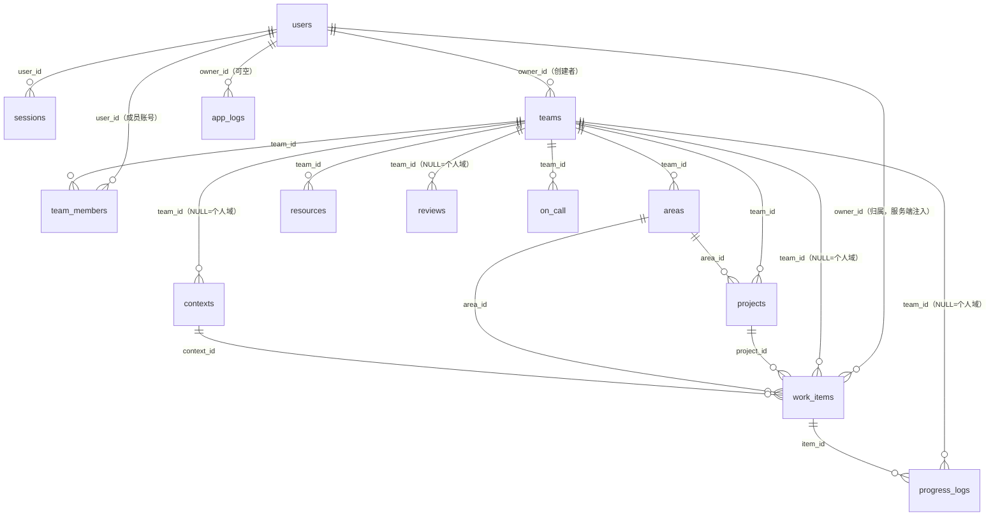
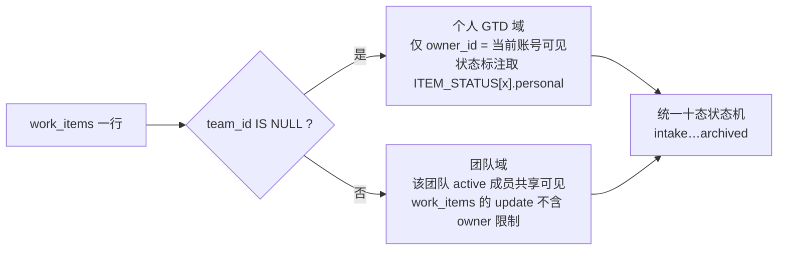
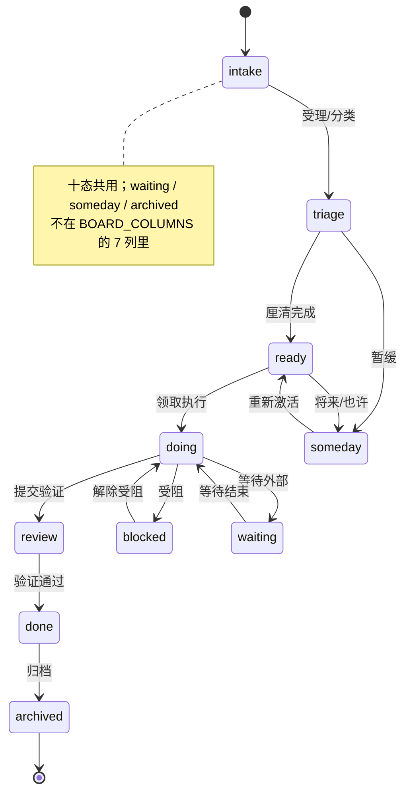
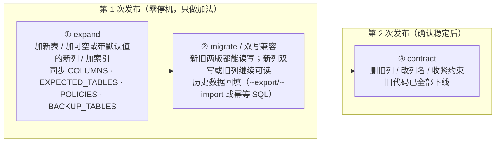

# 05 · 数据模型与迁移规范

> GTD4Teams 治理体系重建 · 数据建模师（库清源）编制
> 版本：**v1.2**（v1.0 2026-11-13 首版；v1.1 同日补录后端定向实测交叉核对，见 §0.3 / §12.4；**v1.2 2026-11-14 新增 §13 版本化迁移层（CR-2026-001 引入，含 §13.9 主理人三项裁决记录），并补 §8.4 交叉引用**）｜ 日期：2026-11-14 ｜ 执行模式：**严格模式**
> 上位文档：`00_开发流程总纲.md`（门禁矩阵 §4、编号规则 §5.2、追溯链 §5.3、变更纪律 §7、六项必填 §9）
> 同位文档：`04_TDS` / `06_接口契约`（G1 设计阶段）、`07_测试体系`（G4）、`08_安全审计`（G5）、`09_运维手册`（G6）
> 技术依据（全部实读）：`pyapp/db.py`、`pyapp/policy.py`、`pyapp/store.py`、`pyapp/httpd.py`、`pyapp/config.py`、`js/config.js`、`js/views.js`、`server.py`、`tests/test_api.py`、`README.md`、`docs/零停机发布方案.md`、`docs/Docker部署方案.md`、`deploy/backup.sh`
> **本文性质**：「**现状规格 + 变更门禁**」，**不是重新设计**。所有表/字段/策略按代码原样记录，包括被判定为怪异或不对称的部分；凡「刻意保留」处一律标注「改动前必须先读」，不顺手修正。

---

## 0. 结论先行

| 项 | 判断 |
|---|---|
| 当前判断 | 数据层是本项目**最扎实的资产**：单一文件 SQLite + `COLUMNS` 唯一权威 + 与云版 RLS 逐条对齐的策略集 + 防漂移断言 + 幂等建库，均有代码与测试支撑。缺口不在「表设计得对不对」，而在「**结构变更没有执行路径、全量读取没有下推过滤、灾难恢复没有自动化演练**」三处。**v1.1** 经后端定向实测交叉核对，另补入三项数据面事实：日志截断可被通用写路径绕过、HTTP 导出不按可见范围过滤、导入不校验 `format`/`version` 且导入前不自动备份（行为层均由本机 P4/P5/P6 复现，见 §0.3）。 |
| 本文产出 | 14 张表逐表规格、ER 全景、双域分界、状态机与枚举、索引与查询路径、权限矩阵与四处刻意保留、`app_logs` 审计边界、**expand/contract 三阶段 + 数据库变更十项门禁 + 可填写 `CR-` 变更单**、备份恢复语义与**可勾选恢复验收清单**、测试数据策略、严格模式六项必填、未验证项，以及**后端定向实测交叉核对（§0.3 / §12.4）**。 |
| 最大风险 | **【实测·本机】「加列」类结构变更在当前机制下不会自动落库**：`schema_present()` 只按表名子集判断（`db.py:439-449`），`init_db()` 在结构已建全时直接返回（`db.py:471-472`），`CREATE TABLE IF NOT EXISTS` 不会给已存在的表补列。P3 实测：仅在 `COLUMNS` 登记新字段后重跑 `init_db`，列数仍 39、`schema_present=True`、`COLUMNS` 与 `PRAGMA` 漂移；P4 实测 `SELECT _probe_col` → `no such column: _probe_col`。这意味着**按现状发一个「加列」版本，生产库不会长出新列，应用写入随即报错**。**定性（主理人中转要求）：跳过 DDL 本身是零停机三支撑之一，是对的；缺的是版本化迁移层**（`schema_version` + `_MIGRATIONS` 顺序幂等列表），方案与双槽位执行时机见 §8.4。 |
| 是否阻塞下一步 | 不阻塞本次文档交付，但**阻塞下一次任何带表/字段/索引变更的发布**：必须先按 §8.4 补**版本化迁移层**（**不是**改回「每次重跑 DDL」）并在临时 `--data-dir` 演练，否则 G1 不予放行。与 `00` §1 一致，唯一硬阻塞仍是首次上服务器前跑 `python3 tests/test_zerodowntime.py`。 |
| 证据原则 | 用户要求「重视实测数据与证据，不接受未经验证的断言」。本文对每处结论使用 §0.1 的标记；**本次未修改任何业务代码、未对 `data/gtd4teams.db` 执行任何 DDL / `--import`**，只对真实库做了只读 PRAGMA 查询，并在系统临时目录做了隔离演练。对主理人中转的后端定向实测按「**行为结论纳入、代码引用逐条复核**」处理，4 处不一致登记为【待核对】（§0.3 / §12.4），不写成现状事实。 |

### 0.1 证据标记（与 `07` §0.1 的四态标记对齐并扩展）

| 标记 | 含义 | 本文例子 |
|---|---|---|
| 【实测·本机】 | 本次会话**实跑并留有输出**的只读查询或临时库演练 | `PRAGMA` 表/列/索引清单、`COLUMNS` vs `PRAGMA` 零漂移、加列不落库演练 |
| 【实测·引用】 | 项目既有实测记录，照录不改写 | `python server.py --check` 输出的 14 张表清单（团队下发）、49/9 项测试全绿（`README.md` §测试、`07` §0.2） |
| 【代码事实】 | 直接读源码/DDL 得出的确定结论，附 `文件:行号` | `work_items.status` 十态、`reviews_uniq_idx` 表达式唯一索引、`owner_id` 丢弃规则 |
| 【推断】 | 由代码事实推出的后果，未在真实环境复现 | 全量 `refresh()` 随数据量的增长曲线、加列后写入报 `no such column` |
| 【未验证】 | 命令从未实跑或条件不具备（本机无 Docker / 无服务器 / 无生产数据） | Linux 写锁行为、灾备「先删库再导入」在服务器演练、备份 cron |
| 【待裁决】 | 需主理人 / 用户拍板 | 见 §12.3 开放问题 |

> 【实测·引用】不等于本文作者本次跑过；本次为纯文档编制，**未重跑任何测试套件**（与 `07` §0.1 声明一致）。凡出现「全绿」均指既有记录状态。

### 0.2 本次实跑清单（可复跑，见附录 A）

| # | 命令性质 | 结论摘要 |
|---|---|---|
| P1 | 只读 `mode=ro` 连真实库 + `PRAGMA` | 14 张业务表 + `sqlite_sequence`；列数/索引与 `db.py` 一致；**所有表 `foreign_key_list` 均为 0**；`journal_mode=wal` |
| P2 | 只读校验 `COLUMNS` vs `PRAGMA table_info` | `MISMATCH=[]`（11 张业务表零漂移）；`WRITABLE_TABLES=11`、`EXPECTED_TABLES=14`；4 个唯一/表达式索引 SQL 与 DDL 逐字一致 |
| P3 | 系统临时目录隔离演练（不碰真实库、不改文件） | 仅登记新字段后重跑 `init_db` → `AFTER_COLS=39`、`HAS_NEW_COL=False`、`SCHEMA_PRESENT=True`、`COLUMNS_MINUS_PRAGMA=['__probe_col']` |
| P4 | 临时目录复现「加列后查询」（复核后端实测9） | `SELECT _probe_col FROM work_items` → `sqlite3.OperationalError: no such column: _probe_col`；`SCHEMA_PRESENT=True` |
| P5 | 只读核对权限映射覆盖（复核后端实测10） | 9 张含 `team_id` 的表 `MISSING_TEAM_KEY=[]`；11 张可写表 `MISSING_POLICIES=[]`；`TEAM_KEY` 共 10 项 → **当前无缺口** |
| P6 | 临时目录对比日志截断（复核后端实测4） | 通用写路径（`store.insert_row`，即 `/api/rows` 同一路径）写 2500 字符 → 落库 **2500（未截断）**；`write_app_log` 写 2500 字符 → 落库 **1000** |

> **v1.2 补充**：本节 P1–P6 是 v1.1 阶段的实测编号。**v1.2 新增的迁移层演练使用 M1–M9 编号**，命令与输出见 **§13.7**（可复跑），避免与本节编号冲突。

### 0.3 与后端定向实测的交叉核对（主理人中转，v1.1 补录）

主理人转交后端工程师寇豆码 17 项定向实测中与数据层相关的结论。本文按「**行为结论纳入、代码引用逐条复核**」处理：行为层结论均已用本机临时库复现（P4/P5/P6）并写入相应章节；下列 4 处**代码引用 / 命名与当前工作区不一致**，按【待核对】登记，不写成现状事实、也不擅自替对方订正。

| # | 转交表述 | 当前工作区复核 | 处理 |
|---|---|---|---|
| D1 | `store.py:336 BACKUP_TABLES` 含 `users/sessions/settings` 等 **14 张表** | `store.py:336` 为 `tuple(COLUMNS.keys()) + ('users','settings')` = **13 张、不含 `sessions`**；`store.py:346` 明确「会话表不导出」；`Docker部署方案.md:345` 同样说明会话不在备份范围 | 本文按 **13 张**写（§9.1）；差异登记于 §12.4 |
| D2 | 格式错误的备份会「先删掉现有 sessions / llm 配置再抛 `ValueError`，服务停在半途状态」 | `import_all`（`store.py:355-378`）**无删除 `sessions` 逻辑、无显式 `ValueError` 抛出点**；缺 `tables` 抛的是 `StoreError('BAD_BACKUP')`（`store.py:359`）；`INSERT OR REPLACE` 会覆盖 `settings`（含 LLM 配置） | **成立部分**「不校验 `format`/`version`」「导入前不自动备份」「counts 只报 `len(rows)`」已写入 §9.1 / §9.5；「删 sessions + ValueError」登记于 §12.4 |
| D3 | `pyapp/db.py:249-251` 定义 `LOG_TEXT_LIMIT=2000` | 全项目**零命中**；`db.py:249-251` 实为 `reviews_uniq_idx` 的注释与定义；当前只有 `db.py:386 LOG_LIMIT=400`（`progress_logs` 读取条数）；`write_app_log` 的 `message` 上限是 **1000**（`store.py:298`），实测 P6 落库 1000 | 本文按实测 **1000** 写（§7.1）；常量名/行号登记于 §12.4 |
| D4 | 存在 `test_all_tables_with_team_id_have_team_key` 防漂移断言 | 该测试名全项目**零命中**（`tests/test_api.py` 的 `StorageSpecTest` 只有 5 条，`686-782`）；`TEAM_KEY` 本身存在（`policy.py:32-43`） | 「当前无缺口」改由本机 **P5** 实测坐实（§8.5 ②）；测试名登记于 §12.4 |

> **纠偏（主理人明确要求，不得列为待修）**：`COLUMNS` 单一权威与 `test_columns_spec_matches_real_schema` 防漂移断言、`init_db` 建库幂等且不丢数据、静态白名单与目录穿越拦截、双进程共库前提（`test_zerodowntime.py` 9 项全绿）**均已实测成立**。本文一律作为**既有纪律 / 资产**记录（§8.7、§8.8），不在 §11.1 风险清单中列为缺陷。

---

## 1. 文档控制与术语

### 1.1 文档定位与维护规则

对齐 `00` §5.1：

| 项 | 值 |
|---|---|
| 编号 / 文件名 | `05` / `05_数据模型与迁移规范.md` |
| 责任角色 | 数据建模师（`00` §5.1） |
| **更新触发条件** | **任何表 / 字段 / 索引变更**（`00` §5.1 第 90 行）；此外备份恢复语义、`COLUMNS` kind、策略集变更也必须同步更新 |
| 所属门禁 | **G1 设计**（与 `03 FDS` / `04 TDS` / `06 接口契约` 同批，`00` §4 第 51、68 行） |
| G1 对本文件的判定标准 | 数据表变更**含迁移 SQL + 回滚 SQL + 兼容性分析**（`00` §4 第 68 行）；缺回滚 SQL 即 G1 不通过 |
| 本文在 `00` §9 的落点 | **数据库回滚 SQL**、数据侧风险清单、数据侧测试用例、迁移验收标准、日志监控点、失败处理方案 |
| 一致性巡检 | 每季度与代码做一次一致性巡检，漂移记入 `01_现状评估与改善路线图.md`（`00` §8） |

> **本文不是一份「建议改成什么样」的设计稿，而是「现在是什么样 + 要改必须走哪道门」的规格书。** 任何与本文描述不一致的「顺手修正」都必须先开 `CR-` 变更单。

### 1.2 编号规则与追溯链对齐（`00` §5.2 / §5.3）

本文自身**不新造编号前缀**，全部沿用总纲：

| 前缀 | 含义 | 本文中的用法 |
|---|---|---|
| `REQ-` | 需求 | 结构变更必须挂到某条 `REQ-`（见变更单 §8.6） |
| `BR-` | 业务规则 | 双域分界、权限取舍、状态机规则登记为 `BR-` |
| `EX-` | 异常场景 | 被拦返回空数组、`--import` 叠加覆盖等登记为 `EX-` |
| `TC-` | 测试用例 | §10.3 / §11.2 给出建议用例名，编号归 `07` |
| `ACC-Gn-` | 阶段验收单 | 迁移验收挂 `ACC-G1`（设计）、`ACC-G4`（测试）、`ACC-G6`（上线） |
| `BUG-` | 缺陷 | 漂移/迁移事故登记 |
| `CR-` | 需求变更单 | **任何表/字段/索引变更必须先开 `CR-`**（`00` §7.1），模板见 §8.6 |
| `APP_VERSION` | 版本串 | 结构变更常伴随前后端改动，四处同步（`00` §7.2） |
| `GTD_BUILD` | 构建标识 | 切流前核对新槽位 `/api/health` 回传（`00` §7.5） |

追溯链中本文件的位置（`00` §5.3 原图）：

```
REQ-xxx → BR-xxx / EX-xxx → FDS 页面·流程 → TDS 模块 → 接口契约 /api/xxx
                                                  │
                                                  ▼
                                    【05 数据模型：表·字段·索引·迁移】
                                                  │
                                                  ▼
                            TC-xxx → ACC-Gn-xxx → GTD_BUILD → 线上验证
```

**最低要求**：一次结构变更至少要能追到「一条 `BR-` 规则 + 一处 `db.COLUMNS` / DDL 实现 + 一条 `TC-` 用例 + 一张 `ACC-G1` 验收单」；追不到视为未完成（`00` §5.3）。

### 1.3 术语表

| 术语 | 定义 | 证据 |
|---|---|---|
| **双域** | 个人 GTD 域与团队域共用同一张 `work_items`：`team_id IS NULL` = 个人（仅本人可见），非空 = 团队（本团队成员共享） | `policy.py:11-12`、`README.md:85` |
| **归属列 `owner_id`** | `COLUMNS` 中 kind=`owner` 的列；客户端提交值**一律丢弃**，由服务端注入 `ctx.uid`（云版靠列默认 `auth.uid()` 的本地等价物） | `db.py:294, 570-583`、`store.py:113-115` |
| **COLUMNS 规格表** | **唯一权威**：驱动可写字段白名单、类型归一化、JSON 编解码；键集合必须严格等于 `PRAGMA table_info` 列集合 | `db.py:19-21, 300-375`、`test_api.py:686-697` |
| **kind** | `pk / owner / int / real / bool / text / date / ts / json / jsonarr / stamp`，见 §3.15 | `db.py:292-298` |
| **逻辑外键** | 有关联字段但**无 `FOREIGN KEY` 约束**；SQLite 实测 `foreign_key_list` 全为 0 | 【实测·本机】P1 |
| **逻辑备份** | `--export` 产出的纯 JSON（非 `.db` 文件拷贝） | `store.py:339-352`、`deploy/backup.sh:67-73` |
| **expand / contract** | 加列/加表 → 双写兼容 → 删列的破坏性变更拆多次发布 | `00` §7.3、`零停机发布方案.md:281-310` |
| **槽位（蓝/绿）** | `app-blue` / `app-green` 双进程**共用一个库文件** | `README.md:120-130`、`零停机发布方案.md:41-74` |
| **被拦下返回 0 行** | 更新/删除未过策略时返回空数组且不抛异常，应用层须显式提示 | `policy.py:13-14`、`store.py:142, 155` |

### 1.4 与上下游文档的接口（避免重复写、明确谁引用谁）

| 对象 | 本文提供给对方的输入 | 对方需要回填给本文的 |
|---|---|---|
| `04_TDS`（架构师） | §2 实体关系、§6 权限字段、§8 并发 DDL 纪律 | 部署拓扑中槽位与数据卷的绑定描述 |
| `06_接口契约`（架构师） | §3 逐表可写字段白名单（`WRITABLE_TABLES` 11 张）、§6 被拦返回空数组的响应形状 | `/api/data/:table` 的错误码与空数组语义 |
| `07_测试体系`（QA） | §10.3 `TC-MIG-*`、§10.4 `TC-BAK-*`（含新增 `TC-BAK-006/007`）与 `TC-LOG-001/002`、§11.2 六类用例清单、§0.2 实测清单（P1~P6）、G1-04 判定口径 | 用例编号、G1-04 数据模型评审勾选（`07` §205 行已引用本文） |
| `08_安全审计`（安全） | §6.4 越权用例 V1~V14、§7.3 脱敏要求、**§7.3 / R12：`GET /api/export` 只要求登录即返回全库，导出结果必须按可见范围过滤、敏感表不得经 HTTP 返回**、**§7.1 / R11：通用 `/api/rows` 可绕过日志截断** | 越权用例执行结论、`GET /api/export` 是否列 G5 阻塞项（§12.3 Q8）、G5 放行结论 |
| `09_运维手册`（运维） | §9 备份恢复 SOP、§9.4 校验 SQL（含 `format`/`version` 前置校验命令）、**§9.5 可勾选恢复验收清单**（先删库文件 / 导入前强制自动备份 / 校验 format / 覆盖·跳过计数）、§8.2 发布时序、**§8.4 迁移只能由新槽位在承载流量前执行** | 服务器上实际演练记录、备份 cron 实跑输出、恢复验收清单签字 |
| `后端现状审查`（后端） | §0.3 / §12.4 的 **D1~D4 待核对项**（备份表清单 13 vs 14、格式错误行为、`LOG_TEXT_LIMIT`、防漂移断言名）；§8.4 版本化迁移层方案（`schema_version` + `_MIGRATIONS`） | 原始实测输出 / 订正引用；版本化迁移层实现排期（§12.3 Q2、Q7） |
| `01_现状评估`（主理人） | §0 结论先行的三项优先改进、§12 未验证项、§0.3 交叉核对结论 | 季度一致性巡检的漂移记录 |

---

## 2. 实体关系全景

### 2.1 表清单（【实测·本机】P1 + 【实测·引用】`--check` 输出）

```
app_logs, areas, contexts, on_call, progress_logs, projects, resources,
reviews, sessions, settings, sqlite_sequence, team_members, teams, users, work_items
```

共 **14 张业务表 + 1 张系统表 `sqlite_sequence`**（由 `INTEGER PRIMARY KEY AUTOINCREMENT` 自动产生，非手工创建，不登记进 `EXPECTED_TABLES`，`test_api.py:715` 明确排除 `sqlite_` 前缀）。

按职责分三组：

| 组 | 表 | 数量 | 是否开放通用 CRUD |
|---|---|---:|---|
| 身份与运行支撑 | `users`、`sessions`、`settings` | 3 | **否**（`WRITABLE_TABLES` 不含，`db.py:377-378`） |
| 团队与成员 | `teams`、`team_members` | 2 | 是 |
| 业务数据 | `work_items`、`projects`、`areas`、`contexts`、`resources`、`progress_logs`、`reviews`、`on_call`、`app_logs` | 9 | 是（`app_logs` 特殊：策略只允许 insert） |

`EXPECTED_TABLES = ('users','sessions','settings') + WRITABLE_TABLES`，共 14（`db.py:382`）。【实测·本机】P2 确认 `EXPECTED_TABLES=14`、`WRITABLE_TABLES=11`。

### 2.2 ER 全景（Mermaid）

> **关系全部是逻辑关联**：【实测·本机】P1 对 14 张表逐一执行 `PRAGMA foreign_key_list`，结果**全部为 0**，即没有任何 `FOREIGN KEY` 约束；级联、存在性校验由应用层承担（`store.py:166-205` 用事务保证团队+成员原子创建）。图中连线仅表示「字段指向」，不代表数据库级约束。



`settings` 为独立键值表，无关联（主键 `key`，`db.py:61-67`）。

**双域分界**（`work_items` / `contexts` / `progress_logs` / `reviews` 的 `team_id` 可空，`db.py:108, 189, 223, 239`）：



### 2.3 归属 / 状态 / 软删除 / 审计字段矩阵

> 逐表「关键字段」以 `db.py` 的 `COLUMNS` 为准（§3 每表给出指向行号）；本表只标**治理相关字段**。`✔`=存在，`—`=无，`可空`=允许 NULL。

| 表 | `owner_id`（归属） | `team_id`（域/团队键） | 状态 / 软删字段 | `created_at` | `updated_at` | 证据 |
|---|:---:|:---:|---|:---:|:---:|---|
| `users` | —（主键 `id` 即账号） | — | — | ✔ | ✔ | `db.py:35-43` |
| `sessions` | —（`user_id` 指向账号） | — | `expires_at` / `last_seen_at` | ✔ | — | `db.py:48-56` |
| `settings` | —（主键 `key`） | — | — | — | ✔ | `db.py:61-66` |
| `teams` | ✔ `NOT NULL` | 自身 `id` 即团队键 | `archived`（软删） | ✔ | ✔ | `db.py:71-84` |
| `team_members` | —（`user_id` 即成员账号） | ✔ `NOT NULL` | `status`（active 才有效）/ `role` | ✔ | ✔ | `db.py:90-102` |
| `work_items` | ✔ `NOT NULL` | **可空（双域分界）** | `status` 十态 / `completed_at` / `flagged` / `is_next` | ✔ | ✔ | `db.py:106-146` |
| `projects` | ✔ `NOT NULL` | ✔ `NOT NULL` | `status` | ✔ | ✔ | `db.py:151-168` |
| `areas` | ✔ `NOT NULL` | ✔ `NOT NULL` | `archived`（软删）/ `criticality` | ✔ | ✔ | `db.py:171-184` |
| `contexts` | ✔ `NOT NULL` | **可空（双域分界）** | `kind` | ✔ | ✔ | `db.py:187-196` |
| `resources` | ✔ `NOT NULL` | ✔ `NOT NULL` | `archived` / `pinned` / `criticality` | ✔ | ✔ | `db.py:199-218` |
| `progress_logs` | ✔ `NOT NULL` | **可空** | `kind` | ✔ | — | `db.py:221-232` |
| `reviews` | ✔ `NOT NULL` | **可空** | `kind` / `period_key` / `completed_at` | ✔ | ✔ | `db.py:237-248` |
| `on_call` | ✔ `NOT NULL` | ✔ `NOT NULL` | `status` / `slot` / `shift_date` | ✔ | ✔ | `db.py:254-269` |
| `app_logs` | **可空**（未登录也能留日志） | — | `level` / `scope` / `event` | ✔ | — | `db.py:272-283` |

**审计字段现状**：11 张业务表都有 `created_at`，其中 8 张有 `updated_at`；**没有 `deleted_at` / `deleted_by` / 变更前值快照 / 操作者 IP**。`archived` / `status` 承担业务软删，但不等价于审计留痕（详见 §7.2）。

---

## 3. 逐表规格（14 张，全量）

> 通用约定（**不再逐表重复**）：
> - 业务表的**可写字段白名单、类型归一化、JSON 编解码一律以 `db.COLUMNS` 为唯一权威**（`db.py:19-21, 300-375`）；下表「证据」列给出该表在 `COLUMNS` 中的行号。
> - 写入时 `id`（pk）、`owner_id`（owner）、`created_at`/`updated_at`（stamp）、以及未知字段一律被 `split_payload()` 丢弃（`db.py:565-591`）；`owner_id` 由 `store.insert_row()` 注入 `ctx.uid`（`store.py:113-115`）。
> - 所有表**无物理外键**（【实测·本机】P1 `foreign_key_list=0`）；下表「外键与关联」均为逻辑指向。
> - 权限策略要点取自 `pyapp/policy.py` 的 `POLICIES`（`224-267`），完整矩阵见 §6.2。

### 3.1 `users` — 账号

| 要素 | 内容 |
|---|---|
| 用途 | 本地自持身份源，取代云平台托管身份（`db.py:34`） |
| 主键 | `id TEXT PRIMARY KEY`（非自增，字符串账号 ID） |
| 关键字段 | `email TEXT NOT NULL`、`name`、`password_hash TEXT NOT NULL`、`created_at`、`updated_at` |
| 外键与关联 | 被 `teams.owner_id` / `team_members.user_id` / `work_items.owner_id` / `sessions.user_id` / `app_logs.owner_id` 逻辑指向 |
| 归属判定 | **不参与通用 CRUD**（`WRITABLE_TABLES` 不含，`db.py:377-378`）；由 `security.py` 与 `httpd.py` 认证路径直接读写 |
| 权限策略要点 | 不在 `POLICIES` 中；`email` 大小写不敏感唯一 `users_email_uniq ON users(lower(email))`（`db.py:44`）；**邮箱是账号标识，成员行里永远 readonly**（团队下发约定） |
| 约束 | `password_hash` NOT NULL；存 PBKDF2-HMAC-SHA256（含独立随机盐与参数，`README.md:75`） |
| 证据 | `db.py:35-45`；索引 `db.py:44`；认证写入 `httpd.py:550-575` |

### 3.2 `sessions` — 会话

| 要素 | 内容 |
|---|---|
| 用途 | 只存令牌的 **SHA-256 散列**，库被读走也无法直接冒用登录态（`db.py:47`, `README.md:76`） |
| 主键 | `token_hash TEXT PRIMARY KEY` |
| 关键字段 | `user_id TEXT NOT NULL`、`created_at`、`expires_at`、`last_seen_at` 均 NOT NULL，`user_agent` 可空 |
| 外键与关联 | `user_id → users.id`（逻辑） |
| 归属判定 | 不开放通用 CRUD；`last_seen_at` 按 **300 秒节流**刷新，刷新失败只当记账失败不让请求变 500（`零停机发布方案.md:157-166`） |
| 权限策略要点 | 不在 `POLICIES`；**不进备份范围**（`store.py:336, 346`）——令牌是短暂凭据，恢复后所有人需重新登录 |
| 约束 | 索引 `sessions_user_idx(user_id)`（`db.py:57`）；改密后只保留当前一个会话（`README.md:105`） |
| 证据 | `db.py:48-58`；`store.py:336, 346`；`config.py:64-66` |

### 3.3 `settings` — 键值配置

| 要素 | 内容 |
|---|---|
| 用途 | LLM 凭据等运行期设置，避免让用户改环境变量（`db.py:60`） |
| 主键 | `key TEXT PRIMARY KEY` |
| 关键字段 | `value TEXT NOT NULL`、`updated_at TEXT NOT NULL` |
| 外键与关联 | 无 |
| 归属判定 | 不开放通用 CRUD；由 `store.get_setting / set_setting / delete_setting` 访问（`store.py:313-329`），`set_setting` 用 `ON CONFLICT(key) DO UPDATE` 幂等 upsert |
| 权限策略要点 | 不在 `POLICIES`；**进备份范围**（`BACKUP_TABLES`，`store.py:336`）——因此备份 JSON **可能含 LLM API Key**，属敏感文件（§7.3） |
| 约束 | `value` NOT NULL，空值以 `''` 落库（`store.py:322`） |
| 证据 | `db.py:61-67`；`store.py:313-329, 336` |

### 3.4 `teams` — 团队

| 要素 | 内容 |
|---|---|
| 用途 | 团队空间；`join_code` 是自助加入唯一凭证 |
| 主键 | `id INTEGER PRIMARY KEY AUTOINCREMENT` |
| 关键字段 | `owner_id NOT NULL`、`owner_name`、`name`、`description`、`mission`、`join_code`、`board_config(json)`、`sla_config(json)`、`archived(bool, 默认 0)`、`created_at`、`updated_at` |
| 外键与关联 | `owner_id → users.id`；**`TEAM_KEY['teams']='id'`**（policy.py:33，团队键是自身 id 而非 team_id） |
| 归属判定 | 创建者即 owner；成员关系建立后团队数据才对创建者可见 |
| 权限策略要点 | `select` = owner 或本团队成员；`insert` = `owner_id` 是本人；`update` = owner 或 admin；`delete` = **仅 owner**（`policy.py:136-150`） |
| 约束 | `teams_join_code_uniq`：**大小写不敏感 + 部分唯一** `ON teams(upper(join_code)) WHERE join_code IS NOT NULL AND join_code <> ''`（`db.py:86-87`）；`teams_owner_idx(owner_id)`（`db.py:88`）。建团队与建 owner 成员行**同一事务**（`store.py:166-205`） |
| 证据 | `db.py:71-88`；`COLUMNS` `db.py:301-306`；`policy.py:136-150`；`store.py:166-205, 219-221` |

### 3.5 `team_members` — 团队成员关系

| 要素 | 内容 |
|---|---|
| 用途 | 成员关系 + 角色 + 岗位 + 并行容量；是 `is_team_member` 的事实来源 |
| 主键 | `id INTEGER PRIMARY KEY AUTOINCREMENT` |
| 关键字段 | `team_id NOT NULL`、`user_id NOT NULL`、`email`、`display_name`、`role(默认 'member')`、`title`、`capacity REAL 默认 6`、`status(默认 'active')`、`created_at`、`updated_at` |
| 外键与关联 | `team_id → teams.id`；`user_id → users.id` |
| 归属判定 | **不以 `owner_id` 判定**（本表无 owner_id）；`load_context()` 用 `SELECT team_id, role, status FROM team_members WHERE user_id=?` 构造 `AuthzContext`（`policy.py:304-319`），且是**受信任的内部读取**，绕过本表自身策略 |
| 权限策略要点 | `select` = 本人 `user_id` 或该团队成员；`insert` = admin 或 owner；`update.using` = admin 或本人；`update.check` = admin **或**（本人且 `role` 未变，防自行提权）；`delete` = `role != 'owner'` 且（admin 或本人）（`policy.py:153-178`） |
| 约束 | `team_members_team_user_uniq(team_id, user_id)` 唯一（`db.py:103`）；`team_members_user_idx`（`db.py:104`）。**`status != 'active'` 视为非成员**（`policy.py:315-318`）。**成员建立只有两条合法路径**：① 创建团队时创建者自动成为 owner（`store.py:191-195`）；② 本人登录后凭邀请码 `join_team_by_code`（`store.py:208-251`）。**不提供「输入邮箱直接添加成员」**；`email` 是账号标识，建立后 readonly，owner/admin 只可改 `role` / `title` / `capacity` / `status` |
| 证据 | `db.py:90-104`；`COLUMNS` `db.py:307-312`；`policy.py:153-178, 304-319`；`store.py:166-205, 208-251` |

### 3.6 `work_items` — 工作项（双域共用，核心表）

| 要素 | 内容 |
|---|---|
| 用途 | **个人 GTD 事项与团队工作项共用一张表**，统一十态状态机（`db.py:106`、`config.js:14, 31-48`） |
| 主键 | `id INTEGER PRIMARY KEY AUTOINCREMENT`；**39 列**（【实测·本机】P1/P2） |
| 关键字段 | `team_id`（**可空 = 双域分界**）、`owner_id NOT NULL`、`title`、`notes`、`item_type(默认 'routine')`、`status(默认 'intake')`、`priority(默认 'p3')`、`swimlane(默认 'planned')`、`assignee_id/name`、`reviewer_id`、`project_id` / `area_id` / `context_id`、`source/impact/urgency`、`sla_due_at`、`responded_at`、`start_date`、`due_date`、`recurrence(json)`、`est_hours`/`actual_hours`(REAL)、`progress(默认 0)`、`last_update`、`blocked_reason`、`waiting_for`、`flagged`/`is_next`(bool)、`kanban_order(REAL 默认 0)`、`tags(jsonarr)`、`completed_at`、`created_at`、`updated_at`、`focus_date`、`gtd_note`、`reported_by` |
| 外键与关联 | `team_id → teams.id`（可空）；`project_id → projects.id`；`area_id → areas.id`；`context_id → contexts.id`；`owner_id / assignee_id / reviewer_id → users.id`（全部逻辑） |
| 归属判定 | **双域**：`team_id IS NULL` → `owner_id == ctx.uid`；`team_id` 非空 → `ctx.is_member(team_id)`（`policy.py:79-85`） |
| 权限策略要点 | `select` = 个人域本人 / 团队域成员；`insert` = `_own_writable`（归属本人 + 个人域或本团队成员）；**`update.using` 与 `update.check` 都是 `_personal_or_member`，不含「owner_id 必须是我」**（`policy.py:227-236`）——团队成员必须能推进别人建的工单；`delete` = `_personal_or_member` |
| 约束 | 索引 `work_items_team_idx` / `work_items_owner_idx` / `work_items_status_idx`（`db.py:147-149`）；`tags` 为 JSON 数组文本、`recurrence/board_config` 类为 JSON 对象文本（`db.py:319, 323`） |
| 证据 | `db.py:106-149`；`COLUMNS` `db.py:313-326`；`policy.py:227-236`；状态枚举 `config.js:37-48` |

### 3.7 `projects` — 项目

| 要素 | 内容 |
|---|---|
| 用途 | 项目汇总（Run/Build 两类，`config.js:93-96`） |
| 主键 | `id INTEGER PRIMARY KEY AUTOINCREMENT`；16 列 |
| 关键字段 | `team_id NOT NULL`、`owner_id NOT NULL`、`name`、`description`、`status(默认 'active')`、`kind(默认 'build')`、`lead_id/lead_name`、`area_id`、`due_date`、`color(默认 '#14867a')`、`progress`、`sort_order`、`created_at`、`updated_at` |
| 外键与关联 | `team_id → teams.id`；`area_id → areas.id`；被 `work_items.project_id` 指向 |
| 归属判定 | **纯团队表**（`team_id NOT NULL`）：`_member_only` |
| 权限策略要点 | `select` / `insert` = 团队成员；`update` = `_member_update`（using/check 均为成员）；`delete` = `_admin_or_row_owner`（admin 或本行 owner，`policy.py:237-240`） |
| 约束 | `projects_team_idx(team_id)`（`db.py:169`）；`status` 枚举见 `config.js:98-104` |
| 证据 | `db.py:151-169`；`COLUMNS` `db.py:327-332`；`policy.py:237-240` |

### 3.8 `areas` — 责任领域

| 要素 | 内容 |
|---|---|
| 用途 | 稳定的责任面（服务域），默认 7 个（`config.js:129-137`） |
| 主键 | `id INTEGER PRIMARY KEY AUTOINCREMENT`；12 列 |
| 关键字段 | `team_id NOT NULL`、`owner_id NOT NULL`、`name`、`description`、`criticality(默认 'normal')`、`steward_id/name`、`archived(bool)`、`sort_order`、`created_at`、`updated_at` |
| 外键与关联 | `team_id → teams.id`；被 `work_items.area_id`、`projects.area_id` 指向 |
| 归属判定 | 纯团队表：`_member_only` |
| 权限策略要点 | `select`/`insert` = 成员；`update` = `_member_update`；`delete` = **仅 admin**（`policy.py:241-245`） |
| 约束 | `areas_team_idx(team_id)`（`db.py:185`）；`archived` 为业务软删 |
| 证据 | `db.py:171-185`；`COLUMNS` `db.py:334-339`；`policy.py:241-245` |

### 3.9 `contexts` — 情境

| 要素 | 内容 |
|---|---|
| 用途 | GTD 情境在运维场景 = 可用工作模式/工具（`config.js:114-126`） |
| 主键 | `id INTEGER PRIMARY KEY AUTOINCREMENT`；8 列 |
| 关键字段 | **`team_id` 可空（双域分界）**、`owner_id NOT NULL`、`name`、`kind(默认 'mode')`、`sort_order`、`created_at`、`updated_at` |
| 外键与关联 | `team_id → teams.id`（可空）；被 `work_items.context_id` 指向 |
| 归属判定 | 双域：`_personal_or_member` |
| 权限策略要点 | `select` = 个人域本人 / 团队域成员；`insert` = `_own_writable`；**`update.using` = `_personal_or_member`，但 `update.check` = `_own_writable`（含 `owner_id = 本人`）** —— 非创建者改不动团队情境，这是云版遗留形状，**如实保留**（`policy.py:246-254`）；`delete` = `_personal_or_member` |
| 约束 | **只有 `contexts_owner_idx(owner_id)`，没有 `team_id` 索引**（`db.py:197`）——见 §5.5 |
| 证据 | `db.py:187-197`；`COLUMNS` `db.py:340-344`；`policy.py:246-254`；`README.md:89` |

### 3.10 `resources` — 资源台账

| 要素 | 内容 |
|---|---|
| 用途 | 文档/链接/工具/资产/凭据位置台账（`config.js:83-90`） |
| 主键 | `id INTEGER PRIMARY KEY AUTOINCREMENT`；18 列 |
| 关键字段 | `team_id NOT NULL`、`owner_id NOT NULL`、`kind(默认 'doc')`、`title`、`category`、`url`、`description`、`tags(jsonarr)`、`custodian_id/name`、`criticality(默认 'normal')`、`review_due`、`meta(json)`、`pinned`、`archived`、`created_at`、`updated_at` |
| 外键与关联 | `team_id → teams.id` |
| 归属判定 | 纯团队表：`_member_only` |
| 权限策略要点 | `select`/`insert` = 成员；`update` = `_member_update`；`delete` = `_admin_or_row_owner`（`policy.py:255-258`） |
| 约束 | `resources_team_idx(team_id)`（`db.py:219`）；`kind='credential'` 只记「凭据位置」而非凭据本身（`config.js:89`）——**不得在 `meta`/`url` 里落明文密钥**（§7.3） |
| 证据 | `db.py:199-219`；`COLUMNS` `db.py:345-352`；`policy.py:255-258` |

### 3.11 `progress_logs` — 进度记录

| 要素 | 内容 |
|---|---|
| 用途 | 工作项进度/动态留痕；`load_workspace` 中唯一被限流拉取的表 |
| 主键 | `id INTEGER PRIMARY KEY AUTOINCREMENT`；10 列 |
| 关键字段 | `team_id`（**可空**）、`owner_id NOT NULL`、`author_name`、`item_id`、`item_title`、`kind(默认 'progress')`、`progress`、`note`、`created_at` |
| 外键与关联 | `team_id → teams.id`（可空）；`item_id → work_items.id`（逻辑，删除工作项**不级联**） |
| 归属判定 | 双域：`select` = `_personal_or_member`；`insert` = `_own_writable` |
| 权限策略要点 | `update.using`/`check` = **仅 `owner_id == ctx.uid`**；`delete` = owner 或（`ctx.is_admin(team_id)`）（`policy.py:181-193`） |
| 约束 | **3 个索引**：`progress_logs_team_idx` / `progress_logs_item_idx` / `progress_logs_created_idx`（`db.py:233-235`）；`DEFAULT_ORDER['progress_logs']=('created_at','DESC')`（`db.py:385`）；`LOG_LIMIT=400`（`db.py:386`），在 `load_workspace` 以 `limit=LOG_LIMIT` 传入（`store.py:98`） |
| 证据 | `db.py:221-235, 385-386`；`COLUMNS` `db.py:353-357`；`policy.py:181-193`；`store.py:98` |

### 3.12 `reviews` — 复盘

| 要素 | 内容 |
|---|---|
| 用途 | 周/月复盘，同一 (账号, 团队, 类型, 周期) 只保留一条 |
| 主键 | `id INTEGER PRIMARY KEY AUTOINCREMENT`；10 列 |
| 关键字段 | `team_id`（**可空**）、`owner_id NOT NULL`、`kind(默认 'weekly')`、`period_key NOT NULL 默认 ''`、`notes`、`stats(json)`、`completed_at`、`created_at`、`updated_at` |
| 外键与关联 | `team_id → teams.id`（可空） |
| 归属判定 | 双域：`select` = `_personal_or_member`；`insert` = `_own_writable` |
| 权限策略要点 | `update.using`/`check` = 仅 owner；`delete` = 仅 owner（`policy.py:196-205`） |
| 约束 | **`reviews_uniq_idx` 表达式唯一索引**：`UNIQUE ON reviews (owner_id, COALESCE(team_id, 0), kind, period_key)`（`db.py:251-252`，【实测·本机】P2 读到 SQL 逐字一致）；`save_review()` 保留「先查后写」语义，重复提交即更新（`store.py:258-283`） |
| 证据 | `db.py:237-252`；`COLUMNS` `db.py:358-362`；`policy.py:196-205`；`store.py:258-283` |

### 3.13 `on_call` — 值班排班

| 要素 | 内容 |
|---|---|
| 用途 | 值班矩阵与交接单（`config.js:107-112, 151-159`） |
| 主键 | `id INTEGER PRIMARY KEY AUTOINCREMENT`；14 列 |
| 关键字段 | `team_id NOT NULL`、`owner_id NOT NULL`、`shift_date(date) NOT NULL`、`slot(默认 'day')`、`primary_id/name`、`backup_id/name`、`notes`、`handover_notes`、`status(默认 'planned')`、`created_at`、`updated_at` |
| 外键与关联 | `team_id → teams.id`；`primary_id`/`backup_id → users.id`（逻辑） |
| 归属判定 | 纯团队表：`_member_only` |
| 权限策略要点 | `select`/`insert` = 成员；`update` = `_member_update`；`delete` = **仅 admin**（`policy.py:261-265`） |
| 约束 | `on_call_team_idx(team_id)`（`db.py:270`）；**`(team_id, shift_date, slot)` 没有唯一约束**，重复排班由应用层负责（【推断】，未在代码中发现去重断言） |
| 证据 | `db.py:254-270`；`COLUMNS` `db.py:363-369`；`policy.py:261-265` |

### 3.14 `app_logs` — 运行日志

| 要素 | 内容 |
|---|---|
| 用途 | 结构化运行日志（前端上报 + 服务端留痕）；详见 §7 |
| 主键 | `id INTEGER PRIMARY KEY AUTOINCREMENT`；10 列 |
| 关键字段 | `owner_id`（**可空**）、`level`、`scope`、`event`、`message`、`detail(json)`、`page_url`、`user_agent`、`created_at NOT NULL` |
| 外键与关联 | `owner_id → users.id`（可空，允许未登录留痕） |
| 归属判定 | `select` = `owner_id == ctx.uid`（**只看自己的日志**）；`insert` = `owner_id in (ctx.uid, None, '')`（本人或空，不允许替他人写）；`update`/`delete` = **恒 `deny`**（`policy.py:208-221`） |
| 权限策略要点 | **只写不改不删**，避免掩盖故障证据（`policy.py:220`）；`write_app_log()` 对所有字段做长度截断，且 `detail` 仅接受 dict（`store.py:290-306`） |
| 约束 | `app_logs_created_idx(created_at)`（`db.py:284`）；**无保留期/清理策略**（§7.2）；【实测·本机】P2 本机真实库 `app_logs=3` 行，其余 13 张表均 0 行（近空库） |
| 证据 | `db.py:272-284`；`COLUMNS` `db.py:370-374`；`policy.py:208-221`；`store.py:290-306` |

### 3.15 `COLUMNS` 规格的 `kind` 语义（写入契约）

`db.py:292-298` 定义，是「允许写入哪些字段、按什么类型归一化」的唯一依据：

| kind | 语义 | 写入行为 |
|---|---|---|
| `pk` | 自增主键 | **丢弃**（`split_payload` 直接跳过） |
| `owner` | 归属列 | **一律丢弃**，由 `store.insert_row()` 注入 `ctx.uid` |
| `stamp` | 时间戳（`created_at`/`updated_at`） | **丢弃**，由服务端维护 |
| `int` / `real` | 整数 / 浮点 | `encode_value()` 强转；失败返回 `None`（`db.py:547-558`） |
| `bool` | 0/1 | 字符串 `'1'/'true'/'yes'/'on'` → 1，其余 → 0（`db.py:543-546`） |
| `json` / `jsonarr` | 对象 / 数组，落 TEXT | `json.dumps`，读取时 `decode_row()` 还原；解析失败回退 `None` / `[]`（`db.py:494-513, 525-542`） |
| `text` / `date` / `ts` | 文本 / `YYYY-MM-DD` / ISO8601 | 统一 `str()`（`db.py:559-562`）——**注意：`date`/`ts` 不做格式校验** |

> **类型归一化的理由**（`db.py:516-521`）：SQLite 动态类型下若 `progress` 被写成字符串 `'50'`，`WHERE progress > 10` 会静默给出错误结果。因此「不要绕过 `COLUMNS` 直接拼 SQL」是一条数据完整性纪律。

### 3.16 完整性约束汇总（【实测·本机】P2 读到索引 SQL）

| 约束 | 定义 | 证据 |
|---|---|---|
| 邮箱唯一（大小写不敏感） | `UNIQUE ON users(lower(email))` | `db.py:44` |
| 邀请码唯一（大小写不敏感 + 部分索引） | `UNIQUE ON teams(upper(join_code)) WHERE join_code IS NOT NULL AND join_code <> ''` | `db.py:86-87` |
| 成员关系唯一 | `UNIQUE (team_id, user_id)` | `db.py:103` |
| 复盘唯一（表达式索引） | `UNIQUE (owner_id, COALESCE(team_id,0), kind, period_key)` | `db.py:251-252` |
| 无 `FOREIGN KEY` | 14 张表 `PRAGMA foreign_key_list` 全 0 | 【实测·本机】P1 |
| 无 `CHECK` 约束 / 无枚举约束 | DDL 中未出现；状态合法性仅前端下拉约束 | `db.py:70-285`、`views.js:1438` |

`SQLITE` 自动索引：`sqlite_autoindex_users_1` / `sqlite_autoindex_sessions_1` / `sqlite_autoindex_settings_1`（由 `TEXT PRIMARY KEY` 产生）；`INTEGER PRIMARY KEY AUTOINCREMENT` 是 rowid 别名，不产生自动索引（【实测·本机】P1 的 `index_list` 结果与此一致）。

---

## 4. 状态机与枚举

### 4.1 `work_items.status` 十态（【代码事实】`js/config.js:37-48`）

| 状态 | 团队视角（Kanban） | 个人视角（GTD，来自 `ITEM_STATUS[x].personal`） |
|---|---|---|
| `intake` | 待受理 | 收集箱 |
| `triage` | 待分类 | 待厘清 |
| `ready` | 待办 | 下一步行动 |
| `doing` | 处理中 | 执行中 |
| `review` | 待验证 | 待复核 |
| `blocked` | 受阻 | 受阻 |
| `waiting` | 等待外部 | 等待他人 |
| `someday` | 暂缓 | 将来/也许 |
| `done` | 已完成 | 已完成 |
| `archived` | 已归档 | 已归档 |

**两套标注只是同一枚举的不同文案**（`config.js:31-35`），数据库只存一个 `status` 列，默认 `'intake'`（`db.py:113`）。个人视角靠前端 `ITEM_STATUS[x].personal` 换标注，**不改数据**。

### 4.2 允许迁移图（**UI 约束，非后端校验**）

`BOARD_COLUMNS = ['intake','triage','ready','doing','review','blocked','done']`（`config.js:51`），顺序即看板流转方向；`DEFAULT_WIP` 给出各列上限（`config.js:54-62`：`triage=2`、`doing=5`、`review=3`、`ready=8`、`blocked=5`、`intake=99`、`done=0`）。



> **重要**：上图的箭头是**依据 `BOARD_COLUMNS` 顺序与 GTD 语义整理的推断**（【推断】），**不是代码里实现的状态机**。项目里没有一份「允许迁移表」（【实测·本机】全局检索 `VALID_STATUS` / `ALLOWED` / `STATUS_FLOW` 均无命中）。见 §4.5。

### 4.3 其它枚举（全部【代码事实】，均只在前端定义）

| 枚举 | 取值 | 落库列 / 默认值 | 证据 |
|---|---|---|---|
| 工作项类型 | `routine, inspection, request, incident, problem, change, project_task`（7 种，带默认泳道 lane） | `work_items.item_type` 默认 `routine` | `config.js:21-29`、`db.py:112` |
| 优先级 | `p1(4h) / p2(8h) / p3(24h) / p4(72h)`（ITIL 影响×紧急度简化） | `work_items.priority` 默认 `p3` | `config.js:68-73`、`db.py:114` |
| 泳道 | `planned` / `unplanned`（由 `ITEM_TYPES.lane` 决定） | `work_items.swimlane` 默认 `planned` | `config.js:19, 22-28`、`db.py:115` |
| 项目状态 | `active, waiting, someday, done, archived` | `projects.status` 默认 `active` | `config.js:98-104`、`db.py:157` |
| 项目性质 | `build` / `improve` | `projects.kind` 默认 `build` | `config.js:93-96`、`db.py:158` |
| 团队角色 | `owner / admin / member` | `team_members.role` 默认 `member` | `config.js:76-80`、`db.py:96` |
| 成员状态 | `active` 及非 active（停用即失去访问权） | `team_members.status` 默认 `active` | `db.py:99`、`policy.py:315-318` |
| 资源类型 | `runbook, doc, link, tool, asset, credential`（6 种） | `resources.kind` 默认 `doc` | `config.js:83-90`、`db.py:203` |
| 情境类别 | `mode / place / energy / tool`（默认 7 个情境） | `contexts.kind` 默认 `mode` | `config.js:118-126`、`db.py:192` |
| 领域关键度 | `high / normal`（默认 7 个领域） | `areas.criticality`、`resources.criticality` 默认 `normal` | `config.js:129-137`、`db.py:177, 211` |
| 值班班次 | `day, night, weekend, holiday` | `on_call.slot` 默认 `day` | `config.js:107-112`、`db.py:259` |
| 值班状态 | `planned`（DDL 默认值；前端未给出完整枚举） | `on_call.status` 默认 `planned` | `db.py:266` |
| 复盘类型 | `weekly`（DDL 默认值） | `reviews.kind` 默认 `weekly` | `db.py:241` |
| 进度记录类型 | `progress`（DDL 默认值） | `progress_logs.kind` 默认 `progress` | `db.py:228` |
| 日志级别 | `info`（`write_app_log` 缺省值，`level` 截断 16 字符） | `app_logs.level` | `store.py:295` |

> **如实标注**：`on_call.status`、`reviews.kind`、`progress_logs.kind`、`app_logs.level` 在 `js/config.js` **没有对应常量表**，只有 DDL 默认值与 `store.py` 缺省值；其完整取值集合【未验证】，不得凭常识补全。

### 4.4 校验落点判定表（区分「已验证 / 推断」）

| 判定 | 结论 | 证据 |
|---|---|---|
| 【实测·本机】 | 全局检索 `ITEM_STATUS / VALID_STATUS / ALLOWED / STATUS_FLOW`：`ITEM_STATUS` **只出现在 `js/config.js`、`js/views.js`**；后端 `pyapp/` 无任何枚举白名单 | 全局 Grep 结果 |
| 【代码事实】 | HTTP 写入路径只校验 `payload` 是 dict，随后直接 `store.insert_row` / `store.update_row`，**无字段级枚举校验** | `httpd.py:659-666` |
| 【代码事实】 | `store.update_row()` 只做「取原行 → `split_payload` 白名单/类型归一化 → `can_update` 权限判定 → 执行」；`status` 的 kind 是 `text`，`encode_value` 只做 `str()` | `store.py:130-147`、`db.py:559-562` |
| 【代码事实】 | 状态输入由前端 `<select id="f-status">` 用 `Object.keys(ITEM_STATUS)` 生成，属于 **UI 约束** | `views.js:1438` |
| 【推断】 | 因此**任意状态跃迁（含非法值）都能通过 API 直接写入**；`work_items.status` 十态与 `BOARD_COLUMNS` 七列的一致性完全依赖前端，绕过 UI 即无防护 | 由上三条推出 |
| 【代码事实】 | 被策略拦下的更新返回 `[]`，前端 `assertAffected()` 据此提示「可能不存在或不在你可见范围内」 | `store.py:142, 155`、`js/app.js:347` |
| 【实测·引用】 | QA 在 `07` §覆盖矩阵 #2/#3 已把「10 态全流转路径、非法状态跃迁的边界用例」「列间流转、WIP 上限触发与拦截」标为**缺口（🟡/❌）** | `07:129-130` |

> **给 QA 的直接输入**：状态机目前**没有服务端状态机**，只有枚举常量 + UI 下拉。若要补 TC，应按「后端拒绝非法值」还是「承认这是 UI 约束并只测写入往返」先做产品决策——这属于【待裁决】开放问题（§12.3），不要默认按「应该加校验」来写用例。

---

## 5. 索引与查询路径

### 5.1 现有索引清单（【实测·本机】P1 `PRAGMA index_list` + P2 索引 SQL）

| 表 | 索引 | 字段 / 表达式 | 类型 | 理由 | 证据 |
|---|---|---|---|---|---|
| `users` | `users_email_uniq` | `lower(email)` | UNIQUE（表达式） | 邮箱大小写不敏感唯一 | `db.py:44` |
| `users` | `sqlite_autoindex_users_1` | `id` | 自动（PK） | TEXT PRIMARY KEY | P1 |
| `sessions` | `sessions_user_idx` | `user_id` | 普通 | 改密时按用户清理会话 | `db.py:57` |
| `sessions` | `sqlite_autoindex_sessions_1` | `token_hash` | 自动（PK） | 令牌散列查会话 | P1 |
| `settings` | `sqlite_autoindex_settings_1` | `key` | 自动（PK） | 键值读取 | P1 |
| `teams` | `teams_join_code_uniq` | `upper(join_code)` + 部分条件 | UNIQUE（表达式+部分） | 邀请码不重复、不冲突 | `db.py:86-87` |
| `teams` | `teams_owner_idx` | `owner_id` | 普通 | 按创建者查团队 | `db.py:88` |
| `team_members` | `team_members_team_user_uniq` | `(team_id, user_id)` | UNIQUE | 防止重复成员行 | `db.py:103` |
| `team_members` | `team_members_user_idx` | `user_id` | 普通 | **`load_context()` 每请求按 user_id 取成员关系** | `db.py:104`、`policy.py:310-312` |
| `work_items` | `work_items_team_idx` | `team_id` | 普通 | 团队域筛选 | `db.py:147` |
| `work_items` | `work_items_owner_idx` | `owner_id` | 普通 | 个人域筛选 | `db.py:148` |
| `work_items` | `work_items_status_idx` | `status` | 普通 | 看板按状态分组 | `db.py:149` |
| `projects` | `projects_team_idx` | `team_id` | 普通 | 团队项目 | `db.py:169` |
| `areas` | `areas_team_idx` | `team_id` | 普通 | 团队领域 | `db.py:185` |
| `contexts` | `contexts_owner_idx` | `owner_id` | 普通 | 个人域情境 | `db.py:197` |
| `resources` | `resources_team_idx` | `team_id` | 普通 | 团队资源 | `db.py:219` |
| `progress_logs` | `progress_logs_team_idx` | `team_id` | 普通 | 团队动态 | `db.py:233` |
| `progress_logs` | `progress_logs_item_idx` | `item_id` | 普通 | 按工作项查动态 | `db.py:234` |
| `progress_logs` | `progress_logs_created_idx` | `created_at` | 普通 | 时间倒序 | `db.py:235` |
| `reviews` | `reviews_uniq_idx` | `(owner_id, COALESCE(team_id,0), kind, period_key)` | UNIQUE（表达式） | 同周期只留一条 + 并发兜底 | `db.py:251-252` |
| `on_call` | `on_call_team_idx` | `team_id` | 普通 | 团队排班 | `db.py:270` |
| `app_logs` | `app_logs_created_idx` | `created_at` | 普通 | 日志按时间查 | `db.py:284` |

合计 **19 个显式索引 + 3 个 PK 自动索引 = 22**（【实测·本机】P1 逐表 `index_list` 求和一致）。

### 5.2 高频查询路径（【代码事实】）

| 路径 | SQL / 调用 | 用到索引？ | 证据 |
|---|---|---|---|
| **工作区全量刷新 `refresh()`** | `load_workspace()` → 对 10 张表各调 `select_table()` → `_fetch_all()` 执行 `SELECT * FROM {table}`（**无 WHERE、无 ORDER BY、无 LIMIT**）→ Python 逐行 `can_select()` 过滤 → 内存排序 → 切片 | **否，全表扫描** | `store.py:43-44, 64-79, 82-99` |
| 每请求权限上下文 | `load_context()`：`SELECT team_id, role, status FROM team_members WHERE user_id=?` | ✅ `team_members_user_idx` | `policy.py:310-312` |
| 按 id 取单行 | `_fetch()`：`SELECT * FROM {table} WHERE id=?` | ✅ rowid / PK | `store.py:38-40` |
| 凭邀请码加入 | `SELECT * FROM teams WHERE upper(join_code)=? AND archived=0` | ✅ `teams_join_code_uniq`（表达式匹配） | `store.py:219-221` |
| 重复加入检查 | `SELECT id, status FROM team_members WHERE team_id=? AND user_id=?` | ✅ 唯一索引 | `store.py:226-229` |
| 复盘先查后写 | `SELECT id FROM reviews WHERE owner_id=? AND COALESCE(team_id,0)=? AND kind=? AND period_key=?` | ✅ `reviews_uniq_idx` | `store.py:274-278` |
| 设置读取 | `SELECT value FROM settings WHERE key=?` | ✅ PK | `store.py:313-315` |
| 整库导出 | `export_all()`：对 13 张表各 `SELECT * FROM {table}` | 全表扫描（备份场景可接受） | `store.py:339-352` |

### 5.3 全量 `refresh()` 的增长风险（核心性能结论）

**【代码事实】** `select_table()` 的注释明确说明设计取向（`store.py:64-70`）：

> 「这里在 Python 里逐行判策略而不是把策略编译成 SQL……本应用的数据体量是『一个小团队的工单』，并且前端本来就是一次性把整个工作区拿进内存（`loadWorkspace`），没有额外开销。」

由此推出【推断】：

1. **所有 19 个显式索引在 `refresh()` 路径上形同虚设**：SQL 是 `SELECT * FROM {table}`，没有任何 `WHERE`，优化器只能全表扫描；索引只服务于上面 §5.2 中「按 id / 按 user_id / 按 join_code / 按 period_key」的点查。
2. **写放大随数据量线性增长**：一次刷新 = 10 张表全量读出 + 10 次 Python 逐行策略判定 + 10 次全量 JSON 编解码（`decode_row` 对每行每列做 `COLUMNS` 查表与类型转换，`db.py:494-513`）+ 前端整体重建内存态。团队工单数 N 增长时，成本 ≈ O(10·N)，且**每个已登录用户的每次刷新都重算一遍**。
3. **`progress_logs` 的 `LOG_LIMIT=400` 是在过滤之后截断**（`store.py:77-78` 先 `visible` 全量排序再 `[:limit]`），因此 `progress_logs_created_idx` 与 `DEFAULT_ORDER` 都无法减少读取量；日志表越大，每次刷新越慢。`app_logs` 不在 `load_workspace` 里（`store.py:88-99` 未包含），所以它的增长不直接影响刷新，但影响备份体积与磁盘（§7.2）。
4. **蓝绿双进程共库时，全表读会与另一槽位的写同时发生**：WAL 让读不阻塞写，但两个进程同时刷新会放大 I/O 与 Python CPU；`test_zerodowntime.py` 验证的是「并发写 40 次零失败」，**未验证大数据量下的刷新耗时**（`07` §0.2 A3 / §15 兼容性）。

> 【实测·本机】P2：本机 `data/gtd4teams.db` 是近空库（13 张表 0 行，`app_logs` 3 行），**无法据此推断生产数据量**。以上增长曲线属结构推断，不是本机压测结论；真正的量级需在服务器上用真实数据量测（§12.2）。

### 5.4 N+1 与关联风险点

| 风险 | 说明 | 证据 |
|---|---|---|
| 无 JOIN、前端内存关联 | `load_workspace()` 返回 10 个平铺数组（`teams/members/items/...`），`js/app.js` 的 `state.data` 在前端按 id 自行关联；后端不做联表，故**不存在 SQL 层 N+1**，但存在「10 次独立全表查询」的往返放大 | `store.py:82-99`、`README.md:209` |
| `load_context()` 每请求一次 | 每个已认证请求都要查一次成员关系（受信任内部读取），走 `user_id` 索引，成本可控但仍是固定开销 | `policy.py:304-319` |
| 逻辑外键无存在性校验 | `work_items.project_id/area_id/context_id` 指向的行被删除后，不会级联也不会报错，前端出现「悬空引用」 | 【实测·本机】P1 无外键；`store.py:150-159` 只删本行 |
| `contexts` 缺 `team_id` 索引 | 只有 `contexts_owner_idx`；团队情境按 `team_id` 判可见性，但因全表扫描目前无影响；一旦把过滤下推到 SQL 就会成为缺口 | `db.py:197`、`policy.py:246-254` |
| `progress_logs.item_id` 无级联 | 删工作项后动态记录保留 `item_id`/`item_title` 快照，属有意设计（留痕），但需明确不是 bug | `db.py:226-227` |

### 5.5 零依赖约束下的优化建议（**建议，未实施；不引入 ORM / 缓存中间件**）

> 前提：项目明确「零第三方依赖」（`README.md:28`、`Docker部署方案.md:36`），且 `select_table()` 选择「Python 逐行判策略以便与 RLS 逐条对照」（`store.py:67-69`）。以下建议**只加索引 / 改 SQL**，保持 `policy.py` 作为唯一权限语义来源。

| 优先级 | 建议 | 做法 | 兼容性 |
|---|---|---|---|
| P1 | 把「可见范围」下推到 SQL 的粗筛 | `select_table()` 先按 `ctx.uid` 与 `memberships` 生成 `WHERE owner_id=? OR team_id IN (...)` 的**粗筛**，再对结果逐行跑 `can_select()` 做精确判定。粗筛只减少读取量，**不改变策略语义**；索引 `work_items_owner_idx` / `*_team_idx` 才真正生效 | 纯加法，双槽位兼容 |
| P1 | `progress_logs` 的 LIMIT 下推 | `SELECT * FROM progress_logs WHERE <粗筛> ORDER BY created_at DESC LIMIT 400`（用上 `progress_logs_created_idx`），替代「全表读进内存再切片」 | 纯读路径改动，不改表结构 |
| P2 | 复合索引 | `CREATE INDEX IF NOT EXISTS work_items_team_status_idx ON work_items(team_id, status)`、`work_items_owner_status_idx`、`progress_logs_team_created_idx` —— 服务于看板分组与时间倒序；**必须先按 §8.5 走十项门禁**（新增索引属「加法」，可直接发） | `00` §7.3 允许 |
| P2 | `contexts` 补 `team_id` 索引 | `CREATE INDEX IF NOT EXISTS contexts_team_idx ON contexts(team_id)`，与双域判定对齐 | 加法 |
| P3 | `app_logs` 保留策略 | 定时 `DELETE FROM app_logs WHERE created_at < ?`（配合 `app_logs_created_idx`），或按行数保留；避免备份体积与磁盘无限增长（`Docker部署方案.md:495` 已指出增长主要来自 `app_logs`） | 需变更单 + 演练 |
| P3 | 增量刷新（后续增强版，**本期不做**） | 按 `updated_at` 做增量拉取；但会改动接口契约与前端 `state.data` 形状，属于跨 `06`/`04` 的破坏性变更，必须走 expand/contract | `00` §10 明确「不要跳到增强版」 |

> 所有建议均为**【推断】层面的设计选项**，本次未实施、未压测、未验证收益；落地前须按 §8.6 开 `CR-` 并补性能基线用例。

---

## 6. 数据权限字段

### 6.1 归属字段全景

| 字段 | 出现位置 | 作用 | 注入/判定 |
|---|---|---|---|
| `owner_id` | 11 张业务表（除 `team_members`） | **数据归属**：个人域可见性、`insert` 归属校验 | `COLUMNS` kind=`owner`；写入一律丢弃客户端值，由 `store.py:113-115` 注入 `ctx.uid` |
| `team_id` | **9 张表含 `team_id` 列**（`team_members / work_items / projects / areas / contexts / resources / progress_logs / reviews / on_call`）；`TEAM_KEY` 共 **10 项**，第 10 项是 `teams`（用自身 `id` 作团队键，`policy.py:32-43`）。【实测·本机】P5：`MISSING_TEAM_KEY=[]` | **域/团队键**：`NULL`=个人域，非空=团队域 | `ctx.is_member(team_id)`；成员关系来自 `load_context()` |
| `user_id` | `sessions`、`team_members` | 账号标识 / 成员标识 | `AuthzContext` 构造、`team_members.select` 的「本人那一行」 |
| `role` / `status` | `team_members` | admin/owner 判定；`status != 'active'` 视为非成员 | `policy.py:56-63, 315-318` |

> **云版对照**（`db.py:16-17`、`policy.py:5-7`）：PG 里 `owner_id` 默认值是 `auth.uid()`，SQLite 没有这个概念，**等价防线就是「客户端给什么都不采纳」**。这不是可以简化的冗余检查。

### 6.2 `policy.py` 逐表可见/写入规则矩阵（【代码事实】`POLICIES`, `policy.py:224-267`）

记号：`POM` = `_personal_or_member`（个人域本人 / 团队域成员）；`MO` = `_member_only`（仅团队成员）；`OW` = `_own_writable`（归属本人 + 个人域或成员）；`AOO` = `_admin_or_row_owner`（admin 或本行 owner）；`MU` = `_member_update`（using/check 均 MO）；`OWN` = `owner_id == ctx.uid`；`ADM` = `ctx.is_admin(team_id)`。

| 表 | select | insert | update.using | update.check | delete | 证据 |
|---|---|---|---|---|---|---|
| `teams` | owner 或成员 | owner 是本人 | owner 或 admin | owner 或 admin | **仅 owner** | `136-150` |
| `team_members` | 本人或团队成员 | admin 或 owner | admin 或本人 | admin 或（本人且 `role` 不变） | `role != 'owner'` 且（admin 或本人） | `153-178` |
| `work_items` | POM | OW | **POM（不含 owner）** | **POM（不含 owner）** | POM | `227-236` |
| `projects` | MO | MO | MO（MU） | MO（MU） | AOO | `237-240` |
| `areas` | MO | MO | MO（MU） | MO（MU） | **仅 admin** | `241-245` |
| `contexts` | POM | OW | **POM** | **OW（含 owner）** | POM | `246-254` |
| `resources` | MO | MO | MO（MU） | MO（MU） | AOO | `255-258` |
| `progress_logs` | POM | OW | OWN | OWN | OWN 或 admin | `181-193` |
| `reviews` | POM | OW | OWN | OWN | OWN | `196-205` |
| `on_call` | MO | MO | MO（MU） | MO（MU） | **仅 admin** | `261-265` |
| `app_logs` | OWN | `owner_id ∈ (uid, None, '')` | **deny** | **deny** | **deny** | `208-221` |

> `update` 拆两段，对应 SQL 的 `USING` 与 `WITH CHECK`（`policy.py:27-30`）：`using` 判「这一行当前是否允许被我改动」，`check` 判「改动之后的行是否仍合法」（例如把个人情境挪到自己不在的团队）。`can_update()` 要求两段同时为真（`policy.py:295-297`）。
> `users` / `sessions` / `settings` **不在 `POLICIES`**，也不在 `WRITABLE_TABLES`（`db.py:377-378`），由认证/配置专用路径访问。

### 6.3 四处「刻意保留」取舍（**改动前必须先读**）

> 团队下发文概括的「四处」指**权限策略层**的四条；`README.md:83-90` 实列**六条**（另两条是模型层约定）。本文**六条全列并分组**，以免遗漏或误判为 bug 被「顺手修好」。`00` §2 已把这类取舍列为「决策 → 实现断链」的头号风险。

**A 组 · 权限策略层（四处）**

| # | 取舍 | 为什么保留 | 证据 |
|---|---|---|---|
| A1 | **`work_items` 的 update 不含 `owner_id = 我`** | 团队成员必须能推进别人建的工单，否则**看板流转当场失效** | `policy.py:230-234`、`README.md:88` |
| A2 | **`contexts` 的 update.check 含 `owner_id = 我`** | 云版原有策略形状，与 A1 **不对称**，但「差异本身就是需要被记录的事实」，如实保留，未顺手修好 | `policy.py:249-252`、`README.md:89` |
| A3 | **更新/删除被拦下返回 0 行 / 空数组且不报错** | 与 RLS 语义一致；前端 `assertAffected()` 靠「空数组 = 没改到」如实提示，**不能假装成功** | `policy.py:13-14`、`store.py:6-9, 142, 155, 156` |
| A4 | **`team_members.status != 'active'` 视为非成员** | 有意收紧：云版只要成员行存在就仍可访问，与「停用即失去访问权限」的产品语义矛盾；前端 `saveMember` 确认弹窗就是这么承诺的 | `policy.py:17-21, 315-318`、`README.md:90`、`store.py:231-239` |

**B 组 · 数据模型层（两条）**

| # | 约定 | 证据 |
|---|---|---|
| B1 | **双域共用一张 `work_items`**：`team_id IS NULL` = 个人域（仅本人可见），非空 = 团队域（成员共享）；个人视角只换 `ITEM_STATUS[x].personal` 标注 | `policy.py:11-12`、`config.js:14, 31-48`、`README.md:85` |
| B2 | **写入永不携带 `owner_id`**：客户端提交值一律丢弃，归属由服务端注入 | `db.py:570-583`、`store.py:113-115`、`README.md:86` |

**成员关系的两条合法建立路径**（同样容易「顺手加功能」破坏）：① 创建团队时创建者自动成为 owner（`store.py:166-205`）；② 本人登录后凭邀请码 `join_team_by_code`（`store.py:208-251`）。**不提供「输入邮箱直接添加成员」**——会把成员行错误绑定到填写者账号。成员建立后 owner/admin 可改 `role` / `title` / `capacity` / `status`；**邮箱是账号标识，永远 readonly**。

### 6.4 越权用例必须覆盖的边界（**供 `08` 安全审计直接引用**）

| # | 边界 | 期望 | 依据 |
|---|---|---|---|
| V1 | 个人域 `team_id IS NULL` 的行，非 owner 读/改/删 | 全部被拦；改/删返回 `[]` 且 HTTP 不报错 | `policy.py:79-85` |
| V2 | A 团队成员读/写 B 团队的 `work_items/projects/areas/resources/on_call` | 被拦且返回 `[]` | `policy.py:88-91` |
| V3 | payload 携带伪造 `owner_id` | 被 `split_payload` 丢弃，落库为 `ctx.uid` | `db.py:581-583`、`test_api.py:249` |
| V4 | 直接按 id 枚举他人行 `PUT /api/data/work_items/{id}` | 先取原行 → `can_update` 失败 → `[]` | `store.py:130-142` |
| V5 | **团队成员改他人创建的工单** | **必须允许**（这是正常业务，不是越权） | A1 |
| V6 | **非创建者改团队情境 `contexts`** | **必须被拒**（update.check 含 owner） | A2 |
| V7 | 被停用成员（`status != active`）读取团队数据 / 凭邀请码自助恢复 | 全部失去可见性；自助恢复返回 `MEMBER_DISABLED 403` | A4、`store.py:231-239` |
| V8 | 非管理员改自己的 `role` 提权 | `update.check` 拒绝（且不得报错，返回 `[]`） | `policy.py:169-170` |
| V9 | 删除 `role='owner'` 的成员行 | 恒拒 | `policy.py:174-176` |
| V10 | `app_logs` 通过接口 update / delete、或替他人写日志 | 恒拒；insert 仅允许 `owner_id ∈ (uid, None, '')` | `policy.py:208-221` |
| V11 | `progress_logs` / `reviews` 由非 owner 改 | 恒拒（update.using/check 仅 OWN） | `policy.py:181-205` |
| V12 | `areas` / `on_call` 由非 admin 删 | 恒拒 | `policy.py:244, 264` |
| V13 | `teams` 由非 owner 删 | 恒拒 | `policy.py:147-148` |
| V14 | 未登录写 `/api/data/*`、`/api/export` | 401（`Origin`/`Content-Type` 双重校验） | `test_api.py:625-631`、`README.md:96-97` |

> 「被拦下不报错」这一条会让「用 HTTP 状态码判断越权是否成功」的用例失效：**必须断言响应体是空数组**，而不是断言 4xx（`policy.py:13-14`）。这是给 `08` 与 `07` 最容易被忽略的一条。

---

## 7. 审计与运行日志

### 7.1 `app_logs` 实际记录什么（【代码事实】）

`write_app_log()`（`store.py:290-306`）写入 9 个字段，且**全部做长度截断**，避免前端把异常堆栈整段灌进库：

| 字段 | 来源 / 截断 | 说明 |
|---|---|---|
| `owner_id` | `ctx.uid or None` | **可空**：允许「登录前就失败」的场景留日志（`policy.py:213`） |
| `level` | 缺省 `info`，截断 16 | |
| `scope` | 缺省 `app`，截断 64 | |
| `event` | 截断 120 | |
| `message` | 截断 1000 | |
| `detail` | **仅接受 dict**（否则写 `{}`），以 JSON 落库 | 不接收任意字符串/堆栈 |
| `page_url` / `user_agent` | 各截断 300 | |
| `created_at` | `db.now_iso()`，UTC 秒精度带 `Z` | `db.py:395-400` |

策略上**只写不改不删**（`policy.py:220`），`select` 只看自己的日志。`app_logs` **不在** `load_workspace()` 的 10 个键里（`store.py:88-99`），但在备份范围 `BACKUP_TABLES` 内（`store.py:336`）。

**⚠️ 截断只覆盖专用上报路径，通用写路径可绕过（【实测·本机】P6，复核后端定向实测4）**

| 写入路径 | 入口 | 截断 | 实测：写入 2500 字符 `message` 后落库长度 |
|---|---|---|---|
| `store.write_app_log()` | `POST /api/log` → `h_log`（`httpd.py:711-723`），**允许未登录**，带 `log\|IP` 限流（`httpd.py:717-720`） | ✅ 逐字段截断 `16 / 64 / 120 / 1000 / 300`，`detail` 仅接受 dict（`store.py:290-306`） | **1000** |
| `store.insert_row(..., 'app_logs', ...)` | `POST /api/rows` → `h_rows`（`httpd.py:648-671`），**要求登录**（`_require_user`, `httpd.py:654`） | ❌ 只校验 `payload` 是 dict（`httpd.py:659-661`）；`split_payload` 对 `text` kind 仅做 `str()`（`db.py:559-562`），**无长度上限** | **2500（未截断）** |

即：**已登录用户**可经通用 `/api/rows` 把任意长度文本写进 `app_logs.message`（以及 `page_url` / `user_agent` / `detail`），绕过 `write_app_log` 的截断。这是**数据完整性与存储膨胀**风险（长文本进库 → 备份 JSON 与磁盘放大），**不是匿名越权**（`h_rows` 有 `_require_user`）。转交中提到的 `LOG_TEXT_LIMIT=2000` 常量在当前工作区不存在，实际 `message` 上限是 `1000`，见 §0.3 D3。建议把长度约束**下沉到 `db.encode_value()` 或 `app_logs` 写入拦截**，使两条路径一致（【建议，未实施】；若落地须按 §8.5 开 `CR-`，属改写入契约而非表结构）。

其它日志源分工见 `Docker部署方案.md:292-299`：进程输出用 `docker compose logs`、Docker 日志限 `10MB×3`、Caddy 访问日志在卷内。

### 7.2 缺什么（【代码事实】+【推断】）

| 缺口 | 影响 | 依据 |
|---|---|---|
| **无业务表变更审计** | `work_items` / `teams` / `team_members` 的「谁在什么时候把什么从 A 改成 B」无法追溯；`updated_at` 只记时间不记操作者与旧值 | §2.3 审计字段矩阵 |
| 无 `actor` / 请求 ID / 关联 ID | 跨表、跨请求排障无法串联 | `app_logs` 字段清单 `db.py:272-283` |
| 无 `deleted_at` / 删除留痕 | `delete_row()` 是物理 `DELETE`（`store.py:157`），删了就没了，只能靠备份找回 | `store.py:150-159` |
| 无日志保留期 / 清理 | `app_logs` 只增不减；`Docker部署方案.md:495` 已指出磁盘增长主要来自它和 SQLite 库 | `db.py:272-284` |
| 无 `updated_at` 的 3 张表 | `sessions` / `progress_logs` / `app_logs` 只有 `created_at`，无法做增量刷新（§5.5 P3 的前置障碍） | §2.3 |
| 日志完整性依赖前端上报 | 服务端自身异常主要落在 `docker compose logs`，不在 `app_logs` | `Docker部署方案.md:296-299` |
| **截断可被通用写路径绕过** | 已登录用户经 `POST /api/rows` 可写入无上限文本，专用 `write_app_log` 的截断形同半设防；长文本直接放大库与备份体积 | 【实测·本机】P6；`httpd.py:648-671`、`store.py:290-306` |

> **定性**：`app_logs` 是**运行/前端事件日志**，不是**审计日志表**。若未来要满足「谁改了什么」的可追溯要求，需新增独立审计表（append-only + 旧值快照 + actor），属于新建表（加法，可按 §8.2 直接发），并须同步 **`SCHEMA_SQL` / `COLUMNS` / `TEAM_KEY`（若含 `team_id`）/ `POLICIES` 四处**，另评估 `EXPECTED_TABLES` / `BACKUP_TABLES`（§8.5 ②）。其中 `EXPECTED_TABLES` 漏登记会被 `test_expected_tables_are_all_created` 抓到（`test_api.py:699-718`），而 `TEAM_KEY` 漏登记**当前没有对应自动断言**（§0.3 D4），只能靠变更单人工勾选——这正是 §8.5 ② 把它列为硬检查项的原因。

### 7.3 敏感信息脱敏要求（供 `08` / `09`）

| 载体 | 敏感内容 | 要求 | 依据 |
|---|---|---|---|
| 备份 JSON | **`users.password_hash`**（PBKDF2 串）、`settings` 中可能存的 **LLM API Key**、`team_members.email`、`app_logs.page_url/user_agent/message` | 文件权限 `600`、**不入版本库 / 不进镜像 / 不放公开目录**；异地容灾自行同步到对象存储并加密 | `store.py:344`、`deploy/backup.sh:75-76`、`Docker部署方案.md:289` |
| `sessions` | 只存令牌 **SHA-256**，不存明文 | 保持现状；**会话表不导出** | `db.py:47`、`store.py:336, 346` |
| `resources` (`kind='credential'`) | 设计上只记「凭据位置」 | **不得**在 `url` / `description` / `meta` 里落明文口令或密钥 | `config.js:89` |
| `app_logs.detail` / `message` | 前端可能上报异常、URL 参数 | 已有长度截断，但**无关键字脱敏**；建议在 `write_app_log` 增加对 `token/password/apiKey/authorization` 的过滤（【建议，未实施】） | `store.py:290-306` |
| AI 密钥 | `GET /api/llm/config` 只回答「配没配 + 模型 + 端点」，连掩码都不给 | 保持；`test_api.py:642-656` 有断言 | `README.md:106` |
| **`GET /api/export`（HTTP 导出）** | `h_export` 只做 `_require_user`（`httpd.py:726-728`），直接 `store.export_all(conn)` 返回**全库 13 张表**，含 `users.password_hash` 与 `settings`（可能含 LLM 密钥），**不按可见范围过滤** | **导出结果必须按可见范围过滤，敏感表不得经 HTTP 返回**；与 `08` 安全审计对齐，本文不展开安全分析 | `httpd.py:726-728`、`store.py:339-352` |

> **注释与实现的一处措辞偏差（如实记录）**：`store.py:344` 注释写「其中含口令散列与会话，属于敏感文件」，但 `BACKUP_TABLES`（`store.py:336`）**不含 `sessions`**，且 `store.py:346` 明确「会话表不导出」。实际敏感点是 `users.password_hash` + `settings` 凭据，不是会话。结论：**备份仍属敏感文件**，理由要按实现写，不要照抄注释。

---

## 8. 迁移与变更规范（核心章节）

### 8.1 为什么「一次发布只做加法」

`docs/零停机发布方案.md:281-295` 给出硬约束，根因是**双槽位蓝绿期间新旧两版代码同时读写同一个库文件**：

1. **两个进程共用一个库**：`app-blue` / `app-green` 挂同一个 `gtd-data` 卷（`零停机发布方案.md:71-72`）；切流后的引流窗口内旧槽位仍在跑（`§4` 第 238-240 行）。
2. **DDL 需要写锁**：`CREATE TABLE IF NOT EXISTS` 这类语句在两进程争用下会失败，实测报 `attempt to write a readonly database`（`db.py:441-446`、`零停机发布方案.md:139-149`）。
3. **旧代码不认识新结构**：删列 / 改列名 → 旧版本 `SELECT *` 或写入立刻报错；改列语义（同名列含义变了）最危险，两个版本对同一列解读不同（`零停机发布方案.md:292-294`）。
4. **`NOT NULL` 且无默认值的新列**：旧版本写入的行会违反约束（同前表）。

因此 `00` §7.3 与 `零停机方案 §6` 一致规定：**一次发布只做加法；破坏性变更拆三次发布，或 `release.sh --stop-first`（接受短暂停机）**。

### 8.2 expand / migrate / contract 三阶段（三步两发布）



| 阶段 | 允许的操作 | 禁止的操作 | 旧版本是否仍可跑 | 证据 |
|---|---|---|---|---|
| ① expand | 新增表、新增列（可空或带默认值）、新增索引 | 删列、改列名、改列语义、`NOT NULL` 无默认值新列 | ✅ 是 | `零停机发布方案.md:287-294` |
| ② migrate / 双写 | 数据回填、双写、新旧字段并存、兼容读取 | 停止写旧列（此时还不能停） | ✅ 是 | `零停机发布方案.md:296-300` |
| ③ contract | 删旧列 / 收紧约束 | — | ❌ 否（须确认旧槽位已停） | `零停机发布方案.md:300` |

**为什么「三步」却「两发布」**：① 与 ② 同属第一次发布（① 随新版本启动生效，② 在该版本运行期间完成），③ 单独作为第二次发布。若确实要一次性完成破坏性变更，用逃生口 `sudo bash deploy/release.sh --stop-first`（先停旧槽位再起新槽位，接受几秒中断，`零停机发布方案.md:302-310`），此刻「任何时刻只有一个版本在读写这个库」。

### 8.3 变更类型兼容矩阵（照录 `零停机方案 §6` 并补充）

| 变更类型 | 能否直接发 | 说明 |
|---|---|---|
| 新增表 | ✅ | 新版本启动时建出来，旧版本完全不感知（**但必须同步 `EXPECTED_TABLES`，见 §8.8**） |
| 新增列（可空或带默认值） | ⚠️ **理论上 ✅，现状 ❌** | 旧版本 `SELECT *` 多拿一列但不消费它；**但本项目当前无自动加列路径，见 §8.4** |
| 新增索引 | ✅ | 对旧版本无影响；`CREATE INDEX IF NOT EXISTS` 幂等 |
| 删除列 / 改列名 | ❌ | 旧版本会立刻报错 |
| 改列语义（同名列含义变了） | ❌ | 最危险：两个版本对同一列解读不同 |
| `NOT NULL` 且无默认值的新列 | ❌ | 旧版本写入的行会违反约束 |
| 改 `COLUMNS` 的 kind（如 `text`→`int`） | ❌ | 会改变类型归一化与前端 JSON 形状，等同改列语义 |

### 8.4 ⚠️ 现状硬缺口：跳过 DDL 是对的，缺的是版本化迁移层（【实测·本机】P3 + P4，复核后端实测9）

**先把定性说清楚（主理人中转要求）**：`schema_present()` 命中即 `return`、**整体跳过 DDL 本身是正确的**，它是零停机发布三支撑之一——蓝绿切换时新槽位正是在旧槽位还在写入时启动，若每次启动都重跑 `CREATE TABLE IF NOT EXISTS`，两个进程会抢写锁并抛 `attempt to write a readonly database`（`db.py:440-447`、`零停机发布方案.md:139-149`）。`test_init_db_is_idempotent`（`test_api.py:733-753`）进一步把「重复启动不得重跑 DDL、不得丢数据」固化为断言。**所以修法绝不是「改回每次都重跑 DDL」**，而是在跳过 DDL 之后**补一层独立、版本化、幂等的迁移**；缺少这一层才是真正的缺口。后端定向实测9 与本机 P4 复现的是同一后果。

**代码事实链**：

1. `schema_present(conn)` 的实现是 `set(EXPECTED_TABLES).issubset({row['name'] for row in sqlite_master where type='table'})` —— **只判断「表名集合」是否为子集，完全不检查列**（`db.py:439-449`）。
2. `init_db()` 第一步就是 `if schema_present(conn): return`（`db.py:471-472`）——结构「看起来」建全就**跳过全部 DDL**，这是零停机发布刻意的设计（避免抢写锁）。
3. `SCHEMA_SQL` 全部用 `CREATE TABLE IF NOT EXISTS`（`db.py:35-285`）——**对已存在的表不会补列**；加索引同样不会生效（`CREATE INDEX IF NOT EXISTS` 也在被跳过的 `SCHEMA_SQL` 里）。
4. 项目全局检索 `ALTER TABLE` / `ADD COLUMN` / `schema_version` / `_MIGRATIONS` / 迁移框架：**零命中**（【实测·本机】全局 Grep）。唯一出现 `PRAGMA table_info` 的地方是测试断言（`test_api.py:693`）。**`schema_version` 与 `_MIGRATIONS` 是下文建议方案，不是现状**。

**隔离演练（系统临时目录，不碰真实库、不改任何文件）**

P3：

```
BEFORE_COLS= 39
AFTER_COLS= 39   HAS_NEW_COL= False   SCHEMA_PRESENT= True
COLUMNS_MINUS_PRAGMA= ['__probe_col']
CONCLUSION= 加列不会自动落库，且 COLUMNS/PRAGMA 漂移
```

P4（复核后端定向实测9，同法复现「加列后查询」）：

```
SELECT _probe_col FROM work_items
  → sqlite3.OperationalError: no such column: _probe_col
SCHEMA_PRESENT= True
```

即：模拟「新版本只登记字段规格」后重跑 `init_db`，旧库 `work_items` 仍是 39 列、`schema_present()` 仍为 `True`；随后查询/写入新列直接报 `no such column`。

**后果（【推断】+【实测·本机】P4）**：

- 只改 `DATA_SCHEMA` 与 `COLUMNS` 就发版 → **生产库不会长出新列 / 新索引**；
- `split_payload()` 会把新字段放进 writable，写入旧库时抛 `no such column`（**P4 已在查询路径实测同一报错**）；
- `test_columns_spec_matches_real_schema`（`test_api.py:686-697`）在**新库**上会通过（新库按新 DDL 建），但在**旧库 / 生产库**上必然失败 → 典型的「本地全绿、上线才炸」；
- `test_schema_present_is_false_on_empty_db`（`test_api.py:724-731`）的注释只提到「新版本新增的**表**永远不会被建出来」，**未覆盖新增列 / 新增索引**。

**建议方案（未实施；主理人中转后端建议 + 本文补充约束）**

| 步骤 | 做法 | 约束 |
|---|---|---|
| 1 | 新增 `schema_version` 表（存当前版本号），纳入 `EXPECTED_TABLES` / `BACKUP_TABLES` 与相应断言 | 属「加表」，可按 §8.2 第一次发布直接发；旧版本完全不感知 |
| 2 | `db.py` 维护 `_MIGRATIONS = [(ver, callable), ...]` **顺序幂等列表**；每个 callable 先用 `PRAGMA table_info` 判重，缺列才 `ALTER TABLE {t} ADD COLUMN ...`，缺索引才 `CREATE INDEX IF NOT EXISTS` | **只加不删（expand）**，新列必须可空或带默认值；迁移里**禁止** `DROP COLUMN` / 改列名 / 改列语义（§8.3） |
| 3 | `init_db()` 在 `schema_present()` 之后**仍执行版本检查**：读 `schema_version` → 顺序执行所有 `ver > 当前` 的 callable → 成功后原子更新版本号 | 版本检查**默认只读**（已是最新版则不产生任何写入，保持蓝绿并发安全）；真正迁移时复用现有 6 次退避重试（`db.py:467-485`）。**不要把版本检查塞进 `schema_present()` 之前**：空库/首次部署仍走原有 `SCHEMA_SQL` 一次性建表，两条路径互不干扰 |
| 4 | 每条迁移**必须成对提供回滚 SQL**，登记进 `CR-` 变更单 ⑤ | SQLite 删列受限，优先「保留新列 + 代码回滚」（§8.9、§11.3） |
| 5 | 补测试 `TC-MIG-001 / 003 / 004 / 007`（§10.3）：旧库升级、重复执行幂等、**旧库上**的 `COLUMNS` vs `PRAGMA`、双进程并发迁移 | 先在临时 `--data-dir` 演练（§10.2）后才允许进入 G1 → G2 |

> **v1.2 更新（以 §13 为准）**：上表是缺口判定阶段的「建议方案」，现已由 **§13 版本化迁移层**落地为可执行规格。其中两处细节在 v1.2 做了修正，**与上表冲突时一律以 §13 为准**：
> ① `schema_version` **必须**登记进 `EXPECTED_TABLES`（否则 `test_api.py:1179-1182` 的「建出来了但没登记」断言必红），但**不**进 `BACKUP_TABLES`（理由见 §13.1.1）；
> ② 加列的幂等判据是 `PRAGMA table_info` 判重，而**不是** `ALTER TABLE ... IF NOT EXISTS`（SQLite 不支持该语法）。
> 另：`_MIGRATIONS` 的元素形状在 §13 定为三元组 `(version, description, callable)`，不是二元组。

**迁移在双槽位共用一个库文件时的执行时机（写入上线步骤，见 §8.6 ⑧）**

- 迁移是**写操作**，只能由**新槽位在启动阶段、尚未承载流量之前**执行（对应 `零停机方案 §4` 第 4 步「启动另一个槽位，等待 healthy」）；
- 此刻旧槽位仍在服务、且可能正在写同一个库文件 → 必须靠 WAL + `busy_timeout=15000` + 6 次退避重试（`db.py:425-436, 467-485`），**旧槽位绝不能同时执行迁移**；
- 迁移**只做加法**，因此引流窗口内旧版本代码继续读写同一库不受影响（§8.1-§8.3）；
- 新槽位迁移失败 → **不切流，线上没动过**（`零停机方案.md:237-240`），按 §11.6 处置；确认新版本稳定后才在第二次发布做 contract。

> 这是本文判定的**第 1 优先数据侧改进**。它同时解释了为什么 `07` §143 行把「数据库迁移 / 表结构变更」标为 🟡 且「缺 expand/contract 三次发布、迁移 SQL + 回滚 SQL 的专项测试」。

### 8.5 数据库变更十项门禁（逐项模板，`HARD_GATES.md:26-39`）

> 硬规则：**任何表 / 字段 / 索引变更**必须开 `CR-`，并逐项填满下表；缺任一项 → **G1 不通过**（`00` §4 第 68 行：「数据库变更缺回滚 SQL」是明文阻塞条件）。

| # | 门禁项 | 必须回答的问题 | 本项目特有的填写要求 | 模板 / 证据 |
|---|---|---|---|---|
| ① | **变更目的** | 解决哪条 `REQ-` / `BR-`？不改会怎样？ | 必须给出 `REQ-xxx` 与追溯链（`00` §5.3） | `CR-` 变更单 §1 |
| ② | **影响表/字段/索引/约束** | 动到哪张表、哪个 `COLUMNS` kind、哪个索引、哪个唯一约束？ | **新增含 `team_id` 的表必须同步四处**：`SCHEMA_SQL`(DDL) / `COLUMNS` / **`TEAM_KEY`（`policy.py:32-43`）** / `POLICIES`；另需评估 `EXPECTED_TABLES` / `BACKUP_TABLES`。漏 `TEAM_KEY` 会让 `_team_of()`（`policy.py:70-72`）取不到团队键，可见性判定直接失效。**【实测·本机】P5：9 张含 `team_id` 的表 `MISSING_TEAM_KEY=[]`、11 张可写表 `MISSING_POLICIES=[]`，当前无缺口，不得报成现状缺陷** | §3.15、§8.7、§8.8、§0.3 |
| ③ | **兼容性分析** | 旧版本能否继续读写？是否属「加法」？双槽位共库期间新旧代码对同一列的解读是否一致？ | 对照 §8.3 矩阵；破坏性变更必须写明走三阶段还是 `--stop-first` | §8.1-§8.3 |
| ④ | **迁移 SQL** | 可重复执行吗？会不会抢写锁？ | 必须 `IF NOT EXISTS` / 幂等；**加列需显式 `ALTER TABLE`（§8.4）**；DDL 前先只读判断 | `migrations/`（上线阶段） |
| ⑤ | **回滚 SQL** | 怎么退回？SQLite 删列/改列支持吗？ | **SQLite 对 `DROP COLUMN` 有限制且旧版本可能不兼容**；优先「代码回滚 + 保留旧列」而非物理回滚；必要时用备份恢复（§9.3） | §11.3 |
| ⑥ | **测试数据与步骤** | 哪些 `TC-` 覆盖？在哪个库上跑？ | 用 `--data-dir` 指临时目录（§10.2）；至少含「旧库升级」「新库首建」「重复执行幂等」「旧数据不丢」 | §10.3、§11.2 |
| ⑦ | **备份方案** | 变更前备份在哪、怎么验、谁保管 | `deploy/backup.sh` 或 `--export`；`chmod 600`；确认 `BACKUP_TABLES` 含新表 | §9 |
| ⑧ | **上线步骤** | 与 `release.sh` 时序如何对齐？**迁移在哪一步执行**？ | 对照 `零停机方案 §4` 十步；**发布前自动备份是第 2 步**（失败即中止）；**迁移只能由新槽位在第 4 步「启动另一槽位、承载流量之前」执行**（§8.4），旧槽位不得同时迁移、且迁移只加不删；切流前核对 `GTD_BUILD` | §8.2、§8.4、`00` §7.5 |
| ⑨ | **验证 SQL** | 怎么证明改对了？ | `PRAGMA table_info` / `sqlite_master` / `PRAGMA integrity_check` / 行数 / `COLUMNS` vs `PRAGMA` 一致性；给出可复制命令 | §9.4、附录 A |
| ⑩ | **失败后恢复策略** | 迁移中断 / 部分成功 / 补偿 | 每请求一连接、异常时连接关闭 → 未提交事务整体丢弃（`零停机方案.md:164-166`）；必要时回滚代码 + 从备份重建 | §11.6 |

### 8.6 可直接填写的变更单模板（`CR-`）

> 嵌在本文内使用，**不另建文件**；编号规则与 `00` §5.2 一致。复制以下区块到发布说明或 `docs/process/` 下的变更记录即可。

````markdown
## CR-YYYY-NNNN · <一句话标题>

| 项 | 填写 |
|---|---|
| 变更单号 | CR-2026-____ |
| 提出 / 执行 / 复核 | ____ / ____ / ____ |
| 关联需求与规则 | REQ-____ ；BR-____ ；EX-____ |
| 关联文档 | 02 PRD □  03 FDS □  04 TDS □  **05 数据模型 ☑**  06 接口契约 □  07 测试 □  08 安全 □  09 运维 □ |
| 执行模式 | **严格模式**（命中「数据库变更 / 生产库迁移 / 备份恢复」门禁） |
| 版本串四处同步 | APP_VERSION=____ ；?v=____ ；index.html ____ ；pyapp/__init__.py ____ |
| 构建标识 | GTD_BUILD=____ |

### ① 变更目的
<为什么改；不改的后果；对应哪条 REQ/BR>

### ② 影响范围（表 / 字段 / 索引 / 约束）
- 表：____________________
- 字段（含 COLUMNS kind）：____________________
- 索引 / 唯一约束：____________________
- **新增表四处同步勾选**：SCHEMA_SQL □  COLUMNS □  **TEAM_KEY □（含 team_id 时必填）**  POLICIES □
- 附加评估：EXPECTED_TABLES □  BACKUP_TABLES □  05 本文 □
- 【实测·本机 P5】基线：9 张含 `team_id` 的表全部登记 `TEAM_KEY`、11 张可写表全部有 `POLICIES` → **当前无缺口**；本项只用于新表，不作为现状缺陷

### ③ 兼容性分析
- 变更类型（对照 05 §8.3）：□ 加表 □ 加列 □ 加索引 □ 删/改列 □ 改语义
- 旧版本能否继续读写：□ 能 □ 不能（→ 必须三阶段 / --stop-first）
- 双槽位共库风险：____________________
- 结论：□ 一次发布即可 □ 走 expand→migrate→contract 两发布 □ 用 release.sh --stop-first

### ④ 迁移 SQL（幂等）
```sql
-- 加表示例
CREATE TABLE IF NOT EXISTS ___ (...);
-- 加列示例（现状必须显式，见 05 §8.4）
-- ALTER TABLE ___ ADD COLUMN ___ TEXT;
-- 加索引示例
CREATE INDEX IF NOT EXISTS ___ ON ___ (___);
```
- 是否已处理「结构已建全跳过 DDL」：□ 是（说明：__________）

### ⑤ 回滚 SQL / 回滚方式
```sql
-- 优先「保留旧列 + 代码回滚」；物理回滚需写明 SQLite 限制与备份恢复路径
```
- 代码回滚：`sudo bash deploy/rollback.sh`（零停机，不重建镜像）
- 数据回滚：□ 不需（纯加法） □ 从备份重建（见 05 §9.3，须先删库文件）

### ⑥ 测试数据与步骤
- 演练库：`python server.py --data-dir /tmp/gtd-cr-____ --check`（临时目录，不碰真实库）
- 用例编号：TC-MIG-____ / TC-BAK-____ / TC-____（登记到 07）
- 步骤：旧库建表 → 灌样本 → 跑迁移 → 校验 → 重复跑一次验幂等 → 校验旧数据未丢

### ⑦ 备份方案
- 变更前备份：`bash deploy/backup.sh` → 文件 __________ ，权限 600 □
- 备份可还原验证：□ 已做（记录：__________）

### ⑧ 上线步骤（对照 零停机方案 §4）
1 预检 → 2 L0/L1 + **发布前自动备份** → 3 构建 → 4 起另一槽位 → 5 构建标识 + 冒烟
→ 6 打流 → 7 caddy reload 切流 → 8 引流窗口 → 9 停旧槽位 → 10 汇总
- **迁移执行时机**：□ 仅新槽位在第 4 步「启动、承载流量之前」执行版本化迁移
  □ 旧槽位不同时迁移　□ 迁移只加不删　□ 迁移失败则不切流（线上未动）
- 迁移版本号：schema_version `____` → `____`；迁移 SQL 与回滚 SQL 已登记 ④⑤ □
- GTD_BUILD 核对：□ 一致才切流

### ⑨ 验证 SQL / 命令
```sql
PRAGMA integrity_check;
SELECT name FROM sqlite_master WHERE type='table' ORDER BY name;
PRAGMA table_info(___);           -- 新列存在、类型/默认值正确
SELECT COUNT(*) FROM ___;         -- 与变更前对齐
```
- `COLUMNS` vs `PRAGMA` 一致性：`python tests/test_api.py`（StorageSpecTest）→ □ 通过
- `python server.py --check` → tables/counts → □ 通过

### ⑩ 失败后恢复策略
- 迁移中断 / 部分成功：__________（默认：连接关闭 → 未提交事务丢弃，重试或回滚代码）
- 补偿动作与负责人：__________
- 触发回滚的判定条件：__________

### 验收与放行
- [ ] G1-04 数据模型评审（07 §205）通过
- [ ] ACC-G1 设计验收单 / ACC-G4 测试验收单 / ACC-G6 上线验收单已填
- [ ] G5 安全放行（若涉及权限/敏感字段）
- 放行签字：__________  日期：__________
````

### 8.7 `COLUMNS` 与 `PRAGMA` 一致性断言的意义

`test_api.py:686-697`（`StorageSpecTest.test_columns_spec_matches_real_schema`）：

```python
for table, spec in db.COLUMNS.items():
    real = {r['name'] for r in conn.execute(f'PRAGMA table_info({table})').fetchall()}
    self.assertEqual(set(spec.keys()), real, f'{table} 的字段规格与实际列不一致')
```

意义（`db.py:19-21` 原文）：「这样手写 DDL 与规格表不可能悄悄漂移」。因为 `COLUMNS` 同时驱动**可写字段白名单、类型归一化、JSON 编解码**，一旦 DDL 与规格表不一致：

- 多一列 → 前端拿到无规格的列，`decode_row()` 走 `kind=None` 分支原样返回，视图可能空掉；
- 少一列 → `split_payload()` 允许写入不存在的列，SQL 直接报错；
- kind 改错 → 布尔/JSON 还原错误或比较静默失真（`db.py:516-521`）。

配套的另外三条防漂移断言（`test_api.py:699-753`）：`EXPECTED_TABLES` 与真实表集合严格相等（含「建出来了但没登记」的 extra 检查）、空库 `schema_present=False`、**重复建库不丢数据**。

> 【实测·本机】P2：对真实 `data/gtd4teams.db` 逐表比对 `db.COLUMNS` 与 `PRAGMA table_info`，结果 `MISMATCH=[]`，11 张业务表零漂移；4 个唯一/表达式索引的 `sqlite_master.sql` 与 `db.py` 逐字一致。**这条断言目前是有效的**——但它只在「按当前 DDL 新建的库」上必然成立，遇上 §8.4 的加列场景会在旧库上失效。

### 8.8 并发 DDL 纪律（蓝绿发布地基）

| 纪律 | 实现 | 证据 |
|---|---|---|
| **结构已建全必须跳过全部 DDL** | `schema_present()` 是**只读查询**（`SELECT name FROM sqlite_master`），不产生任何写入；`init_db()` 命中即 `return` | `db.py:439-449, 471-472` |
| 真正需要建表时带退避重试 | `init_db(attempts=6)`，线性退避 `0.25*(attempt+1)`，总计约 5 秒（短于 `busy_timeout` 的 15 秒，避免启动假死） | `db.py:452-487` |
| 连接级并发参数 | `timeout=15.0`、`PRAGMA journal_mode=WAL`、`synchronous=NORMAL`、`busy_timeout=15000` | `db.py:425-436`；【实测·本机】P1 `journal_mode=wal` |
| 平台差异兜底 | Linux 写锁争用报 `SQLITE_BUSY`（`busy_timeout` 自动等待）；**Windows 报 `SQLITE_READONLY`，`busy_timeout` 不处理** → `_dispatch` 统一回滚 + 最多 6 次重试 | `零停机发布方案.md:164-171` |
| 读路径不抢写锁 | `sessions.last_seen_at` 按 300 秒节流，刷新失败只当记账失败 | `零停机发布方案.md:157-163` |
| **`EXPECTED_TABLES` 必须同步** | 新增表若没登记，`schema_present()` 仍返回 True → 新表永远建不出来；且 `test_expected_tables_are_all_created` 的 extra 检查会失败 | `db.py:380-382`、`test_api.py:699-718, 724-731` |

> **结论**：`schema_present()` 的「只读优先」是零停机发布能成立的关键之一，**不要把它改成每次启动都重跑 DDL**（`db.py:440-447` 注释明确说明这是实测踩坑后的修法）。§8.4 建议的列级迁移必须复用同样的「只读判断优先 + 退避重试」纪律，不能绕开它。

### 8.9 回滚的特殊性（与 `09` 对齐）

- **代码回滚零停机**：`deploy/rollback.sh` 不重新构建，直接起上一版镜像 → 冒烟核对 → 切流 → 停新槽位（`零停机方案.md:263-277`）；保留最近 5 个镜像（强制最少 2 个）。
- **数据库回滚不等于代码回滚**：SQLite 是单文件、无迁移框架，`DROP COLUMN` 支持有限且旧版本可能不认识新结构。因此**纯加法变更的正确回滚是「保留新列 + 回滚代码」**，而不是物理删列（`00` §7.3「一次发布只做加法」的用意正在于此）。
- **需要精确回退到某一时刻时**，走 §9.3 的「先删库文件再导入」灾难恢复流程，这会**丢失备份之后的所有写入**，属于有意识的取舍，须由用户拍板（`00` §6 RACI：发布与回滚 A/R 在用户）。
- 回滚前会自动备份（`零停机方案.md:273`）。

---

## 9. 备份与恢复设计

### 9.1 `--export` / `--import` 的真实语义（【代码事实】）

| 项 | 事实 | 证据 |
|---|---|---|
| 导出内容 | `BACKUP_TABLES = tuple(COLUMNS.keys()) + ('users','settings')` = **13 张表**（11 业务 + users + settings）；**不含 `sessions`** | `store.py:336` |
| 文件格式 | `{'format':'gtd4teams-backup','version':1,'exported_at':ISO8601,'tables':{...}}`，纯 JSON | `store.py:348-352` |
| 导出方式 | 逐表 `SELECT * FROM {table}`（正常读连接 → 一致性快照） | `store.py:349-351`、`backup.sh:11-13` |
| **导入语义** | **`INSERT OR REPLACE`，按主键覆盖**，**既不清空、也不做增量合并去重** | `store.py:355-378`、`Docker部署方案.md:309-315` |
| 导入字段过滤 | 只导入 `COLUMNS` 内字段（`users`/`settings` 例外）；备份里的额外列被丢弃 → 新列取默认值（加列后旧备份仍可导） | `store.py:367-368` |
| `--import` 前置动作 | `cmd_import()` **先 `db.init_db(cfg.db_path)`**，再 `import_all()`；**不会清空现有库** | `server.py:123-131` |
| 恢复到空库 | 精确还原 | `Docker部署方案.md:313` |
| 恢复到非空库 | 按 id 覆盖合并，**备份里没有的行继续留在库里** | `Docker部署方案.md:314` |
| CLI | `--data-dir` / `GTD_DATA_DIR` 决定库路径（`db_path = data_dir/'gtd4teams.db'`） | `server.py:42`、`config.py:64-66`、`README.md:59` |
| **不校验 `format` / `version`** | `import_all()` 只读 `payload.get('tables')`，**完全不检查 `format` / `version` / `exported_at`**；缺 `tables` 抛 `StoreError('BAD_BACKUP')`（`store.py:359`）。任何带 `tables` 字典的 JSON 都会被当作备份处理 | `store.py:355-359`；【实测·引用】后端实测7 |
| **导入前不自动备份** | `cmd_import()` 无 `--export` 前置动作，直接 `init_db` → `import_all`；误导入没有即时退路 | `server.py:123-131`；【实测·引用】后端实测7 |
| **导入结果计数不可信** | `counts[table] = len(rows)` 只报**备份里的行数**，不报 `INSERT OR REPLACE` 实际覆盖 / 跳过了多少行；`cmd_import` 原样打印该值，运维无法判断「覆盖了多少」 | `store.py:376`、`server.py:133`；【实测·引用】后端实测7 |
| **`GET /api/export`（HTTP 路径）** | `h_export` 只 `_require_user` 后直接 `store.export_all(conn)` 返回全库，**不按可见范围过滤** | `httpd.py:726-728`；见 §7.3 |

> `test_api.py:755-782` 的 `test_backup_round_trip` 是**在新建的空库 `roundtrip2.db` 上导入**，所以它只能证明「空库可精确还原」，**不能证明「非空库恢复正确」**——这正是语义陷阱没被测试覆盖的原因（`07` §139 已标为缺口）。

> **【实测·引用】后端定向实测7（主理人中转）三条硬证据**：① 导入到非空库后，未出现在备份里的 `u_extra` 行**仍在**（与本节「按 id 覆盖合并」一致，是独立佐证）；② `import_all` 不校验 `format`/`version`；③ 导入前不自动备份、且 `counts` 只报 `len(rows)`。转交中「先删掉现有 sessions 再抛 `ValueError`」与当前工作区 `store.py:336, 355-378` 不一致（备份不含 `sessions`、无显式 `ValueError` 抛出点），见 §0.3 D2 / §12.4，按【待核对】处理。
>
> **与 `08` 对齐的一句提示**：`GET /api/export` 的**导出结果必须按可见范围过滤，敏感表不得经 HTTP 返回**；本文只记录数据面事实，不展开安全分析（§7.3）。

### 9.2 逻辑备份 vs 文件复制（WAL）

| 方式 | 正确性 | 依据 |
|---|---|---|
| `--export`（逻辑备份） | ✅ 走正常读连接，拿到一致性快照；跨机器/跨版本不依赖 SQLite 二进制格式，便于人工检查 | `store.py:339-346`、`backup.sh:11-13`、`零停机方案.md:363-364` |
| 直接 `cp gtd4teams.db` | ❌ **WAL 模式下只拷 `.db` 而漏掉 `-wal` 会拿到旧数据**；且可能拷到写入中途状态 | `零停机方案.md:364`、`backup.sh:13`、`README.md:57` |
| 停服务后连 `.db-wal` 一起拷 | 理论可行，但容器 uid 10001 + 只读根文件系统让这条路径更脆弱 | `backup.sh:41-44` |

`deploy/backup.sh` 的做法：优先从**当前活跃槽位**在线 `--export` 到卷内临时文件 → `docker compose cp` 到宿主机 → 删卷内临时文件（不撑大数据卷）（`backup.sh:32-39, 67-73`）。

### 9.3 灾难恢复正确流程（**必须先删库文件再导入**）

> 因为 `--import` 是 `INSERT OR REPLACE` 且 `cmd_import` 会先 `init_db`（不清空），**恢复到非空库只是叠加覆盖**。要把库精确拉回备份那一刻，必须**先删除库文件（含 `-wal` / `-shm`）**。照录 `Docker部署方案.md:316-333`：

```bash
cd /opt/gtd4teams

# 1) 停服务：避免恢复过程中仍有写入
docker compose down

# 2) 用临时容器清空旧库并把备份灌回去（备份只读挂进容器）
docker compose run --rm \
  -v "$PWD/gtd4teams-20260928-033000.json:/tmp/restore.json:ro" \
  app sh -c 'rm -f /data/gtd4teams.db* && python server.py --import /tmp/restore.json'

# 3) 起服务
docker compose up -d
docker compose ps          # 确认 healthy
```

非 Docker / 演练形态（等价于「删库文件再导入」，**务必用 `--data-dir` 指临时目录**）：

```bash
# 不要对真实 data/ 执行这一条；这里只是演练模板
rm -f /tmp/gtd-restore/gtd4teams.db /tmp/gtd-restore/gtd4teams.db-wal /tmp/gtd-restore/gtd4teams.db-shm
python server.py --data-dir /tmp/gtd-restore --import /path/to/backup.json
```

**只想把某几条数据补进现有库**（不是整体回滚）时，**不要清空**，用合并导入即可，但必须清楚它是「覆盖」而非「合并去重」（`Docker部署方案.md:335-342`）。

> 恢复后**所有人需要重新登录**：`sessions` 不在备份范围（`Docker部署方案.md:345`）。这是正常现象，不是故障。

### 9.4 恢复校验 SQL / 命令

```bash
# 0) 导入前校验备份格式（当前 import_all 不校验 format/version，必须人工补这一步）
python -c "import json,sys; p=json.load(open(sys.argv[1],encoding='utf-8')); assert p.get('format')=='gtd4teams-backup' and p.get('version')==1 and isinstance(p.get('tables'),dict), '备份格式不符'; print('备份格式 OK，表数 =', len(p['tables']))" /path/to/backup.json

# 1) 结构自检（--check 会 init_db：对已存在的库是只读判断，不写 DDL）
python server.py --check --data-dir /tmp/gtd-restore
#    核对 tables 含 14 张业务表 + sqlite_sequence；counts.users/teams/workItems 与备份预期一致

# 2) 完整性（只读）
python -c "import sqlite3; c=sqlite3.connect('file:/tmp/gtd-restore/gtd4teams.db?mode=ro',uri=True); \
print(c.execute('PRAGMA integrity_check').fetchone()[0]); \
print(c.execute('PRAGMA journal_mode').fetchone()[0]); c.close()"
```

```sql
-- 3) 内容抽查（只读）
SELECT 'users',        COUNT(*) FROM users
UNION ALL SELECT 'teams',        COUNT(*) FROM teams
UNION ALL SELECT 'team_members', COUNT(*) FROM team_members
UNION ALL SELECT 'work_items',   COUNT(*) FROM work_items
UNION ALL SELECT 'reviews',      COUNT(*) FROM reviews;

-- 双域分界是否保持
SELECT SUM(team_id IS NULL) AS personal, SUM(team_id IS NOT NULL) AS team FROM work_items;

-- 归属列没有被写成伪造值（应全部非空）
SELECT COUNT(*) FROM work_items WHERE owner_id IS NULL OR owner_id = '';

-- 结构清单（应等于 14 张业务表 + sqlite_sequence）
SELECT name FROM sqlite_master WHERE type = 'table' ORDER BY name;

-- 唯一约束未被破坏（复盘同周期只一条）
SELECT owner_id, COALESCE(team_id,0), kind, period_key, COUNT(*)
FROM reviews GROUP BY 1,2,3,4 HAVING COUNT(*) > 1;   -- 应返回 0 行

PRAGMA foreign_key_check;   -- 本项目无物理外键，应为空
```

`--check` 输出样例字段见 `server.py:97-105`（`ok/version/python/dbPath/tables/counts/config`）。

### 9.5 演练频率与记录表

| 项 | 规定 | 依据 |
|---|---|---|
| 备份频率 | 每天 03:30（cron） | `deploy/backup.sh:8-9`、`零停机方案.md:356-361` |
| 保留 | 最近 **14** 份，默认 `/var/backups/gtd4teams` | `backup.sh:23-24, 78-79` |
| 权限 | `chmod 600`（含口令散列，属敏感文件） | `backup.sh:75-76`、`Docker部署方案.md:289` |
| 恢复演练 | **每季度至少一次**，且首次上服务器后必须做一次；`Docker部署方案.md:435` 安全基线已把「实际验证过一次恢复流程」列为勾选项 | `09` 范围 |
| 发布前备份 | `release.sh` 第 2 步自动备份，**失败即中止发布** | `零停机方案.md:233` |
| 回滚前备份 | `rollback.sh` 自动备份（`--no-backup` 可跳过） | `零停机方案.md:273` |

**恢复验收清单（可勾选，主理人中转要求）**

> 对应后端定向实测7 暴露的四处缺口；每次恢复演练 / 真实灾难恢复都必须逐项勾选，**任一项未过即判定恢复失败**，不得以「命令 EXIT=0」代替验收（当前 `counts` 与 `format` 校验都不足以证明恢复正确）。

- [ ] **灾难恢复必须先删库文件再导入**：`rm -f gtd4teams.db gtd4teams.db-wal gtd4teams.db-shm` 后再 `--import`；只有空库导入才等于精确还原（§9.3、`Docker部署方案.md:316-333`）
- [ ] **导入前强制自动备份**：先 `--export` 一份「导入前快照」并 `chmod 600`，记录路径 __________；当前 `cmd_import` 不自动备份（`server.py:123-131`），必须由脚本或 SOP 补上
- [ ] **校验 `format` / `version`**：导入前检查 JSON 的 `format == 'gtd4teams-backup'` 且 `version == 1`（`import_all` 当前不校验，`store.py:355-359`）；校验命令见 §9.4
- [ ] **导入结果给覆盖 / 跳过计数**：逐表记录「备份行数 / 实际覆盖行数 / 跳过行数」；当前 `counts` 只报 `len(rows)`（`store.py:376`），需补统计或人工抽查
- [ ] 恢复后按 §9.4 跑 `PRAGMA integrity_check`、14 张表清单、行数与双域分界校验
- [ ] 确认 `sessions` 不在备份内，所有人需重新登录（`Docker部署方案.md:345`）
- [ ] 恢复结论：□ 通过 □ 不通过　执行人 __________　日期 __________

**演练记录表（建议由 `09` 维护，本文给模板）**：

| 日期 | 演练类型 | 备份文件 / GTD_BUILD | 目标环境 | 是否先删库文件 | 校验命令输出 | 结论 | 执行人 |
|---|---|---|---|---|---|---|---|
| ____ | 空库还原 / 非空库叠加 / 灾备精确恢复 | ____ | `---data-dir /tmp/...` | □ 是 □ 否 | `integrity_check=ok` / counts=____ | □ 通过 □ 不通过 | ____ |

> **必测的反例**：在**非空库**上直接 `--import` 一个「缺少若干行」的备份，验证「残留行确实继续存在」——把语义陷阱变成可复跑的断言（对应 §10.4 `TC-BAK-003`）。

### 9.6 备份文件权限与保留策略小结

- 产物：`gtd4teams-YYYYmmdd-HHMMSS.json`（`backup.sh:25-26`），`chmod 600`，只保留最近 `KEEP` 份（`backup.sh:76-79`）。
- 不入版本库 / 不进镜像：`.dockerignore` 排除 `data/`（含本机库），`Docker部署方案.md:76-82` 白名单式 COPY。
- 异地容灾：自行同步到对象存储（`Docker部署方案.md:290`）；**同步前建议加密**，因为文件含 `password_hash` 与可能的 LLM 密钥。
- `push.sh` 上传代码时排除本机 `data/`（`零停机方案.md:380-381`）。

---

## 10. 测试数据策略

### 10.1 现有 fixture 生成方式（【代码事实】）

`tests/test_api.py` 的策略是**真起服务 + 真库**，且每个用例用临时目录下的独立 `.db` 文件，不碰 `data/gtd4teams.db`：

| 手段 | 说明 | 证据 |
|---|---|---|
| `_DATA_DIR` 临时目录 | `StorageSpecTest` 用 `spec-check.db` / `expected-tables.db` / `idempotent.db` / `roundtrip.db` / `roundtrip2.db` 等独立库 | `test_api.py:687, 706, 726, 735, 756, 772` |
| `db.init_db(path)` | 直接调存储层建库，不启动 HTTP | `test_api.py:688, 707, 736, 757, 773` |
| `fresh_user()` / `Client()` | 端到端用例真注册账号 | `test_api.py:627, 634` |
| `store.create_team_with_owner` + `load_context` | 造团队与成员关系（**建团队后必须重新 `load_context`，成员关系才存在**） | `test_api.py:763-767` |
| `store.export_all` → `import_all` | 备份往返 | `test_api.py:768-780` |

> **关键**：造团队后必须重新 `load_context(conn, uid)`（`test_api.py:765` 注释写明原因），否则 `ctx.memberships` 里没有该团队，后续插入会被 `_own_writable` 拦下。这条是写迁移/权限用例时最容易踩的坑。

### 10.2 不污染真实库的迁移演练（`--data-dir` 指临时目录）

`config.py:64-66`：`data_dir` 来自 `--data-dir` 或 `GTD_DATA_DIR`，`db_path = data_dir/'gtd4teams.db'`。因此**所有迁移演练都用独立目录**：

```bash
# 1) 造一个"旧版"库并灌样本（全部落在临时目录）
TMP=$(mktemp -d)
python server.py --data-dir "$TMP" --check          # 建库 + 打印结构/计数

# 2) 导出旧库快照作为基线
python server.py --data-dir "$TMP" --export "$TMP/before.json"

# 3) 在临时目录上执行迁移 SQL（不要在真实库上试）
python -c "import sqlite3; c=sqlite3.connect('$TMP/gtd4teams.db'); \
c.execute('ALTER TABLE work_items ADD COLUMN ___ TEXT'); c.commit(); c.close()"

# 4) 验证：结构、数据、幂等、防漂移断言
python server.py --data-dir "$TMP" --check
python tests/test_api.py        # StorageSpecTest 的 COLUMNS/PRAGMA 一致性

# 5) 重复执行迁移一次，确认幂等且不丢数据
# 6) 演练结束删除临时目录
```

**纪律**：
- 演练目录一律用系统临时目录（`mktemp -d`），**绝不指向 `./data`**；
- 演练用的库文件名必须是 `gtd4teams.db`（`config.py:66` 固定），否则 `--check` 找不到；
- 迁移 SQL 必须先在临时库跑通，再进变更单（`HARD_GATES` 验证命令要求：「执行迁移 SQL 前先在测试库验证」「执行回滚 SQL 演练」）；
- 【未验证】上述 `--data-dir` 迁移演练本次**未实际在服务器上执行**（本机仅做了 P3 的临时库 `db.init_db` 演练，未走 CLI 全链路），见 §12.2。

### 10.3 迁移测试应补的用例名（建议，编号由 `07` 统一登记）

| 建议用例名 | 覆盖点 | 对应缺口 |
|---|---|---|
| `TC-MIG-001` | 旧库（按旧 DDL 建）启动新版本后**新列存在**且类型/默认值正确 | **§8.4 硬缺口**、`07` §143 |
| `TC-MIG-002` | 加列后 `INSERT/UPDATE` 新字段往返（含 JSON/布尔类型归一化） | §3.15 |
| `TC-MIG-003` | `ALTER TABLE` 迁移**重复执行幂等**（第二次不报错、不改数据） | `test_api.py:733-753` 幂等纪律 |
| `TC-MIG-004` | 迁移后 `db.COLUMNS` 与 `PRAGMA table_info` 严格相等（在**旧库**上，不是新库） | `test_api.py:686-697` |
| `TC-MIG-005` | 迁移前后已有数据行数与内容不变（不丢数据） | `00` §7.3 |
| `TC-MIG-006` | 新表登记进 `EXPECTED_TABLES` / `BACKUP_TABLES` / `POLICIES`，且 `schema_present` 在旧库返回 False → 新表被建出 | §8.8、`test_api.py:699-731` |
| `TC-MIG-007` | **双进程并发**：旧槽位持续写入时新槽位启动并执行迁移，零失败、无 `SQLITE_READONLY`/`SQLITE_BUSY` 栈 | `零停机方案.md:139-171`、`test_zerodowntime.py` |
| `TC-MIG-008` | 回滚演练：执行回滚 SQL 后旧版本代码可读写；或「保留新列 + 代码回滚」路径可跑 | §11.3 |
| `TC-MIG-009` | expand → migrate → contract 三次发布的状态序列（新旧版本交叉读写） | `07` §143「缺三次发布专项测试」 |
| `TC-MIG-010` | 变更单十项门禁完整性校验（可用文档检查清单，不必自动化） | §8.5 |

### 10.4 备份 / 状态机 / 权限应补的用例名

| 建议用例名 | 覆盖点 | 对应缺口 |
|---|---|---|
| `TC-BAK-001` | 空库 `--export` → `--import` 精确还原（含 `users`/`settings`） | 已有 `test_api.py:755-782` 覆盖，建议显式命名 |
| `TC-BAK-002` | `sessions` 不在备份内，恢复后需重新登录 | §9.1 |
| `TC-BAK-003` | **非空库直接 `--import` 一个缺行的备份 → 残留行继续存在**（把语义陷阱变成断言） | `07` §139 明确缺口 |
| `TC-BAK-004` | 灾备「先删库文件（含 -wal/-shm）再导入」→ 行数与备份精确一致 | §9.3 |
| `TC-BAK-005` | 加列后的旧备份导入新库 → 新列取默认值、不报错 | §9.1 字段过滤 |
| `TC-BAK-006` | 导入前校验 `format` / `version`：缺字段或值不符必须被拒（当前 `import_all` 不校验，先按 §9.4 命令前置或补代码） | §9.1、§9.4、后端实测7 |
| `TC-BAK-007` | 导入结果计数：备份行数 vs 实际覆盖 / 跳过行数可核对（当前 `counts` 只报 `len(rows)`） | `store.py:376`、后端实测7 |
| `TC-LOG-001` | 经 `POST /api/rows` 写 2500 字符 `message`，断言**被截断到与 `write_app_log` 一致的上限**（当前实测 2500 未截断，属待修行为） | 【实测·本机】P6、`httpd.py:648-671` |
| `TC-LOG-002` | 专用 `POST /api/log` 与通用 `/api/rows` 两条路径对同一超长 payload 的落库长度一致 | 【实测·本机】P6、`store.py:290-306` |
| `TC-STM-001~010` | 十态全流转路径 + **非法状态跃迁**（先按 §4.4 的【待裁决】决定期望） | `07` §129 |
| `TC-WIP-001` | `BOARD_COLUMNS` 列间流转 + WIP 上限（triage=2/doing=5）触发与拦截 | `07` §130 |
| `TC-AUTHZ-*` | §6.4 V1~V14 逐条（尤其 V5「成员改他人建工单必须允许」、V6「情境非创建者改不动」、V7 停用成员） | `07` §136「缺枚举式越权用例表」 |

---

## 11. 严格模式六项必填

> 依据 `HARD_GATES.md:15-24` 与 `00` §9。本节是**数据侧**的六项，不替代 `01/02/08/09` 各自的风险/测试/回滚文档。

### 11.1 风险清单（影响范围 / 触发条件 / 严重程度）

| # | 风险 | 影响范围 | 触发条件 | 严重程度 | 证据 | 缓解 |
|---|---|---|---|---|---|---|
| R1 | **加列无自动迁移路径** | 全部业务表写入、G1 之后的所有发布 | 发布任何「加列」版本 | **高（发布即故障）** | 【实测·本机】P3、§8.4 | 列级幂等迁移 + 旧库升级用例 + 临时目录演练 |
| R2 | **全量 `refresh()` 无 SQL 下推** | 每次工作区刷新、双槽位并发读 | 数据量增长 / 多人同时在线 | 中（渐进劣化） | `store.py:64-99`、§5.3 | §5.5 P1/P2（粗筛下推 + 复合索引）；先建性能基线 |
| R3 | **`--import` 叠加覆盖 + 灾备需先删库** | 灾难恢复、数据完整性 | 在非空库上执行 `--import` 且未删库文件 | **高（残留脏数据）** | `store.py:355-378`、`Docker方案.md:309-333` | `TC-BAK-003/004` + 演练记录表 + `09` SOP |
| R4 | **无审计留痕、物理删除** | 事故追溯、`00` §2「不可追溯」 | 误删 / 越权改动后要查「谁改了什么」 | 中 | §7.2、`store.py:157` | 新增 append-only 审计表（加法）；或先靠备份 |
| R5 | **状态机只有 UI 约束** | 数据一致性、看板语义 | 绕过 UI 直接调 `/api/data/*` 写非法 status | 中 | §4.4、§4.5 | 【待裁决】是否加服务端枚举校验；先补 `TC-STM-*` |
| R6 | **`COLUMNS`/`EXPECTED_TABLES`/`POLICIES`/`BACKUP_TABLES` 四处漏同步** | 防漂移断言、新表可见性 | 新增表但只改 DDL | 中 | §8.7、§8.8 | 变更单 ② 强制四处勾选 |
| R7 | **DDL 写锁争用** | 蓝绿发布新槽位启动 | 旧槽位正在写时新槽位跑 DDL | 高（新槽位起不来） | `db.py:440-447`、`零停机方案.md:139-149` | 保持 `schema_present()` 只读优先 + 6 次退避；不加「每次都重跑 DDL」 |
| R8 | **备份含敏感信息** | 合规 / 凭据泄露 | 备份文件放公开目录 / 入版本库 / 未加密同步 | 高 | §7.3、`store.py:344` | `chmod 600` + `.dockerignore` + 加密异地 |
| R9 | **`app_logs` 无限增长** | 磁盘、备份体积 | 长期运行 | 低~中 | §7.2、`Docker方案.md:495` | 保留策略（§5.5 P3） |
| R10 | **逻辑外键无存在性校验** | 前端悬空引用 | 删除 projects/areas/contexts 后 | 低 | §5.4 | 明确为设计取舍；如需修，走 `CR-` |
| R11 | **日志截断可被通用写路径绕过** | `app_logs` 数据完整性、库与备份体积 | 已登录用户经 `POST /api/rows` 写超长文本 | 中 | 【实测·本机】P6、`httpd.py:648-671`、`store.py:290-306` | 长度约束下沉到 `encode_value` / `app_logs` 写入拦截，使两条路径一致（§7.1）；补 `TC-LOG-001` |
| R12 | **HTTP 导出不按可见范围过滤** | 全库敏感数据（含 `users.password_hash`、`settings` 凭据） | 任一已登录用户调 `GET /api/export` | **高（交 `08` 判定）** | `httpd.py:726-728`、§7.3 | 导出结果必须按可见范围过滤、敏感表不得经 HTTP 返回；与 `08` 对齐，本文不展开 |
| R13 | **导入前无自动备份 / 不校验 `format` / 计数不可信** | 误导入后无即时退路、无法判断恢复是否精确 | 在非空库执行 `--import` | 中~高 | `server.py:123-131`、`store.py:355-378`、后端实测7 | §9.5 可勾选恢复验收清单 + `TC-BAK-003/004/006` |

> **纠偏（主理人中转，不得列为待修）**：`COLUMNS` 单一权威与 `test_columns_spec_matches_real_schema` 防漂移断言、`init_db` 建库幂等且不丢数据、静态白名单与目录穿越拦截、双进程共库前提（`test_zerodowntime.py` 9 项全绿）、以及 **9 张含 `team_id` 的表全部登记 `TEAM_KEY` / 11 张可写表全部有 `POLICIES`（【实测·本机】P5）** 均已实测成立。以上一律是**既有纪律 / 资产**，不列入待修；`schema_present()` 跳过 DDL 同样不是缺陷（§8.4 已定性），缺的只是版本化迁移层。

### 11.2 测试用例清单（正常 / 边界 / 异常 / 权限 / 并发 / 重复请求）

| 类别 | 用例 | 期望 |
|---|---|---|
| 正常 | 新库首建 14 张表；`COLUMNS` vs `PRAGMA` 相等；备份空库还原 | 全通过（已有 `StorageSpecTest`） |
| 正常 | 加列后新字段写入/读取往返（text/json/bool/int/real） | 类型归一化正确（`db.py:516-562`） |
| 边界 | 空库 `schema_present=False`；`team_id IS NULL` 与 `COALESCE(team_id,0)` 的复盘唯一键 | 不误判、不冲突 |
| 边界 | `join_code` 大小写不敏感唯一 + 空串/NULL 不冲突；`lower(email)` 唯一 | `IntegrityError` 被翻译成 `JOIN_CODE_TAKEN 409`（`store.py:196-200`） |
| 边界 | 十态全流转 + 非法状态跃迁（【待裁决】） | 按裁决结论 |
| 异常 | 迁移 SQL 中途失败 / `SQLITE_READONLY` / `SQLITE_BUSY` | 重试后成功或整体回滚，**不留半截结构** |
| 异常 | 备份文件缺 `tables` 字段 / 字段不在白名单 | `BAD_BACKUP`；多余列被忽略（`store.py:357-368`） |
| 权限 | §6.4 V1~V14 全表 | 被拦**返回空数组且不报错** |
| 并发 | 双进程共库并发写 40 次零失败（已有 `test_zerodowntime.py` 9 项） | 全绿；服务器上需实跑 |
| 并发 | 旧槽位持续写入时新槽位执行迁移（`TC-MIG-007`） | 零失败、无锁冲突栈 |
| 重复请求 | `init_db` 重复调用不丢数据（已有 `test_api.py:733-753`）；`join_team_by_code` 重复加入幂等（`store.py:240`）；`save_review` 同周期只一条（`store.py:258-283`）；迁移 SQL 重复执行幂等（`TC-MIG-003`） | 均不产生第二行 / 不报错 |

### 11.3 回滚方案

| 层 | 手段 | 触发条件 |
|---|---|---|
| 代码 | `sudo bash deploy/rollback.sh`（零停机，起上一版镜像，不重建）；状态互换可「回滚掉回滚」 | 新槽位冒烟失败 / 探测有失败请求（`零停机方案.md:263-277`） |
| 数据库（纯加法） | **保留新列 + 回滚代码**，不执行物理删列 | 变更属 expand 且旧代码不消费新列 |
| 数据库（需要精确回退） | 从备份重建：停服务 → **删库文件（含 -wal/-shm）** → `--import` → 校验 → 起服务（§9.3） | 数据被污染且需回到某时刻；**会丢备份之后的写入，须用户拍板** |
| 迁移 SQL | 变更单 ⑤ 的回滚 SQL；先在新库演练（`HARD_GATES` 验证命令要求） | 迁移验证不通过 |
| 配置 / 依赖 | `deploy/run/state.env` 与镜像标签由 `rollback.sh` 维护；本项目无第三方 DB 依赖，无需回退外部服务 | — |
| 备份 | 回滚前自动备份（`--no-backup` 可跳过，但数据变更不建议跳） | 每次回滚 |

### 11.4 验收标准（可勾选 / 可判定）

- [ ] `python server.py --check` 输出 `tables` = 14 张业务表 + `sqlite_sequence`，`counts` 与变更前后一致
- [ ] `python tests/test_api.py` 49 项全绿（含 `StorageSpecTest` 的「`COLUMNS` == `PRAGMA table_info`」「建库幂等不丢数据」）
- [ ] `python tests/test_zerodowntime.py` 9 项**在目标服务器**全绿（`00` §1 唯一硬阻塞）
- [ ] `PRAGMA integrity_check` = `ok`；`PRAGMA foreign_key_check` 为空
- [ ] 迁移 SQL 与回滚 SQL 都在临时 `--data-dir` 库上演练过，记录留存
- [ ] 变更单十项门禁填满，`CR-` 编号已登记，`REQ-/BR-/TC-/ACC-G1` 可追溯
- [ ] `ACC-G1-____`（设计）/ `ACC-G4-____`（测试）/ `ACC-G6-____`（上线）三张验收单已填
- [ ] 发布前备份存在且 `chmod 600`；`GTD_BUILD` 与新槽位 `/api/health` 一致才切流
- [ ] `smoke.sh` 全过、`probe.sh` 零失败且最大间隔 ≤ 3000ms（`00` §4 G6）
- [ ] 涉及权限/敏感字段时 **G5 安全放行结论**已出（独立阻塞权）

### 11.5 日志与监控点

| 点 | 位置 / 命令 | 关注什么 |
|---|---|---|
| 结构漂移 | `python server.py --check`、`PRAGMA table_info`、`test_api.py` StorageSpecTest | 表数、列集合与 `COLUMNS` 一致 |
| 迁移执行 | `docker compose logs` 新槽位启动日志 | `attempt to write a readonly database` / `SQLITE_BUSY` / `SQLITE_READONLY`（`零停机方案.md:458`） |
| 写锁争用 | 服务端日志 + `_dispatch` 重试计数 | 是否触发 6 次退避、是否有异常栈 |
| 运行事件 | `app_logs`（`level/scope/event/message`） | 前端异常上报；注意无脱敏（§7.3） |
| 备份 | `/var/log/gtd4teams-backup.log`、`backup.sh` 输出字节数 | 是否每天生成、`chmod 600`、保留 14 份 |
| 健康 | `/api/health`（含 `build`）、healthcheck 15s/30s | 容器活着 ≠ 内容正确，必须核对 build |
| 看门狗 | `watchdog.sh` 连续 3 次重启 / 8 次告警 | 默认不自动降级（`零停机方案.md:349-354`） |
| 磁盘 | `docker system df`、SQLite 库与 `app_logs` 体积 | `Docker方案.md:495` 指出的增长点 |

### 11.6 失败处理方案（迁移中断 / 部分成功 / 补偿）

| 场景 | 现象 | 处置 | 依据 |
|---|---|---|---|
| **迁移中断（进程被杀 / DDL 半途）** | 新槽位起不来或结构不全 | 每请求一个连接，处理器抛异常时连接关闭，**未提交事务整体丢弃** → 要么整体生效要么完全没发生；重试 `init_db`（6 次退避） | `零停机方案.md:164-166`、`db.py:467-485` |
| **DDL 抢写锁** | `SQLITE_BUSY`（Linux）/ `SQLITE_READONLY`（Windows） | `_dispatch` 回滚连接 + 指数退避最多 6 次；仍失败则**放弃本次发布，线上没动过** | `零停机方案.md:164-171, 237-240` |
| **部分成功（多表迁移只做了一半）** | 部分表有新列、部分没有 | 迁移 SQL 必须逐条幂等（`IF NOT EXISTS` / 先查 `PRAGMA table_info`），**重跑即可补齐**；不允许「一次性脚本、跑一半就完」 | §8.5 ④ |
| **迁移后旧版本报错** | 旧槽位 `SELECT *`/写入异常 | 立即 `rollback.sh` 切回旧镜像；纯加法变更保留新列即可；必要时从备份重建 | §11.3 |
| **导入到非空库（叠加覆盖）** | 残留行继续存在 | 立即停服务 → **删库文件（含 -wal/-shm）** → 重新 `--import` → §9.4 校验 | §9.3 |
| **备份文件损坏 / 格式不对** | `BAD_BACKUP` 或 `json.load` 失败 | 换上一份备份（保留 14 份）；`--check` 确认结构完好再重试 | `store.py:357-359`、`backup.sh:79` |
| **重复请求 / 重复迁移** | 二次执行 | 幂等：不产生第二行、不丢数据；`init_db`/`join_team_by_code`/`save_review` 已有幂等语义 | §11.2 |
| **补偿** | 数据已被写入但需回退 | 有明确 `CR-` 记录与备份时间点；由用户按 `00` §6 RACI 决定「丢掉备份之后的写入」是否可接受 | `00` §6 |

---

## 12. 未验证项

### 12.1 本次会话未做/不能做的事项（如实标注）

- 【未验证】**未重跑任何测试套件**（`test_api.py` 49 项 / `test_zerodowntime.py` 9 项 / 三个 `.mjs`）——本次是纯文档编制，与 `07` §0.1 声明一致；文中「全绿」均为【实测·引用】。
- 【未验证】**未对 `data/gtd4teams.db` 执行任何 DDL、`--import`、写入或删除**；只做了 `mode=ro` 的 `PRAGMA` / `SELECT COUNT(*)` 查询（附录 A P1/P2）。
- 【未验证】**未实施 §8.4 的列级迁移方案**：P3 只证明了「现状不会自动加列」，修复方案本身未写、未测。
- 【未验证】**未在真实数据量下测刷新耗时**：本机库近空（13 张表 0 行、`app_logs` 3 行），§5.3 的增长曲线是结构推断，不是压测结论。
- 【未验证】**未实跑灾备「先删库文件再导入」全流程**（只在文档中照录 `Docker部署方案.md` 的命令）；`TC-BAK-003/004` 尚未写成自动化用例。
- 【未验证】**状态机的「允许迁移图」**是依据 `BOARD_COLUMNS` 顺序整理的推断，项目里没有允许迁移表（§4.2）。
- 【未验证】`on_call.status` / `reviews.kind` / `progress_logs.kind` / `app_logs.level` 的**完整取值集合**（只有 DDL 默认值，前端无常量表）。

### 12.2 需在服务器上执行 / 需具备条件才能验证的命令

| # | 命令 | 目的 | 前置条件 |
|---|---|---|---|
| S1 | `python3 tests/test_zerodowntime.py` | 确认双进程共库前提在本机成立（`00` §1 唯一硬阻塞） | 目标 Linux 服务器 |
| S2 | `python3 server.py --data-dir "$(mktemp -d)" --check` + 迁移 SQL + `--export/--import` | 完整迁移演练（§10.2 全链路） | 临时目录；**不要指向生产 `data/`** |
| S3 | `docker compose run --rm ... sh -c 'rm -f /data/gtd4teams.db* && python server.py --import ...'` | 灾备精确恢复演练（§9.3） | Docker + 一份真实备份 + **停服窗口** |
| S4 | `bash deploy/backup.sh` + `ls -l /var/backups/gtd4teams` | 验证 `chmod 600`、保留 14 份、cron 调度 | 服务器 cron 权限 |
| S5 | `PRAGMA integrity_check` / `SELECT COUNT(*)` 对比 | 迁移前后数据量核对 | 生产库只读连接 |
| S6 | 按 `07` §9.1 命令清单当场重跑 L0/L0b/L1 | 以本文作为发布放行依据时必须留输出 | 构建机 Python/Node |
| S7 | `docker build` / `docker compose config -q` / Caddy `lb_policy first` | Docker 侧全链路（【未验证】，照录 `零停机方案.md §11` / `07` §0 最大风险） | 开发机无 Docker |

### 12.3 需要主理人裁决的开放问题（【待裁决】）

| # | 问题 | 为什么需要裁决 | 建议 |
|---|---|---|---|
| Q1 | **是否补服务端状态枚举校验**？ | §4.4 结论是「状态机只有 UI 约束」。`08` 写越权用例、`07` 写 `TC-STM-*` 时，必须先知道「非法状态跃迁应该被拒」还是「承认是 UI 约束、只测写入往返」。默认加校验会改变 API 契约（需同步 `06`） | 先按「承认 UI 约束」写用例，把「加服务端校验」作为独立 `CR-` 提案 |
| Q2 | **列级幂等迁移（§8.4）由谁实现、排期**？ | 这是「发布即故障」级风险，但本次任务限定「只写文档，不改业务代码」 | 列为下一次带加列需求发布的**前置阻塞项**，指定后端 + QA |
| Q3 | **`refresh()` 下推优化（§5.5 P1）是否本期做**？ | 会改 `store.select_table()` 的 SQL 形状（不改表结构），涉及 `04`/`06` 与前端回归；`00` §10 明确「不要跳到增强版」 | 本期只做索引类加法，下推留到有性能基线之后 |
| Q4 | **是否新增独立审计表**？ | §7.2 缺业务变更留痕；但新增表要同步四处（§8.7），且会进备份增大体积 | 若 `08` G5 判定需要「谁改了什么」再立项 |
| Q5 | **`app_logs` 保留期 / 脱敏**由 `08` 还是 `09` 落 SOP？ | 涉及日志脱敏（安全）与磁盘/备份（运维）交叉 | 由主理人指定归属，本文只给要求（§7.3、§5.5 P3） |
| Q6 | **灾备演练的停服窗口与「丢失备份后写入」是否可接受**？ | §9.3 精确恢复会丢数据，`00` §6 规定发布/回滚 A/R 在用户 | 由用户拍板并写入 `09` SOP |
| Q7 | **§0.3 / §12.4 的 D1~D4 由谁确认、何时回填**？ | 4 处「代码引用 / 命名 / 清单数字」与当前工作区不一致，本文按【待核对】处理、未写成现状事实 | 请主理人转交后端提供原始输出或订正引用，确认后更新 §0.3 / §12.4 并升 v1.2 |
| Q8 | **`GET /api/export` 的可见范围过滤是否阻塞 G5**？ | `h_export` 只要求登录即返回全库（`httpd.py:726-728`）；本文已按要求写入「导出结果必须按可见范围过滤，敏感表不得经 HTTP 返回」与 `08` 对齐 | 归属 `08` 判定，本文不展开安全分析；若定为阻塞项需回写 §7.3 / §11.1 R12 |

### 12.4 与后端定向实测的交叉核对差异（【待核对】，不写成现状事实）

| # | 待核对项 | 当前工作区证据 | 需要谁确认 |
|---|---|---|---|
| D1 | 备份表清单是「14 张、含 `sessions`」还是「13 张、不含 `sessions`」 | `store.py:336` = `tuple(COLUMNS.keys()) + ('users','settings')` = **13 张**；`store.py:346` 明确「会话表不导出」；`Docker部署方案.md:345` 同样说明会话不在备份范围 | 后端复核其 `BACKUP_TABLES` 引用；本文按 **13 张** |
| D2 | 「格式错误的备份会先删掉现有 sessions / llm 配置再抛 `ValueError`，服务停在半途状态」 | `import_all`（`store.py:355-378`）**无删除 `sessions` 逻辑、无显式 `ValueError` 抛出点**；缺 `tables` 抛的是 `StoreError('BAD_BACKUP')`（`store.py:359`）；`conn.commit()` 在循环之后（`store.py:377`），异常时连接关闭会回滚未提交事务（`server.py:130-131`）；项目无 `/api/import` HTTP 路由（`httpd.py:826-831` 路由表） | 后端提供该条实测的原始输出与触发 payload，确认是否为另一版本代码或另一路径；本文只纳入其中**已复核成立**的三条（不校验 `format`、不自动备份、`counts` 只报 `len(rows)`） |
| D3 | `db.py:249-251` 定义 `LOG_TEXT_LIMIT=2000` | 全项目**零命中**；`db.py:249-251` 实为 `reviews_uniq_idx` 的注释与定义；当前 `write_app_log` 的 `message` 上限是 **1000**（`store.py:298`），【实测·本机】P6 落库 1000 | 后端复核常量名 / 行号；本文按 **1000** |
| D4 | `test_all_tables_with_team_id_have_team_key` 断言是否存在 | 该测试名全项目**零命中**（`StorageSpecTest` 只有 5 条，`test_api.py:686-782`）；`TEAM_KEY` 本身存在（`policy.py:32-43`） | 后端确认测试名 / 来源；「当前无缺口」已由【实测·本机】**P5** 独立坐实，不依赖该断言 |

> **处理原则**：行为层结论（加列不落库、非空库残留、绕过日志截断、权限映射无缺口）已由本机 **P4 / P5 / P6** 与既有 **P1 / P2 / P3** 复现并写入正文；上述 4 处仅涉及**引用命名 / 行号 / 清单数字**，在核对完成前不写成现状事实，也不擅自替对方订正。请主理人转交后端确认后回填，届时同步更新 §0.3 与本小节。

---

## 13. 版本化迁移层（CR-2026-001 引入）

> **本节性质**：§8.4 判定的「第 1 优先数据侧改进」的**可执行规格**。目标是让后端**照着写就能实现**，让 QA**照着断就能验收**。
> **不变更范围**：本节只规定 `pyapp/db.py` 的迁移层与 `users` 两列；不改任何业务表结构，不改 `policy.py` 的策略语义。
> **前置阅读**：§8.1（只做加法）、§8.2（expand/migrate/contract）、§8.4（缺口判定）、§8.8（并发 DDL 纪律）、§8.9（回滚特殊性）。

**结论速览（给不读全文的人）**

| 问题 | 答案 |
|---|---|
| `COLUMNS` 有没有被改动？ | **没有**。`users` 不进 `COLUMNS`，两列只存在于 `USER_SCHEMA` / `SCHEMA_SQL` / 迁移函数里（§13.2.3，且列为**禁止项**） |
| 迁移版本号 | `_MIGRATIONS` **两条**：v1 = `is_system_admin`、v2 = `must_change_password`；`schema_version` **终值 = 2**。不合并的理由见 §13.2.1 |
| 两列的类型默认值 | 都是 `INTEGER NOT NULL DEFAULT 0`；不加 `CHECK`、不加索引（§13.2.2） |
| `schema_version` 归谁管 | 进 `SCHEMA_SQL` 与 `EXPECTED_TABLES`；**不进** `COLUMNS` / `WRITABLE_TABLES` / `BACKUP_TABLES`（§13.1.1） |
| 本期还加别的列吗 | **不加**。`users.temp_password_expires_at` 明确不做（§13.2.5） |
| 新建库会不会依赖迁移 | **不会**。`SCHEMA_SQL` 里 `users` 直接含两列（设计原则 D1，§13.1.3） |
| `users` 的防漂移断言 | 新增 `SYSTEM_COLUMN_SPEC` + 单独一条断言（裁决 1，§13.2.3 / §13.9） |
| `--import` 是否裁剪列 | **不裁剪**。改为捕获结构不匹配的 `OperationalError` → `IMPORT_SCHEMA_MISMATCH` 明确报错（裁决 2，§13.6 / §13.9） |
| 引流窗口还能不能注册 | **不能**，由 `GTD_ALLOW_SIGNUP=0` 保证 → **G6 上线检查项**（裁决 3，§13.3.5） |

### 13.1 设计（全部落在 `pyapp/db.py`）

#### 13.1.1 `schema_version` 表及其归属判定

```sql
CREATE TABLE IF NOT EXISTS schema_version (
  version     INTEGER PRIMARY KEY,   -- 已应用的最高迁移版本号（同时也是"流水账"：一行一条）
  applied_at  TEXT NOT NULL,         -- ISO8601 UTC，now_iso() 格式
  description TEXT                   -- 人读说明，取 _MIGRATIONS 的第二元素
);
```

**归属判定（逐项给结论 + 理由，这是本节最容易被改错的地方）**

| 归属 | 结论 | 理由（附证据） |
|---|---|---|
| `SCHEMA_SQL`（`db.py:287`） | ✅ **必须进** | 新建库走 `executescript(SCHEMA_SQL)` 一次性建表（`db.py:549`）。若 `schema_version` 不在其中，新建库就没有这张表 → `schema_present()` 恒为 `False` → **每次启动都重跑全文 DDL**，正是 §8.8 要避免的事。【代码事实】 |
| `EXPECTED_TABLES`（`db.py:382`） | ✅ **必须进** | ① `schema_present()` 用 `set(EXPECTED_TABLES).issubset(...)`（`db.py:524-525`），**子集**方向 → 老版本代码遇到"多出来的表"完全无感（§13.3.2 有实测）；② 更硬的原因：`test_expected_tables_are_all_created` 有一条「建出来了但没登记」的 extra 断言（`test_api.py:1179-1182`），**不登记这条测试必红**。<br>⚠️ §8.4 表格第 1 步写的是"纳入 EXPECTED_TABLES / BACKUP_TABLES"，前一半对、后一半不对，见下一行。 |
| `BACKUP_TABLES`（`store.py:395`） | ❌ **不进** | 它是"**代码与库的对照关系**"，不是业务数据。若进备份：① `--export` 会把它写进 JSON，人工检查时容易误以为可以手工改；② 把**旧**备份恢复到**新**库会把版本号倒退，于是"列已存在但账上没记"→ 靠幂等判重虽能自愈，但语义混乱；③ 反向更糟——把**新**备份恢复到**旧**库，版本号领先于实际列，迁移被永久跳过。**版本号必须由"库的实际结构"重新推导，而不是由备份携带。** |
| `WRITABLE_TABLES` / `COLUMNS`（`db.py:378`） | ❌ **绝对不进** | `WRITABLE_TABLES = tuple(COLUMNS.keys())`（`db.py:378`）—— 一旦登记进 `COLUMNS`，它**自动变成客户端可写表**，`POST /api/rows` 就能改写迁移版本号（可"降级"版本号制造重复 ALTER、或"升级"跳过迁移），属越权。且 `store._assert_table()` 放行后 `policy.can_*` 会 `POLICIES[table]` 直接 `KeyError`（`policy.py:314-319`，`POLICIES` 里没有该表）。 |
| HTTP 导出（`export_visible`，`store.py:441-442`） | ❌ 自然不含 | 它只遍历 `WRITABLE_TABLES`，`schema_version` 不在其中。 |

> **一句话**：`schema_version` 是「系统表」，口径与 `sessions` 一致 —— 参与「结构是否完整」的判断、不参与业务读写、不参与逻辑备份。

> **两列在备份里的位置（与 `schema_version` 恰好相反）**：`export_all()` 用 `SELECT * FROM users`（`store.py:415-417`）→ 备份**自动带上**两列；`import_all()` 对 `users` 放行任意列（`store.py:467-468`）→ 还原**自动带回**两列。**因此备份/还原代码无需为这两列做任何改动**（架构师已独立核对，结论一致）。代价是"备份文件成了可授予实例管理员的文件"，处置见 §13.6 R3。
> 另注意**跨版本的方向性**：**新**代备份导入**旧**结构库会直接报错（§13.7 M9：`table users has no column named is_system_admin`）→ 运维须"先把结构补到最新、再导入"。

#### 13.1.2 `_MIGRATIONS` 的形状与纪律

```python
# db.py 模块级常量，放在 COLUMNS 之后（与 SCHEMA_SQL 相邻便于对照）
_MIGRATIONS = (
    (1, 'users.is_system_admin',      _migration_0001_users_is_system_admin),
    (2, 'users.must_change_password', _migration_0002_users_must_change_password),
)
```

| 元素 | 类型 | 语义 | 约束 |
|---|---|---|---|
| `version` | `int` | 迁移版本号，从 **1** 开始连续递增 | 严格递增、**全局唯一**、**永不重用、永不修改**。已发布的版本号一旦被某个库应用过，改它的函数体 = 让"同一个版本号"在不同库里代表不同结构 |
| `description` | `str` | 写入 `schema_version.description` | 只做人读用，不得含换行与引号 |
| `callable` | `Callable[[Connection], None]` | 执行迁移本体 | ① 接收**连接**（不是路径，便于在同一事务里连 DDL 带记账）；② **内部自己判重**（`PRAGMA`），已存在则直接返回**不抛错**；③ **不得调用 `commit()` / `rollback()`**（事务边界由执行器拥有）；④ **不得 `try/except: pass`**（见 13.1.4） |

> 与 §8.4 建议的差异：那边写的是二元组 `(ver, callable)`。这里加一列 `description`，原因是 `schema_version` 表本身要能被人直接 `SELECT` 出「哪一版加了什么」——线上排障时不该还要回去读代码。

#### 13.1.3 `init_db()` 新流程（伪代码，后端照抄）

```python
def init_db(db_path, attempts: int = 6) -> None:
    Path(db_path).parent.mkdir(parents=True, exist_ok=True)
    error = None
    for attempt in range(attempts):
        conn = None
        try:
            conn = connect(db_path)                 # 已有 busy_timeout=15000 / WAL（db.py:425-436）
            # ── ① 首次建库：仍然走 SCHEMA_SQL，新建库直接就是**最新结构**
            if not schema_present(conn):            # 只读判断，不产生写入（db.py:515-525）
                conn.executescript(SCHEMA_SQL)      # 含两列 + schema_version 的完整 DDL
                conn.commit()
            # ── ② 无论 schema_present 真假，都要补齐版本
            run_migrations(conn)
            return
        except sqlite3.OperationalError as err:     # ── ③ 只重试"锁争用"这一类
            error = err
            if attempt + 1 >= attempts:
                break
            time.sleep(0.25 * (attempt + 1))        # 线性退避，总约 5 秒
        finally:
            if conn is not None:
                conn.close()
    raise error                                     # 迁移失败/锁拿不到 → 启动失败（不吞）
```

`run_migrations()` 的规格（新增函数，与 `init_db` 同文件）：

```python
def run_migrations(conn) -> list[int]:
    """按版本升序补齐未应用的迁移。已是最新版本时**全程只读、零写入**。"""
    if conn.in_transaction:                        # 防御：进入时不得有未提交事务
        conn.rollback()
    if not _table_exists(conn, 'schema_version'):  # 只读
        conn.executescript(SCHEMA_VERSION_SQL)     # 只发生在"表还不存在"那一次
        conn.commit()

    applied = _applied_versions(conn)              # SELECT version FROM schema_version
    done = []
    for version, description, migrate in sorted(_MIGRATIONS, key=lambda m: m[0]):
        if version in applied:
            continue
        conn.execute('BEGIN IMMEDIATE')            # 抢 RESERVED 写锁：两槽位串行化
        try:
            if version in _applied_versions(conn): # 抢到锁后**二次判重**（另一个进程可能刚做完）
                conn.rollback()
                continue
            migrate(conn)                          # 内部 PRAGMA 判重；出错就抛，不吞
            conn.execute(
                'INSERT INTO schema_version (version, applied_at, description) VALUES (?, ?, ?)',
                (version, now_iso(), description))
            conn.commit()                          # 一个版本 = 一个事务
        except BaseException:
            conn.rollback()                        # 该条整体回滚（DDL 也一起回滚，见 §13.7 M2）
            raise                                  # 向上抛 → init_db 不 catch → 启动失败
        applied.add(version)
        done.append(version)
    return done
```

配套小函数（都在 `db.py`）：

| 函数 | 签名 | 职责 |
|---|---|---|
| `_table_exists` | `(conn, name: str) -> bool` | `SELECT 1 FROM sqlite_master WHERE type='table' AND name=?`，**只读** |
| `_applied_versions` | `(conn) -> set[int]` | `SELECT version FROM schema_version`；表不存在时返回 `set()` |
| `_add_column_if_missing` | `(conn, table: str, column: str, ddl: str) -> bool` | 见 13.1.4；返回是否真的执行了 ALTER |

**三条设计取舍及理由**

1. **【设计原则 D1】首次建库不"建旧结构再逐列迁移"**：`SCHEMA_SQL` 里的 `users` **必须直接包含这两列**，新建库以**最新 DDL** 一次性落地；随后 `run_migrations` 用 `PRAGMA` 判重**只补记版本号**（§13.7 M5 实测：新库两列已在，迁移只写 `schema_version`、不发 ALTER）。
   理由：① 若先建旧结构再靠迁移补列，等于给**新部署**也留一条"迁移必须成功"的依赖 —— 迁移一旦有 bug，全新安装会直接起不来，而它本来没有任何兼容负担；② 每次全新安装都要付出一次带写锁的 ALTER，安装路径变脆；③ 运行时性能靠"新建即最新"来保证，而不是靠"迁移恰好写对"。
   **配套断言**：§13.5-#7（新库建完即含两列）与 §13.5-#8（新库/老库结构指纹相等）。
2. **`schema_present()` 为真也要跑版本检查**：这正是本次要补的洞（`db.py:547-548` 直接 `return`）。判断"结构是否完整"是**表名级别**的，与"列是否齐全"无关，所以版本检查不能被它短路。
3. **失败即启动失败**：`run_migrations` 抛出的非 `OperationalError` 异常**不会**被 `init_db` 的重试循环捕获（`except` 只声明了 `OperationalError`）→ 直接冒到 `ensure_ready()`（`httpd.py:64-71`）→ 进程起不来。这是刻意的：**宁可新槽位不健康、发布脚本不切流（线上未动），也不要带着半套结构对外服务**。`release.sh:269` 的 `wait_healthy 120` 与健康检查（`docker-compose.yml:116-121`：`start_period 10s` + `3 × 15s`）会把这种失败表现成"新槽位不健康 → 未做任何切流"。

#### 13.1.4 幂等判据：`PRAGMA table_info` 判重，禁止 `try/except: pass`

```python
def _add_column_if_missing(conn, table: str, column: str, ddl: str) -> bool:
    """列已存在就跳过并返回 False —— 这就是"已应用"的判据，不是异常。"""
    existing = {r['name'] for r in conn.execute(f'PRAGMA table_info({table})').fetchall()}
    if column in existing:
        return False
    conn.execute(f'ALTER TABLE {table} ADD COLUMN {column} {ddl}')
    return True
```

**为什么必须显式判重、不能靠 `try/except: pass` 吞 `duplicate column name`**

| # | 理由 |
|---|---|
| 1 | SQLite 的 `ALTER TABLE ... ADD COLUMN` **没有 `IF NOT EXISTS`**，吞异常是"唯一的偷懒写法"，但它把「列已存在」与「表不存在 / 语法错 / 磁盘满 / 数据库被锁」**全部归为同一类**。后三种情况下接着写版本号 → **账上记着"已应用"，实际结构没改** → 升级后写入立刻 `no such column`，而下次启动因为版本号已达标**永远不会再试**。这就是本 CR 要根治的那种"半套结构上线"。 |
| 2 | 判重要能区分"该跳过"和"该失败"，只有 `PRAGMA` 能做到。 |
| 3 | `PRAGMA table_info` 是**只读**查询，不取写锁，可在并发下安全调用（§13.7 M6 已用两进程实证）。 |
| 4 | 同一个判据也用于"新建库路径"：新库两列已在 → `PRAGMA` 判重跳过 → 只补版本号。**两条路径共用同一段代码**，这是收敛的实现基础。 |

> 同样纪律适用于将来的"加索引/加表"迁移：索引用 `CREATE INDEX IF NOT EXISTS`（SQLite 原生支持），表用 `CREATE TABLE IF NOT EXISTS`；**唯独加列必须自己写 `PRAGMA` 判重**。

#### 13.1.5 新建库 / 老库两条路径必须收敛到同一结构（及"一条测试"怎么验）

| 路径 | 触发条件 | 走过什么 | `schema_version` 结果 |
|---|---|---|---|
| **A 新建库** | `schema_present()` 为 `False`（空库 / 文件不存在） | `executescript(SCHEMA_SQL)`（最新 DDL，含两列） → `run_migrations()` 判重跳过 ALTER → 补记版本 | `{1, 2}` |
| **B 老库升级** | 库是旧结构：14 张表、`users` 6 列、**无** `schema_version` → 因 `schema_version` 已进 `EXPECTED_TABLES`，`schema_present()` 为 `False` | 同上（`executescript` 全部 `IF NOT EXISTS`，对已有表是无操作，只建出 `schema_version`） → `run_migrations()` 真的发两条 `ALTER` → 记账 | `{1, 2}` |
| **C 已是新版** | 结构与版本都齐 | `schema_present()` 为 `True` → 跳过 DDL；`run_migrations()` 读到 `{1,2}` → **全程只读、零写入** | 不变 |

**收敛验证只要一条测试**：把两个库的「结构指纹」比一比。

```python
def _schema_fingerprint(conn):
    """列名/类型/非空/默认值/主键 + 索引名 —— 与 DDL 顺序无关的稳定指纹。"""
    tables = sorted(r['name'] for r in conn.execute(
        "SELECT name FROM sqlite_master WHERE type='table' AND name NOT LIKE 'sqlite_%'"))
    fp = {}
    for t in tables:
        fp[t] = [tuple(r) for r in conn.execute(f'PRAGMA table_info({t})')]
        fp[t + '.__idx__'] = sorted(r['name'] for r in conn.execute(f'PRAGMA index_list({t})'))
    return fp

# 断言：老库升级后的指纹 == 全新库的指纹
self.assertEqual(_schema_fingerprint(upgraded_conn), _schema_fingerprint(fresh_conn))
```

> 这条断言同时覆盖了「迁移漏了列」「迁移多加了一列」「新库 DDL 与迁移写了不同默认值」三种漂移，比逐条 `assertIn` 更强。

---

### 13.2 两列的迁移（`users.is_system_admin` / `users.must_change_password`）

#### 13.2.1 版本号方案：拆成 version 1 与 version 2（**不合并**）

| 方案 | 判断 | 理由 |
|---|---|---|
| **A：version 1 = 两列合并** | ❌ 不采纳 | 一条迁移 = 一个意图，这是排障时的最小定位粒度。合并后一旦失败，日志只告诉你"版本 1 失败"，却不知道是哪一列；而且两列的业务语义并不同源（一个管"谁能建号"，一个管"首登必须改密"），将来可能分期上线。 |
| **B：version 1 = `is_system_admin`，version 2 = `must_change_password`** | ✅ **采纳** | ① 与 `CR-2026-001` 的门禁项一一对应，变更单里能写清"版本 1 → ②③ 列 A；版本 2 → 列 B"；② 中途失败时**已完成的一步不回滚**（流水账如实记录"到第几步"），下次启动只重试剩下的那条；③ 幂等判重使拆分的代价为零（重复执行不会重复 ALTER，§13.7 M4 实测零写入）。 |

> **不采用"把两列的 ALTER 塞进现有 SCHEMA_SQL 就完事"**：那正是 §8.4 的坑 —— `SCHEMA_SQL` 是「建库」用的，`schema_present()` 命中即整体跳过，加进去等于**只有新库能拿到新列**。

#### 13.2.2 迁移函数与可执行 SQL

```python
def _migration_0001_users_is_system_admin(conn):
    """v1：系统管理员标记。系统管理员负责创建团队管理员账号。"""
    _add_column_if_missing(conn, 'users', 'is_system_admin',
                           'INTEGER NOT NULL DEFAULT 0')


def _migration_0002_users_must_change_password(conn):
    """v2：强制改密标记。新建账号置 1，改密成功后清零。"""
    _add_column_if_missing(conn, 'users', 'must_change_password',
                           'INTEGER NOT NULL DEFAULT 0')
```

等价 SQL（人工执行 / 变更单 ④ 用，**顺序无关、可重复执行**）：

```sql
-- version 1
ALTER TABLE users ADD COLUMN is_system_admin INTEGER NOT NULL DEFAULT 0;
-- version 2
ALTER TABLE users ADD COLUMN must_change_password INTEGER NOT NULL DEFAULT 0;
```

**为什么必须是 `INTEGER NOT NULL DEFAULT 0`**

| 约束 | 原因 |
|---|---|
| `INTEGER` | 本项目布尔一律 `INTEGER(0/1)`（`db.py:12` 的类型映射），`decode_row` 的 `bool` 分支是 `bool(value)`（`db.py:585-586`），`encode_value` 的 `bool` 分支是 `1/0`（`db.py:619-622`） |
| `NOT NULL` | 两列都要参与判定（`if user['is_system_admin']`），可空会引入第三种状态"未知=算不算管理员"，这是权限判定的经典事故源 |
| `DEFAULT 0` | **硬性要求，来自两处旧代码事实**：① `ALTER TABLE ADD COLUMN` 加 `NOT NULL` 列必须带默认值（SQLite 限制）；② 旧槽位在蓝绿共存期间仍在跑（§13.3.2），而**旧代码里有两处不指定这两列的 `INSERT INTO users`** —— `httpd.py:684`（`h_register` 自助注册建号）与 **`server.py:162`（`cmd_set_password` 的"账号不存在则创建"分支，正是"关闭注册后如何开账号"的官方答案）** → 没有 `DEFAULT` 会让旧槽位在引流窗口内直接写入失败，**属全站级故障而非边缘情况**。默认 0 = 最小权限 |
| 取值只允许 0/1（**不加 `CHECK`**） | 加 `CHECK` 在已存在的表上等于重建表（SQLite 无 `ALTER ... ADD CONSTRAINT`），与"只做加法/不重建表"冲突；取值由服务端写死（建号 `=1`、改密 `=0`）保证，与 `archived`（`db.py:81`）/ `flagged`、`is_next`（`db.py:136-137`）的既有风格一致 —— **那三列也没有 CHECK** |
| 不加索引 | 唯一会用到它的查询是"按 id 取当前账号"（`httpd.py:289-294` 已按 `sessions.token_hash` 主键命中），**不按该列过滤** → 加索引没有收益，只会增加写放大 |

#### 13.2.3 `COLUMNS` 规格表：**这两列什么都不加**（这是对原任务假设的一处纠正）

> 任务书里假设「`COLUMNS` 里加字段后 `split_payload` 会允许客户端提交这两个字段」。**实测不成立**，因为 `users` 根本不在 `COLUMNS` 里。

**【实测·本机】M1 基线（`probe_m1_m7.py`，输出见 §13.7）**

```
"users" in db.COLUMNS         = False
"users" in db.WRITABLE_TABLES = False
len(db.COLUMNS)               = 11 -> ['app_logs','areas','contexts','on_call','progress_logs',
                                      'projects','resources','reviews','team_members','teams','work_items']
store.insert_row(users)       -> StoreError UNKNOWN_TABLE / 数据表 users 不存在或不可写
store.insert_row(settings)    -> StoreError UNKNOWN_TABLE
```

**结论：千万不要为了"给两列建规格"而把 `users` 加进 `COLUMNS`。** 后果链是确定的（【代码事实】）：

1. `WRITABLE_TABLES = tuple(COLUMNS.keys())`（`db.py:378`）→ `users` 自动进入通用 CRUD 白名单；
2. `store._assert_table()`（`store.py:33-35`）放行 → `POST /api/rows` 可以 `insert/update/delete users` 行；
3. 紧接着 `policy.can_*`（`policy.py:314-319`）会 `POLICIES['users']` **直接 `KeyError`**（`POLICIES` 只有 11 项，`policy.py:251-294`）→ 500；就算补上策略，也等于**把账号表开放给客户端写**，而 `password_hash` 会顺带进入可写字段集。
4. 同时 `test_columns_spec_matches_real_schema`（`test_api.py:1150-1161`）会开始检查 `users`，而 `decode_row`（`db.py:570-589`）会开始对 `users` 行做 JSON 解码 —— 两条既有路径都会被动改行为。

> ### ⛔ 禁止项（团队级硬规则，建议同时写进 `db.py` 的 `COLUMNS` 上方注释）
>
> **`users` 不得加入 `COLUMNS`。两列只存在于 `users` 表（`SCHEMA_SQL`）、`USER_SCHEMA` 与迁移里，不进 `COLUMNS`。**
>
> 一句话理由：`COLUMNS` 不只是"字段规格表"，它**同时是通用 CRUD 的可写白名单**（`WRITABLE_TABLES = tuple(COLUMNS.keys())`，`db.py:378`）。把 `users` 登记进去，等价于开了一条"任何登录用户都能改自己 `is_system_admin`"的提权通道（`password_hash` 也会一起进可写集）。
>
> 这一条以后很容易被好心人"顺手补全"（看到 `users` 没有规格，以为漏登记）—— 所以必须有注释 + 一条护栏测试（§13.5-#3），不能只靠文档。

**那 `users` 的防漂移怎么办？**（这才是真问题：现状 `users` 是唯一一张**没有任何列规格、也不在这条断言覆盖范围内**的表）

**【已裁决 · 裁决 1】新增 `SYSTEM_COLUMN_SPEC`**（主理人 2026-11-14 拍板，理由：`users` 是唯一一张"既敏感、又完全没有列规格、也不在防漂移断言覆盖内"的表，本次加列在新库路径上等于白装了一道没上锁的门）。三条约束一并记入 §13.9：

```python
# ⚠️ 仅供测试断言使用；严禁并入 COLUMNS —— 并入会让 users 进入 WRITABLE_TABLES，
#    等于开放 /api/rows 写账号表（见 05 §13.2.3 的禁止项）
SYSTEM_COLUMN_SPEC = {
    'users': {
        'id': 'text', 'email': 'text', 'name': 'text', 'password_hash': 'text',
        'created_at': 'ts', 'updated_at': 'ts',
        'is_system_admin': 'bool', 'must_change_password': 'bool',
    },
}
```

| 约束 | 要求 | 理由 |
|---|---|---|
| 命名 | 必须叫 `SYSTEM_COLUMN_SPEC` | **不要**叫 `COLUMNS_USERS` 之类 —— 名字里得带 `SYSTEM_` 才能在误用的第一步就拦住"这是 `COLUMNS` 的一部分"的联想 |
| 注释 | 常量定义处必须有那句显式禁令（上面代码块第 1-2 行） | 把结论**钉在常量旁边**比藏在两千行文档里有效；这也是 §13.2.3 ⛔ 块的落地形式 |
| 断言 | **单独一条** `test_users_table_spec_matches_real_schema`，**不要**并进 `test_columns_spec_matches_real_schema` 的循环 | 后者的语义是"**可写表**的规格必须等于真实列"；混进系统表会让这条断言以后不好改（想收紧可写表规则时会误伤系统表）—— **两条断言、两个语义** |

`kind` 取值沿用现有词表（`db.py:292-298`）：这里用 `bool`，与 `archived` / `pinned` / `is_next` 完全一致；`bool` 的编解码分支已存在（`db.py:585-586` 解码、`db.py:619-622` 编码），**不需要新增 kind**。

> 落地后 `users` 也从"零规格表"变成"有规格但只读"—— 这几列未来若再加，改 `SYSTEM_COLUMN_SPEC` 与 `USER_SCHEMA` 两处即可，断言会把漏改的一边立刻照出来。

#### 13.2.4 「这两个字段禁止客户端写入」到底拦在哪一层

先把**真实的写入入口**穷举出来（不是假设）：

| # | 入口 | 现在会怎样 | 需要做什么 |
|---|---|---|---|
| 1 | `POST /api/rows`，`table='users'` | **已被拦**：`_assert_table()`（`store.py:33-35`）因 `users ∉ WRITABLE_TABLES` 抛 `UNKNOWN_TABLE`（M1 实测） | **不需要**在 `split_payload` 加白名单 —— 它根本管不到 `users`。**需要一条测试把这个事实钉死**（防止有人哪天把 `users` 加进 `COLUMNS`） |
| 2 | `POST /api/auth/register`（`httpd.py:653-691`） | **天然被拦**：`INSERT INTO users (id, email, name, password_hash, created_at, updated_at)` 是**显式列名清单**（`httpd.py:683-687`），body 里塞 `is_system_admin` 无处可去 | **纪律**：这行 SQL 必须保持"列名写死"，禁止改成由 payload 拼列名；新列在注册路径上固定取默认 0（自助注册的账号**永远不是**系统管理员） |
| 3 | **本期新增的"系统管理员创建团队管理员"接口**（由 architect 定契约） | 尚不存在 | **必须服务端注入**：`is_system_admin` 由该接口决定（创建团队管理员时为 0），`must_change_password` **写死为 1**；**请求体里的同名字段一律丢弃**，且该接口本身要校验调用者 `users.is_system_admin = 1` |
| 4 | `--import`（`store.py:455-478`） | 不属于 Web 写入面：`import_all` 对 `users` 的列过滤条件是 `(table in ('users','settings'))`（`store.py:467-468`），备份 JSON 里的 users 列全部照收 | **不是安全边界**（能执行 `--import` 的人本就能执行 `--set-password`），**也不加白名单**。只做可诊断：结构不匹配 → `IMPORT_SCHEMA_MISMATCH`（§13.6 R3 / §13.9 裁决 2）。备份文件按凭据级敏感文件管理 |
| 5 | `python server.py --set-password <email>`（`server.py:136-174`） | **不是客户端路径，但是本期最容易漏的建号入口**：账号不存在时 `INSERT INTO users (id,email,name,password_hash,created_at,updated_at)`（`server.py:162`）→ 新列取默认 **0**，即"用 CLI 开的账号不强制改密"；重置密码分支只 `UPDATE password_hash`（`server.py:168`），也不置位 | **必须改**（属后端账号功能）：① 创建分支显式写 `must_change_password = 1`（这正是"关闭注册后开账号"的官方路径，语义上等价于"管理员建号"）；② 重置密码分支也应 `must_change_password = 1`（管理员重置的密码同样是一次性凭据）。→ 见 §13.8 B9 |

**推荐方案（按拦截层归纳）**

```
① 通用 CRUD 层（已生效，不改代码，只补测试）
   store._assert_table() + users ∉ COLUMNS      ← 唯一需要守住的既有不变量
② 服务端注入层（本期新增，按接口分别写死）
   注册：两列都取默认值（不写）
   建号：must_change_password = 1（写死）；is_system_admin 由接口语义决定
   改密：UPDATE ... SET must_change_password = 0
③ 导入层（**不做列裁剪**，只做可诊断）
   import_all() 捕获 no such column / no such table
   → StoreError('IMPORT_SCHEMA_MISMATCH', '…请先运行 --check 让数据库升级到最新结构，再导入')
   ⚠️ 不要加列白名单：它会把"失败"变成"成功但丢掉两列数据"（§13.6 R3 / §13.9 裁决 2）
```

> **明确不推荐**：在 `split_payload()` 里加"users 敏感列黑名单"。理由：`split_payload` 只被通用 CRUD 调用，`users` 永远到不了那里；加一段永远不执行的代码 = 给后人一个"这里已经防住了"的错误安全感。

**配套的实现点（属于接口契约，登记给 architect / backend）**

| 位置 | 现状 | 本期需要 |
|---|---|---|
| `httpd.py:289-294` `_current_user()` 的 SELECT 列表 | 只取 `u.id, u.email, u.name` | 加 `u.must_change_password`（前端强制改密闸门需要它）；`is_system_admin` 是否下发给前端取决于 UI 是否要显示"建号"入口 |
| `httpd.py:593-594` `_user_public()` | 只回 `id/email/name` | 加 `mustChangePassword`（驼峰，与前端 `oldPassword` 风格一致）；**不回 `password_hash`、不回内部 id 之外的东西** |
| `httpd.py:704-706` `h_login()` | `SELECT *` 后按名取 `row['password_hash']` | 登录响应也需带 `mustChangePassword`（`httpd.py:720`），否则"首登强制改密"要等下一次 `GET /api/auth/session` 才知道 |
| `httpd.py:748-749` `h_change_password()` 的 UPDATE | `SET password_hash=?, updated_at=?` | 加 `must_change_password = 0`（**与改密同一事务、同一次 commit**） |
| `store.py:399` `EXPORT_USER_COLUMNS` | `('id','email','name','created_at','updated_at')` | **保持不变**（不要把 `is_system_admin` 放进 HTTP 导出；这是权限拓扑信息，最小暴露） |

#### 13.2.5 明确不做（本期范围外，写下来防止后面反复讨论）

| 项 | 结论 | 理由 |
|---|---|---|
| **`users.temp_password_expires_at`（临时密码有效期）** | ❌ **本期不加** | ① 本期已经要加两列 + **首次引入迁移层**，再加一列会同时扩大迁移面与回滚面；② "临时密码必须首登改密"这件事**已由 `must_change_password` 闸门强制**，过期时间的边际收益低；③ 想用 `updated_at` 推算有效期不可靠（任何字段更新都会刷新它）。→ 若将来确实要做，**新开一条 version 3 的迁移 + 独立 CR** |
| 存量数据回填（`UPDATE users SET ...`） | ❌ 不需要 | 两列 `DEFAULT 0` 本身就是**正确的存量语义**：存量账号既不是系统管理员、也不需要强制改密。任何"给存量用户置 1"的脚本都是事故 |
| `CHECK (is_system_admin IN (0,1))` | ❌ 不加 | 已存在的表加 `CHECK` 在 SQLite 里等于重建表（无 `ALTER ... ADD CONSTRAINT`），与"只做加法、不重建表"冲突；取值已由服务端写死保证 |
| 索引 | ❌ 不加 | 没有按这两列过滤的查询路径（§13.2.2 已说明） |
| `users` 进 `COLUMNS` | ⛔ **禁止**（不是"本期不做"） | 见 §13.2.3 的禁止项 |
| 把 `schema_version` 纳入业务备份 | ❌ 不进 | 见 §13.1.1 |

---

### 13.3 蓝绿发布下的执行时机（本节最重要）

#### 13.3.1 迁移只能由"新槽位启动、承载流量之前"执行

`release.sh` 的真实时序（【代码事实】）：`269` `wait_healthy "$TARGET" 120` → `282` `deploy/smoke.sh` → `299-300` `caddyfile_generate` + `caddy_reload`（切流） → `320` 停旧槽位（中间还有引流窗口，默认 20 秒，`--drain`）。

| 步骤 | 谁在执行 | 是否允许发生 DDL / 迁移 | 依据 |
|---|---|---|---|
| 旧槽位在服务 | 旧代码进程 | ❌ 不执行。旧代码里**没有** `run_migrations`，它的 `init_db` 早在启动时跑完并已 `return` | 【代码事实】旧版 `db.py:528-563` |
| 新槽位 `docker compose up`（第 4 步） | **新代码进程** | ✅ **唯一的执行点**：`ensure_ready()` → `db.init_db()`（`httpd.py:64-71`），发生在**监听端口之后、通过健康检查之前**，此刻**还没有任何流量** | 【代码事实】 |
| `wait_healthy` / 冒烟 | 发布脚本 | ❌ 只读探测 | `release.sh:269, 282` |
| `caddy reload` 切流 | Caddy | ❌ | `release.sh:299-300` |
| 引流窗口（20s） | 新旧两个槽位同时服务 | ❌ 不再有迁移（新槽位已启动完成） | `release.sh:320` |
| 停旧槽位 | — | — | 同上 |

**三条纪律**（写进 CR 变更单 ⑧）：

1. 迁移**只在**新槽位启动阶段执行，旧槽位不得执行（旧代码没有这段逻辑，属天然保证）；
2. 迁移**失败 → 新槽位不健康 → `wait_healthy` 超时 → 发布脚本中止 → 线上仍是旧版本、库结构未变更**（因为失败的那条迁移整体回滚，见 13.1.3）；
3. 迁移**只做加法**（§8.1-§8.3），所以引流窗口里旧代码继续读写同一库不受影响（下面 13.3.2 逐条给依据）。

#### 13.3.2 旧代码在"库里多了两列"之后是否仍正常工作 —— 逐条给依据

结论：**正常**。但依据必须具体到"它按列名还是按位置"、"白名单还是遍历 payload"。

| # | 关键问题 | 事实 | 证据 |
|---|---|---|---|
| 1 | `db.py` 取值是**按列名**还是按位置？ | **按列名**。`decode_row()` 遍历 `row.keys()` 再 `spec.get(key)`（`db.py:574-588`）；连接是 `sqlite3.Row`（`db.py:432`），只能按名索引。全项目检索 `row[0]` / 元组解包定位访问：**零命中**【实测·本机】Grep | `db.py:432, 574-588` |
| 2 | `SELECT *` 多拿到两列会怎样？ | 多两列进 `dict`，**没有任何消费方读它们**（旧代码不认识这两个键）。`h_login` 就是 `SELECT *` 后按名取 `row['password_hash']`（`httpd.py:704-708`） | 【实测·本机】M8：旧代码在 8 列 `users` 上 `SELECT *` → 取到 `password_hash='h'`、`len(row)=8`，正确 |
| 3 | `split_payload()` 是**白名单**还是遍历 payload 拼列？ | **白名单**：`spec.get(key)`，`None` 即 `dropped`（`db.py:652-655`）；写库时列名只来自 `values` 的键（`store.py:81-86`）。所以"库里多一列"**不会**让旧代码写出多一列，也不会错位 | `db.py:641-667`、`store.py:81-86` |
| 4 | 旧代码写 `users` 会不会违反 `NOT NULL`？ | 不会：`INSERT INTO users (id,email,name,password_hash,created_at,updated_at)` 是**显式列名**（`httpd.py:683-687`），两个新列取 `DEFAULT 0` | 【实测·本机】M8：旧代码写入后 `(is_system_admin, must_change_password) = (0, 0)` |
| 5 | 旧代码的 `init_db()` 遇到"多出来的 `schema_version` 表"会不会重跑 DDL？ | 不会：`schema_present()` 是 `set(EXPECTED_TABLES).issubset(实际表集合)`（`db.py:524-525`）——**子集方向**，多出来的表不影响判断 | 【实测·本机】M8：旧 `init_db()` 正常返回、`schema_present()=True` |
| 6 | 旧代码的 `-import` 会不会炸？ | **会**（唯一一条"旧代码不兼容"）：`import_all` 对 `users` 不按列过滤（`store.py:467-468`）→ 用**新版本导出**的备份在**旧结构库**上导入 → `no such column`。<br>**裁决 2 的处置是"让它响亮地失败"**：不做列过滤，而是把这条 `OperationalError` 翻译成 `IMPORT_SCHEMA_MISMATCH`（提示先 `--check` 升级结构）。**明确不做白名单** —— 白名单会让它"成功但丢列"（M10 ① 实证），静默丢掉管理员标记比报错更糟 | 【实测·本机】M9：`OperationalError: table users has no column named is_system_admin`；【实测·本机】M10 ①：白名单方案的"成功"实际丢失两列数据 |
| 7 | 反过来：**新**备份导到**新**库？ | 正常（列都在）。这也是为什么 ① 规则是"备份与版本一起走"、② 旧备份导新库时新列取默认值（`store.py:467` 的过滤对业务表生效） | §9.1；`TC-BAK-005` |

> **第 6 条要写进运维注意事项**：跨版本恢复备份时，**先用与该备份同代或更新的代码跑一次 `init_db`**（等价于 `python server.py --check --data-dir ...`），再导入。不要在旧结构库上导入新代备份。

**另一条必须写进风险清单的副作用（§13.6 R2）**：引流窗口内旧槽位仍在服务，它的 `h_register`（`httpd.py:653`）不写 `must_change_password` → 这 20 秒内自助注册出来的账号 `must_change_password = 0`，**不会被强制改密**。见 §13.6。

#### 13.3.3 两个槽位若同时启动，会不会并发执行同一条 `ALTER`？

**会。** 所以需要四层防护，缺一层都只是"概率更低"。

| 层 | 机制 | 实测结论 |
|---|---|---|
| 1 | `BEGIN IMMEDIATE`（取 RESERVED 写锁）把两个进程**串行化**：第二个 `BEGIN IMMEDIATE` 会阻塞在 `busy_timeout=15000` 内等待，拿到锁后**重新读一次 `applied`**（13.1.3 的"二次判重"）→ 发现已完成 → `rollback` 跳过 | 【实测·本机】M6 第 1/2 轮：两进程输出均 `OK`，版本 `[1,2]`，新列齐 |
| 2 | `busy_timeout=15000`（`db.py:435`）+ `timeout=15.0`（`db.py:431`）：等锁而不是立刻报错 | 同上 |
| 3 | `schema_version.version` 是 `INTEGER PRIMARY KEY`（唯一）→ 万一真撞上，第二次 `INSERT` 是 `IntegrityError` 而不是**静默重复** | 【实测·本机】M6「无写锁保护」复现了两种形态之一：`IntegrityError: UNIQUE constraint failed: schema_version.version`（谁先谁后取决于竞态，另一种是 `duplicate column name`） |
| 4 | `init_db` 的 6 次退避重试（`db.py:543-558`）只针对 `OperationalError`（`database is locked` / `duplicate column name`） | 见下 |

**反证（为什么必须有第 1 层）**：把 `BEGIN IMMEDIATE` 去掉、只保留 `PRAGMA` 判重，两进程在 0.4s 的竞态窗口内会双发 `ALTER` → 【实测·本机】M6「无写锁保护」第 1 轮：一个进程 `OperationalError: duplicate column name: is_system_admin`。
它**最终**仍能收敛（另一个进程做完了；失败方重试时 `PRAGMA` 判重跳过），但代价是：① 启动日志里出现红色异常，排障时会被误判为"迁移失败"；② 重试会吃掉退避预算。**所以第 1 层不是优化，是正确性的一部分。**

**启动耗时预算（真实数字，不是估算）**

| 项 | 值 | 来源 |
|---|---|---|
| 一次 ALTER 的实际耗时 | 毫秒级（`users` 在本项目是几十行量级） | 【推断】基于表容量 |
| 单次等锁上限 | 15s（`busy_timeout`） | `db.py:435` |
| 重试预算 | 6 次 × (等锁 ≤15s + 退避 0.25~1.5s) ≈ 最坏 90s+ | 【推断】由 `db.py:543-558` 推出 |
| 健康检查判定 unhealthy | `start_period 10s` + `3 × interval 15s` ≈ 55s | `docker-compose.yml:118-121` |
| 发布脚本等待上限 | 120s | `release.sh:269` |

→ **结论**：正常情况毫秒级完成；只有在"有人长时间持写锁"（正常发布不会发生）时才会逼近 55s/120s 上限，届时表现是**新槽位不健康、发布中止、线上未动**（安全失败方向），需要人工查锁而不是加大超时。

#### 13.3.4 回滚时怎么办

| 层 | 做法 | 说明 |
|---|---|---|
| **代码** | `sudo bash deploy/rollback.sh`（起上一版镜像 → 冒烟 → 切流 → 停新槽位） | 【实测·本机】M8 证明旧代码能在"8 列 `users` + 多一张 `schema_version`"的库上正常工作：`init_db` 正常返回、`schema_present()=True`、读写正常 |
| **结构** | **不物理删列**，保留 `is_system_admin` / `must_change_password` | 这就是"只加不删"的兑现方式（§8.1、§8.9）。旧代码不认识它们，但它们有 `DEFAULT 0`，不参与旧代码的任何判定 |
| **版本账** | **保留 `schema_version` 记录，不改不删** | 回滚后的旧代码没有 `run_migrations`，它根本不看这张表（M8 已证不回退），所以留着无副作用；而如果删掉记录，等下次升级回来会**重复 ALTER**（`PRAGMA` 判重虽能兜住，但账本与实际不一致，属自找麻烦） |
| **数据** | 不需要回滚（纯加法，没有改任何既有列的值） | — |

> ⚠️ **回滚前置条件（运维硬约束，不是可选建议）**
> 回滚到 v1.0 后，旧代码**不读**这两列 → 于是 `must_change_password = 1` 的账号**会重新可以正常使用业务接口**（闸门在新代码的 `_require_user` 里，旧代码没有它）。
> 也就是说：**回滚 = 一次性把"未改密账号"全部放行**。所以第 1 步必须先确认没有活跃的未改密账号：
> ```sql
> SELECT id, email FROM users WHERE must_change_password = 1;
> ```
> 结果非空时，二选一：① 等这些账号改完密再回滚；② 由运维用 `python server.py --set-password <email>` 逐个处理（注意该命令本身也要按 §13.2.4-#5 改造）。**不确认就回滚，等于把强制改密的成果全部作废。**

**为什么不要物理 `DROP COLUMN`（尽管 SQLite 3.35+ 支持）**

1. **它把"加法"变成"破坏性变更"**：`DROP COLUMN` 之后，仍在运行的**旧槽位**如果代码里哪天引用了该列（例如回滚到一半又切回来），立刻 `no such column`（§8.3 矩阵：删列 ❌）。
2. **SQLite 的 `DROP COLUMN` 实际是"重建表 + 拷数据"**：要取排他写锁、耗时与表大小相关；在 WAL + 双进程共库的窗口里做这件事，是本次 CR 最不该引入的风险。
3. **账与结构必须一致**：删了列却留着 `schema_version` 的版本记录 → 下次启动"版本已应用" → **永远不会再加回来**，库里永久缺列。而"删列时必须同步删版本记录"本身就是双写语义，多一步就多一个出错点。
4. **跨环境不确定**：本机 SQLite `3.53.1` 实测 `DROP COLUMN` 可用；容器基础镜像是 `python:3.13-slim`（`Dockerfile:9`），其 SQLite 版本**【未验证】**（推断 Debian 系 ≥3.40 ≥ 3.35）。纪律不应依赖一个没实测过的版本能力。
5. 万一真的必须回到旧结构：走 §9.3「停服务 → 删库文件（含 `-wal`/`-shm`）→ 从变更前的备份 `--import`」，并且由用户拍板接受"丢失备份之后的写入"（`00` §6 RACI）。

#### 13.3.5 上线前置依赖：「注册下线」是**配置**保证，不是代码保证（【已裁决 · 裁决 3】）

> 本节替代早前的一条误判。原先我把它列为"引流窗口 20 秒内旧槽位仍可注册 → 建出的账号不强制改密"，**该风险在当前配置下不存在**，但它的消失依赖一个配置值，因此必须写成上线前置检查项。

**事实**：`h_register` 的第一行就是 `if not cfg.allow_signup: raise ApiError(403, 'SIGNUP_DISABLED', ...)`（`httpd.py:655-657`）。第 0 期已把 `deploy/env.example` 的默认值改为 `GTD_ALLOW_SIGNUP=0`，当前实例 `.env` 亦为 0（主理人实测：匿名 `POST /api/auth/register` → `403 SIGNUP_DISABLED`）。因此**引流窗口内旧槽位同样拒绝注册**。

**但这是配置依赖，很脆弱** —— 一旦有人为了演示把它改回 1，引流窗口立刻重新变成"能建号 + 不写 `must_change_password`"的旁路。故写成硬检查：

> **G6 上线检查项（CR-2026-001 必做）**
> 1. `grep '^GTD_ALLOW_SIGNUP=0' /opt/gtd4teams/.env` 必须命中；
> 2. **两个槽位都确认**该值为 0（蓝绿共用同一 `.env`，但容器里已加载的 `cfg` 是启动时读的 → 改了 `.env` 不重启不生效）；
> 3. 现网实测一次：匿名 `POST /api/auth/register` 应返回 `403 SIGNUP_DISABLED`，**不是** `409 EMAIL_EXISTS` 或 `400`。

**结论**：不需要为这条另开小 CR（裁决：不留作待裁决项）。

> 附带说明为什么这条值得单列：本 CR 的"注册下线"在**代码层**生效（前端去注册入口 + 后端建号接口），而"旧槽位不接客"在**配置层**生效。两层任缺其一，20 秒的引流窗口都会重新出现一个绕过强制改密的建号口 —— 而它**不会**在测试里报出来。

---

### 13.4 十项变更门禁（CR-2026-001 逐项填写）

> 沿用 §8.5 / §8.6 的模板。**缺任一项 → G1 不通过。**

#### CR-2026-001 · 引入版本化迁移层，并为 `users` 增加 `is_system_admin` / `must_change_password` 两列

| 项 | 填写 |
|---|---|
| 变更单号 | CR-2026-001 |
| 提出 / 执行 / 复核 | 产品（team-lead 下发）/ 后端 / 数据建模师 + 架构师 |
| 关联需求与规则 | 账号体系变更（系统管理员建号 + 首登强制改密）；`00` §7.3「一次发布只做加法」；`05` §8.4 硬缺口 |
| 关联文档 | **05 数据模型 ☑**、`03 FDS ☑`（建号流程）、`06 接口契约 ☑`（新增建号接口）、`07 测试 ☑`（TC-MIG-001/003/004/005/007）、`08 安全 ☑`（G5 复审计：`is_system_admin` 提权面） |
| 执行模式 | **严格模式**（命中「数据库变更 / 生产库迁移」门禁） |
| 版本串四处同步 | `APP_VERSION` / `?v=` / `index.html` / `pyapp/__init__.py` —— 由前端与后端在发布前一并升版（本 CR 不单独改版本号） |
| 构建标识 | `GTD_BUILD` 由构建注入，切流前用 `deploy/smoke.sh` 核对 |

**① 变更目的**

- 解决两件事，但**顺序不可颠倒**：先补迁移层（地基），再加两列（业务）。
- 不改会怎样（已在第 1 期实测确认，见 §8.4）：给已存在的表加列后，升级不会长出新列 → 写入 `no such column`；而新建库的测试全绿 → "本地全绿、上线才炸"。本期的账号体系变更**正好需要加两列**，所以迁移层不能绕过。
- 业务目的：`users.is_system_admin` 支撑"系统管理员创建团队管理员账号"；`users.must_change_password` 支撑"新建账号置 1、改密成功后清零"的强制改密闸门。

**② 影响范围（表 / 字段 / 索引 / 约束）**

- 表：`users`（加 2 列）、**新增 `schema_version`**（系统表）。
- 字段：`users.is_system_admin INTEGER NOT NULL DEFAULT 0`、`users.must_change_password INTEGER NOT NULL DEFAULT 0`。
- 索引 / 唯一约束：**无新增**（不加索引，理由见 §13.2.2）。
- 四处同步勾选：
  - `SCHEMA_SQL` ☑（`USER_SCHEMA` 加两列；新增 `SCHEMA_VERSION_SQL` 并并入 `SCHEMA_SQL`）
  - `COLUMNS` ☐ **刻意不加**（理由 §13.2.3：加了会让 `users` 进 `WRITABLE_TABLES`）
  - `TEAM_KEY` ☐（`users` 无 `team_id`）
  - `POLICIES` ☐（`users` 不开放 CRUD）
- 附加评估：`EXPECTED_TABLES` ☑（加 `schema_version`）、`BACKUP_TABLES` ☐ 刻意不加、`EXPORT_USER_COLUMNS` ☐ 保持不变、`SYSTEM_COLUMN_SPEC` ☑（**已裁决要加**，三条约束见 §13.2.3 / §13.9）、`import_all()` **不裁剪列**、仅把结构不匹配翻译成 `IMPORT_SCHEMA_MISMATCH` ☑（§13.8 B8）。

**③ 兼容性分析**

- 变更类型：☑ 加表　☑ 加列（**均为加法**）；☐ 删列 ☐ 改列名 ☐ 改语义。
- 旧版本能否继续读写：**能**。逐条依据见 §13.3.2 的 7 行表（按列名取值、白名单写库、`NOT NULL DEFAULT 0`、`schema_present` 用子集判断，均有本机实测 M8）。
- 双槽位共库风险：迁移只在**新槽位启动、承载流量前**执行；旧槽位无迁移代码；引流窗口内旧代码继续读写不受影响。**唯一已知副作用**见 §13.6 R2（引流窗口内旧注册接口建出的账号不强制改密）。
- 结论：☑ **一次发布即可**（纯加表 + 加列，不需要走 contract 阶段，也不需要 `--stop-first`）。

**④ 迁移 SQL（幂等）**

```sql
-- version 1
ALTER TABLE users ADD COLUMN is_system_admin INTEGER NOT NULL DEFAULT 0;
-- version 2
ALTER TABLE users ADD COLUMN must_change_password INTEGER NOT NULL DEFAULT 0;
-- 版本账（建表，幂等）
CREATE TABLE IF NOT EXISTS schema_version (
  version INTEGER PRIMARY KEY, applied_at TEXT NOT NULL, description TEXT
);
```

- 是否已处理「结构已建全跳过 DDL」：☑ 是 —— 版本检查在 `schema_present()` 之后**仍然执行**（§13.1.3 ②）；幂等判据是 `PRAGMA table_info` 判重，不是吞异常（§13.1.4）。
- 重复执行：第二次启动 `run_migrations()` **零写入**（【实测·本机】M4：`set_trace_callback` 捕获到的写语句 = `[]`）。

**⑤ 回滚 SQL / 回滚方式**

```sql
-- 【不推荐】仅在"两槽位都已停 + 备份 + 用户书面确认"时才允许；且必须同时删版本记录
-- ALTER TABLE users DROP COLUMN is_system_admin;
-- ALTER TABLE users DROP COLUMN must_change_password;
-- DELETE FROM schema_version WHERE version IN (1, 2);
```

- 正确做法：**保留新列 + 代码回滚**（§13.3.4）。理由四条：破坏性、`DROP COLUMN` 会重建表并取排他写锁、账与结构必须一致、跨环境 SQLite 版本不确定。
- 代码回滚：`sudo bash deploy/rollback.sh`（零停机，不重建镜像；回滚前自动备份）。
- 数据回滚：☑ 不需（纯加法，未改任何既有列的值）。

**⑥ 测试数据与步骤**

- 演练库：**临时目录**，不碰 `data/gtd4teams.db`
  ```bash
  python server.py --check --data-dir /tmp/gtd-cr-001        # 新建库路径
  python -c "import pyapp.db as d; d.init_db('/tmp/gtd-cr-001/gtd4teams.db')"   # 幂等复跑
  ```
- 用例编号：`TC-MIG-001 / 003 / 004 / 005 / 007`（§10.3 已定义）+ 新增 `TC-MIG-011~014`（§13.5）
- 步骤：旧 DDL 建库（14 表 / `users` 6 列 / 无 `schema_version`）→ 灌 1 条 `users` + 1 条 `teams` + 1 条 `work_items` → 跑新 `init_db` → 校验两列存在且 `('INTEGER',1,'0')` → 校验旧数据行数与内容 → 再跑一次验"零写入" → 校验 `schema_version = {1,2}` → 与新库比对结构指纹。

**⑦ 备份方案**

- 变更前：`bash deploy/backup.sh` → 得到 `gtd4teams-YYYYmmdd-HHMMSS.json`（`chmod 600`，不进版本库：含口令散列）。发布脚本第 2 步自动备份，**失败即中止**。
- 备份可还原验证：在临时目录做一次 `--import` 到空库，核对 `users` / `work_items` 行数。
- `BACKUP_TABLES` 检查：本 CR **不新增业务表**，`schema_version` 刻意不在其中（§13.1.1）→ 无需改备份表清单。

**⑧ 上线步骤（对照 `零停机方案 §4`）**

1. 预检 → 2. L0/L1 + **发布前自动备份** → 3. 构建 → 4. **起另一槽位（迁移在此发生）** → 5. 构建标识 + 冒烟 → 6. 打流 → 7. `caddy reload` 切流 → 8. 引流窗口（20s）→ 9. 停旧槽位 → 10. 汇总。

- 迁移执行时机：☑ 仅新槽位在第 4 步「启动、承载流量之前」执行（`httpd.py:64-71` → `db.init_db`）；☐ 旧槽位不同时迁移（旧代码无此逻辑）；☑ 迁移只加不删；☑ 迁移失败则不切流（`release.sh:269` 超时中止，线上未动）。
- 迁移版本号：`schema_version` **无 → `{1, 2}`**（老库）；新库在建库后由迁移补记为 `{1, 2}`。
- 切流前核对 `GTD_BUILD`：☑ 一致才切流。
- **引流窗口特别注意（裁决 3）**：本 CR 的"注册下线"在**代码层**生效，而"旧槽位不接客"在**配置层**生效。切流前必须确认 `GTD_ALLOW_SIGNUP=0`（两个槽位都确认），见 §13.3.5 的三条 G6 检查步骤。否则这 20 秒会重新出现"能建号且不强制改密"的旁路，而它**不会**在任何测试里报出来。

**⑨ 验证 SQL / 命令**

```sql
PRAGMA integrity_check;                                  -- 期望 ok
SELECT name FROM sqlite_master WHERE type='table' ORDER BY name;   -- 期望含 schema_version，共 15 张 + sqlite_sequence
PRAGMA table_info(users);                                -- 期望 8 列，两新列为 INTEGER / notnull=1 / dflt_value=0
SELECT * FROM schema_version ORDER BY version;            -- 期望 2 行：1 users.is_system_admin / 2 users.must_change_password
SELECT id, is_system_admin, must_change_password FROM users LIMIT 5;  -- 期望老行取 0
SELECT COUNT(*) FROM users;  SELECT COUNT(*) FROM work_items;         -- 与变更前对齐
```

```bash
python tests/test_api.py                                  # StorageSpecTest + MigrationTest 全绿
python server.py --check --data-dir /tmp/gtd-cr-001       # tables / counts 输出正常
```

**⑩ 失败后恢复策略**

| 场景 | 表现 | 处置 |
|---|---|---|
| 迁移抛异常（逻辑错/磁盘满） | 新槽位启动失败 → 不健康 → `wait_healthy` 超时 → **未切流** | 线上未动。修代码后重新发布；失败的那条迁移已整体回滚（M2 实测 `ALTER` 随事务回滚），库停在上一版本，`schema_version` 如实记录已完成步骤 |
| 版本 1 成功、版本 2 失败 | `schema_version={1}`，`users` 有 1 个新列 | 同上；下次启动只重试版本 2（幂等判重保证已加的列不重复加） |
| 锁拿不到（`database is locked`） | 6 次退避后仍失败 → 启动失败 | 确认是否有长事务/外部工具占着库；不要在旧槽位上手工跑迁移 |
| 切流后才发现业务异常 | 线上已跑新版 | `rollback.sh` 回滚代码，**列保留**（§13.3.4）；不要 `DROP COLUMN`。**回滚前必须** `SELECT id,email FROM users WHERE must_change_password = 1` 确认无非空结果（否则回滚等于把"未改密账号"一次性放行） |
| 备份恢复 | 需要回到某一时刻 | §9.3：停服务 → **删库文件（含 `-wal`/`-shm`）** → 从备份 `--import` → 启动时 `init_db` 会自动补齐到最新结构 |

**验收与放行**：☐ G1-04 数据模型评审　☐ `TC-MIG-*` 全绿　☐ G5 安全复审计（`is_system_admin` 提权面 + 备份文件按凭据级敏感文件管理）　☐ ACC-G4/G6 验收单。

---

### 13.5 验证方案（给 QA：可自动化断言清单）

> 命名风格沿用 `tests/test_api.py`：`BackendTest` 用 `test_NN_xxx`，`StorageSpecTest` 用描述式 `test_xxx`。新增一个 `MigrationTest` 类（描述式命名）。所有用例在**临时 `_DATA_DIR`** 上跑，不碰 `data/gtd4teams.db`。

| # | 建议测试函数名（类） | 断言要点 | 对应用例号 |
|---|---|---|---|
| 1 | `StorageSpecTest.test_columns_spec_matches_real_schema`（**既有**，加列后仍须通过） | `set(spec) == {PRAGMA table_info}` 对 11 张业务表；本 CR **不改这 11 张表**，所以它必须保持绿 | `TC-MIG-004` |
| 2 | `StorageSpecTest.test_users_table_spec_matches_real_schema`（**新增**） | ① `'is_system_admin' in {PRAGMA table_info(users)}`；② 同 `must_change_password`；③ 两者的 `(type, notnull, dflt_value) == ('INTEGER', 1, '0')`；④ `set(db.SYSTEM_COLUMN_SPEC['users']) == {PRAGMA table_info(users)}`（裁决 1）。<br>**必须单独一条**，不许并进上面 #1 的循环 —— 那条的语义是「可写表规格 == 真实列」 | 本 CR 新增（裁决 1） |
| 3 | `StorageSpecTest.test_users_table_is_not_client_writable`（**新增，护栏**） | ① `self.assertNotIn('users', db.COLUMNS)`；② `self.assertNotIn('users', db.WRITABLE_TABLES)`；③ `store.insert_row(conn, ctx, 'users', {...})` 抛 `StoreError` 且 `err.code == 'UNKNOWN_TABLE'`；④ `store.insert_row(conn, ctx, 'users', {'is_system_admin': 1})` 同样被拒 → **守住"这两个字段不可由客户端写"的唯一防线** | §13.2.4 |
| 4 | `MigrationTest.test_legacy_db_upgrade_adds_account_columns`（**新增**） | 用**旧 DDL**（14 表、`users` 6 列、无 `schema_version`）建库 → `db.init_db(path)` → 断言两列存在、类型/默认值正确 | `TC-MIG-001` |
| 5 | `MigrationTest.test_legacy_db_upgrade_keeps_existing_rows`（**新增**） | 升级前灌 1 `users` + 1 `teams` + 1 `work_items` → 升级后三张表行数与内容不变；老 `users` 行两新列 = `0` | `TC-MIG-005` |
| 6 | `MigrationTest.test_init_db_is_idempotent_and_writes_nothing_second_time`（**新增**） | 连跑两次 `init_db`：第二次 ① 不抛异常；② `schema_version` 行数不变（=2）；③ **用 `conn.set_trace_callback` 断言没有任何 `ALTER/CREATE/INSERT` 写语句**（这是"零写入"的可执行判据，比"不报错"强） | `TC-MIG-003` |
| 7 | `MigrationTest.test_fresh_db_already_has_account_columns`（**新增**） | 在空路径上 `init_db` → 直接 `PRAGMA table_info(users)` 就有两列（**不是靠迁移补出来**）；随后 `schema_version` 仍为 `{1,2}` | 本 CR 新增（新建库直达） |
| 8 | `MigrationTest.test_new_and_legacy_paths_converge_to_same_schema`（**新增，收敛总闸**） | `_schema_fingerprint(老库升级后) == _schema_fingerprint(新库)`（§13.1.5 的指纹函数） | 本 CR 新增 |
| 9 | `MigrationTest.test_schema_version_records_every_migration`（**新增**） | `{v for v in SELECT version}` == `{m[0] for m in db._MIGRATIONS}`；且每行 `applied_at` 可被 `db.parse_iso()` 解析、`description` 非空 | 本 CR 新增 |
| 10 | `MigrationTest.test_failed_migration_rolls_back_and_does_not_stamp_version`（**新增**） | 临时把 `_MIGRATIONS` 换成 `((1, 'ok', 真迁移), (2, 'boom', 必抛函数))`（用 `unittest.mock.patch`）→ 断言 `init_db` 抛异常、`schema_version == {1}`、失败那一步的列**不存在**（证明"该条整体回滚"） | `TC-MIG-014` |
| 10b | `MigrationTest.test_migration_versions_are_unique_and_ascending`（**新增**） | `_MIGRATIONS` 的版本号全局唯一且严格升序（§13.8 A12 的模块级自检） | 本 CR 新增 |
| 11 | `MigrationTest.test_two_connections_migrate_concurrently`（**新增，可选/慢**） | 两个子进程/线程同时对同一旧库 `init_db` → 都成功、`schema_version == {1,2}`、无重复 ALTER 报错（对应 §13.7 M6）。若纳入 CI，标 `@unittest.skipUnless(os.environ.get('GTD_SLOW_TESTS'))` | `TC-MIG-007` |
| 12 | `BackendTest.test_XX_change_password_clears_must_change_flag`（**新增，属账号功能**） | 建号后 `must_change_password=1` → 调 `/api/auth/password` → 库里变 `0`；且 `GET /api/auth/session` 返回的 `mustChangePassword` 同步为 `false` | 交 `07`/architect 编号 |
| 13 | `BackendTest.test_XX_register_ignores_privilege_fields`（**新增，安全**） | `POST /api/auth/register` 的 body 里塞 `is_system_admin: 1` → 库里取到的仍是 `0`（证明注册路径不采信客户端） | `TC-AUTHZ-*` |
| 14 | `MigrationTest.test_set_password_cli_sets_must_change_flag`（**新增**） | 调 `cmd_set_password` 的创建分支（或直接断言其 SQL）后，该账号 `must_change_password = 1`；重置密码分支同样置 `1`（§13.2.4-#5、§13.8 B9） | 本 CR 新增 |
| 15 | `MigrationTest.test_import_reports_schema_mismatch_clearly`（**新增**，裁决 2；原名 `test_import_ignores_unknown_user_columns` **作废**） | 用含新列的备份导入**旧结构库** → 必须抛 `StoreError`：`code == 'IMPORT_SCHEMA_MISMATCH'`、`status == 400`、`message` 里出现 `--check`（运维能照着修）；并断言**没有发生部分写入**。防回归：不允许这条错误被兜底成 500 / 只留一个 requestId | 本 CR 新增（裁决 2） |
| 16 | `BackendTest` 的 HTTP 导出用例（**建议补断言**，既有 `test_api.py:808` 扩写） | 现有一条 `assertNotIn('password_hash', body, '导出里出现了口令散列')` **是单边检查** —— 它只防凭据列，**不会**发现 `is_system_admin` / `must_change_password` 泄漏进 `GET /api/export`。补两条同风格断言：`assertNotIn('is_system_admin', body)` / `assertNotIn('must_change_password', body)`，把 §13.8 B7「`EXPORT_USER_COLUMNS` 保持不变」变成可执行的护栏 | 本 CR 新增（对应 §13.8 B7） |

> **与仓库现状对照（2026-11-14 09:02 核对 `tests/test_api.py`）** —— **QA 不要另造名字，直接沿用**：
> - 已落地且命名与本表一致的 11 条：`StorageSpecTest.test_users_table_spec_matches_real_schema`、`.test_users_table_is_not_client_writable`，以及 `MigrationTest` 下的 `test_legacy_db_upgrade_adds_account_columns`、`test_legacy_db_upgrade_keeps_existing_rows`、`test_init_db_is_idempotent_and_writes_nothing_second_time`、`test_fresh_db_already_has_account_columns`、`test_new_and_legacy_paths_converge_to_same_schema`、`test_schema_version_records_every_migration`、`test_migration_versions_are_unique_and_ascending`（本表未列，对应 §13.8 A12 的版本号唯一/升序自检，保留）、`test_failed_migration_rolls_back_and_does_not_stamp_version`、`test_two_connections_migrate_concurrently`
> - **尚未落地、待补 4 条**：#12 / #13（账号功能，属后端）、#14（`--set-password`）、#15（导入报错可诊断，裁决 2，原名已作废）
> - 该文件当前处于"测试先写、`db.py` 未实现"的红灯状态（`pyapp/db.py` mtime 仍为 2026-11-13 17:03，无 `SYSTEM_COLUMN_SPEC` / `_migration_*`），属 TDD 预期，不是缺陷

**手工确认项（无法自动化的两条）**

- 服务器上（非本机）跑一次真实升级：`docker compose` 起新槽位 → `wait_healthy` → 冒烟 → 切流，过程中旧槽位持续有写入；观察新槽位日志无 `database is locked` / `readonly database` 栈（`TC-MIG-007` 的服务端形态）。
- 回滚演练：`rollback.sh` 之后旧版本读写正常、两列仍在、`schema_version` 未被清空。

---

### 13.6 风险清单与裁决结果（原「待裁决」已全部裁决，见 §13.9）

| # | 级别 | 风险 | 触发条件 | 处置 | 状态 |
|---|---|---|---|---|---|
| **R1** | 🔴 高 | 把 `users` 加进 `COLUMNS`（为了让两列"有规格"）→ `WRITABLE_TABLES` 自动扩容 → `/api/rows` 可写账号表 | 后人"顺手统一"COLUMNS | 用测试 §13.5-#3 钉死；文档 §13.2.3 写清后果链；`SYSTEM_COLUMN_SPEC` 定义处的禁令注释 | 护栏已定（裁决 1） |
| **R2** | 🟢 已消解 | ~~引流窗口内旧槽位仍可自助注册~~ → 旧槽位不写 `must_change_password`，建出的账号不强制改密 | 仅在 `GTD_ALLOW_SIGNUP=1` 时成立 | **当前配置下该风险不存在**（`env.example` 与现网 `.env` 均为 `0`，匿名注册返回 403）。但它是**配置依赖**：已升级为 **G6 上线检查项**（§13.3.5）。若有人把该值改回 1，风险立刻复活 | **已裁决：配置依赖 + G6 检查项** |
| **R3** | 🟡 中 | `--import` 跨版本：**新**代备份导入**旧**结构库会 `no such column`（`store.py:467-468` 不做列过滤） | 跳版本恢复 | **不做列过滤**（白名单会造成静默丢列 → 灾备后零管理员，见下方判据表）。改为捕获该 `OperationalError` → `StoreError('IMPORT_SCHEMA_MISMATCH', ...)` 让运维看到可读原因；配套"导入前先 `--check`" | **已裁决：不裁剪 + 明确报错** |
| **R4** | 🟡 中 | 跨版本备份恢复：**新**代备份导入**旧**结构库会失败（M9 实测） | 有人跳版本恢复 | ① 裁决 2：失败必须**可诊断**（`IMPORT_SCHEMA_MISMATCH`），而不是被白名单变成"静默成功"；② `09` 灾难恢复流程**强制**"导入前先 `--check`"，把该场景消灭在流程里 | 需写入 `09`（+ G6 前置步骤） |
| **R5** | 🟢 低 | 老库首次升级要跑一次完整 `executescript(SCHEMA_SQL)`（因为 `schema_version` 进了 `EXPECTED_TABLES`，`schema_present` 变 `False`） | 首次升级 | 一次性成本；失败有 6 次退避；实测该脚本在"结构已全在"时**不取写锁**（M7b），只有在真的要建东西时才抢锁 | 已实测评估 |
| **R6** | 🟢 低 | 启动最坏耗时（锁争用下 6×(≤15s + 退避) ≈ 90s+）会超过健康检查的 ~55s | 有人在长事务里占着库 | 表现是"新槽位不健康、发布中止、线上未动"，安全方向；查锁而不是调大超时 | 已评估 |

**R3 展开：三种实现的效果差异，以及为什么本 CR 一条都不走**

这里有过一次判断分歧（我最初主张加白名单，主理人否决）。**否决的理由成立，且比我的更根本**，写下来防止后面又绕回去：

| 方案 | 效果 | 判断 |
|---|---|---|
| **A 白名单 = 本版本已知的用户列** | 新备份导新库：两列保真；**新备份导旧库：不报错，但静默丢掉两列数据** → 还原后实例**零管理员** | ❌ 不采用 —— 见下方「静默降级」 |
| **B 白名单 = 已知列里刻意排除两个新列** | 新备份导新库：管理员标记直接归 0 | ❌ 不采用（比 A 更糟） |
| **C 不做白名单（`import_all` 现状）** | 跨版本 `no such column` → 落进兜底 500，运维只看到 requestId，想不到是版本问题 | ⚠️ 失败方向对、可诊断性差 |
| **D 不做过滤 + 结构化报错（本 CR 采用）** | 新备份导旧库 → `StoreError('IMPORT_SCHEMA_MISMATCH', '…请先运行 --check 让数据库升级到最新结构，再导入', 400)` | ✅ **采用** |

**决策依据（主理人裁决原文，比结论本身更值得留）**

> 灾备还原时，"备份里有 `is_system_admin=1`、但目标库没这一列"意味着什么？意味着还原完成后**实例里零管理员** —— 没人能建团队管理员、没人能改 AI 配置。
> 而操作者看到的是"导入成功"四个绿色字样，他不会去查为什么建号按钮没了，只会以为"权限丢了/系统坏了"。
> **一个明确的失败 + 一句"请先跑 `--check` 升级结构再导入"，比一次成功的静默降级安全得多。**
> 这就是撤销白名单的真正理由 —— 不是"没收益"，是"**收益方向不对**"。

**技术判断上的 nuance（留给将来真要实现的人）**：如果哪天真要做白名单，判据**只有"本版本已知列"这一种正确写法** —— 排除法（方案 B）会在灾备时把管理员标记清零，那是明确错误。
但正因为"已知列"写法在旧库上会**静默丢列**（方案 A），结论才是**两条路都不走**。这句话是"为什么不实现"的一部分，不是实现细节 —— 别把它读成"以后可以按 A 实现"。

**为什么它不是"安全边界"**：能执行 `--import` 的人，本来就能执行同一容器里的 `--set-password` 等 CLI 动作 —— 所以"构造备份 = 提权"不是一条真实路径，把它当安全边界会让注意力放错地方。「备份文件不是信任边界」由 G5 在 `08` 里明确；落地纪律是把它按**凭据级敏感文件**管理（`chmod 600`、不进版本库，与 `store.py:406` 的既有声明一致）。

> 实测依据：**M10** —— ① 新备份 → 旧结构库：**"成功"，但忽略列 = `[garbage_col_from_hand_edit, is_system_admin, must_change_password]`，即丢失两列数据 → 这正是被否决的方案 A 的危害**；② 新备份 → 新库：忽略列只有 `[garbage_col_from_hand_edit]`，`u_a` 的 `(is_system_admin, must_change_password) = (1,1)` 未丢（这一点是 A 的优点，但不足以抵消 ①）。见 §13.7。

**裁决结果（三项，原文见 §13.9）**

| # | 事项 | 裁决 |
|---|---|---|
| 1 | 是否新增 `SYSTEM_COLUMN_SPEC` | **加**（含三条约束：命名 / 禁令注释 / 单独一条断言） |
| 2 | `--import` 的 `users` 列白名单 | **不加**。改为捕获结构不匹配 → `IMPORT_SCHEMA_MISMATCH` 明确报错；理由是"静默降级比响亮失败更危险" |
| 3 | 引流窗口内的注册口子 | **不需要新 CR**：当前配置下不存在；升级为 **G6 上线检查项**（§13.3.5） |

---

### 13.7 本机实测记录（可复跑，全部落在系统临时目录）

> 环境：Windows 11 / Python `3.13.14` / 内置 SQLite `3.53.1`。脚本目录 `%TEMP%\gtd-mig-probe\`，**只 `import pyapp` 取常量与函数，未修改项目任何文件、未触碰 `data/gtd4teams.db`**。
> 复跑（五个脚本按顺序）：
> ```
> cd %TEMP%\gtd-mig-probe
> python probe_m1_m7.py     # M1–M7（基线 / 事务 / 老库升级 / 幂等 / 新库 / 并发 / 零 DDL 判据）
> python probe_m7b.py       # M7b（真 SCHEMA_SQL 在别人持写锁时的行为）
> python probe_m8.py        # M8 （旧代码 + 新结构库）
> python probe_m9.py        # M9 （跨版本备份恢复，现状行为）
> python probe_m10.py       # M10（白名单方案的实测 —— 用于**否决**该方案，裁决 2 依据）
> ```

**M1 基线：`users` 是否在 `COLUMNS` / 客户端能否写它**

```
"users" in db.COLUMNS         = False
"users" in db.WRITABLE_TABLES = False
len(db.COLUMNS)               = 11
store.insert_row(users)       -> StoreError UNKNOWN_TABLE / 数据表 users 不存在或不可写
store.insert_row(settings)    -> StoreError UNKNOWN_TABLE
```
→ 结论：**"客户端能否直接写这两个字段"答案是"不能"，且防线已在 `store._assert_table`，不需要改 `split_payload`**（纠正原任务假设，见 §13.2.3）。

**M2 Python `sqlite3` 的事务行为（决定迁移执行器必须显式 `BEGIN`）**

```
默认 isolation_level = ''
执行 ALTER 后 in_transaction = False          ← DDL 走 autocommit，语句自身就提交了
BEGIN IMMEDIATE + ALTER 后 in_transaction = True
ROLLBACK 后 t 的列 = ['a']                    ← DDL 确实随事务回滚
```
→ 结论：**不写显式 `BEGIN IMMEDIATE` 就做不到"迁移失败则该条回滚"**（`ALTER` 会先自提交，只剩版本号没写，账实不一致）。这是 13.1.3 里那行 `BEGIN IMMEDIATE` 的存在理由。

**M3 老库升级（14 表 / `users` 6 列 / 无 `schema_version` → 新 `init_db`）**

```
升级前 users 列 = ['id','email','name','password_hash','created_at','updated_at']
升级后 users 列 = [... ,'is_system_admin','must_change_password']
schema_version  = [{'version':1,'description':'users.is_system_admin'},
                   {'version':2,'description':'users.must_change_password'}]
users 行        = [('u_old','old@example.com',0,0)]     ← 旧行两列取 0
旧数据仍可读：work_items 行数 = 1 / teams 行数 = 1
新列的类型/非空/默认值 = {'is_system_admin':('INTEGER',1,'0'),
                        'must_change_password':('INTEGER',1,'0')}
升级路径 fresh = True   本次应用的迁移 = [1, 2]
```

**M4 幂等：连跑第二次（用 `set_trace_callback` 抓写语句）**

```
第二次 fresh = False   应用迁移 = []
第二次 init_db_new 内部写语句 = []            ← 零写入
schema_version 行数 = 2
```
→ 这是"已是最新版 → 蓝绿并发安全"的可执行证据（§13.5-#6 直接用它做断言）。

**M5 新建库直达最新结构**

```
仅执行新 SCHEMA_SQL 后 users 列 = [... ,'is_system_admin','must_change_password']
是否已含两列 = True
再跑 init_db_new：应用迁移 = [1, 2]  schema_version = [1, 2]   ← 列已在，只补记账，不发 ALTER
```

**M6 两个进程同时迁移同一旧库**

```
[BEGIN IMMEDIATE] 第1轮 两个进程输出 = ['OK', 'OK']  版本 = [1, 2]  新列齐
[BEGIN IMMEDIATE] 第2轮 两个进程输出 = ['OK', 'OK']  版本 = [1, 2]  新列齐
[无写锁保护    ] 第1轮 输出之一 = OperationalError: duplicate column name: is_system_admin
[无写锁保护    ] 第2轮 输出之一 = OperationalError: duplicate column name: is_system_admin
                                  （另一轮另一次运行观察到 IntegrityError: UNIQUE constraint failed:
                                    schema_version.version —— 撞 ALTER 还是撞版本号取决于竞态先后）
```
→ 结论：**会并发执行同一条 `ALTER`**，`BEGIN IMMEDIATE` + 二次判重是必需项；唯一约束是最后一道兜底。

**M7b 别人持写锁时执行 DDL（解释"为什么保留跳过 DDL 的设计"）**

```
executescript(完整 SCHEMA_SQL)，结构已建全 : 通过（未取写锁）
executescript(完整 SCHEMA_SQL)，少一张表   : OperationalError: database is locked
ALTER TABLE users ADD COLUMN probe INTEGER : OperationalError: database is locked
CREATE INDEX IF NOT EXISTS 新索引          : OperationalError: database is locked
```
→ 关键洞察：**重跑 DDL 不是"总是冲突"，而是"恰好在真要干活时冲突"** —— 而"真要干活"正是升级的那一刻，也正是旧槽位在写的那一刻。所以不能靠"每次启动重跑 `SCHEMA_SQL`"来替代迁移层；迁移必须是"零写入优先 + 极短的写窗口 + 退避重试"。

**M8 旧代码（当前仓库版本）遇上新结构库**

```
旧 db.init_db() = 正常返回（未报错）
旧 schema_present() = True
旧 SELECT * FROM users 取 password_hash = h   列数 = 8       ← 按名取值，多两列无影响
旧代码写入（显式列名，不含新列）-> 新列取默认值 = (0, 0)
旧 store.insert_row(work_items) = 正常
旧 store.insert_row(users) -> StoreError UNKNOWN_TABLE
```
→ 结论：**代码回滚安全**（§13.3.4）。

**M9 跨版本备份恢复（现状下的旧代码不兼容路径）**

```
旧结构库 + 含新列的备份 JSON -> OperationalError: table users has no column named is_system_admin
```
→ 写入运维注意事项（R4）。**裁决 2 的处置是"让它可诊断"**：该 `OperationalError` 被翻译成 `IMPORT_SCHEMA_MISMATCH`（提示先 `--check`），**不是**用白名单把它变成"静默成功"（见 M10）。

**M10 白名单方案的实测（**用于否决该方案**）—— 静默丢列的证据**

> ⚠️ 读法提醒：**下面 ① 的"成功"是危害，不是收益。** 本 CR 最终**不做**白名单（裁决 2 终版），这段实测的作用是证明"为什么不做"，而不是"做了多好"。

```
① 新备份 -> 旧结构库：成功（M9 的 no such column 不再出现）
   被忽略的列 = ['garbage_col_from_hand_edit', 'is_system_admin', 'must_change_password']
   落库的行  = [('u_a', 'a@x.c'), ('u_b', 'b@x.c')]
② 新备份 -> 新库：成功
   被忽略的列 = ['garbage_col_from_hand_edit'] （只丢未知列，两新列保真）
   落库的行  = [('u_a', 1, 1), ('u_b', 0, 0)]  （u_a 的管理员标记未丢）
```
→ **解读（按最终裁决）**：
- **① 是"成功但丢失两列数据"—— 属不可接受**。灾备还原后实例零管理员，而操作者看到的是"导入成功"。
- **② 是白名单唯一的真实优点**（新库↔新库保真），但不足以抵消 ①。
- 若按方案 B（排除两列）实现，连 ② 也会退化成 `(0, 0)`。
- **结论：A 与 B 都不走**，改为方案 D —— 不做过滤，让 `no such column` 被翻译成 `IMPORT_SCHEMA_MISMATCH`（可读、可照着修）。

**附：`DROP COLUMN` 能力实测**

```
sqlite lib version = 3.53.1
DROP COLUMN 可用 -> ['id']
```
→ 本机可用，但**纪律不允许**（§13.3.4）；容器内版本【未验证】。

---

### 13.8 后端的实现规格（函数签名级 checklist）

> 逐行落地用。全部改动集中在 `pyapp/db.py`（+ 由 architect 定义的建号接口/`httpd.py` 的两处字段下发）。

**A. `pyapp/db.py` 新增/修改**

| # | 对象 | 规格 |
|---|---|---|
| A1 | `SCHEMA_VERSION_SQL: str` | 新增常量，`CREATE TABLE IF NOT EXISTS schema_version (version INTEGER PRIMARY KEY, applied_at TEXT NOT NULL, description TEXT);` |
| A2 | `USER_SCHEMA: str` | 在 `updated_at` 后追加两列：`is_system_admin INTEGER NOT NULL DEFAULT 0,` / `must_change_password INTEGER NOT NULL DEFAULT 0` |
| A3 | `SCHEMA_SQL` | 改为 `USER_SCHEMA + SESSION_SCHEMA + SETTINGS_SCHEMA + SCHEMA_VERSION_SQL + DATA_SCHEMA` |
| **A4** 🔴 | `EXPECTED_TABLES` — **必做，不是可选项** | 改为 `('users','sessions','settings','schema_version') + WRITABLE_TABLES`。<br>**漏了会怎样**：`test_expected_tables_are_all_created` 有一条反向断言（真实表集合必须**严格等于** `EXPECTED_TABLES`），漏登记会直接红，而且报错信息指向「多了一张 `schema_version`」—— 极易被误读成「迁移写错了表名 / 建多了表」，然后有人去改迁移或删表，把方向彻底带偏。**先改 `EXPECTED_TABLES`，再看测试**。<br>同时注意：`schema_version` 进了 `EXPECTED_TABLES` 之后，**旧库的 `schema_present()` 会变成 `False`**（它不是子集），于是老库首次启动会走一次完整 `executescript(SCHEMA_SQL)` —— 这是预期行为（R5），不是 bug |
| A5 | `COLUMNS` | **不动**（不加 `users`，不加这两列） |
| A6 | `SYSTEM_COLUMN_SPEC: dict`（**已裁决：要加**） | 见 §13.2.3。三条约束：① 名字必须是 `SYSTEM_COLUMN_SPEC`（不许叫 `COLUMNS_USERS` 之类）；② 定义处必须带禁令注释 `# 仅供测试断言使用；严禁并入 COLUMNS —— 并入会让 users 进入 WRITABLE_TABLES`；③ 配**单独一条** `test_users_table_spec_matches_real_schema`，**不要**并进 `test_columns_spec_matches_real_schema` 的循环。本常量**不参与任何写入路径** |
| A7 | `_table_exists(conn, name) -> bool` | 只读 `sqlite_master` 查询 |
| A8 | `_applied_versions(conn) -> set[int]` | 只读；表不存在返回 `set()` |
| A9 | `_add_column_if_missing(conn, table, column, ddl) -> bool` | `PRAGMA table_info` 判重 + `ALTER TABLE ... ADD COLUMN`；**不 try/except** |
| A10 | `_migration_0001_users_is_system_admin(conn) -> None` | 调 A9，`'INTEGER NOT NULL DEFAULT 0'` |
| A11 | `_migration_0002_users_must_change_password(conn) -> None` | 调 A9，同上 |
| A12 | `_MIGRATIONS: tuple` | `((1, 'users.is_system_admin', A10), (2, 'users.must_change_password', A11))`；模块级自检：版本号唯一且升序 |
| A13 | `run_migrations(conn) -> list[int]` | 按 13.1.3 的规格实现（`BEGIN IMMEDIATE` + 二次判重 + 单条事务 + 失败整条回滚并抛出） |
| A14 | `init_db(db_path, attempts=6)` | 按 13.1.3 伪代码改：`if not schema_present: executescript` → `run_migrations(conn)`（**删掉原来的 `if schema_present(conn): return`**）；`except` 仍只捕 `sqlite3.OperationalError` |

**B. 账号功能侧（由 architect 定契约，这里只列数据面必须做的）**

| # | 位置 | 改动 |
|---|---|---|
| B1 | `httpd.py:289-294` `_current_user()` | SELECT 列表加 `u.must_change_password`（+ 视 UI 需要 `u.is_system_admin`） |
| B2 | `httpd.py:593-594` `_user_public()` | 输出加 `mustChangePassword`（布尔）；**不加** `password_hash` |
| B3 | `httpd.py:720` 登录响应 | 带上 `mustChangePassword`（首登即可强制跳转改密页） |
| B4 | `httpd.py:748-749` `h_change_password()` | `UPDATE users SET password_hash=?, must_change_password=0, updated_at=? WHERE id=?`（与踢会话同一次 commit） |
| **B4a** | 改密闸门的路径豁免 —— **已由契约覆盖**（`06` §10.5.3），不是待解决的冲突 | 闸门放在 `_require_user()` 内部，且**白名单从第一版起就不是空的**：第一条就是生死线 `POST /api/auth/password`（漏掉它 = 用户为了改密必须访问改密接口 → 被自己的闸门拦住 → 密码永远改不了、账号永久锁死）。**后端按契约照抄这个集合，不要自行另加一套豁免逻辑**：<br>`PASSWORD_CHANGE_EXEMPT = frozenset({'/api/health', '/api/auth/session', '/api/auth/profile', '/api/auth/me', '/api/auth/password', '/api/auth/logout'})`6 条路径 / 5 个逻辑项（`profile` 与 `me` 路由到同一个 `h_profile`）。其中**真正会过闸门的只有 3 条**：`password` / `profile` / `me`；`health`、`session`、`logout` 属**防御性登记**（`h_health`、`h_session` 走 `_current_user`（`httpd.py:617-619`）、`h_logout` 只读 cookie（`httpd.py:725-732`），都不过 `_require_user`）—— 登记了不会错，但**别因为"它们不过闸门"就删掉**，`/api/health` 被闸门误伤同样是整站不可用。<br>`/api/logs` 与静态资源**不在**集合里：`h_log` 走 `_current_user`、静态资源走 `_dispatch` 前置分支，根本不经过 `_require_user`。<br>⚠️ **实现细节（整站不可用级别）**：比对必须用**归一化路径**。`_dispatch` 里 `path = parsed.path.rstrip('/') or '/'`（`httpd.py:389`）是**局部变量**；若闸门拿 `self.path`（原始未归一化，见 `httpd.py:144`）比对，`POST /api/auth/password/`（带尾斜杠）落不进白名单 → 账号永久锁死。**验收必须专门跑一条带尾斜杠的用例** |
| B5 | 新建号接口（新增） | `INSERT INTO users (..., must_change_password) VALUES (..., 1)`；**列名写死**，不采信请求体里的两列；`is_system_admin` 由接口语义决定；调用者必须是 `is_system_admin=1` |
| B6 | `httpd.py:683-687` `h_register()` | 保持显式列名清单不变（两列取默认 0）；按产品要求"去注册"时只关入口，**不要**删这段 SQL（`allow_signup` 开关仍需要它） |
| B7 | `store.py:399` `EXPORT_USER_COLUMNS` | **不改**（保持 5 列，不导出 `is_system_admin`）。⚠️ 既有导出用例只断言了 `password_hash` 不出现（`test_api.py:808`），是**单边检查** → 按 §13.5-#16 补两条断言，否则这条纪律没有护栏 |
| B8 | `store.py:455-478` `import_all()`（**已裁决：改，但不裁剪列**） | **不加任何列白名单/过滤**（`password_hash` 等既有导入行为不变）。改为：捕获结构不匹配的 `sqlite3.OperationalError`（`no such column` / `no such table`）→ 翻译成 `StoreError('IMPORT_SCHEMA_MISMATCH', '备份文件的结构与当前库不一致：请先运行 --check 让数据库升级到最新结构，再导入', 400)`；**其余 `OperationalError` 原样上抛，不吞**。目的是**可诊断**，不是安全边界 |
| B9 | **`server.py:160-170` `cmd_set_password()`** | **本期最容易漏的建号入口**：创建分支（`server.py:161-166`）显式加 `must_change_password` 并写 `1`；重置分支（`server.py:167-169`）加 `must_change_password = 1`（一次性凭据）。理由见 §13.2.4-#5 —— 它是"关闭注册后如何开账号"的官方答案，若不改，"CLI 开的账号不强制改密" |
| B10 | `pyapp/db.py` `COLUMNS` 上方 | 加禁用注释：`users` 不得进 `COLUMNS`（§13.2.3 禁止项） |

**C. 测试（`tests/test_api.py`）**

- 新增 `class MigrationTest(unittest.TestCase)`，含 §13.5 的 #4~#11；
- `StorageSpecTest` 增 #2、#3；
- 既有 `test_columns_spec_matches_real_schema` / `test_expected_tables_are_all_created` / `test_init_db_is_idempotent` **必须原样保持绿**（尤其 `test_expected_tables_are_all_created` 要求真实表集合**严格等于** `EXPECTED_TABLES` —— 这直接决定了 A4 必须同步）。

---

### 13.9 裁决记录（主理人 2026-11-14 三项裁决 + 两项确认）

> 本节是§13.2.3 / §13.3.5 / §13.6 的**出处**，也是后来者判断"某条约束是谁定的、为什么"的唯一入口。**裁决优先于本节的任何"建议"措辞。**

#### 裁决 1 · 新增 `SYSTEM_COLUMN_SPEC`：**同意**

| 项 | 内容 |
|---|---|
| 裁决理由（原文要点） | `users` 是唯一一张"既敏感、又完全没有列规格、也不在防漂移断言覆盖内"的表；本次加列在**新库路径**上等于白装了一道没上锁的门 |
| 约束 ①：命名 | 必须叫 `SYSTEM_COLUMN_SPEC`。**不要**叫 `COLUMNS_USERS` 之类 —— 名字里得带 `SYSTEM_` 才能在误用的第一步挡住"这是 `COLUMNS` 的一部分"的联想 |
| 约束 ②：定义处禁令注释 | 常量旁必须有一行：`# 仅供测试断言使用；严禁并入 COLUMNS —— 并入会让 users 进入 WRITABLE_TABLES`。**把结论钉在常量旁边，比藏在文档里有效** |
| 约束 ③：断言要单独一条 | `test_users_table_spec_matches_real_schema`，**不要**并进 `test_columns_spec_matches_real_schema` 的循环 —— 那条的语义是"**可写表**的规格必须等于真实列"，混进系统表会让它以后不好改 |
| `kind` | 用 `'bool'`（编解码分支已存在，不新增 kind）—— 同意 |
| 落点 | §13.2.3（常量 + 三条约束）、§13.5-#2（断言）、§13.8 A6（checklist） |

#### 裁决 2 · `--import` 的 `users` 列白名单：**最终不做**（两轮裁决，终版为"不裁剪 + 明确报错"）

这条改过两次，留全过程，因为**改判的依据比结论本身更值得留**。

**第一轮（我提、主理人暂同意）**：给 `users`/`settings` 加列白名单，定性从"安全边界"降为"健壮性"。依据：能执行 `--import` 的人已经能执行 `--set-password`，所以"构造备份 = 提权"不是真实威胁；白名单的收益是格式兼容 + 失败可诊断。

**第二轮（主理人复核后否决，终版）**：主理人指出 **M10 ① 的"成功"恰恰是危害** ——

> 灾备还原时，"备份里有 `is_system_admin=1`、但目标库没这一列"意味着什么？意味着还原完成后**实例里零管理员** —— 没人能建团队管理员、没人能改 AI 配置。
> 而操作者看到的是"导入成功"四个绿色字样，他不会去查为什么建号按钮没了，只会以为"权限丢了/系统坏了"。
> **一个明确的失败 + 一句"请先跑 `--check` 升级结构再导入"，比一次成功的静默降级安全得多。**
> 这就是撤销白名单的真正理由 —— 不是"没收益"，是"**收益方向不对**"。

**终版裁决内容**

| 项 | 内容 |
|---|---|
| 结论 | **`--import` 不做任何列过滤 / 裁剪**（`password_hash` 等既有导入行为完全不变） |
| 改为 | 捕获结构不匹配的 `sqlite3.OperationalError`（`no such column` / `no such table`）→ `StoreError('IMPORT_SCHEMA_MISMATCH', '备份文件的结构与当前库不一致：请先运行 --check 让数据库升级到最新结构，再导入', 400)`；**其余 `OperationalError` 原样上抛，不吞** |
| 目的 | **可诊断**。现状是这种错误落进兜底路径，运维只看到一个 requestId，想不到是版本问题 |
| 配套 | `09` 灾难恢复流程**强制**"导入前先 `--check`" —— 把"备份比库新"这个场景消灭在**流程**里，而不是被代码悄悄吞掉一半数据 |
| ⚠️ 技术 nuance（必须保留的"为什么不实现"） | 如果哪天真要做白名单，判据**只有"本版本已知列"一种正确写法**；排除法（刻意排除两列）会在灾备时把管理员标记清零，那是明确错误。**但正因为"已知列"写法在旧库上会静默丢列（M10 ①），所以两条路都不走** —— 别把这段读成"以后可以按 A 实现" |
| 已被采纳的另一点 | "备份文件按**凭据级敏感文件**管理（`chmod 600` / 不进版本库）"→ 写进 `08`/`09`；"备份文件不是信任边界"由 G5 明确 |
| 落点 | §13.6 R3 展开（A/B/C/D 四方案对比）+ 裁决结果表、§13.7 M10（解读已按终版改写）、§13.8 B8、§13.5-#15（测试改名） |

#### 裁决 3 · 引流窗口内旧槽位可注册：**判断方向对，但该风险在当前配置下不存在**

| 项 | 内容 |
|---|---|
| 事实 | `h_register` 第一行就是 `if not cfg.allow_signup: raise ApiError(403, 'SIGNUP_DISABLED', ...)`（`httpd.py:655-657`）。第 0 期已把 `deploy/env.example` 默认值改为 `GTD_ALLOW_SIGNUP=0`，现网 `.env` 亦为 0（主理人实测：匿名 `POST /api/auth/register` → `403 SIGNUP_DISABLED`） |
| 结论 | **不需要另出一份小 CR** |
| 但要写成**上线前置依赖**（因为它是配置依赖、很脆弱） | 本 CR 的"注册下线"在**代码层**生效；蓝绿引流窗口内旧槽位是否还能注册，取决于 `GTD_ALLOW_SIGNUP`。→ **G6 上线检查必须包含**：`grep '^GTD_ALLOW_SIGNUP=0' .env`，且**两个槽位都确认**该值为 0。若某天有人为了演示把它改回 1，引流窗口立刻重新变成"能建号且不强制改密"的旁路 |
| 留痕要求 | 标成"**已裁决：配置依赖 + G6 检查项**"，**不要**留成待裁决项 |
| 落点 | 新增 §13.3.5（含 3 条 G6 检查步骤）、§13.6 R2（级别从 🟡 中降为 🟢 已消解） |

#### 确认 1 · M9 的处置归属：**已写进给运维的输入**

新代备份导入旧结构库的 `no such column`，属**运维动作顺序**问题：先 `python server.py --check --data-dir <库目录>` 让迁移把结构升到最新，再 `--import`。
→ 给 `09` 的输入已包含这条（§13.6 R4 + §13.4 ⑩）；请转给运维工程师时明确要求：**`09` 的灾难恢复流程加一步"导入前先跑 `--check`"**。
→ 注：裁决 2 落地后这一步从"必需"降为"保险"，但仍建议保留（可让版本账与结构先对齐，导入失败也不会落在半套结构上）。

#### 确认 2 · `EXPECTED_TABLES` 要加 `'schema_version'`：**已标为必做**

在 §13.8 checklist 里已从普通项升级为 **A4 🔴 必做**，并写清误诊路径：漏登记 → `test_expected_tables_are_all_created` 的反向断言直接红 → 报错说的是"多了一张表" → 很容易被误读成"迁移把表名写错了/建多了"，然后有人去改迁移或删表，方向带偏。**正确动作：先改 `EXPECTED_TABLES`，再看测试。**

#### 裁决对本次文档的影响面（便于复核）

| 章节 | 变化 |
|---|---|
| §13.2.3 | 「待裁决」→「已裁决」，补三条约束与禁令注释原文 |
| §13.3.5 | **新增**（G6 上线前置检查项） |
| §13.3.2 #6 | M9 标注"裁决 2 落地后消失" |
| §13.6 | R2 降级为已消解；R3/R4 改为「不裁剪 + 明确报错」；R3 展开重写为 A/B/C/D 四方案对比 + 主理人决策原文；新增裁决结果表 |
| §13.7 | **新增 M10** 实测记录，并按终版裁决改写解读（① 的"成功"标注为危害） |
| §13.8 | A4 升级为必做、A6 补三条约束、B8 改为"不裁剪列 + `IMPORT_SCHEMA_MISMATCH`" |
| §13.3.2 / §13.4 / §13.5 | #6 改为"响亮失败"、② 附加评估与 #15 测试名同步（`test_import_reports_schema_mismatch_clearly`） |
| §13.9 | **新增本节** |

> 复跑裁决 2 的依据：`python %TEMP%\gtd-mig-probe\probe_m10.py`（输出见 §13.7）。

---

## 附录 A · 本次实测命令与输出（可复跑）

> 全部为**只读查询**或**系统临时目录隔离演练**；不改动 `data/gtd4teams.db`，不改动任何业务代码文件。
> 工作目录 = 项目根；以下为与本次实跑逻辑一致、可直接粘贴复跑的形式，输出要点照录本次实跑结果。

**P1 · 只读 PRAGMA（工作目录 = 项目根）**

```bash
cd "D:/WorkBuddy/工作空间/代码开发/GTD4Teams" && python -c 'import sqlite3; p="data/gtd4teams.db"; c=sqlite3.connect("file:"+p+"?mode=ro",uri=True); ts=[r[0] for r in c.execute("SELECT name FROM sqlite_master WHERE type=\"table\" ORDER BY name")]; print("TABLES=",ts); [print(t,"cols=",len(list(c.execute("PRAGMA table_info("+t+")"))),"idx=",[r[1] for r in c.execute("PRAGMA index_list("+t+")")],"fks=",len(list(c.execute("PRAGMA foreign_key_list("+t+")")))) for t in ts if not t.startswith("sqlite_")]; print("journal_mode=",c.execute("PRAGMA journal_mode").fetchone()[0]); c.close()'
```

输出要点：`TABLES= ['app_logs','areas','contexts','on_call','progress_logs','projects','resources','reviews','sessions','settings','sqlite_sequence','team_members','teams','users','work_items']`；`work_items cols=39`；**所有表 `fks=0`**；`journal_mode= wal`。

**P2 · `COLUMNS` vs `PRAGMA` + 行数 + 索引 SQL**

```bash
cd "D:/WorkBuddy/工作空间/代码开发/GTD4Teams" && python -c '
import sqlite3, sys
sys.path.insert(0, ".")
from pyapp import db
c = sqlite3.connect("file:data/gtd4teams.db?mode=ro", uri=True)
bad = []
for t, spec in db.COLUMNS.items():
    real = {r[1] for r in c.execute("PRAGMA table_info(" + t + ")")}
    if set(spec) != real:
        bad.append((t, sorted(set(spec) - real), sorted(real - set(spec))))
print("COLUMNS_VS_PRAGMA_MISMATCH =", bad)
print("WRITABLE_TABLES =", len(db.WRITABLE_TABLES), "EXPECTED_TABLES =", len(db.EXPECTED_TABLES))
for t in db.EXPECTED_TABLES:
    print("COUNT", t, c.execute("SELECT COUNT(*) FROM " + t).fetchone()[0])
for n in ("reviews_uniq_idx", "teams_join_code_uniq", "team_members_team_user_uniq", "users_email_uniq"):
    print("IDXSQL", n, "=", c.execute("SELECT sql FROM sqlite_master WHERE name=?", (n,)).fetchone()[0])
c.close()'
```

输出要点：`COLUMNS_VS_PRAGMA_MISMATCH = []`；`WRITABLE_TABLES = 11 EXPECTED_TABLES = 14`；本机库 `users/sessions/settings/teams/team_members/work_items/projects/areas/contexts/resources/progress_logs/reviews/on_call = 0`，`app_logs = 3`；4 个索引 SQL 与 `db.py` 逐字一致（含 `COALESCE(team_id, 0)`、`upper(join_code)` 部分条件、`lower(email)`）。

**P3 · 临时库加列演练（隔离，不碰真实库）**

```bash
cd "D:/WorkBuddy/工作空间/代码开发/GTD4Teams" && python -c '
import os, sys, tempfile, shutil
sys.path.insert(0, ".")
from pyapp import db
d = tempfile.mkdtemp(prefix="gtd-mig-probe-")
p = os.path.join(d, "t.db")
try:
    db.init_db(p)
    c = db.connect(p)
    before = [r[1] for r in c.execute("PRAGMA table_info(work_items)")]
    c.close()
    db.COLUMNS["work_items"]["__probe_col"] = "text"   # 仅改内存对象，不写任何 .py 文件
    db.init_db(p)
    c = db.connect(p)
    after = [r[1] for r in c.execute("PRAGMA table_info(work_items)")]
    print("BEFORE_COLS =", len(before))
    print("AFTER_COLS =", len(after), "HAS_NEW_COL =", "__probe_col" in after,
          "SCHEMA_PRESENT =", db.schema_present(c))
    print("COLUMNS_MINUS_PRAGMA =", sorted(set(db.COLUMNS["work_items"]) - set(after)))
    c.close()
finally:
    shutil.rmtree(d, ignore_errors=True)'
```

输出：`BEFORE_COLS=39` / `AFTER_COLS= 39 HAS_NEW_COL= False SCHEMA_PRESENT= True` / `COLUMNS_MINUS_PRAGMA= ['__probe_col']`（见 §8.4）。

> 说明：P3 只修改**内存中** `db.COLUMNS` 字典对象，未写任何 `.py` 文件；临时库随 `shutil.rmtree` 删除。

**P4 · 加列后查询复现（复核后端定向实测9）**

```bash
cd "D:/WorkBuddy/工作空间/代码开发/GTD4Teams" && python -c '
import sqlite3, sys, tempfile, shutil, os
sys.path.insert(0, ".")
from pyapp import db
d = tempfile.mkdtemp(prefix="gtd-ddl-probe-")
p = os.path.join(d, "t.db")
try:
    db.init_db(p)
    db.COLUMNS["work_items"]["_probe_col"] = "text"
    db.init_db(p)
    c = db.connect(p)
    try:
        c.execute("SELECT _probe_col FROM work_items").fetchall()
        print("SELECT = OK")
    except sqlite3.OperationalError as err:
        print("SELECT = OperationalError:", err)
    print("SCHEMA_PRESENT =", db.schema_present(c))
    c.close()
finally:
    shutil.rmtree(d, ignore_errors=True)'
```

输出：`SELECT = OperationalError: no such column: _probe_col` / `SCHEMA_PRESENT = True`。

**P5 · `TEAM_KEY` / `POLICIES` 覆盖核对（复核后端定向实测10）**

```bash
cd "D:/WorkBuddy/工作空间/代码开发/GTD4Teams" && python -c '
from pyapp import db
from pyapp.policy import TEAM_KEY, POLICIES
with_team = [t for t, s in db.COLUMNS.items() if "team_id" in s]
print("TABLES_WITH_TEAM_ID =", len(with_team), with_team)
print("MISSING_TEAM_KEY =", sorted(set(with_team) - set(TEAM_KEY)))
print("TEAM_KEY_ENTRIES =", len(TEAM_KEY))
print("WRITABLE_TABLES =", len(db.WRITABLE_TABLES))
print("MISSING_POLICIES =", sorted(set(db.WRITABLE_TABLES) - set(POLICIES)))'
```

输出：`TABLES_WITH_TEAM_ID = 9 [team_members, work_items, projects, areas, contexts, resources, progress_logs, reviews, on_call]` / `MISSING_TEAM_KEY = []` / `TEAM_KEY_ENTRIES = 10`（含 `teams` 用自身 `id`）/ `WRITABLE_TABLES = 11` / `MISSING_POLICIES = []` → **当前无缺口**。

**P6 · 日志截断对比（复核后端定向实测4）**

```bash
cd "D:/WorkBuddy/工作空间/代码开发/GTD4Teams" && python -c '
import sys, tempfile, shutil, os
sys.path.insert(0, ".")
from pyapp import db, store
from pyapp.policy import load_context
d = tempfile.mkdtemp(prefix="gtd-log-probe-")
p = os.path.join(d, "t.db")
try:
    db.init_db(p)
    c = db.connect(p)
    ctx = load_context(c, "u_probe")
    rows = store.insert_row(c, ctx, "app_logs", {"message": "x" * 2500, "level": "info"})
    n = c.execute("SELECT length(message) AS n FROM app_logs WHERE id=?", (rows[0]["id"],)).fetchone()["n"]
    print("VIA_GENERIC_ROWS_LEN =", n)
    store.write_app_log(c, ctx, {"message": "y" * 2500, "level": "info"})
    n2 = c.execute("SELECT max(length(message)) FROM app_logs WHERE message LIKE \"y%\"").fetchone()[0]
    print("VIA_write_app_log_LEN =", n2)
    c.close()
finally:
    shutil.rmtree(d, ignore_errors=True)'
```

输出：`VIA_GENERIC_ROWS_LEN = 2500`（通用写路径，未截断）/ `VIA_write_app_log_LEN = 1000`（专用上报路径，截断到 1000）。

---

## 附录 B · 证据索引（`文件:行号` 汇总）

| 主题 | 证据位置 |
|---|---|
| DDL 全量 | `pyapp/db.py:35-285`（`USER/SESSION/SETTINGS/DATA_SCHEMA`、`SCHEMA_SQL:287`） |
| `COLUMNS` 权威规格 | `pyapp/db.py:300-375`；kind 语义 `:292-298` |
| 可写表 / 期望表 / 排序与上限 | `pyapp/db.py:377-388`（`WRITABLE_TABLES`、`EXPECTED_TABLES`、`DEFAULT_ORDER`、`LOG_LIMIT`） |
| 时间工具 | `pyapp/db.py:395-422`（`now_iso` / `parse_iso` / `seconds_since`） |
| 连接与并发 | `pyapp/db.py:425-436`（WAL / `synchronous=NORMAL` / `busy_timeout=15000`） |
| 只读结构判断与幂等建库 | `pyapp/db.py:439-449`（`schema_present`）、`:452-487`（`init_db` 6 次退避） |
| JSON / 类型归一化 / 白名单 | `pyapp/db.py:494-513`（`decode_row`）、`:516-562`（`encode_value`）、`:565-591`（`split_payload`） |
| 权限谓词与策略集 | `pyapp/policy.py:26-30`（`Policy`/`PolicyUpdate`）、`:32-43`（`TEAM_KEY`）、`:46-63`（`AuthzContext`）、`:70-129`（谓词）、`:136-267`（逐表 `POLICIES`） |
| 对外权限接口 / 成员上下文 | `pyapp/policy.py:274-319`（`Denied`、`can_*`、`load_context`） |
| 全量读取 / 通用写 | `pyapp/store.py:64-99`（`select_table`/`load_workspace`）、`:106-159`（`insert/update/delete_row`） |
| 团队生命周期 | `pyapp/store.py:166-205`（`create_team_with_owner`）、`:208-251`（`join_team_by_code`） |
| 复盘 / 日志 / 设置 | `pyapp/store.py:258-283`（`save_review`）、`:290-306`（`write_app_log`）、`:313-329`（settings） |
| 备份还原 | `pyapp/store.py:336-383`（`BACKUP_TABLES`/`export_all`/`import_all`/`load_backup_file`） |
| CLI | `server.py:42`（`--data-dir`）、`:86-133`（`cmd_check/cmd_export/cmd_import`）；`pyapp/config.py:64-66` |
| HTTP 写入无枚举校验 | `pyapp/httpd.py:659-666` |
| 状态与业务枚举 | `js/config.js:21-29`（ITEM_TYPES）、`:37-48`（ITEM_STATUS）、`:51`（BOARD_COLUMNS）、`:54-62`（DEFAULT_WIP）、`:68-80`（PRIORITY/ROLES）、`:83-112`（资源/项目/班次）、`:118-137`（情境/领域） |
| 状态下拉（UI 约束） | `js/views.js:1438`；空数组提示 `js/app.js:347` |
| 防漂移断言 | `tests/test_api.py:683-782`（`StorageSpecTest` 5 条）、`:625-631`（`/api/export` 需登录） |
| 备份往返（空库） | `tests/test_api.py:755-782` |
| 编号 / 门禁 / 变更纪律 | `docs/process/00_开发流程总纲.md:47-57, 65-75, 79-125, 144-151, 173-182` |
| 库结构兼容纪律 | `docs/零停机发布方案.md:281-310`（§6）、`:88-115, 137-171`（§2.2/§2.4）、`:356-368`（§7） |
| `--import` 语义与灾备 | `docs/Docker部署方案.md:303-345`（§6）、`:271-299`（§5.5/§5.6）、`:429-441`（§9 基线） |
| 备份脚本 | `deploy/backup.sh:23-26, 32-39, 67-79` |
| 云版本差别 / 刻意保留 | `README.md:69-90`、`:52-59`（数据位置）、`:238-253`（测试） |
| 严格模式 / 十项门禁 | `HARD_GATES.md:5-24`（六项必填）、`:26-39`（数据库变更十项） |
| QA 已标缺口 | `docs/process/07_测试体系与各阶段验收标准.md:129-130, 139, 143, 205, 369, 556` |
| HTTP 写入 / 导出路径 | `pyapp/httpd.py:648-671`（`h_rows` 通用写、无截断）、`:659-661`（payload 只查 dict）、`:711-723`（`h_log` 专用上报 + 限流）、`:726-728`（`h_export` 只 `_require_user`）、`:826-831`（路由表，无 `/api/import`） |
| `TEAM_KEY` / `POLICIES` 覆盖（P5） | `pyapp/policy.py:32-43`（`TEAM_KEY` 共 10 项）、`:224-267`（`POLICIES` 11 张）、`:70-72`（`_team_of`）；9 张含 `team_id` 的表 `MISSING_TEAM_KEY=[]` |
| 日志截断（P6） | `pyapp/store.py:290-306`（`write_app_log`，`message` 上限 1000）、`pyapp/db.py:559-562`（`encode_value` 对 `text` 只做 `str()`）、`pyapp/db.py:386`（`LOG_LIMIT=400`，是 `progress_logs` 条数，**不是** 2000 字符） |
| 备份清单与导入语义 | `pyapp/store.py:336`（`BACKUP_TABLES` = 13 张、不含 sessions）、`:339-352`（`export_all`）、`:355-378`（`import_all`）、`:381-383`（`load_backup_file`）、`server.py:123-133`（`cmd_import`） |
| 后端定向实测（主理人中转） | 本文 §0.3（交叉核对）、§12.4（待核对 D1~D4）；行为结论由本机 P4 / P5 / P6 复现 |

---

> **变更提示**：本文件更新触发条件为「任何表 / 字段 / 索引变更」（`00` §5.1）。修改前请先读 §6.3 的六条「刻意保留」与 §8.4 的定性（**跳过 DDL 是对的，缺的是版本化迁移层**）；任何结构变更必须按 §8.5 十项门禁 + §8.6 `CR-` 变更单执行，并同步 `04`/`06`/`07`/`08`/`09` 五份文档。**v1.1** 补录后端定向实测交叉核对（§0.3 / §12.4），D1~D4 待后端确认后回填。
